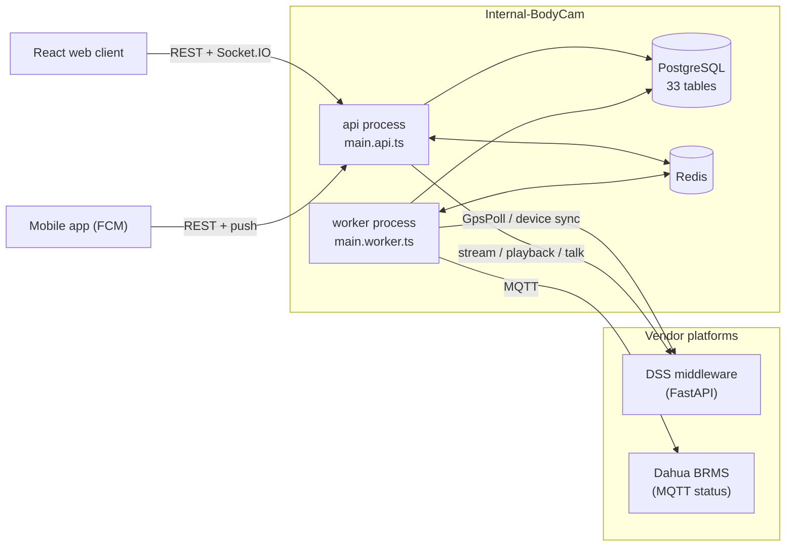

# Part 1 — Existing System Analysis (`C:\Git\Internal-BodyCam`)

> สรุปจากการอ่าน source code จริง (ไม่ใช่เอกสารอย่างเดียว) ณ 2026-11-03 · path ทั้งหมดอ้างจาก root ของ reference project
> Reference project **ไม่ถูกแก้ไข** ในงานนี้

---

## 1.1 ภาพรวม

ระบบเดิมเป็น **integration + management layer** สำหรับ Dashcam (ติดรถ) และ Bodycam (พนักงานภาคสนาม) — ไม่คุยกับอุปกรณ์โดยตรง ทุกอย่าง (GPS, สถานะ, live, playback, talk) ผ่าน platform ของ vendor:

| Platform | ใช้ทำอะไร | ไฟล์หลัก |
|---|---|---|
| **DSS middleware** (FastAPI ภายใน หน้า Dahua DSS) | device list, `/location` ต่อเครื่อง, live/playback HLS URL, recording search, talk | `server/src/modules/devices/provider/dss-device-inventory.provider.ts`, `server/src/common/dss/` |
| **Dahua BRMS** (MQTT) | สถานะ online/offline ของกล้อง (ปิดเป็นค่าเริ่มต้น `BRMS_MQ_ENABLED`) | `server/src/modules/device-status-mq/brms-mq.service.ts` |

---

## 1.2 Backend (`server/`)

### Stack และ process model

| หัวข้อ | สิ่งที่พบ |
|---|---|
| Framework | NestJS 10.4, `@nestjs/swagger` 8 (`/api/docs`), `class-validator` + global `ValidationPipe({whitelist, transform})` |
| ORM / DB | Drizzle ORM 0.45 + drizzle-kit 0.31 + postgres.js 3.4 (pool 10) — `server/src/db/schema.ts` |
| Process | 2 process จาก codebase เดียว: `server/src/main.api.ts` (HTTP + Socket.IO) และ `server/src/main.worker.ts` (`createApplicationContext(WorkerModule)` ไม่มี HTTP) |
| Redis 4 บทบาท | (1) Socket.IO adapter (API) / emitter (worker) (2) lock `RedisLockService` (`server/src/common/lock/redis-lock.service.ts`) (3) rate limit (fail-open) (4) BullMQ (`notification-push`, `evidence-export`) |
| Logging | Nest `Logger` + `morgan('dev')` — **ไม่มี structured log / correlation id** |
| Error handling | ใช้ HttpException ค่า default ของ Nest + ข้อความไทย — **ไม่มี global exception filter** |
| Tests | Vitest 2 · unit `*.test.ts` · integration `*.int-test.ts` (ต้องมี Postgres `_test` + Redis) |

### Module structure (17+ feature modules + global infra)

- **Global infra** `server/src/common/*`: `DbModule`, `ScopeModule` (`DataScopeService`, `ScopeWriteService`), `SettingsModule` (`setting-spec.ts` = bounds/validation), `LockModule`, `QueueModule`, `PushModule` (FCM HTTP v1 เซ็น JWT เอง `fcm.push.provider.ts`), `RateLimitModule`, `StorageModule` (local/minio), `PermissionCheckModule`, `context` (AsyncLocalStorage), `audit`, `upload` (magic-byte check), `realtime-bus`
- **Feature modules** `server/src/modules/*`: auth, users, companies, departments, employees, sites, **vehicles**, devices, device-assignments, work-orders, approval-delegations, realtime, tracking, dashboard, notifications, permission-grants, settings, audit-logs, streaming, talk, reports, scheduler (worker only), device-status-mq (worker only)
- **กติกา import ที่ต้องรักษา**: `SchedulerModule` / `DeviceStatusMqModule` / `*-worker` modules ห้าม import เข้า `AppModule` (API จะ sweep ซ้ำ) · emit realtime ผ่าน `RealtimeGateway.bus` เท่านั้น

### Authentication / Authorization

| ชั้น | Implementation |
|---|---|
| Access token | JWT 15 นาที · payload `{sub, username, roleId, roleCode, departmentId, companyId, employeeId, permissions[]}` · `JwtAuthGuard` ตรวจ signature อย่างเดียว |
| Refresh token | random 32 bytes เก็บ SHA-256 ใน `RefreshTokens` · rotation ทุกครั้ง (`ReplacedByTokenId`) · reuse ⇒ revoke ทั้งหมด · web = httpOnly cookie, mobile = body |
| SSO | Microsoft Entra ID: client ใช้ MSAL (PKCE) → `POST /api/auth/azure {IdToken}` → verify ด้วย `jose` (JWKS) → match `AzureObjectId` แล้ว fallback email |
| Guards | global `JwtAuthGuard` → `RateLimitGuard` → `PermissionsGuard` + `AuditInterceptor` · `@Public()` · `@RequirePermission('resource:action')` · `@Audit(action, resource)` |
| Lockout | `server/src/modules/auth/lockout.ts` (pure) · threshold อยู่ใน Settings `auth.*` |
| Data scope | `server/src/common/scope/scope.types.ts` (`all` / `company` subtree / `dept` / `own`) + predicates `scope.predicates.ts` ต่อท้าย `conds[]` ทุก query · นอก scope = **404** |

### Device, GPS และสถานะ

- **GPS ingestion** — `GpsPoll` (`server/src/modules/scheduler/gps-poll.service.ts`, timer แยก 15s + lock `gps:poll`) → `TrackingService.ingestLocations` (`server/src/modules/tracking/tracking.service.ts`): map device → sort/dedupe → ตัด stale (`≤ LastSeenAt`) → drift filter (>200 km/h ⇒ `IsValidFix=false` ไม่ทิ้งข้อมูล) → bulk insert `ON CONFLICT DO NOTHING` → update snapshot แบบเดินหน้าเท่านั้น → emit `gps:batch` / `device:status`
- **Webhook** `POST /api/integration/webhooks/{device-location,device-status}` — `@Public` + HMAC (`X-Timestamp` + `X-Signature` บน `${ts}.`+rawBody) ใน `server/src/modules/tracking/webhook-auth.ts` — พร้อมใช้แต่ vendor ยังไม่ push
- **สถานะ 2 คอลัมน์**: `OnlineStatus` (ยังส่ง GPS ไหม) vs `PlatformOnlineStatus` + `PlatformStatusAt` (ต่อ platform อยู่ไหม) — กล้อง 76/78 ตัวไม่มี GPS fix ในอาคาร ⇒ "กล้องเปิด" ต้องดูจาก platform status
- **Device sync** `POST /api/devices/sync-vendor {dryRun}` — planner pure `server/src/modules/devices/device-sync.plan.ts` (ไม่ทับค่าที่คนกรอก, ไม่ลบเครื่องที่ vendor ไม่ส่งมา)

### Auto camera-session work order (ต้นแบบของ requirement ใหม่)

`server/src/modules/scheduler/camera-session.service.ts` + `camera-session-rules.ts` (`decideCameraSession`, pure):

- sweep ทุก 60s · เปิดใบงาน `WorkType = 5` เมื่อ platform online ต่อเนื่อง ≥ 15 นาที · ปิดเมื่อ offline ≥ merge gap 15 นาที หรือเปิดครบ 24 ชม.
- กันซ้ำด้วย partial unique `UQ_WO_OpenCameraSession` · มี loop guard กรณีคนปิดเอง
- **จุดอ่อนที่พบในโค้ด** (ใช้เป็นบทเรียน):
  1. ใช้ pseudo work order + reserved seed rows `CAM-AUTO` (แผนก) / `SITE-CAM` (ไซต์ที่ 0,0) เพื่อเลี่ยง NOT NULL FK ⇒ ต้องมีข้อยกเว้นทั่วระบบ (ไม่มี approval, ไม่มีเวลาจบ, แก้ได้แค่ title)
  2. query โหลดกล้อง `.limit(100)` **ไม่มี `ORDER BY`** ⇒ ถ้ามีกล้อง > 100 ตัว บางตัวไม่ถูกประเมินเลย
  3. `PlatformStatusAt` = เวลาที่ระบบ *ได้รับ* message ไม่ใช่เวลาที่อุปกรณ์เปลี่ยนสถานะ และ MQ reconnect ล้างค่าเป็น `null` ⇒ นาฬิกา "online ตั้งแต่" ถูก reset
  4. bug ที่เคยเกิดใน production: ใบงานที่ปิดเพราะครบ 24 ชม. เกิดใหม่พร้อมเวลาเริ่มเดิม ⇒ 720 ใบ/วัน/กล้อง (แก้แล้วด้วย `max(platformStatusAt, lastEndedAt)`)
  5. กล้องชาร์จค้างคืน = online ⇒ เปิดใบงานทั้งคืน

### Streaming / Evidence / Talk

- Backend เป็น broker + proxy: vendor URL ถูก seal ด้วย AES-256-GCM (`server/src/modules/streaming/url-seal.ts`) แล้ว proxy playlist/segment (`hls-rewrite.ts`, `STREAM_ALLOWED_HOSTS` กัน SSRF) — URL จริงไม่ถึง browser
- quota ต่อผู้ใช้ (`streaming.max-concurrent-per-user`), idle timeout, toggle สิทธิ์ต่อ role และต่ออุปกรณ์
- Playback ≤ 24 ชม./ครั้ง · recording list cache ใน `PlaybackRecords`
- Evidence MP4: BullMQ processor ใน worker ดึง HLS segment → ffmpeg → เก็บไฟล์ + SHA-256 → ลบหลัง 24 ชม. · ดาวน์โหลดผ่าน ticket 60s
- Talk: `POST /api/talk/sessions` → ticket ใช้ครั้งเดียว → raw WebSocket `/api/talk/ws` (PCM16LE 8 kHz) ผ่าน FastAPI relay

### Scheduler (worker)

`server/src/modules/scheduler/scheduler.service.ts`: `setInterval` 60s + `withLock('scheduler:sweep')` · jobs: DeviceOffline, DutyDeviceStatus, ApprovalOverdue, JobReminder, JobEndOverdue, WorkAreaWatch, CameraSession, StreamIdle, TalkIdle, StagedUploadCleanup, EvidenceExportCleanup, Retention (ลบ GPS เก่าด้วย batched ctid DELETE — `retention.service.ts`)

---

## 1.3 Frontend (`client/`)

| หัวข้อ | สิ่งที่พบ |
|---|---|
| Stack | React 18.3 + Vite 6 + TypeScript 5.5 strict + Tailwind 3.4 + shadcn (Radix) + lucide |
| Routing | react-router-dom 7 `createBrowserRouter` + route-level `lazy` — `client/src/routeConfig.tsx`, guard `RequireAuth` / `RequirePermission`, access map `client/src/lib/routeAccess.ts` |
| State | TanStack Query 5 (server state) · Zustand เฉพาะ auth (`client/src/stores/authStore.ts`) · Realtime/Language/Theme/Motion = React Context |
| API | axios `client/src/lib/apiClient.ts` (Bearer จาก memory, single-flight refresh on 401, epoch guard) · `client/src/lib/authEndpoints.ts` |
| Realtime | socket.io-client `/realtime` — `client/src/lib/socket.ts`, `client/src/providers/RealtimeProvider.tsx` |
| Map | Leaflet 1.9 + react-leaflet 4 + OSM tiles · `L.divIcon` markers · ไม่มี clustering |
| Live position | `useLivePositions.ts` + `liveMerge.ts`: REST snapshot + queue socket event flush ทุก 1s, poll สำรอง 60s เมื่อ socket หลุด |
| Streaming | hls.js (dynamic import) `client/src/features/streaming/components/StreamPlayer.tsx` · live wall 1/4/6/9/16 จอ · talk = AudioWorklet + WebSocket `client/src/features/talk` |
| i18n | เขียนเอง `client/src/i18n` (th/en ~2.1k บรรทัด/ภาษา) default `th` |
| Forms | ไม่มี form library — pure `xxxForm.ts` ต่อ feature |
| Tests | Vitest + jsdom + Testing Library (178 test files) · **ไม่มี ESLint · build ไม่ typecheck** |

### Design system (ต้องรักษา)

- Token เป็น **OKLCH** ใน `client/src/styles/tailwind.css` (ไม่ใช่ HSL) · class-based dark mode · กติกาใน `client/DESIGN.md` ("PSD Sentinel Precision Plate")
- Font เดียว `Noto Sans Thai Variable` · type roles caption 12 / control 14 / body 16 / subheading 18 / heading 22 / display 28
- Spacing 8/12/16/24/32 · radius 6–8px · border ก่อน shadow · cobalt ~10% ของจอ · สีต้องคู่กับข้อความ/ไอคอนเสมอ · target ≥ 44px · row tools 3+ action ยุบเป็น `•••`
- Shell: `client/src/components/AppLayout.tsx` + `layout/AppSidebar.tsx` (232/72px) + `layout/BranchedNav.tsx` + header 56px
- Primitives `client/src/components/ui/*` (26 ตัว) + composites `client/src/components/command-center/*` (AsyncState, DataPagination, DataTableFrame, DataToolbar, PageHeader, RowActionsMenu, StatusBadge, ToolButton, MetricSummary ฯลฯ)

---

## 1.4 Database

| หัวข้อ | สิ่งที่พบ |
|---|---|
| Engine | PostgreSQL · ไม่มี PostGIS (lat/lng `double precision`) |
| Convention | ตาราง/คอลัมน์ PascalCase (quoted) · PK `bigint identity` (serialize เป็น string ผ่าน `BigInt.prototype.toJSON`) · `timestamptz` UTC แสดงผล Asia/Bangkok · soft delete `IsDeleted/DeletedAt/DeletedBy` + partial unique · enum = `smallint` append-only · JSON เก็บเป็น `text` |
| ตาราง | 33 ตาราง: org/auth 12 · devices/master 4 · work orders 5 · tracking 5 (3 ตารางไม่มีโค้ดใช้: `GpsTripSummaries`, `Geofences`, `Events`) · streaming 4 · alerts/audit/settings 4 |
| GPS | `GpsLocations` ตารางเดียว ไม่ partition ไม่มี BRIN · unique `(DeviceId, RecordedAt)` + index ซ้ำซ้อนอีกตัว · ~12.6M แถว/ปี ต่อ 78 เครื่อง · retention ลบด้วย ctid batch, ไม่มี archive |
| Migration | `drizzle-kit generate` + custom data migration (`ON CONFLICT DO NOTHING`) · production รัน `migrate.entry.js` + advisory lock · drift gate `guardMigrationsOrExit()` (`server/src/db/migration-status.ts`, `assert-migrations.ts`) · **ห้ามรัน seed ใน production** (seed เขียนทับ RolePermissions/Settings) |
| Work order no. | `SELECT max + 1` + retry เมื่อชน unique (`work-order-no.ts`) — race-prone |
| Booking | **ไม่มีคอลัมน์หรือโค้ดเกี่ยวกับ Booking / external reference เลย** (grep ทั้ง repo = 0) |

จุดอ่อนเชิงโครงสร้างที่พบ: `CompanyId = null` มี 3 ความหมาย (ยังไม่ระบุ / ใช้ร่วม / derive จากแผนก) จนเกิด bug 404 · snapshot สถานะที่เปลี่ยนทุก 15s อยู่บน master row `Devices` · JSON เป็น text · `AuditLogs` โตไม่จำกัด · `UserDevices.DeviceId` (โทรศัพท์) ชนชื่อกับ `Devices.Id` (กล้อง)

---

## 1.5 Reuse / Refactor / Remove / Rebuild

### Backend

| กลุ่ม | สิ่งที่ทำ | รายการ (path ใน reference) |
|---|---|---|
| **Reuse** (port เกือบทั้งก้อน) | ยกมาแก้ชื่อ/ลบส่วน company | `server/src/common/*` (lock, settings + `setting-spec.ts`, rate limit, storage, upload, context, audit interceptor, permission check, realtime bus, migration guards) · `modules/auth` (JWT, refresh rotation, Entra, lockout) · `modules/realtime` · GPS pipeline `tracking.service.ts` · `gps-poll.service.ts` · DSS providers · `brms-mq.service.ts` · `modules/streaming` · `modules/talk` · evidence export processor · `modules/notifications` + FCM · `modules/audit-logs` · webhook HMAC `webhook-auth.ts` |
| **Refactor** | ปรับให้เข้ากับ domain ใหม่ | `common/scope` (ตัด company subtree เหลือ `all/department` — ไม่มีผู้ใช้ภาคสนามจึงไม่มี scope `team`/`own`) · `modules/devices` (bodycam อย่างเดียว, แยก snapshot ออกเป็น `DeviceState`) · `device-assignments` (ผูกกล้อง → ทีม แทน → company/vehicle) · `users`/`employees`/`departments` (ตัด CompanyId) · `dashboard` · `scheduler` (ตัด job ที่ผูก approval/crew) · GpsPoll ให้ใช้ device-list status แบบ bulk · มาตรฐาน JSON key เป็น camelCase ทั้งหมด |
| **Remove** | ไม่มีใน domain ใหม่ | `modules/vehicles` · `tracking/road-match/*` (OSRM) · dashcam branch ใน `tracking/active-job-devices.ts` · `modules/companies` · `modules/sites` · `modules/approval-delegations` · `modules/permission-grants` · approval / crew / leader-driven steps / attachments ใน `modules/work-orders` · `modules/reports` (เขียนใหม่ภายหลังถ้าต้องการ) · camera-session pseudo work order (`WorkType = 5`) |
| **Rebuild** (ใหม่ทั้งหมด) | ไม่มีในระบบเดิม | Session engine (แทน `camera-session.service.ts` — แยก TrackingSession ออกจาก WorkOrder) · Work Order module แบบ Booking-driven · Booking Integration module (adapter, projection, inbox/outbox, matching, reconcile) · Teams module · Integration monitoring · global exception filter + structured logging + correlation id |

### Frontend

| กลุ่ม | รายการ |
|---|---|
| **Reuse** | `client/src/styles/tailwind.css` (tokens), `tailwind.config.cjs`, ส่วนที่ใช้ของ `global.css`, `client/DESIGN.md` · `components/ui/*` · `components/command-center/*` · shell (`AppLayout`, `AppHeader`, `AppSidebar`, `BranchedNav`, `Breadcrumb`, `ThemeToggle`, `LanguageSwitcher`) · i18n mechanism · `lib/apiClient.ts`, `apiError.ts`, `authEndpoints.ts`, `socket.ts`, `RealtimeProvider` · auth (`RequireAuth`, `RequirePermission`, `msalClient.ts`) · `StreamPlayer`, live wall, talk module, evidence download flow · pattern `useLivePositions` + `liveMerge` |
| **Refactor** | `features/tracking/MapPage.tsx` (975 บรรทัด — ตัด dashcam marker/filter, แตกไฟล์) · `tracking/history/HistoryPage.tsx` (ตัด `roadSegments`) · dashboard (ตัด FleetMatrix) · devices (ตัด DeviceType / vehicle assignment) · เพิ่ม `usePermission()` แทน `permissions.includes()` กระจาย · ย้าย `Paged<T>` ไป `lib/` · เพิ่ม 404 + `errorElement` · ใช้ route จริง `/work-orders/:id` แทน `?open=` |
| **Remove** | `features/vehicles` · dashcam marker assets · `VehicleRouteLinks`, `roadMatch.ts` · plate mask ใน `lib/inputMasks.ts` · work-order create form / approval / crew panels · `features/sites`, `features/companies`, `features/approval-delegations` · i18n keys ฝั่ง vehicle/dashcam (~110 ต่อภาษา) · dependency ที่ไม่ใช้ (`@boxicons/react`, `@fontsource/kanit`, `@fontsource/ibm-plex-sans`) |
| **Rebuild** | Work Order list/detail แบบ Booking-driven · Review queue (Unlinked/Ambiguous/Suggested) · Booking job reference panel · Tracking Sessions page · Device detail (status timeline, assignment history) · Teams · Integration monitoring |

### Database

| กลุ่ม | ตาราง |
|---|---|
| **Reuse (ปรับเล็กน้อย)** | `Users`, `Roles`, `Permissions`, `RolePermissions`, `RefreshTokens`, `PushTokens`, `UserDevices` (ตัดคอลัมน์ PIN/biometric, เปลี่ยน `DeviceId` → `InstallationId`), `Departments`, `Employees`, `StreamingSessions`, `TalkSessions`, `EvidenceExports`, `Notifications`, `Settings`, `AuditLogs` (partition) |
| **Refactor** | `Devices` (แยก `DeviceState`), `DeviceAssignments` (→ ทีม), `GpsLocations` (partition รายเดือน, ตัด `IgnitionOn`/`OdometerKm`), `PlaybackRecords` → `RecordingSegments`, `Alerts` (ตัด VehicleId/GeofenceId/SourceEventId) |
| **Remove** | `Vehicles`, `Companies`, `Sites`, `GpsTripSummaries`, `Geofences`, `Events`, `WorkAssignments`, `WorkOrderAttachments`, `AttachmentUploads`, `ApprovalDelegations`, `TemporaryPermissionGrants` |
| **Rebuild / New** | `Teams`, `TeamMembers`, `DeviceState`, `DeviceStatusHistory`, `TrackingSessions`, `WorkOrders` (ใหม่), `WorkOrderEvents`, `WorkOrderCounters`, `BookingJobs`, `MatchAttempts`, `IntegrationInbox`, `IntegrationOutbox`, `IntegrationSyncState`, `IntegrationCallLogs` |

---

## 1.6 Dashcam / Vehicle ที่ต้องตัดออก (checklist)

| ชั้น | รายการ |
|---|---|
| Enum / constants | `DeviceType = 1` (Dashcam) · `ASSIGNEE_TYPE.VEHICLE = 1` · `DEVICE_TYPE_DASHCAM` ใน `server/src/modules/device-assignments/assignment-rules.ts` · การจับชื่อ mdvr/mxvr/dashcam ใน `device-sync.plan.ts` · alert 35 ฝั่ง vehicle |
| Module / service | `server/src/modules/vehicles` ทั้งโมดูล · `tracking/road-match/*` + `RoadMatchService` · `movingRuns`/`matchSegments` ใน `route-builder.ts` · dashcam leg ใน `active-job-devices.ts` · `decideBindVehicle` · `assertVehicleWritable` (`scope-write.service.ts`) · OSRM checks ใน `common/config/prod-readiness.ts` + env `ROAD_MATCH_DRIVER`, `OSRM_*` |
| Schema | ตาราง `Vehicles` · คอลัมน์ `VehicleId` ใน `DeviceAssignments`, `WorkAssignments`, `Alerts`, `Events`, `GpsTripSummaries` · `GpsLocations.IgnitionOn`, `OdometerKm` · `Devices.ChannelCount` (MDVR หลาย channel — bodycam ใช้ channel 1) |
| Permission | `vehicles:read`, `vehicles:manage`, `devices:assign` (ผูกกับรถ) |
| Seed / scripts | แผนก `*-FLEET` · `scripts/mock-dashcam-route.js` · `scripts/dev-setup-fleet.js` |
| Client | `client/src/features/vehicles` · dashcam markers `client/src/assets/markers/dashcam-*` · type filter ใน `MapPage.tsx` · `history/roadMatch.ts` · `VehicleRouteLinks.tsx` · `vehicleOptionLabel` · dashboard `FleetMatrix` · `evidenceCameras.ts` (`kind: 'dashcam'`) · nav `/vehicles` · i18n keys |

---

## 1.7 บทเรียนที่ต้องพกไประบบใหม่

1. **"กล้องเปิด" ≠ "มี GPS"** — ใช้ platform status เป็นสัญญาณหลัก
2. **`null` ต้องไม่ถูกตีความว่า offline** — ไม่งั้นปิดทุก session พร้อมกัน; ระบบใหม่คำนวณ UNKNOWN จากอายุข้อมูลแทนการเขียน null
3. **ห้าม pseudo work order** — แยก "สิ่งที่สังเกตได้" (TrackingSession) ออกจาก "ระเบียนธุรกิจ" (WorkOrder)
4. **Invariant ต้องบังคับที่ DB** (partial unique / exclusion) ไม่ใช่แค่ใน code
5. **อย่า `.limit()` โดยไม่ `ORDER BY`** และอย่าให้ sweep ข้ามอุปกรณ์
6. **หลังคนปิดงาน ต้องไม่มี auto-reopen loop**
7. **Settings ที่ตัดสินกติกาต้องปรับได้** แต่ค่าที่ผูกกับข้อจำกัด vendor (เช่น playback ≤ 24 ชม.) ห้ามเป็น setting
