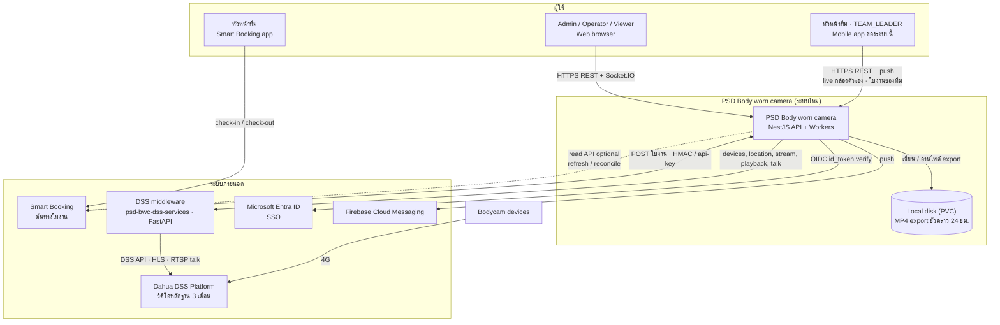
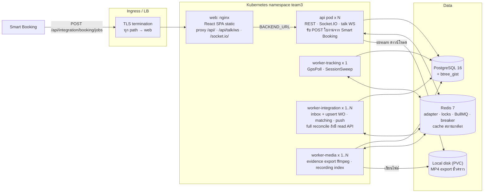
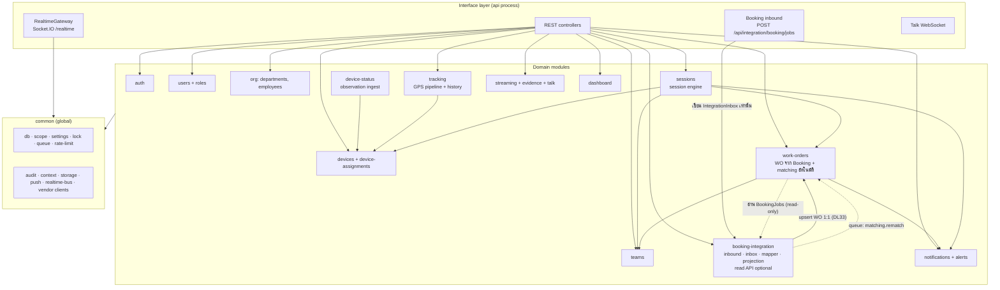
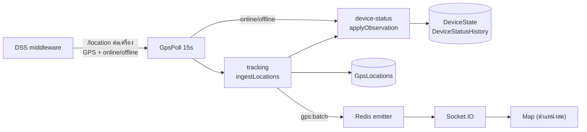
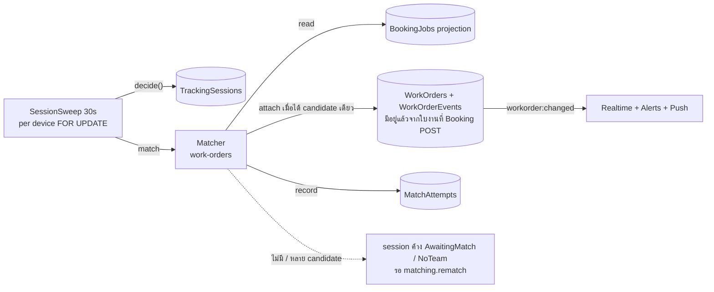
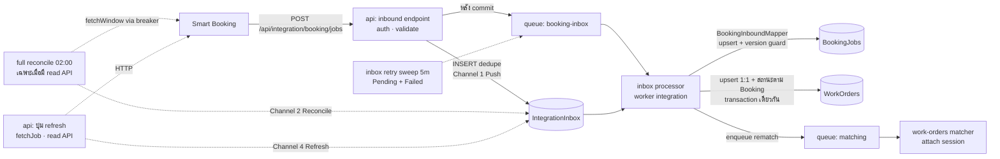

# Part 2 — Proposed System Architecture

---

## 2.1 Architecture Style: Modular Monolith

| เกณฑ์ | Modular Monolith (เลือก) | Microservices |
|---|---|---|
| ขนาดทีม / ระบบ | เหมาะกับทีมเล็ก กล้อง 100–300 ตัว | overhead สูงเกินขนาดงาน |
| Reuse จาก reference | port โค้ด NestJS เดิมได้ตรง (`server/src/common/*`, auth, tracking, streaming) | ต้องแตกโค้ดเดิมใหม่ทั้งหมด |
| Transaction ข้าม domain | session + work order + events อยู่ใน transaction เดียวได้ | ต้องใช้ saga/distributed tx |
| Failure isolation | ได้จาก **process role + queue แยก + circuit breaker** (ดู 2.6) | ได้โดยธรรมชาติ |
| การ scale | แยก worker role เป็น pod ได้ด้วย env โดยไม่แก้โค้ด | scale รายบริการ |

**ข้อสรุป**: Modular Monolith บน NestJS · 1 codebase · หลาย process role · boundary ชัดเจนระดับ module (ห้าม import ข้าม boundary ที่กำหนด) · แตกเป็น service ได้ภายหลังถ้าจำเป็น (Booking Integration เป็นตัวแรกที่แตกได้ เพราะคุยกับส่วนอื่นผ่าน table + queue อยู่แล้ว)

---

## 2.2 System Context

ขอบเขต: ระบบใหม่ **ไม่คุยกับกล้องโดยตรง** (เหมือน reference) และ **ไม่สร้างใบงานเอง** — ใบงานทุกใบมาจาก Booking (DL33)

- **Smart Booking เรียกเข้าระบบเรา (DL46)**: POST ใบงานที่ `POST /api/integration/booking/jobs` เมื่อสร้างใบงาน **[Confirmed]** และ (คาดว่า) ทุกครั้งที่ใบงานเปลี่ยน **[Assumption]** · ระบบเราเรียก read API ของ Booking เฉพาะเมื่อมี (optional) · ไม่ส่งข้อมูลกลับ — Booking app ลิงก์มาดูหลักฐานผ่าน deep link (Part 7 §7.9)
- **หัวหน้าทีมใช้ 2 แอป (DL47)**: check-in / check-out ใน Smart Booking app · live กล้องตัวเอง + รายละเอียดใบงานใน mobile app ของระบบนี้
- **DSS มี 2 ชั้น [Confirmed — reference `docs/LIVE-STREAMING-CONTRACT.md`]**: ระบบเราเรียก DSS middleware (`psd-bwc-dss-services`, FastAPI) เท่านั้น แล้ว middleware เรียก Dahua DSS Platform (VMS กล้องของ Dahua) อีกชั้น · token / URL / session ของ DSS Platform ไม่ออกจาก middleware · HLS URL ที่ได้ชี้กลับ `/proxy` ของ middleware · talk เป็น RTSP ระหว่าง middleware กับ DSS Platform · กล้องลงทะเบียนกับ DSS Platform ผ่าน 4G · ทั้ง DSS middleware และ Dahua DSS Platform ติดตั้งใน **PSD on-premise** (DL40)
- วิดีโอหลักฐานต้นฉบับอยู่บน Dahua DSS Platform (retention 3 เดือน ฝั่ง infra) · ระบบเราเก็บเฉพาะไฟล์ MP4 ที่ export ชั่วคราวบน Local disk (PVC) — ไม่มี MinIO / object storage (DL34)

---

## 2.3 Container & Deployment

- **Process roles** จาก codebase เดียว: `main.api.ts` และ `main.worker.ts` + env `WORKER_ROLES` (`tracking`, `integration`, `media` — ใส่หลายค่าคั่นด้วย comma ได้) · dev/pilot รัน worker ตัวเดียว `WORKER_ROLES=tracking,integration,media`
- `worker-tracking` ต้องมี **1 instance ที่ active** (Redis lock กันซ้ำอยู่แล้ว แต่ไม่ได้ประโยชน์จากการ scale)
- `worker-integration` / `worker-media` scale แนวนอนได้ (BullMQ consumers)
- Redis ต้องมี persistence (AOF) และใช้ร่วมระหว่าง API กับ worker (key prefix ต่อ environment — port `lock-key.ts` ของ reference)
  - บทบาท: Socket.IO adapter (`api`) / emitter (worker) · lock · rate limit · BullMQ · circuit breaker · ผล `Idempotency-Key` 24 ชม. · **cache สถานะกล้องบนหน้าจอ** (DL45)
  - ไม่ใช้ Redis เป็น cache ข้อมูลทั่วไป — ข้อมูลจากระบบภายนอกเก็บเป็น projection ใน PostgreSQL (`BookingJobs`, `RecordingSegments`, `DeviceState`) · cache ที่เหลือเป็น in-memory ต่อ process (data scope 60s, token DSS, token read API ของ Booking ถ้ามี)
- `worker-media` image ต้องมี ffmpeg · migrate เป็น job แยกก่อน rollout
- **กันงานแปลงไฟล์แย่งเครื่อง (DL39)** — สำคัญเป็นพิเศษเพราะ `api` กับ worker อยู่บน PSD Server เครื่องเดียวกัน (DL44): การแยก process ยังกัน event loop, crash และ deploy ไม่ให้ลากกัน แต่ CPU / RAM / network / disk ยังใช้ร่วมกัน จึงต้องคุมเพิ่ม
  - Kubernetes `resources` แยกต่อ container: `worker-media` ตั้ง `limits` (เริ่มที่ CPU 1 core / memory 1 GiB แล้วปรับตามโหลดจริง) · `api` ตั้ง `requests` กัน CPU / memory ไว้ให้เสมอ
  - จำกัดงานแปลงพร้อมกันของ queue `evidence-export` ด้วย env `EVIDENCE_EXPORT_CONCURRENCY` (port จาก reference: default 1, สูงสุด 8) · งานที่เกินรอคิว · timeout ต่องาน `EVIDENCE_EXPORT_TIMEOUT_MINUTES` (default 180)
  - ffmpeg ใช้ `-c:v copy` (ไม่ encode วิดีโอใหม่) จึงกิน CPU น้อย — ภาระหลักคือ network (ดึง segment จาก DSS) กับ disk (เขียน MP4) · คิวยาวให้เพิ่ม pod `worker-media` (× 1..N) แทนการเพิ่ม concurrency ในเครื่องเดียว
- **ไฟล์ export (DL34)**: Local disk (PVC, `STORAGE_DRIVER=local`) mount ทั้ง `api` และ `worker-media` — `worker-media` เขียนไฟล์ MP4, `api` stream ให้ดาวน์โหลดผ่าน download ticket · ลบไฟล์หลัง 24 ชม. (`EvidenceCleanup`) แต่เก็บแถว `EvidenceExports` 12 เดือน · ไม่มี MinIO / object storage · ตอนนี้มี node เดียว (PSD Server) ใช้ PVC แบบ ReadWriteOnce ได้ · ถ้าเพิ่ม node ภายหลังต้องเป็น ReadWriteMany (Part 9 R16)
- **เส้นทาง HTTP เหมือนระบบเดิมที่รันอยู่** (`psd-bwc-frontend`): ingress ส่งทุก path ไปที่ container `web` แล้ว nginx ของ `web` proxy `/api/`, `/api/talk/ws` (WebSocket ดิบของ talk) และ `/socket.io/` ต่อไปที่ API ผ่าน env `BACKEND_URL` (`scheme://host:port` ไม่มี path) — ดู `client/nginx.conf` · หน้าเว็บกับ API จึงเป็น same-origin (`VITE_API_BASE=/api`) ไม่ต้องตั้ง CORS / `COOKIE_SAMESITE` ข้ามโดเมน
  - container `web` ไม่ยอม start ถ้าไม่มี `BACKEND_URL` หรือมี path (`client/docker-entrypoint.d/15-require-backend-url.sh`)
  - API อยู่หลัง proxy 2 ชั้น (ingress + nginx ของ `web`) ⇒ ตั้ง `TRUST_PROXY=2` หรือช่วง IP ของ pod / ingress — ค่าเริ่มต้น `loopback` ใช้ไม่ได้บน Kubernetes (`req.ip` จะเป็น IP ของ nginx ทุกคำขอ)
  - ลำดับปล่อยเวอร์ชัน: API ก่อน `web` เสมอ
  - POST จาก Smart Booking (`/api/integration/booking/*`) ใช้เส้นทางเดียวกันนี้ (ingress → nginx `web` → api — DL29) · ไม่มีอะไรใหม่ใน K8s (DL46)
- **Namespace = `team3` เดิม (DL41)** — namespace ของทีมที่ระบบเดิม (`psd-bwc-frontend`, `psd-bwc-web-backend`) ใช้อยู่ ไม่ใช่ชื่อระบบ · ระบบนี้ deploy ร่วมใน namespace เดียวกัน
  - ชื่อ Deployment / Service ต้องไม่ชนกับของระบบเดิม (`psd-bwc-*`) · ชื่อจริงกำหนดใน gitops
  - `BACKEND_URL` ของ `web` = `http://<api-service>.team3.svc:3000`
  - quota CPU / memory ของ namespace ใช้ร่วมกับระบบเดิม ⇒ `requests` / `limits` ตาม DL39 ต้องตั้งให้ครบทุก container
- **ทั้งระบบอยู่ใน PSD on-premise (DL43)** — อยู่ใน data center ของ PSD **2 VM (DL44)**
  - **PSD Server** (VM Ubuntu · `xxx.xxx.x.xx`) เครื่องเดียวรัน Kubernetes namespace `team3` (web / api / worker-\*), data tier (PostgreSQL / Redis / PVC) และ DSS middleware (systemd นอก K8s)
  - **Dahua DSS Platform** (VM Windows · `xxx.xxx.x.xx`) อยู่คนละเครื่อง
  - PSD Server เป็น single point of failure (Part 9 R17) ⇒ backup PostgreSQL ต้องเก็บนอกเครื่อง
  - นอก on-prem: ผู้ใช้ (browser / mobile), Microsoft Entra ID, FCM, Smart Booking (ตำแหน่ง **[Assumption]**) และกล้องที่ต่อเข้ามาทาง 4G
  - firewall ขาออกจาก cluster ต้องเปิด: Entra ID (JWKS / OIDC), FCM HTTP v1 · read API ของ Booking เฉพาะเมื่อใช้ (optional — DL46) · ขาเข้า: HTTPS ที่ ingress **รวมจาก egress IP ของ Smart Booking** (DL46)
- DSS middleware (`psd-bwc-dss-services`, FastAPI) รันเป็น systemd บน **PSD Server** เครื่องเดียวกับ K8s (นอก cluster) ได้ instance เดียว (`WORKERS=1`, state อยู่ใน memory) — API และ worker เรียกผ่าน HTTP ภายในเครื่อง (`xxx.xxx.x.xx:3004`, ไม่ออก network) แล้ว middleware เรียก Dahua DSS Platform อีกเครื่องต่อ (§2.2) · ถ้าแยก middleware ไปเครื่องอื่นภายหลัง talk ต้องเข้ารหัส (TLS / VPN) · diagram infra ดู `docs/diagrams/infrastructure.drawio`

---

## 2.4 Module Map

### หน้าที่ของแต่ละ module

| Module | Responsibility | Reuse จาก reference |
|---|---|---|
| `auth` | login password + Entra SSO, refresh rotation, lockout, ทะเบียนเครื่องมือถือ (ไม่มี PIN) | `modules/auth` เกือบทั้งหมด |
| `users` | ผู้ใช้, role, role-permission matrix, ระงับบัญชี (`cutAllSessions`) · บัญชี `TEAM_LEADER` ต้องผูก employee (`Employees.UserId`) — ตรวจใน service (DL47) | `modules/users` (ตัด company) |
| `org` | departments (tree), employees, link employee ↔ user, `BookingEmployeeRef` | `departments`, `employees` |
| `teams` | ทีม, สมาชิก, เปลี่ยนหัวหน้าทีม (ประวัติ), `BookingTeamRef` | ใหม่ |
| `devices` | ทะเบียน bodycam, vendor sync (`device-sync.plan.ts`), streaming toggle, Depots · การผูกกล้อง → ทีม **มาจากข้อมูล Booking เท่านั้น** (ไม่มีหน้าจอผูกเอง — Q20) · สถานะกล้องที่แสดงบนหน้าจอ `api` ถาม DSS middleware ตอน request (DL35) ผ่าน cache Redis (DL45) | `devices`, `device-assignments` (refactor เป็น read-only projection) |
| `device-status` | **Device Event Processing**: รับ observation จาก GpsPoll (`/location` ให้ทั้ง GPS และ online/offline — DL32) → `DeviceState` + `DeviceStatusHistory` ให้ session engine ใช้ภายใน · ไม่ push สถานะขึ้นหน้าจอ (ไม่มี `device:status` — DL35) · ไม่มี business logic | แยกจาก `GpsPoll.applyVendorStatuses` (ไม่ port `brms-mq.service.ts` — DL30) |
| `tracking` | GPS ingestion pipeline (`ingestLocations`), positions snapshot, route history | `modules/tracking` (ตัด road-match) |
| `sessions` | **Session engine** (sweep, pure `decide()`, open/close/split) · เป็น writer เดียวของ lifecycle session · ไม่สร้างใบงาน — match ไม่ได้ ⇒ session ค้าง `AwaitingMatch` / `NoTeam` · กล้องชาร์จที่ฐาน ⇒ ระบบตั้ง `Classified` + `IdleOrCharging` · recording index | ใหม่ (แทน `camera-session.service.ts`) |
| `work-orders` | WO **1:1 กับ `BookingJobs`** สร้าง/อัปเดตจากข้อมูลที่ Smart Booking ส่งเข้ามาเท่านั้น (inbox processor เรียก writer ของ module นี้ — DL33, DL46) · สถานะตาม Booking (check-in / check-out / ยกเลิก) · **matching อัตโนมัติ** attach session เข้า WO ของ Booking job (อ่าน `BookingJobs`) · read model ใบงาน (list/detail, หน้า หลักฐาน) · read model ของ mobile (`/mobile/jobs` scope `team` — DL47) · ไม่มี link / unlink / merge / void / คิวตรวจสอบ (DL33) | ใหม่ |
| `booking-integration` | **inbound endpoint** `POST /api/integration/booking/jobs` (รันใน `api`: auth `BookingInboundAuthGuard` + validate + insert `IntegrationInbox` แล้ว enqueue `booking-inbox` — DL46) · **inbox processor** ใน worker `integration` (`BookingInboundMapper` → upsert `BookingJobs` + `WorkOrders` 1:1 ใน transaction เดียว) · `BookingProvider` port (read API optional: `none` / `mock` / `http`) สำหรับ refresh รายใบ / full reconcile · CSV import · circuit breaker (เฉพาะ read API) · mapping · monitoring endpoints | ใหม่ (ใช้ pattern provider/driver ของ reference) |
| `streaming` / `evidence` / `talk` | live, playback, recording search, MP4 export (ไฟล์บน Local disk PVC — DL34 · ช่วงเดิมที่ยังใช้ได้ ⇒ reuse job เดิม — DL36), two-way talk, quota, role/device access | port ทั้งหมด |
| `notifications` | alert engine (dedupe), in-app inbox, FCM push via BullMQ — push ถึงหัวหน้าทีมเมื่อมีใบงานใหม่ของทีม · alert ไม่ push ขึ้นมือถือ (DL47) | port + alert types ใหม่ |
| `dashboard` | overview cards | refactor |
| `realtime` | Socket.IO gateway, rooms (รวม `team:{id}` สำหรับ `TEAM_LEADER` — DL47), auth, emitter จาก worker | port |
| `audit-logs`, `settings`, `health` | ตาม reference + health ของ Redis/integration | port + ขยาย |

### กติกา dependency (บังคับด้วย lint rule `no-restricted-imports` หรือ dependency-cruiser)

1. `booking-integration` **ห้าม import** `sessions` และ matcher ของ `work-orders` — ส่งงาน match ต่อผ่าน BullMQ queue `matching` เท่านั้น · ข้อยกเว้นเดียว: inbox processor เรียก writer ของ `work-orders` เพื่อ upsert `WorkOrders` 1:1 กับ `BookingJobs` (+ สถานะตาม Booking) ใน transaction เดียวกับ projection — writer นี้ lock แค่แถว `WorkOrders` ไม่แตะ session / `DeviceState` (DL33)
2. `work-orders` อ่าน `BookingJobs` ผ่าน `BookingReadModel` (read-only repository ของ `work-orders` เอง — ไม่ import `booking-integration` จึงไม่เกิด import วน) — ไม่เรียก Booking API
3. `tracking` / `device-status` / `sessions` **ห้ามเรียกระบบภายนอกที่ไม่ใช่ vendor กล้อง** — real-time path ไม่ขึ้นกับ Booking
4. ทุก write ที่แตะ session ของอุปกรณ์ต้องถือ row lock `DeviceState` ของอุปกรณ์นั้น (lock order: `DeviceId` จากน้อยไปมาก → `WorkOrders` → `TrackingSessions`)
5. Worker-only modules (`scheduler` timers, BullMQ processors) ห้าม import เข้า `AppModule` (กติกาเดิมของ reference)
6. inbound endpoint ของ Booking ใน `api` เขียนแค่ `IntegrationInbox` (+ `IntegrationSyncState.LastReceivedAt`, `IntegrationCallLogs`) แล้ว enqueue — **ไม่ map และไม่แตะ `BookingJobs` / `WorkOrders`** (DL46)

---

## 2.5 Data Flows

### (A) Real-time tracking — ไม่แตะ Booking

- สถานะ online/offline **ไม่ถูก push ขึ้นหน้าจอ** (ไม่มี `device:status` — DL35) · `DeviceState` ใช้ภายในโดย session engine · หน้าจอที่แสดงสถานะกล้อง (รายการ/รายละเอียดอุปกรณ์, ก่อนเปิด live) ให้ `api` ถาม DSS middleware ตอนเปิดหน้า
- **cache สถานะกล้อง (DL45)**: `api` เก็บผลจาก DSS ใน Redis key `device-status:{deviceId}` (prefix ต่อ environment) อายุ `status.display-cache-seconds` (10s) ใช้ร่วมทุก api pod · `GET /devices` อ่านทีละหลาย key (`MGET`) แล้วถาม DSS เฉพาะกล้องที่ไม่มีใน cache · หลายคนเปิดหน้าพร้อมกันจึงไม่ยิง DSS ซ้ำ · session engine ไม่ใช้ cache นี้ (ใช้ `DeviceState` จาก GpsPoll)

### (B) Session → Work Order ของ Booking job

- เส้นทาง session **ไม่สร้างใบงาน** — ใบงานเกิดจากข้อมูลที่ Smart Booking ส่งเข้ามาเท่านั้น (flow C · DL33) · ไม่มีการ link / override ด้วยมือ · rematch อัตโนมัติเมื่อข้อมูล Booking เปลี่ยน ภายใน `booking.rematch-horizon-hours`

### (C) Booking push — Smart Booking POST เข้ามา (DL46), แยก queue · ทางเดียวที่สร้างใบงาน (DL33)

- `api` ตอบ 202 `accepted` / 200 `duplicate` ทันทีหลัง insert inbox — ไม่รอ processor · ไม่ map และไม่แตะ `BookingJobs` / `WorkOrders` · enqueue ไม่ได้ก็ยังตอบ 202 แล้ว retry sweep เก็บ (Part 7 §7.5.1)
- เส้นประ = read API ขาออก **optional** (`BOOKING_PROVIDER_DRIVER=none` ⇒ ไม่มี) · CSV import ของ admin เข้า inbox เดียวกัน (`Channel = 3 CsvImport`)
- ทุกแถว `BookingJobs` มี `WorkOrders` 1 แถว (`UQ_WO_BookingJob`) · ใบงานที่ยังไม่ check-in ⇒ Planned (DL37) · check-in ⇒ Open · check-out ⇒ Closed (`BookingCheckout`) · Booking ยกเลิก ⇒ Cancelled (ยังดูหลักฐานได้) · emit `workorder:changed` หลัง commit (รวม room `team:{teamId}` ของงาน — DL47)

### (D) Streaming

Browser → `POST /api/streams/live` → `StreamingService` ตรวจสิทธิ์สด + scope + `StreamingEnabled` + quota → ขอ URL จาก DSS middleware (ชี้กลับ `/proxy` ของ middleware) → seal AES-GCM → browser เล่นผ่าน proxy `/api/streams/:token/playlist.m3u8` (port จาก reference ทั้ง flow)

Evidence (หน้า หลักฐาน `/evidence` — DL36): เลือกใบงาน → กล้อง + ช่วงเวลาจาก session ของใบงาน → playback หรือ `POST /api/evidence-exports` (device + channel + start/end เดิมที่ยัง queued / processing / ready ไม่หมดอายุ ⇒ ใช้ job เดิม) → `worker-media` ดึง HLS → ffmpeg → เขียน MP4 ลง Local disk (PVC) → ดาวน์โหลดผ่าน ticket จาก `api` (DL34)

---

## 2.6 Failure Isolation

| สิ่งที่ล่ม | ผลกระทบ | สิ่งที่ยังทำงาน | กลไก |
|---|---|---|---|
| **Smart Booking ล่ม / ไม่ส่ง POST** | ไม่มีใบงานใหม่ / สถานะใบงานไม่อัปเดต · ระบบเรา**ไม่รู้**ว่ามีใบงานที่ส่งไม่ถึง | tracking, session, match กับ projection เดิม, live/playback ทั้งหมด | ฝั่งเราทำอะไรไม่ได้นอกจากแจ้ง: alert 17 `BOOKING_INBOUND_SILENT` เมื่อไม่มี POST นาน `booking.inbound-silence-alert-hours` (DL46) · session ที่ match ไม่ได้ค้าง `AwaitingMatch` แล้ว rematch อัตโนมัติเมื่อ POST มาถึง · ถ้ามี read API: full reconcile รายคืนเก็บใบที่หาย |
| **api ของเราล่ม** ตอน Booking POST | Booking ได้ timeout / 5xx | — | Smart Booking retry แบบ backoff ≥ 24 ชม. **[Assumption]** · รับซ้ำได้ปลอดภัย (inbox dedupe + version guard) |
| Booking read API ช้า / ล่ม (optional) | refresh รายใบ / full reconcile ใช้ไม่ได้ | ทุกอย่างอื่น **รวมการรับ POST** | circuit breaker (Redis) · timeout 5s / 8s · concurrency จำกัด · อยู่คนละ worker role |
| worker-integration ค้าง / ล่ม | POST ยังรับได้ (เก็บใน inbox) แต่ยังไม่ถูก process ⇒ ใบงานใหม่ยังไม่เห็น | api รับ POST, tracking, session, live/playback | inbox เป็น buffer · retry sweep · alert 10 `BOOKING_SYNC_STALE` + banner "ข้อมูล Booking ไม่เป็นปัจจุบัน" เมื่อ backlog เก่ากว่า `booking.stale-after-minutes` · matching ได้ `ProjectionStale` |
| DSS middleware / Dahua DSS Platform | ไม่มี status/GPS ใหม่, live/playback ใช้ไม่ได้, หน้าจอดึงสถานะกล้องไม่ได้ (DL35) เมื่อ cache หมดอายุ (≤ 10s — DL45) | หน้าจอ, WO เดิม, รับใบงานจาก Booking | สถานะอุปกรณ์กลายเป็น UNKNOWN (คำนวณจากอายุข้อมูล) · session **ไม่ถูกปิดทันที** (hold ≤ `session.unknown-max-minutes`) |
| Redis | ไม่มี realtime จาก worker, ไม่มี lock, queue หยุด, ไม่มี cache สถานะกล้อง | REST API, DB, รับ POST จาก Booking (เก็บใน inbox — enqueue ไม่ได้ก็ตอบ 202 แล้ว sweep เก็บทีหลัง) | health check แจ้ง · worker-tracking หยุด sweep เมื่อ lock ไม่ได้ (fail-safe) · `api` ข้าม cache แล้วถาม DSS ตรง (fail-open — DL45) |
| worker-tracking | ไม่มี session ใหม่ / ไม่มี GPS ใหม่ | UI, รับใบงานจาก Booking | level-triggered sweep ⇒ เมื่อกลับมา คำนวณใหม่จาก state ปัจจุบันได้เอง |
| PostgreSQL | ระบบหยุด · POST จาก Booking ได้ 503 | — | managed HA + backup (นอกขอบเขต design นี้) · Booking retry **[Assumption]** |

---

## 2.7 Worker Jobs & Queues

| Role | Job | กลไก | ความถี่ | Lock / Concurrency |
|---|---|---|---|---|
| tracking | `GpsPoll` (DSS `/location` → GPS + online/offline — DL32) | timer | 15s (setting) | lock `gps:poll` · concurrency 8 |
| tracking | `SessionSweep` (open/close/split session · pass ระดับ WO: alert ไม่มี check-out 36 ชม. / ปิด `SafetyTimeout` 7 วัน — ไม่สร้างใบงาน) | timer | 30s | lock `session:sweep` · ทุกอุปกรณ์ ORDER BY Id แบ่งหน้า |
| tracking | `AlertSweep` (offline during work · inbox backlog — alert 10 · Booking ไม่ส่ง POST — alert 17) | timer | 60s | lock `alert:sweep` |
| integration | `booking-inbox` (map ด้วย `BookingInboundMapper` → upsert `BookingJobs` + `WorkOrders` 1:1) | BullMQ · `api` enqueue หลังรับ POST (DL46) | ทันที | concurrency 4 · ต่อ job ใช้ version guard |
| integration | inbox retry sweep (`Failed` + `Pending` ที่เก่ากว่า 1 นาที → enqueue `booking-inbox` ซ้ำ · ครบ 10 ครั้ง ⇒ `Dead`) | BullMQ repeatable | 5 นาที | concurrency 1 |
| integration | `booking-sync` full reconcile — **เฉพาะเมื่อมี read API** (`BOOKING_PROVIDER_DRIVER` ≠ `none` — DL46) | BullMQ repeatable | รายคืน 02:00 + ทันทีที่ breaker ปิด | concurrency 1 · ข้ามเมื่อ breaker เปิด |
| integration | `matching` (rematch session → WO อัตโนมัติ) | BullMQ `jobId` dedupe ต่อทีม+ช่วงเวลา | ทันที | concurrency 2 |
| integration | `notification-push` | BullMQ | ทันที | port |
| media | `evidence-export` | BullMQ | ทันที | concurrency `EVIDENCE_EXPORT_CONCURRENCY` (default 1, ≤ 8 — DL39) · ffmpeg · เขียนไฟล์ลง Local disk PVC (DL34) |
| media | `recording-index` | BullMQ repeatable | session เปิด: ทุก 30 นาที · ปิดแล้ว: 30 นาทีหลังจบ | concurrency 2 |
| media | `StreamIdle` / `TalkIdle` / `EvidenceCleanup` | timer | 60s | port |
| tracking | `PartitionMaintenance` / `Retention` (GPS 3 เดือน, ใบงาน 3 เดือน, audit 12 เดือน, แถว `EvidenceExports` 12 เดือน · ไม่มี archive) | BullMQ repeatable | รายวัน | lock |

หลักคิด: งานความถี่สูงที่ level-triggered (poll/sweep) ใช้ timer + Redis lock (แบบ reference — ง่าย, self-healing) · งานที่ต้อง retry/durable ใช้ BullMQ

---

## 2.8 Authentication / Authorization Layer

- **Guard chain** (port): `JwtAuthGuard` → `RateLimitGuard` → `PermissionsGuard` + `AuditInterceptor` · secure by default (`@Public()` เท่านั้นที่เปิด) · ข้อยกเว้นเดียวที่ไม่ใช่ผู้ใช้: inbound endpoint ของ Booking ใช้ `@Public()` + `BookingInboundAuthGuard` (§2.9 · DL46)
- **Roles** (บริษัทเดียว):

| Role | Data scope | ใช้ทำอะไร |
|---|---|---|
| `ADMIN` | all | ทุกอย่าง รวม settings, integration, roles |
| `OPERATOR` | department (รวมแผนกย่อย) | ศูนย์ควบคุม (web): เฝ้าดู (แผนที่/live/live wall/talk), playback / export หลักฐาน, จัดการทีม, ack alert · ไม่มีคิวตรวจสอบ / link / classify (DL33) |
| `VIEWER` | department | อ่านอย่างเดียว (web) |
| `TEAM_LEADER` | team | **แอปมือถือเท่านั้น**: live กล้องของตัวเอง/ทีม + รายละเอียดใบงานของทีมจาก Smart Booking · ไม่มี web UI (login เว็บเห็นหน้า "ใช้งานผ่านแอปมือถือ") · ไม่มี playback / หลักฐาน / GPS / สถานะกล้อง / talk / alert (DL47) |

- `OPERATOR` แทน `SUPERVISOR` + `DISPATCHER` ของ reference — ระบบใหม่ไม่มีงานสร้าง/อนุมัติ/มอบหมายใบงาน จึงไม่ต้องแยก 2 บทบาท (Part 9 DL14)
- ชื่อ role เป็นชื่อกลาง ไม่ใช้คำว่า Safety (DL48): "แอดมินฝ่ายความปลอดภัย" ใน requirement = `ADMIN` · "ผู้จัดการแผนก/ฝ่าย" = `OPERATOR` (scope department) · `VIEWER` คงไว้
- **ไม่มีการสร้าง/ปิด/reopen/void ใบงานโดยคนในระบบนี้** — ใบงานทุกใบมาจาก Booking และเปลี่ยนสถานะตาม check-in / check-out / ยกเลิกของ Booking (หัวหน้าทีม/แอดมินทำฝั่ง Booking) **[Confirmed — DL13, DL15, DL33]**
- **หัวหน้าทีมใช้แอปมือถือของระบบนี้** (role `TEAM_LEADER`) — check-in / check-out ยังทำใน Smart Booking app **[Confirmed — requirement ฉบับ 2026-11-12 · DL47 แทน DL4 / DL16]**
  - บัญชีสร้างโดย `ADMIN` ใน User Management และต้องผูก employee (`Employees.UserId`) · login ได้ทั้ง Entra SSO (มีบัญชี Entra) และ username/password แบบ reference (ไม่มี Entra) **[Confirmed — DL49]**

- **Scope** port `server/src/common/scope/*` แล้วเปลี่ยน level เป็น `all` / `department` / `team` · นอก scope = 404 (กติกาเดิม)
  - `department` = subtree ด้วย recursive CTE + cache 60s
  - `team` (DL47) = ทีมที่ employee ของผู้ใช้ (`Employees.UserId = me`) เป็นหัวหน้าที่ active (`TeamMembers.Role = 1 Leader`) · เปลี่ยนหัวหน้ามีผลทันที (DL22)
    - ใบงาน: `BookingJobs.TeamId = myTeam` หรือ `BookingJobs.LeaderEmployeeId = myEmployee`
    - อุปกรณ์: `DeviceAssignments` ที่ active ของทีม + อุปกรณ์ใน `DeviceRefs` ของใบงานที่ `Planned` / `Open`
    - ไม่มีทีม / ไม่ได้เป็นหัวหน้า ⇒ รายการว่าง (ไม่ error)
- Permission catalog ดู [05-api-design.md §5.7](05-api-design.md#57-permission-catalog)
- **Service-to-service**:
  - Smart Booking → เรา (DL46): `POST /api/integration/booking/jobs` ตรวจด้วย HMAC-SHA256 (default) หรือ API key (`BOOKING_INBOUND_AUTH`) + IP allowlist (optional) **[Assumption — ตกลงกับ Booking]** · รายละเอียด Part 7 §7.4
  - เรา → Smart Booking: **optional** — เฉพาะเมื่อ Booking มี read API (`BOOKING_PROVIDER_DRIVER=http`) · OAuth2 client credentials หรือ API key ตามที่ Booking กำหนด **[Assumption]** · token cache + refresh ก่อนหมดอายุ
  - เรา → DSS middleware: `DssAuth` เดิม (token cache 10 นาที, re-login เมื่อ 401) · token ของ Dahua DSS Platform อยู่ใน middleware เท่านั้น **[Confirmed]**

---

## 2.9 Security & Reliability

| หัวข้อ | การออกแบบ |
|---|---|
| Authentication | JWT 15 นาที + refresh rotation (reuse ⇒ revoke ทั้งหมด) · Entra SSO · lockout ปรับได้ใน Settings · ระงับบัญชีตัด session ทันที (`cutAllSessions` + `session:revoked`) |
| RBAC + data scope | permission ต่อ endpoint + scope ที่ query layer · action ที่ sensitive (live, talk, export) ตรวจสิทธิ์สดจาก DB (`PermissionCheckService.hasPermissionNow`) |
| API security | `ValidationPipe({whitelist, forbidNonWhitelisted})` (ยกเว้น inbound ของ Booking ที่ยอมรับ field ที่ไม่รู้จักแล้วเก็บใน raw — DL46) · rate limit ต่อกลุ่ม · CORS whitelist (ห้าม `*`) · helmet · ขนาด body จำกัด · ไม่ส่ง stack trace ใน production |
| Inbound endpoint ของ Smart Booking (DL46) | `POST /api/integration/booking/jobs` ไม่ใช้ JWT: `@Public()` + `BookingInboundAuthGuard` — HMAC-SHA256 ของ `{timestamp}.{rawBody}` (±300 s กัน replay) หรือ `X-Api-Key` · เทียบแบบ constant-time · 401 `INBOUND_AUTH_FAILED` ไม่บอกว่าผิดข้อไหน · rate limit group `booking-inbound` 600 req/min (429 + `Retry-After`) · body ≤ 256 KB (413) · `application/json` เท่านั้น (415) · IP allowlist `BOOKING_INBOUND_ALLOWED_CIDRS` (optional · ต้องตั้ง `TRUST_PROXY` ถูก) · ไม่ log secret / signature / body เต็ม (`IntegrationCallLogs` เก็บ excerpt ที่ redact ≤ 4 KB) · `api` เขียนแค่ inbox ไม่ map / ไม่แตะใบงาน |
| Device event validation | observation ต้อง map กับ `Devices.VendorDeviceId` ที่ลงทะเบียนแล้ว (ไม่รู้จัก = นับ + ทิ้ง) · เวลาอนาคตเกิน 2 นาทีปฏิเสธ · drift filter |
| Secure streaming | URL vendor seal AES-256-GCM ไม่ถึง browser · allowlist host กัน SSRF · session token + idle timeout · toggle ต่อ role / ต่ออุปกรณ์ · audit ทุกการเปิดดู |
| Audit logging | `@Audit` ทุก write + การเปิดดู live/playback/export · `WorkOrderEvents` เป็น timeline ระดับธุรกิจ · partition `AuditLogs` |
| Secret management | env จาก Kubernetes Secret / vault · ไม่มี secret ใน repo · `prod:check` (port `prod-readiness.ts`) ตรวจ env ก่อน deploy · rotate secret ขาเข้าของ Booking ได้ (`BOOKING_INBOUND_SECRETS` ใช้พร้อมกัน 2 ตัวช่วงเปลี่ยน — DL46) |
| Idempotency | inbox unique `(Source, ExternalEventId)` — POST ซ้ำจาก Booking ⇒ 200 `duplicate` · upsert ใบงานจาก Booking job ด้วย `UQ_WO_BookingJob` + `ON CONFLICT` · API ที่เปลี่ยนสถานะรับ `Idempotency-Key` header (optional) |
| Race condition | row lock `DeviceState` ต่ออุปกรณ์ · compare-and-set (`WHERE Status = expected`) · optimistic `RowVersion` (`If-Match`) สำหรับ action ของคน · exclusion constraint |
| Duplicate event | observation ซ้ำไม่เปลี่ยน `StateSince` · GPS `ON CONFLICT DO NOTHING` · inbox dedupe · alert `DedupeKey` |
| Transaction | domain change + `WorkOrderEvents` ใน transaction เดียว · emit realtime **หลัง commit** เท่านั้น (บทเรียน `cutAllSessions` ของ reference) |
| Retry / backoff | BullMQ exponential + jitter (30s, 1m, 2m, 4m, 8m) · max 5 ครั้ง ⇒ Dead + alert · breaker (เฉพาะ read API ของ Booking) 5 failures ⇒ เปิด 2 นาที ⇒ half-open 1 probe · POST ขาเข้า: Booking retry เอง **[Assumption]** |
| Network failure recovery | level-triggered sweep (state ล่าสุดชนะ) · Booking retry POST เมื่อเราล่ม **[Assumption]** + reconcile full window รายคืน + ตอน breaker ปิด (เฉพาะเมื่อมี read API) · reconnect socket ฝั่ง client invalidate snapshot (pattern `useLivePositions`) |
| Observability | **pino structured log** (JSON) + `correlationId` ต่อ request/job (AsyncLocalStorage — ต่อยอด `common/context`) · Prometheus metrics (`/api/metrics`, ภายในเท่านั้น): sweep duration, devices online, sessions open, match results, booking inbound requests / last received, booking inbox lag, breaker state, queue depth, inbox dead · health `/api/health`, `/db`, `/redis`, `/integrations` · global exception filter (reference ไม่มี) |
