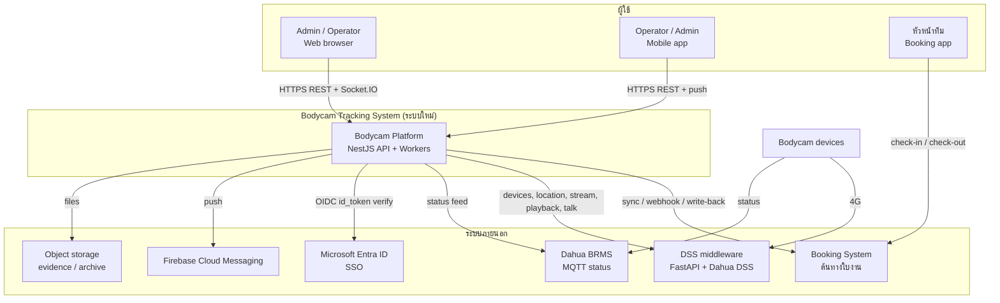
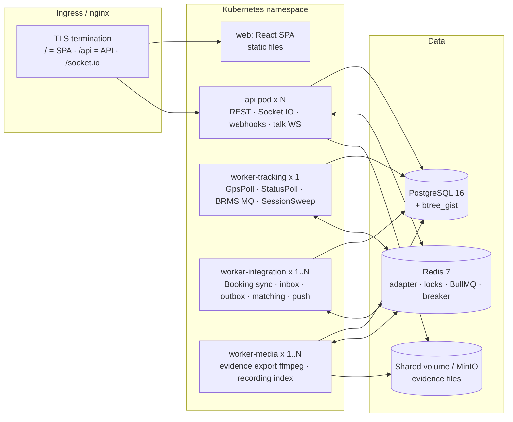
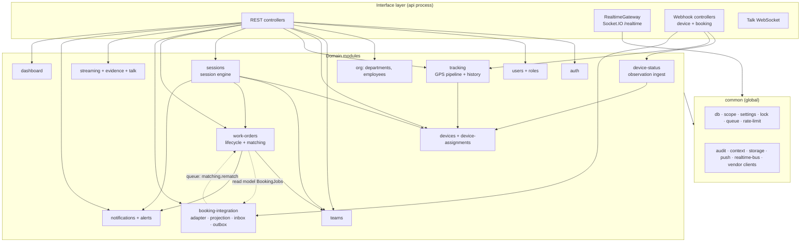
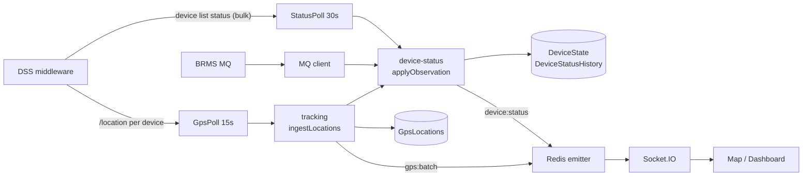
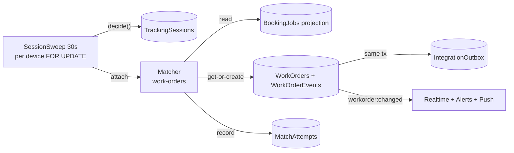
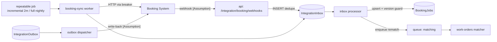

# Part 2 — Proposed System Architecture

---

## 2.1 Architecture Style: Modular Monolith

| เกณฑ์ | Modular Monolith (เลือก) | Microservices |
|---|---|---|
| ขนาดทีม / ระบบ | เหมาะกับทีมเล็ก กล้อง 100–300 ตัว | overhead สูงเกินขนาดงาน |
| Reuse จาก reference | port โค้ด NestJS เดิมได้ตรง (`server/src/common/*`, auth, tracking, streaming) | ต้องแตกโค้ดเดิมใหม่ทั้งหมด |
| Transaction ข้าม domain | session + work order + outbox อยู่ใน transaction เดียวได้ | ต้องใช้ saga/distributed tx |
| Failure isolation | ได้จาก **process role + queue แยก + circuit breaker** (ดู 2.6) | ได้โดยธรรมชาติ |
| การ scale | แยก worker role เป็น pod ได้ด้วย env โดยไม่แก้โค้ด | scale รายบริการ |

**ข้อสรุป**: Modular Monolith บน NestJS · 1 codebase · หลาย process role · boundary ชัดเจนระดับ module (ห้าม import ข้าม boundary ที่กำหนด) · แตกเป็น service ได้ภายหลังถ้าจำเป็น (Booking Integration เป็นตัวแรกที่แตกได้ เพราะคุยกับส่วนอื่นผ่าน table + queue อยู่แล้ว)

---

## 2.2 System Context

ขอบเขต: ระบบใหม่ **ไม่คุยกับกล้องโดยตรง** (เหมือน reference) และ **ไม่ใช่ต้นทางใบงาน** (Booking เป็นต้นทาง)

---

## 2.3 Container & Deployment

- **Process roles** จาก codebase เดียว: `main.api.ts` และ `main.worker.ts` + env `WORKER_ROLES` (`tracking`, `integration`, `media` — ใส่หลายค่าคั่นด้วย comma ได้) · dev/pilot รัน worker ตัวเดียว `WORKER_ROLES=tracking,integration,media`
- `worker-tracking` ต้องมี **1 instance ที่ active** (Redis lock กันซ้ำอยู่แล้ว แต่ไม่ได้ประโยชน์จากการ scale)
- `worker-integration` / `worker-media` scale แนวนอนได้ (BullMQ consumers)
- Redis ต้องมี persistence (AOF) และใช้ร่วมระหว่าง API กับ worker (key prefix ต่อ environment — port `lock-key.ts` ของ reference)
- `worker-media` image ต้องมี ffmpeg · migrate เป็น job แยกก่อน rollout

---

## 2.4 Module Map

### หน้าที่ของแต่ละ module

| Module | Responsibility | Reuse จาก reference |
|---|---|---|
| `auth` | login password + Entra SSO, refresh rotation, lockout, ทะเบียนเครื่องมือถือ (ไม่มี PIN) | `modules/auth` เกือบทั้งหมด |
| `users` | ผู้ใช้, role, role-permission matrix, ระงับบัญชี (`cutAllSessions`) | `modules/users` (ตัด company) |
| `org` | departments (tree), employees, link employee ↔ user, `BookingEmployeeRef` | `departments`, `employees` |
| `teams` | ทีม, สมาชิก, เปลี่ยนหัวหน้าทีม (ประวัติ), `BookingTeamRef` | ใหม่ |
| `devices` | ทะเบียน bodycam, vendor sync (`device-sync.plan.ts`), streaming toggle, Depots · การผูกกล้อง → ทีม **อ่านจาก Booking sync เท่านั้น** (ไม่มีหน้าจอผูกเอง — Q20) | `devices`, `device-assignments` (refactor เป็น read-only projection) |
| `device-status` | **Device Event Processing**: รับ observation จาก StatusPoll / GpsPoll / BRMS MQ / webhook → `DeviceState` + `DeviceStatusHistory` + emit `device:status` · ไม่มี business logic | แยกจาก `GpsPoll.applyVendorStatuses` + `brms-mq.service.ts` |
| `tracking` | GPS ingestion pipeline (`ingestLocations`), positions snapshot, route history | `modules/tracking` (ตัด road-match) |
| `sessions` | **Session engine** (sweep, pure `decide()`, open/close/split) · เป็น writer เดียวของ lifecycle session · recording index | ใหม่ (แทน `camera-session.service.ts`) |
| `work-orders` | lifecycle WO (**สถานะตาม Booking check-in/check-out**), **matching engine** (อ่าน `BookingJobs`), link/unlink/merge/void, review queue, mobile overview | ใหม่ |
| `booking-integration` | Booking provider port + adapters (`mock`, `http`), sync (incremental/full), inbox processor, outbox dispatcher, circuit breaker, mapping, monitoring endpoints | ใหม่ (ใช้ pattern provider/driver + webhook HMAC ของ reference) |
| `streaming` / `evidence` / `talk` | live, playback, recording search, MP4 export, two-way talk, quota, role/device access | port ทั้งหมด |
| `notifications` | alert engine (dedupe), in-app inbox, FCM push via BullMQ | port + alert types ใหม่ |
| `dashboard` | overview cards | refactor |
| `realtime` | Socket.IO gateway, rooms, auth, emitter จาก worker | port |
| `audit-logs`, `settings`, `health` | ตาม reference + health ของ Redis/integration | port + ขยาย |

### กติกา dependency (บังคับด้วย lint rule `no-restricted-imports` หรือ dependency-cruiser)

1. `booking-integration` **ห้าม import** `sessions` / `work-orders` — ส่งงานต่อผ่าน BullMQ queue `matching` เท่านั้น
2. `work-orders` อ่าน `BookingJobs` ผ่าน `BookingReadModel` (read-only repository) — ไม่เรียก Booking API
3. `tracking` / `device-status` / `sessions` **ห้ามเรียกระบบภายนอกที่ไม่ใช่ vendor กล้อง** — real-time path ไม่ขึ้นกับ Booking
4. ทุก write ที่แตะ session ของอุปกรณ์ต้องถือ row lock `DeviceState` ของอุปกรณ์นั้น (lock order: `DeviceId` จากน้อยไปมาก → `WorkOrders` → `TrackingSessions`)
5. Worker-only modules (`scheduler` timers, BRMS MQ, BullMQ processors) ห้าม import เข้า `AppModule` (กติกาเดิมของ reference)

---

## 2.5 Data Flows

### (A) Real-time tracking — ไม่แตะ Booking

### (B) Session → Work Order → Booking link

### (C) Booking sync — แยก queue, มี breaker

### (D) Streaming

Browser → `POST /api/streams/live` → `StreamingService` ตรวจสิทธิ์สด + scope + `StreamingEnabled` + quota → ขอ URL จาก DSS → seal AES-GCM → browser เล่นผ่าน proxy `/api/streams/:token/playlist.m3u8` (port จาก reference ทั้ง flow)

---

## 2.6 Failure Isolation

| สิ่งที่ล่ม | ผลกระทบ | สิ่งที่ยังทำงาน | กลไก |
|---|---|---|---|
| **Booking API** | sync หยุด, projection เก่าลง, write-back ค้างใน outbox | tracking, session, สร้าง WO (match กับ projection เดิม), live/playback ทั้งหมด | circuit breaker (Redis) · retry backoff · banner "ข้อมูล Booking ไม่เป็นปัจจุบัน" · WO ที่ match ไม่ได้ระหว่างนั้น = `Pending` แล้ว reconcile ภายหลัง |
| Booking ช้า (timeout) | job ของ queue `booking-*` ช้า | ทุกอย่างนอก queue นั้น | timeout 8s · concurrency จำกัด · อยู่คนละ worker role |
| DSS middleware | ไม่มี status/GPS ใหม่, live/playback ใช้ไม่ได้ | หน้าจอ, WO เดิม, Booking sync | สถานะอุปกรณ์กลายเป็น UNKNOWN (คำนวณจากอายุข้อมูล) · session **ไม่ถูกปิดทันที** (hold ≤ `session.unknown-max-minutes`) |
| BRMS MQ | สูญเสียความเร็วของ status | StatusPoll/GpsPoll ยังให้ status | ไม่ล้าง state เป็น null (ต่างจาก reference) |
| Redis | ไม่มี realtime จาก worker, ไม่มี lock, queue หยุด | REST API, DB | health check แจ้ง · worker-tracking หยุด sweep เมื่อ lock ไม่ได้ (fail-safe) |
| worker-tracking | ไม่มี session ใหม่ / ไม่มี GPS ใหม่ | UI, Booking sync | level-triggered sweep ⇒ เมื่อกลับมา คำนวณใหม่จาก state ปัจจุบันได้เอง |
| PostgreSQL | ระบบหยุด | — | managed HA + backup (นอกขอบเขต design นี้) |

---

## 2.7 Worker Jobs & Queues

| Role | Job | กลไก | ความถี่ | Lock / Concurrency |
|---|---|---|---|---|
| tracking | `StatusPoll` (DSS device list → observations) | timer | 30s | Redis lock `status:poll` |
| tracking | `GpsPoll` (DSS `/location`) | timer | 15s (setting) | lock `gps:poll` · concurrency 8 |
| tracking | `BrmsMq` (MQTT status) | long-lived connection | — | Redis lease (port) |
| tracking | `SessionSweep` (open/close/split + WO idle close) | timer | 30s | lock `session:sweep` · ทุกอุปกรณ์ ORDER BY Id แบ่งหน้า |
| tracking | `AlertSweep` (offline during work, stale Booking) | timer | 60s | lock `alert:sweep` |
| integration | `booking-sync` incremental / full | BullMQ repeatable | 2 นาที / รายคืน 02:00 | concurrency 1 · ข้ามเมื่อ breaker เปิด |
| integration | `booking-inbox` | BullMQ | ทันที | concurrency 4 · ต่อ job ใช้ version guard |
| integration | `matching` (rematch) | BullMQ `jobId` dedupe ต่อทีม+ช่วงเวลา | ทันที | concurrency 2 |
| integration | `booking-outbox` | BullMQ | poll pending ทุก 10s | 1 ข้อความที่เก่าสุดต่อ aggregate |
| integration | `notification-push` | BullMQ | ทันที | port |
| media | `evidence-export` | BullMQ | ทันที | port (ffmpeg) |
| media | `recording-index` | BullMQ repeatable | session เปิด: ทุก 30 นาที · ปิดแล้ว: 30 นาทีหลังจบ | concurrency 2 |
| media | `StreamIdle` / `TalkIdle` / `EvidenceCleanup` | timer | 60s | port |
| tracking | `PartitionMaintenance` / `Retention` (GPS 3 เดือน, ใบงาน 3 เดือน, audit 12 เดือน) | BullMQ repeatable | รายวัน | lock |

หลักคิด: งานความถี่สูงที่ level-triggered (poll/sweep) ใช้ timer + Redis lock (แบบ reference — ง่าย, self-healing) · งานที่ต้อง retry/durable ใช้ BullMQ

---

## 2.8 Authentication / Authorization Layer

- **Guard chain** (port): `JwtAuthGuard` → `RateLimitGuard` → `PermissionsGuard` + `AuditInterceptor` · secure by default (`@Public()` เท่านั้นที่เปิด)
- **Roles** (บริษัทเดียว):

| Role | Data scope | ใช้ทำอะไร |
|---|---|---|
| `ADMIN` | all | ทุกอย่าง รวม settings, integration, roles |
| `OPERATOR` | department (รวมแผนกย่อย) | ศูนย์ควบคุม (web + mobile): แผนที่/live/live wall/talk, คิวตรวจสอบ (link/unlink/ยืนยันคำแนะนำ), classify session, playback/export, จัดการทีม, ack alert |
| `VIEWER` | department | อ่านอย่างเดียว |

- `OPERATOR` แทน `SUPERVISOR` + `DISPATCHER` ของ reference — ระบบใหม่ไม่มีงานสร้าง/อนุมัติ/มอบหมายใบงาน จึงไม่ต้องแยก 2 บทบาท (Part 9 DL14)
- **ไม่มีการปิด/reopen ใบงานโดยคนในระบบนี้** — ใบงานที่ผูก Booking เปลี่ยนสถานะตาม check-in/check-out ของ Booking (หัวหน้าทีม/แอดมินทำฝั่ง Booking) **[Confirmed — DL13, DL15]** · void = `ADMIN` เฉพาะใบที่ไม่ผูก Booking
- **ไม่มี role หัวหน้าทีม** — แอปมือถือสำหรับ Operator/Admin/Viewer (monitoring + ตรวจหลักฐาน) **[Confirmed — DL16]**

- **Scope** port `server/src/common/scope/*` แล้วเปลี่ยน level เป็น `all` / `department` (subtree ด้วย recursive CTE + cache 60s) · นอก scope = 404 (กติกาเดิม)
- Permission catalog ดู [05-api-design.md §5.7](05-api-design.md#57-permission-catalog)
- **Service-to-service**:
  - Booking → เรา: HMAC-SHA256 (`X-Timestamp` + `X-Signature` บน `${ts}.${rawBody}`, skew ±5 นาที) port จาก `webhook-auth.ts` · หรือ mTLS ถ้า Booking รองรับ **[Assumption]**
  - เรา → Booking: OAuth2 client credentials หรือ API key ตามที่ Booking กำหนด **[Assumption]** · token cache + refresh ก่อนหมดอายุ
  - เรา → DSS: `DssAuth` เดิม (token cache 10 นาที, re-login เมื่อ 401)

---

## 2.9 Security & Reliability

| หัวข้อ | การออกแบบ |
|---|---|
| Authentication | JWT 15 นาที + refresh rotation (reuse ⇒ revoke ทั้งหมด) · Entra SSO · lockout ปรับได้ใน Settings · ระงับบัญชีตัด session ทันที (`cutAllSessions` + `session:revoked`) |
| RBAC + data scope | permission ต่อ endpoint + scope ที่ query layer · action ที่ sensitive (live, talk, export, link/void) ตรวจสิทธิ์สดจาก DB (`PermissionCheckService.hasPermissionNow`) |
| API security | `ValidationPipe({whitelist, forbidNonWhitelisted})` · rate limit ต่อกลุ่ม · CORS whitelist (ห้าม `*`) · helmet · ขนาด body จำกัด · ไม่ส่ง stack trace ใน production |
| Device event validation | observation ต้อง map กับ `Devices.VendorDeviceId` ที่ลงทะเบียนแล้ว (ไม่รู้จัก = นับ + ทิ้ง) · เวลาอนาคตเกิน 2 นาทีปฏิเสธ · drift filter · webhook ต้องผ่าน HMAC |
| Secure streaming | URL vendor seal AES-256-GCM ไม่ถึง browser · allowlist host กัน SSRF · session token + idle timeout · toggle ต่อ role / ต่ออุปกรณ์ · audit ทุกการเปิดดู |
| Audit logging | `@Audit` ทุก write + การเปิดดู live/playback/export · `WorkOrderEvents` เป็น timeline ระดับธุรกิจ · partition `AuditLogs` |
| Secret management | env จาก Kubernetes Secret / vault · ไม่มี secret ใน repo · `prod:check` (port `prod-readiness.ts`) ตรวจ env ก่อน deploy · rotate HMAC secret ได้ (รองรับ 2 key ช่วงเปลี่ยน) |
| Idempotency | inbox unique `(Source, ExternalEventId)` · outbox `IdempotencyKey` · get-or-create ด้วย partial unique + `ON CONFLICT` · API ที่เปลี่ยนสถานะรับ `Idempotency-Key` header (optional) |
| Race condition | row lock `DeviceState` ต่ออุปกรณ์ · compare-and-set (`WHERE Status = expected`) · optimistic `RowVersion` (`If-Match`) สำหรับ action ของคน · exclusion constraint |
| Duplicate event | observation ซ้ำไม่เปลี่ยน `StateSince` · GPS `ON CONFLICT DO NOTHING` · inbox dedupe · alert `DedupeKey` |
| Transaction | domain change + `WorkOrderEvents` + outbox ใน transaction เดียว · emit realtime **หลัง commit** เท่านั้น (บทเรียน `cutAllSessions` ของ reference) |
| Retry / backoff | BullMQ exponential + jitter (30s, 1m, 2m, 4m, 8m) · max 5 ครั้ง ⇒ Dead + alert · breaker 5 failures ⇒ เปิด 2 นาที ⇒ half-open 1 probe |
| Network failure recovery | level-triggered sweep (state ล่าสุดชนะ) · reconcile full window รายคืน + ตอน breaker ปิด · reconnect socket ฝั่ง client invalidate snapshot (pattern `useLivePositions`) |
| Observability | **pino structured log** (JSON) + `correlationId` ต่อ request/job (AsyncLocalStorage — ต่อยอด `common/context`) · Prometheus metrics (`/api/metrics`, ภายในเท่านั้น): sweep duration, devices online, sessions open, match results, booking sync lag, breaker state, queue depth, outbox dead · health `/api/health`, `/db`, `/redis`, `/integrations` · global exception filter (reference ไม่มี) |
