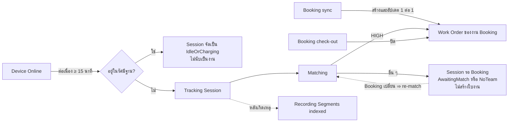
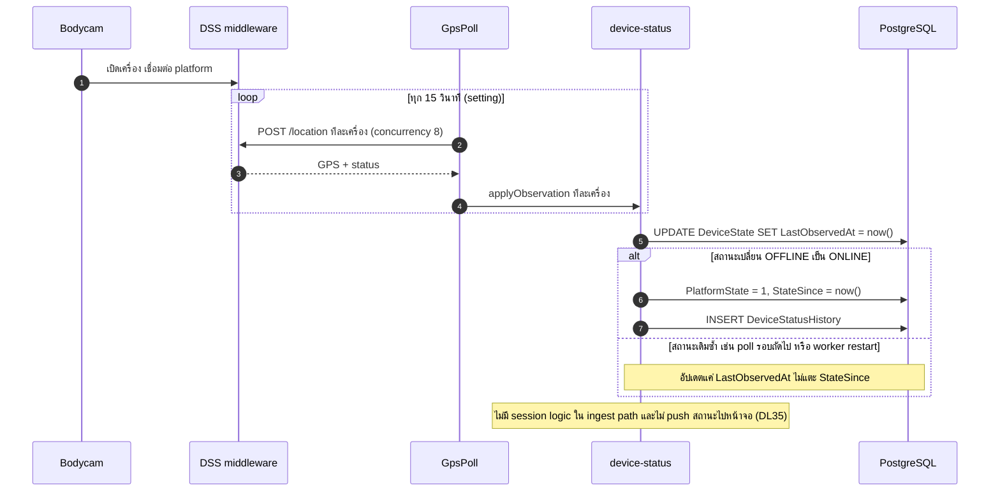
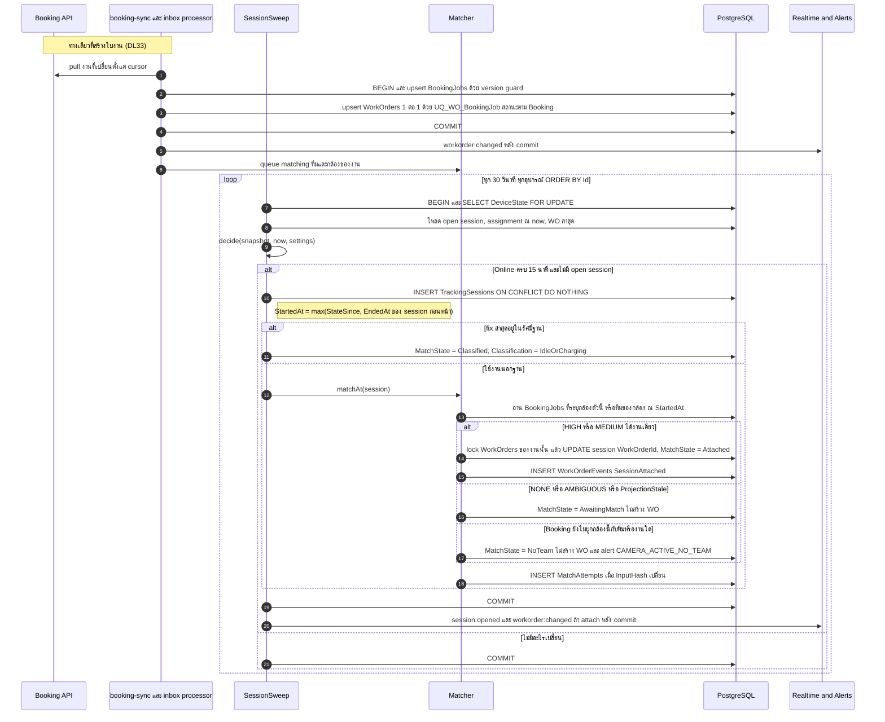
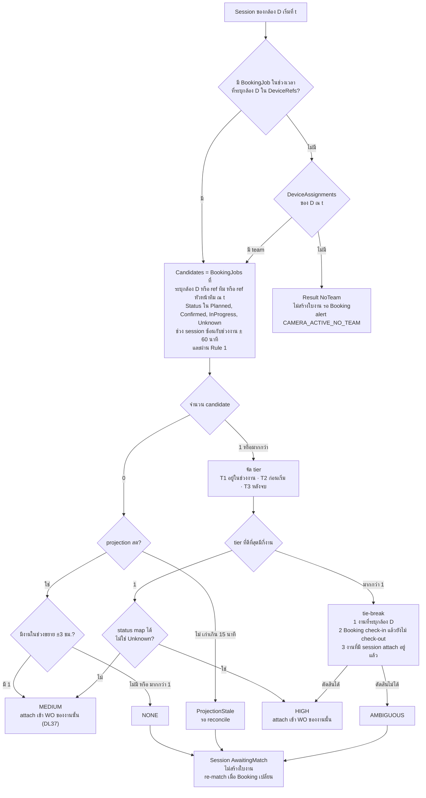
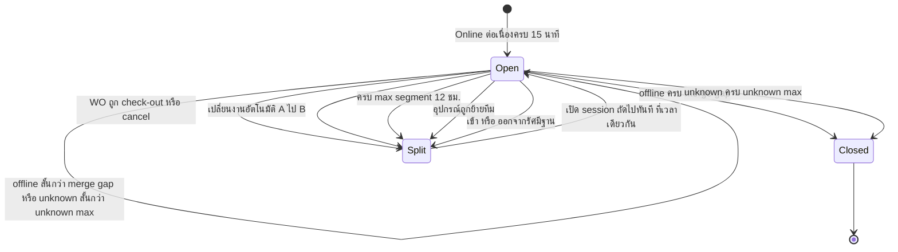
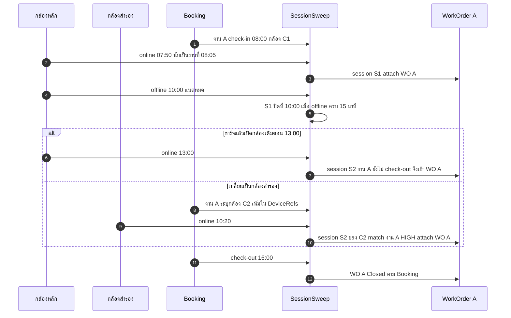
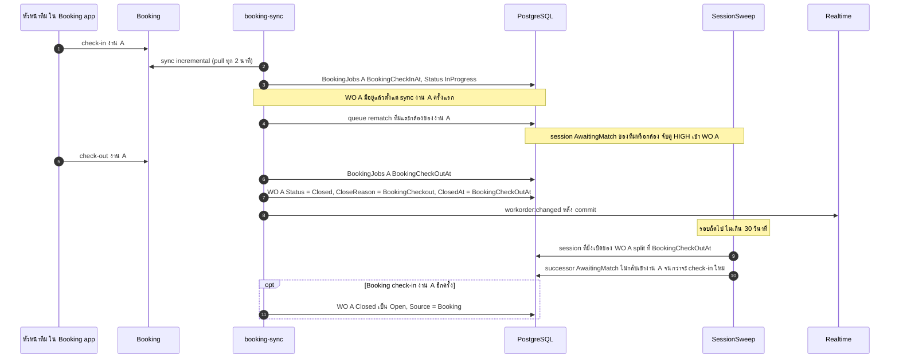
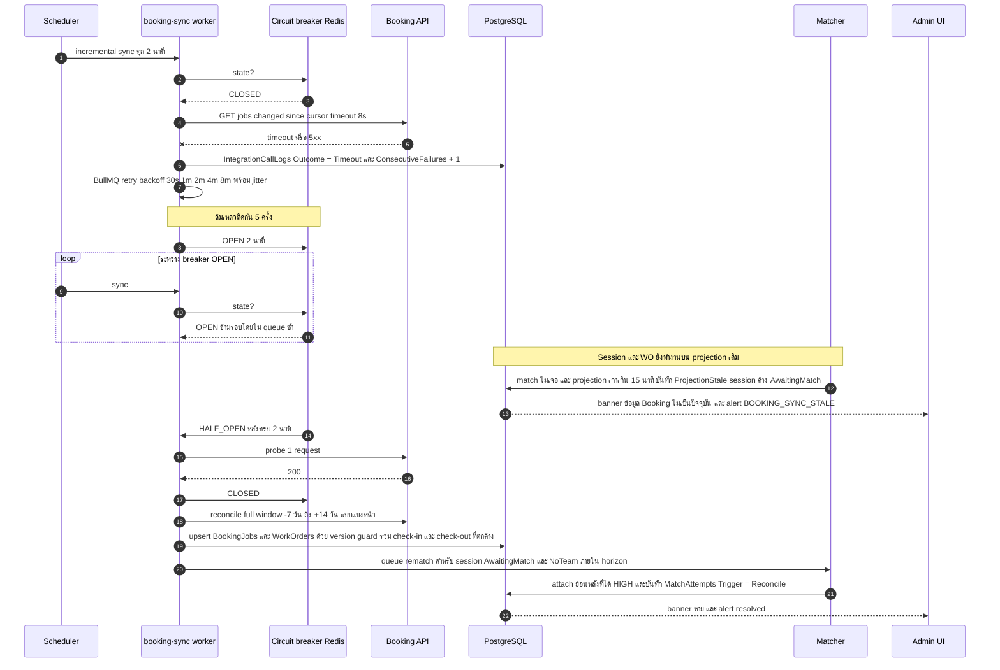
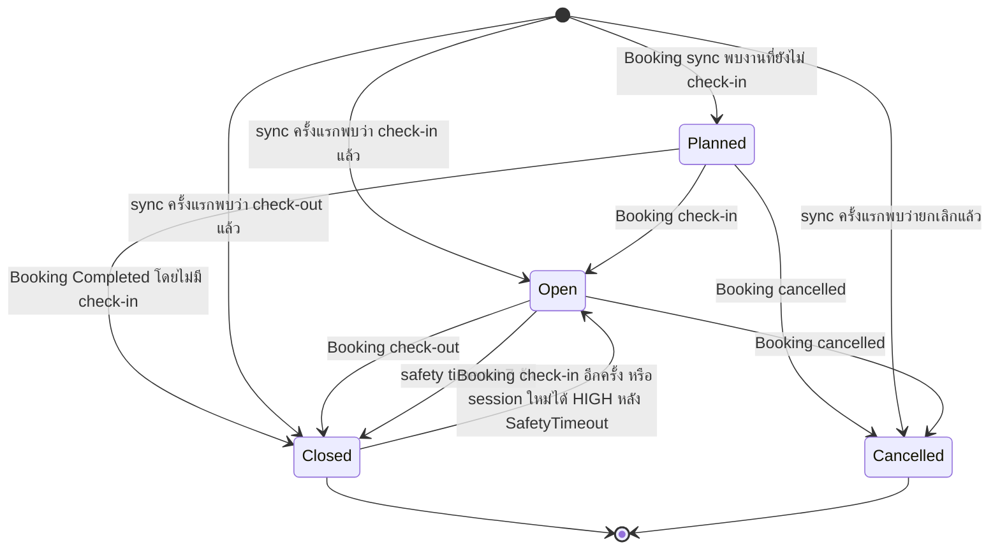
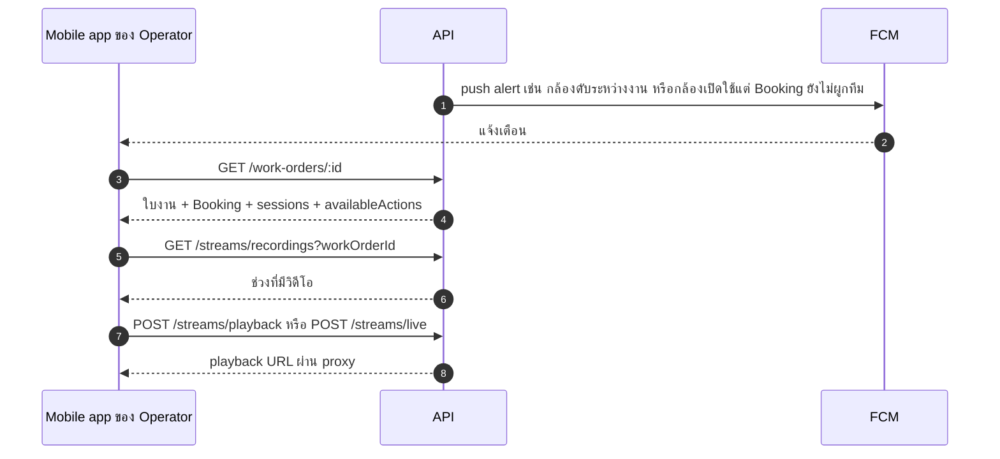

# Part 3 — Business Workflows

> ชื่อตาราง/enum ตาม [04-database-design.md](04-database-design.md) · ค่าตัวเลขในวงเล็บคือ default ของ Settings (ดู §3.11)
> กติกาในส่วนนี้ปรับตามคำตอบของผู้ใช้ 2026-11-04 และ DL33/DL35 (2026-11-09) (Part 9 §9.5) — **อาจเปลี่ยนตามข้อมูลจากทีม Booking**
> **DL33**: ใบงานมาจาก Booking sync เท่านั้น (1 ต่อ 1 กับ `BookingJobs`) · ระบบไม่สร้างใบงานเอง · ไม่มีใบรวม ไม่มีการผูก/void ด้วยมือ ไม่มีคิวตรวจสอบ

---

## 3.0 แยกความหมายของสถานะ (ห้ามปนกัน)

| คำ | ความหมาย | แหล่งข้อมูล | ใช้ตัดสินอะไร |
|---|---|---|---|
| **Device Online** | กล้องต่อ platform อยู่ (`DeviceState.PlatformState = 1` และข้อมูลไม่เก่าเกิน `status.unknown-after-seconds`) | GpsPoll: DSS `/location` (`status`) — DL32 | เปิด/ปิด session (ใช้ภายใน session engine) · หน้าจอไม่ได้รับ push สถานะ — ดึงสถานะจาก DSS ตอนเปิดหน้า (DL35) |
| **Device Unknown** | ไม่มี observation ใหม่นานเกินกำหนด (คำนวณ ไม่ได้เก็บ) | อายุของ `LastObservedAt` | **hold** — ไม่เปิดและไม่ปิด session จนกว่าจะเกิน `session.unknown-max-minutes` |
| **GPS Active** | มี fix ที่ valid อายุ ≤ 2 นาที | GpsPoll | แสดงตำแหน่ง · ตรวจว่าอยู่ฐาน (ถ้ามี fix) · ไม่ใช้เป็น trigger |
| **At Base** | fix ล่าสุดอยู่ในรัศมีฐาน/จุดชาร์จ (`Depots` — รองรับหลายจุด) | `DeviceState.LastLat/LastLng` · vendor **ไม่มี** charging state (Q21) | **ไม่นับเป็นงาน** — session จัดเป็น `IdleOrCharging` (Q15) |
| **Camera Active (เริ่มใช้งาน)** | Online ต่อเนื่อง ≥ `camera.activation-debounce-minutes` (**15**) และไม่ได้อยู่ฐาน | คำนวณจาก `StateSince` | **trigger เปิด Tracking Session ที่นับเป็นงาน** |
| **Recording Started** | มีไฟล์บันทึกในช่วงเวลานั้นจริง | DSS recording search (หลังเกิดเหตุเท่านั้น) → `RecordingSegments` | แสดงหลักฐาน · **ไม่ใช้เป็น trigger และไม่สมมติว่าเปิดกล้อง = อัด** |
| **Tracking Session** | ระเบียน `TrackingSessions` = ช่วงที่กล้อง 1 ตัวเปิดต่อเนื่องและสังกัด WO เดียวกัน (หรือยังไม่มี WO — `AwaitingMatch` / `NoTeam`) | Session engine | หน่วยของ "การใช้งานกล้อง" |
| **Booking Check-in / Check-out** | หัวหน้าทีม (หรือแอดมิน) กดเริ่ม/จบงาน **ในระบบ Booking** | Booking sync **[Assumption ด้านรูปแบบข้อมูล]** | **กำหนดสถานะใบงาน** — check-out = ปิดใบงาน (ผู้ใช้ยืนยัน) |
| **Work Order** | ระเบียนธุรกิจใน `WorkOrders` (PK ของตัวเอง) — **1 ต่อ 1 กับ `BookingJobs`** สร้าง/อัปเดตโดย Booking sync เท่านั้น (DL33) | Booking sync (inbox processor) | รวมหลาย session · **สถานะตาม Booking ไม่ใช่คนในระบบเรากดปิด** |

---

## 3.1 Bodycam Activation

กติกา:
- `applyObservation` เป็น `UPDATE` เดียว ใช้ `IS DISTINCT FROM` ตรวจ transition · เวลาใช้ DB `now()`
- **ไม่ล้างสถานะเป็น null** เมื่อ DSS หลุด/worker restart (ต่างจาก `clearPlatformStatuses()` ของ reference) — ความเก่าของข้อมูลถูกตีความเป็น UNKNOWN เอง
- GPS fix ที่สดถือเป็น ONLINE observation ด้วย (source = DssLocation) · fix ที่ valid ใช้คำนวณ `DeviceState.IsAtDepot`
- **แหล่งสถานะเดียวคือ GpsPoll** (DL32): `/location` ให้ทั้ง GPS และ online/offline ในรอบเดียว · ไม่มี StatusPoll / BRMS MQ / device webhook จึงไม่ต้องตัดสินลำดับระหว่าง source · observation ซ้ำแค่ bump `LastObservedAt`
- **ไม่มี event `device:status`** (DL35): `DeviceState` ใช้ภายใน session engine เท่านั้น · หน้าจอที่แสดงสถานะกล้อง (รายการ/รายละเอียดกล้อง/ก่อนเปิด live) ดึงสถานะจาก DSS ผ่าน API ตอนเปิดหน้า · ตำแหน่งบนแผนที่ยังมาทาง `gps:batch` ตามเดิม

---

## 3.2 Work Order Creation (จาก Booking sync เท่านั้น — DL33) และการเปิด Session

ใบงานเกิดได้ทางเดียว: Booking sync (inbox processor, worker `integration`) upsert `WorkOrders` **1 ต่อ 1 กับ `BookingJobs`** ทันทีที่ sync งานเข้ามา · **session engine ไม่สร้างใบงาน** — แค่เปิด session แล้วให้ matcher attach เข้า WO ของงานที่ชนะ

ข้อกำหนดที่ flow นี้ตอบ:
- **ไม่สร้าง WO ซ้ำ**: WO ต่อ Booking job ได้ใบเดียว (`UQ_WO_BookingJob`) — sync ซ้ำ/inbox ซ้ำ = upsert ใบเดิม · session เปิดได้ตัวเดียวต่ออุปกรณ์ (`UQ_TS_OpenPerDevice` + `EX_TS_NoOverlap`) · sweep ซ้ำ/worker 2 ตัว/observation ซ้ำ → ผลเหมือนเดิม
- **เปิดกล้องแต่ไม่พบ Booking**: session ค้าง `AwaitingMatch` (หรือ `NoTeam`) — **ไม่สร้างใบงาน รอ Booking อย่างเดียว** แล้ว re-match อัตโนมัติเมื่อข้อมูล Booking เปลี่ยน (§3.3.4 · DL33 แทน DL10)
- **กล้องชาร์จที่ฐานไม่นับเป็นงาน [Confirmed — Q15]** · vendor ไม่ส่งสถานะชาร์จ **[Confirmed — Q21]** จึงตรวจตอนเปิด session: fix ล่าสุดที่ valid อายุ ≤ `depot.fix-max-age-minutes` (30) อยู่ในรัศมีของ `Depots` (หลายจุด — พิกัด mock ไว้ก่อน, Q22) ⇒ `Classified` + `IdleOrCharging` · กล้องในอาคารที่ไม่มี fix และไม่มีงาน Booking ⇒ ค้าง `AwaitingMatch` (ไม่มีใบงานให้ void แล้ว — DL33)
- **เลขใบงาน** `WO-YYYYMM-NNNNN` จาก `WorkOrderCounters` (atomic) ตอน sync สร้าง WO
- **Title**: ชื่องานจาก Booking

---

## 3.3 Booking Work Order Matching

### 3.3.1 Algorithm (`matchAt(session)`) — pure function, versioned (`AlgoVersion`)

| ผล | การกระทำ | `TrackingSessions.MatchState` |
|---|---|---|
| HIGH (ผู้ชนะ 1 งาน) | attach session เข้า WO ของ Booking job นั้น (WO มีอยู่แล้วจาก sync) | 1 Attached |
| MEDIUM (งานเดียวในช่วงขยาย ±3 ชม. หรือสถานะ Booking map ไม่ได้) | attach อัตโนมัติเหมือน HIGH · บันทึก confidence MEDIUM ใน `MatchAttempts` (DL37) | 1 Attached |
| AMBIGUOUS | ไม่ attach · เก็บทุก candidate ใน `MatchAttempts` | 2 AwaitingMatch |
| NONE | ไม่ attach | 2 AwaitingMatch |
| ProjectionStale | ไม่ attach · re-match อัตโนมัติเมื่อ sync สำเร็จ | 2 AwaitingMatch |
| NoTeam | ไม่ attach · alert `CAMERA_ACTIVE_NO_TEAM` | 3 NoTeam |

**ไม่มีผลใดสร้างใบงาน** (DL33) · session ที่ยังไม่มี WO ดู §3.3.4

นิยามที่ใช้ในการ match:
- **ลำดับแหล่งที่บอกว่ากล้องไปงานไหน**:
  1. **`BookingJobs.DeviceRefs`** — Booking ระบุกล้องที่ใช้กับงาน (รวมกล้องสำรอง) **[Confirmed — Q4, Q20: การผูกกล้องมาจากฝั่ง Booking เท่านั้น · รูปแบบข้อมูลเป็น Assumption]** — match ด้วย `Devices.DeviceCode` / `VendorDeviceId` / `SerialNo` · ไม่ต้องมีทีมก็ match ได้
  2. **ทีม** จาก `DeviceAssignments` ณ `StartedAt` (**sync มาจาก Booking เท่านั้น** ถ้า Booking มีข้อมูลกล้องประจำทีม) แล้วเทียบ `BookingJobs.BookingTeamRef` กับ `Teams.BookingTeamRef` หรือ `BookingJobs.BookingLeaderRef` กับ `Employees.BookingEmployeeRef` ของหัวหน้าทีม — ทั้งสองแบบ HIGH ได้
  - session ที่ไม่มีทั้งข้อ 1 และ 2 = `NoTeam` (ไม่สร้างใบงาน) และ re-match เมื่อ Booking ส่งข้อมูลมา · **ระบบเราไม่มีหน้าจอผูกกล้องกับทีมเอง**
- `BookingJobs.TeamId` / `LeaderEmployeeId` เป็น **cache สำหรับแสดงผล** · เมื่อแก้ ref ของทีม/พนักงาน/กล้อง ⇒ job `re-resolve` อัปเดต cache + enqueue re-match
- **ช่วงเวลางาน** = `[min(PlannedStartAt, BookingCheckInAt), BookingCheckOutAt ?? (check-in แล้ว ⇒ ไม่มีขอบบน) ?? PlannedEndAt]` · candidate = ช่วง session `[StartedAt, EndedAt หรือ now]` **ซ้อน** กับช่วงงาน ± `matching.window-before/after-minutes` (60) · tier คิดจาก `StartedAt` · งานที่ไม่มีเวลาใช้ทั้งวัน `ScheduledDate` (Asia/Bangkok) และ confidence สูงสุด MEDIUM (จึงยังไม่ attach จนกว่า Booking จะมีเวลา check-in หรือเวลาตามแผน)
- **งานที่ check-in แล้วแต่ยังไม่ check-out = ยังเป็นใบเดิม** — กล้องแบตหมด เอาไปชาร์จแล้วเปิดใหม่หลายชั่วโมง session ใหม่ก็ยังเข้า WO เดิม **[Confirmed — Q3]**
- ระยะห่าง GPS กับ `BookingJobs.SiteLat/SiteLng` เป็นแค่ข้อมูลประกอบใน candidate list (กล้องส่วนใหญ่ไม่มี fix)
- **Rule 1 (กัน loop)**: session ที่เริ่ม**ตั้งแต่** `BookingCheckOutAt` ของงานไปแล้ว ไม่ match งานนั้น จนกว่า Booking จะ **check-in ใหม่** (ระบบ reopen ให้) — กัน successor ที่ถูก split ตอน check-out วนกลับเข้าใบเดิม · session ที่เริ่มก่อน check-out ยัง attach ย้อนหลังได้ (เช่น sync ล่าช้า — WO ที่ Closed รับ session ได้โดยสถานะไม่เปลี่ยน) · Cancelled ไม่เป็น candidate อีก · WO ที่ปิดเพราะ `SafetyTimeout` ยังเป็น candidate (session ใหม่ได้ HIGH ⇒ reopen + `NeedsReview`)
- `MatchAttempts` เขียนเฉพาะเมื่อ `InputHash` เปลี่ยน · `Candidates` เก็บทุก candidate พร้อม tier และเหตุผล — ใช้อธิบายย้อนหลังว่าทำไม attach หรือไม่ attach

### 3.3.2 ไม่มีการผูกด้วยมือ (DL33)

ไม่มี link / unlink / merge / void ใบงาน และไม่มีการ attach หรือจัดประเภท session ด้วยมือ — การจับคู่เป็นอัตโนมัติจากข้อมูล Booking อย่างเดียว · ถ้าผลไม่ถูก ต้องแก้ข้อมูลฝั่ง Booking (เช่น `DeviceRefs` / ทีม) แล้วระบบ re-match เอง (§3.3.3)

### 3.3.3 Re-matching

| Trigger | ขอบเขต | กติกา |
|---|---|---|
| Booking job ใหม่/เปลี่ยน (`PayloadHash` เปลี่ยน รวม check-in/check-out/DeviceRefs) | session ของทีมและกล้องที่เกี่ยวข้อง ±`booking.rematch-horizon-hours` (72) | queue `matching` ด้วย `jobId = team:{id}:{window}` (dedupe) |
| Sync กลับมาสำเร็จหลัง stale | session `AwaitingMatch` / `NoTeam` ภายใน horizon (รวมที่ผลล่าสุดเป็น ProjectionStale) | re-run ทั้งหมด |
| แก้ assignment / ref ย้อนหลัง | session ในช่วงที่แก้ | job `re-resolve` แล้ว re-run |
| Sweep | **session ที่ยังเปิด** ซึ่ง `AwaitingMatch` หรือ `NoTeam` | re-run ทุกรอบ (local, ถูก) |

- **session ที่เข้าข่าย**: `AwaitingMatch` / `NoTeam` ที่เริ่มภายใน horizon — ทั้งที่ยังเปิดและปิดแล้ว (attach ย้อนหลังได้)
- **ใครเขียนอะไร**: queue `matching` จัดการ session ที่ปิดแล้ว · **session ที่ยังเปิด** ให้ `SessionSweep` (writer เดียวของ lifecycle session) · ทั้งสองฝั่งใช้ **lock order เดียวทั้งระบบ**: `DeviceState` (DeviceId น้อยไปมาก) → `WorkOrders` (Id น้อยไปมาก) → `TrackingSessions` · retry สูงสุด 3 ครั้งเมื่อ deadlock
- session ที่ attach แล้วย้ายไป WO ของงานอื่นได้เฉพาะเมื่อ WO เดิมยัง Open และผลใหม่เป็น HIGH ของงานอื่น — นอกนั้นคงไว้ + `NeedsReview`

### 3.3.4 Session ที่ยังไม่มีใบงาน (แทน "ใบรวม" เดิม — DL33)

| คำถาม | กติกา |
|---|---|
| เกิดเมื่อไร | ผล AMBIGUOUS / NONE / ProjectionStale ⇒ `AwaitingMatch` · ไม่รู้ทีมและ Booking ไม่ระบุกล้อง ⇒ `NoTeam` |
| สร้างใบงานไหม | **ไม่** — ไม่มีใบรวม ไม่มีการปิดที่ 240 นาที · รอ Booking อย่างเดียว |
| attach เมื่อไร | re-match อัตโนมัติได้ HIGH เมื่อข้อมูล Booking เปลี่ยน (§3.3.3) ภายใน `booking.rematch-horizon-hours` · พ้น horizon แล้วคงเป็น session ที่ไม่มีใบงาน |
| ดูหลักฐานที่ไหน | หน้าค้นหาวิดีโอรายกล้อง `/recordings` (ไม่ใช่รายการใบงาน) · มี recording ⇒ alert `RECORDING_OUTSIDE_WORK` |
| session ต่อเนื่องหลัง WO ถูก check-out ขณะกล้องยังเปิด | `AwaitingMatch` · attach **เฉพาะเมื่อได้ HIGH** ของงานอื่น (เช่นงานถัดไป) — ไม่กลับเข้างานเดิม (Rule 1) |

---

## 3.4 Tracking Session Lifecycle

### 3.4.1 State diagram

| เหตุการณ์ | EndedAt | EndReason | session ถัดไป |
|---|---|---|---|
| Offline ≥ merge gap (15) | `StateSince` ของ offline | DeviceOffline | — (ถ้ากล้องเปิดใหม่ภายหลังและงานยังไม่ check-out ⇒ session ใหม่เข้า WO เดิม) |
| Unknown ≥ 30 นาที | `LastOnlineObservedAt` | StatusUnknown | — |
| Booking check-out / cancel ขณะกล้องเปิด | `BookingCheckOutAt` / เวลาที่ cancel | WorkOrderClosed | เปิดทันที · `AwaitingMatch` · ไม่กลับเข้างานเดิมจนกว่าจะ check-in ใหม่ (Rule 1) |
| สลับงานอัตโนมัติ A→B (A ยังไม่ check-out) | `max(A.PlannedEndAt, B.BookingCheckInAt ?? B.PlannedStartAt)` | JobSwitched | attach B · WO A `NeedsReview` (AutoSwitched) **[Confirmed — Q5]** |
| ครบ `session.max-segment-hours` (12) | เวลาครบ cap | MaxSegment | WO เดิม · `StartInferred = SplitBoundary` |
| ย้ายทีม | เวลาที่ assignment เปลี่ยน | DeviceReassigned | match ใหม่ |
| เข้าฐาน (หรือออกจากฐาน) | เวลาที่ตรวจพบ | AtBaseChanged | ฝั่งฐาน = Classified IdleOrCharging · ฝั่งนอกฐาน = match ปกติ |

> max segment 12 ชม. ผูกกับข้อจำกัด playback ≤ 24 ชม. ของ DSS — **ไม่เป็น setting ที่ตั้งเกิน 24 ได้**
> session ถัดไปเริ่ม **ที่เวลาจบของตัวก่อนหน้าพอดี** — กัน bug "เกิดใหม่พร้อมเวลาเกิน cap" ของ reference

### 3.4.2 แบตหมด / พัก / กล้องสำรอง

- กล้องสำรองต้อง **ระบุจากฝั่ง Booking เท่านั้น** (`DeviceRefs` ในใบงาน) **[Confirmed — Q4, Q20]** — ระบบเราไม่มีการผูกกล้องเอง
- ถ้า Booking ยังไม่ระบุ: session ของกล้องสำรอง = `NoTeam` (ไม่สร้างใบงาน) + alert `CAMERA_ACTIVE_NO_TEAM` · เมื่อ Booking เพิ่มกล้องในใบงาน ⇒ re-match HIGH attach เข้า WO ของงานอัตโนมัติ · ไม่มีการ attach ด้วยมือ (DL33)

### 3.4.3 Decision table ของ `decide()` (ต่ออุปกรณ์ ต่อรอบ)

| # | เงื่อนไข | การกระทำ |
|---|---|---|
| 1 | อุปกรณ์ Retired / Inactive | ปิด open session (ถ้ามี) · ไม่เปิดใหม่ |
| 2 | ไม่มี open session · effective = ONLINE · `now − StateSince ≥ debounce (15)` | เปิด session `StartedAt = max(StateSince, lastSession.EndedAt)` · อยู่ในรัศมีฐาน ⇒ Classified IdleOrCharging · ไม่งั้น match (§3.3 — HIGH ⇒ attach · อื่น ๆ ⇒ `AwaitingMatch` / `NoTeam`) |
| 3 | ไม่มี open session · อื่น ๆ | ไม่ทำอะไร |
| 4 | มี open session · effective = OFFLINE · `now − StateSince ≥ merge gap` | ปิด `EndedAt = StateSince` |
| 5 | มี open session · effective = UNKNOWN · `now − LastObservedAt ≥ unknown max` | ปิด `EndedAt = LastOnlineObservedAt` |
| 6 | มี open session · WO ของ session ไม่ Open แล้ว (check-out / cancel) | split ที่เวลานั้น · successor `AwaitingMatch` |
| 7 | มี open session · `now − StartedAt ≥ max segment` | split · successor WO เดิม |
| 8 | มี open session · assignment ณ now ≠ `session.TeamId` | split · successor match ใหม่ |
| 9 | มี open session · สถานะอยู่ในรัศมีฐานเปลี่ยน | split (`AtBaseChanged`) |
| 10 | มี open session `AwaitingMatch` / `NoTeam` · match ได้ HIGH | ถ้า session เริ่มก่อนช่วงงาน − window-before: split ที่จุดนั้น (`StartInferred = PlannedBoundary`) แล้ว attach successor · ไม่งั้น attach ทั้ง session |
| 11 | มี open session ใน WO A (ยังไม่ check-out) · `now ≥ A.PlannedEndAt` และงาน B ของทีม/กล้องเดียวกันเป็น HIGH · `matching.auto-switch-enabled` | split ที่ `max(A.PlannedEndAt, B.BookingCheckInAt ?? B.PlannedStartAt)` |
| 12 | อื่น ๆ | hold |

pass ระดับ WO ใน sweep เดียวกัน:

| เงื่อนไข WO (Open) | การกระทำ |
|---|---|
| Booking check-out แล้ว | Closed (`BookingCheckout`) เวลา = `BookingCheckOutAt` — **ทางปิดหลัก** **[Confirmed — Q1, Q2]** |
| ยังไม่ check-out · `now − OpenedAt ≥ workorder.stale-open-hours` (**36**) | **ไม่ปิด** · `NeedsReview` + alert `WORK_ORDER_NO_CHECKOUT` **[Confirmed — Q23]** |
| ยังไม่ check-out · `now − OpenedAt ≥ workorder.force-close-after-hours` (168 = 7 วัน) | Closed (`SafetyTimeout`) + `NeedsReview` — กันใบงานค้างตลอดไป **[Confirmed — Q23]** |

> `OpenedAt` = เวลา check-in ใน Booking · ใบ `Planned` (ยังไม่ check-in) ไม่เข้า pass นี้ (DL37) · ใบ Planned ปิดเมื่อ Booking ส่ง Completed / Cancelled มาเท่านั้น (ถาม Booking — Part 9 §9.4)
> `NeedsReview` เป็นแค่ badge ข้อมูลบนหน้าใบงาน + alert ถึง Admin — **ไม่มีคิวตรวจสอบ ไม่มีปุ่ม clear ไม่มี SLA** (DL33)

---

## 3.5 สถานะใบงานตาม Booking Check-in / Check-out

- **ในระบบเราไม่มีปุ่มปิดใบงาน** — สถานะใบงานตาม check-in/check-out ของ Booking เท่านั้น **[Confirmed — Q2]** · หัวหน้าทีม/แอดมินทำ check-out ฝั่ง Booking (สอดคล้องกับคำตอบเดิมว่า "ปิดได้ทั้งหัวหน้าทีมและแอดมินระบบ" — DL13)
- **Reopen = เปลี่ยนสถานะจาก Closed กลับเป็น Open** ไม่ใช่การเปิดดู · **การเปิดดูใบงานและหลักฐานทำได้ตลอด** ตราบที่ข้อมูลยังอยู่ใน retention (3 เดือน) **[Confirmed — Q9]** · ระบบ reopen เองเฉพาะเมื่อ Booking check-in ใหม่ หรือใบที่ปิดด้วย SafetyTimeout มี session HIGH ใหม่ · ไม่มีปุ่ม reopen ให้คน
- **ไม่มี Void / Merge** (DL33) — ใบงานทุกใบมาจาก Booking · งานที่ไม่ใช่งานจริงให้ยกเลิกฝั่ง Booking ⇒ `Cancelled` (หลักฐานยังเปิดดูได้)
- **Session engine เป็น writer เดียวของ lifecycle session** — sync เปลี่ยนแค่ WO แล้ว sweep ทำ split ให้ (เวลาจบ = `BookingCheckOutAt` ⇒ deterministic)

---

## 3.6 Booking API Failure / Recovery

- **Booking ล่มไม่กระทบ tracking**: real-time path และ session engine ไม่เรียก Booking
- ระหว่างล่ม **ใบงานจะไม่ถูกปิด** (ไม่รู้ check-out) — ปิดย้อนหลังด้วยเวลา `BookingCheckOutAt` จริงเมื่อ sync กลับมา
- งานที่สร้างใน Booking ระหว่างล่มยังไม่มี WO จนกว่า sync กลับมา — session ช่วงนั้นค้าง `AwaitingMatch` แล้ว attach ย้อนหลังเมื่อ reconcile (Rule 1 ยอมให้ session ที่เริ่มก่อน check-out เข้า WO ที่ Closed ได้)
- ข้อความที่ fail เกิน 5 ครั้ง ⇒ `Dead` แสดงในหน้า Integration ให้ admin กด retry

---

## 3.7 เหตุการณ์จาก Booking

| เหตุการณ์จาก Booking | sync ครั้งแรก (ยังไม่มี WO) | WO Open | WO Closed แล้ว |
|---|---|---|---|
| งานใหม่ (ยังไม่ check-in) | **สร้าง WO** สถานะ `Planned` (รอเริ่ม — DL37) 1 ต่อ 1 · re-match session ที่เกี่ยวข้อง | — | — |
| Check-in | **สร้าง WO** สถานะ Open 1 ต่อ 1 (มีใบ `Planned` อยู่แล้ว ⇒ เปลี่ยนเป็น Open) · re-match session ที่เกี่ยวข้อง | อัปเดตข้อมูลแสดงผล · re-match | **reopen** (Source Booking) |
| Check-out / Completed | สร้าง WO สถานะ Closed (`BookingCheckout`) — session ย้อนหลังที่ match ภายหลังเข้าใบนี้ได้ (Rule 1) | **Closed (`BookingCheckout`)** · split open session | อัปเดตเวลา check-out ถ้าเปลี่ยน |
| Cancelled | สร้าง WO สถานะ `Cancelled` (ไม่เป็น candidate) | WO → `Cancelled` · split open session · `NeedsReview` ถ้ามี recording (alert `WORK_ORDER_CANCELLED_WITH_EVIDENCE`) — **ฝั่ง bodycam ตรวจสอบหลักฐานได้** **[Confirmed — Q6]** | `NeedsReview` |
| เปลี่ยนทีม / เวลา / DeviceRefs | — (ถือเป็นงานใหม่) | re-match (§3.3.3) · `WorkOrders.TeamId` / `DepartmentId` อัปเดตตาม Booking (แผนกมาจาก Booking — DL38) | `NeedsReview` (alert `BOOKING_JOB_CHANGED_AFTER_CLOSE`) |
| หายจาก full sync | — | `SourceMissingSince` + `NeedsReview` | `SourceMissingSince` + `NeedsReview` |

`NeedsReview` = badge ข้อมูลบนหน้าใบงาน + alert ถึง Admin เท่านั้น (ไม่มีคิวตรวจสอบ — DL33)

---

## 3.8 State Diagrams ของ Work Order

### Status

- สถานะมี Planned (รอเริ่ม) / Open / Closed / Cancelled และตาม Booking เท่านั้น (DL33, DL37) · session attach เข้าใบ Planned ได้ (เปิดกล้องก่อน check-in) แต่สถานะไม่เปลี่ยนจนกว่า Booking check-in · ค่า 4 Voided / 5 Merged สงวนไว้ (เลิกใช้ DL33 — ห้ามใช้เลขซ้ำ)
- **ไม่มี LinkStatus** (DL33) — ใบงานทุกใบผูก Booking 1 ต่อ 1 ตั้งแต่สร้าง · สถานะการจับคู่อยู่ที่ session (`TrackingSessions.MatchState`)

---

## 3.9 Mobile: Monitoring และดูหลักฐาน

ผู้ใช้แอปคือ **ฝั่ง monitoring และดูหลักฐาน** (Operator, Admin, Viewer) — **ไม่ใช่พนักงานภาคสนาม** **[Confirmed — Q18]** · หัวหน้าทีมใช้ Booking app สำหรับ check-in/check-out

- แอปเป็น **monitoring + ดูหลักฐาน** เท่านั้น — ไม่มีคิวตรวจสอบ / link / จัดประเภท session (DL33)
- แอปใช้ API ชุดเดียวกับ web (scope + permission เดียวกัน) + endpoint เฉพาะมือถือ: ทะเบียนเครื่อง, push token, `GET /mobile/overview` (สรุปสั้นสำหรับหน้าแรก)
- Check-in/check-out หน้างาน **อยู่ฝั่ง Booking** — ระบบเรารับเป็นข้อมูลเท่านั้น (Q14 รอทีม Booking เรื่องรูปแบบข้อมูล)

---

## 3.10 สิ่งที่ยังรอจากทีม Booking (สรุปไป Part 9 §9.4)

พัฒนาด้วย **mock adapter ก่อน** แล้วเปลี่ยนเป็นของจริงเมื่อได้ spec **[Confirmed — Q14]**

1. **รูปแบบ check-in/check-out**: มีเวลา check-in/check-out ต่อใบงานไหม · เป็น field ในใบงานที่ดึงผ่าน change feed (pull อย่างเดียว — DL31) · check-in ซ้ำได้ไหม
2. **Booking ระบุกล้องในใบงาน** (`DeviceRefs` รวมกล้องสำรอง) ด้วยรหัสอะไร (DeviceCode / Serial / รหัส DSS) — **เป็นแหล่งเดียวของการผูกกล้อง** (Q20)
3. Booking มอบงานให้ "ทีม" / "หัวหน้าทีม-คนขับ" / "รถ" — ใช้ ref อะไร · มีข้อมูลกล้องประจำทีมให้ sync ไหม

---

## 3.11 Settings ที่ใช้ใน workflow

| Key | Default | Bounds | ใช้ที่ |
|---|---|---|---|
| `status.unknown-after-seconds` | 120 | ≥ 2 × poll | คำนวณ UNKNOWN |
| `status.display-cache-seconds` | 10 | 0–60 (0 = ไม่ cache) | อายุ cache Redis ของสถานะกล้องที่ `api` ดึงจาก DSS ให้หน้าจอ (DL45) · ไม่กระทบ session engine |
| `gps.poll-interval-seconds` | 15 | 5–300 | GpsPoll (เดิม) |
| `camera.activation-debounce-minutes` | **15** **[Confirmed — Q3]** | 1–60 | เปิด session |
| `session.merge-gap-minutes` | 15 | 0–240 | ตัด session เมื่อ offline (ไม่ใช่การปิดใบงาน) |
| `session.unknown-max-minutes` | 30 | 5–240 | ปิด session เมื่อ unknown |
| `session.max-segment-hours` | 12 | 1–24 (**ผูกกับ playback 24 ชม.**) | split |
| `depot.fix-max-age-minutes` | 30 | 5–240 | ตรวจอยู่ฐาน |
| `matching.window-before-minutes` / `after` | 60 / 60 **[Confirmed — Q3]** | 0–240 | candidate window |
| `matching.extended-window-minutes` | 180 **[Confirmed — Q3]** | ≥ window | MEDIUM — attach อัตโนมัติ (DL37) |
| `matching.auto-switch-enabled` | true **[Confirmed — Q5]** | bool | A→B |
| `workorder.stale-open-hours` | 36 **[Confirmed — Q23]** | 12–336 | alert ไม่มี check-out (นับจาก check-in) |
| `workorder.force-close-after-hours` | 168 **[Confirmed — Q23]** | 24–720 | SafetyTimeout (นับจาก check-in) |
| `booking.sync-interval-seconds` | 120 | 30–3600 | incremental |
| `booking.stale-after-minutes` | 15 | 5–240 | banner / ผล ProjectionStale |
| `booking.rematch-horizon-hours` | 72 | 1–336 | re-match |
| `alert.offline-during-job-minutes` | 10 | 1–120 | alert 5 |

ไม่มี setting ของใบรวม / auto-void / SLA คิวตรวจสอบแล้ว (DL33)

เพิ่ม key = แก้ `SETTING_DEFAULTS` + `SETTING_BOUNDS` (`setting-spec.ts`) + data migration (กติกาเดิมของ reference — ไม่พึ่ง seed)
