# Part 3 — Business Workflows

> ชื่อตาราง/enum ตาม [04-database-design.md](04-database-design.md) · ค่าตัวเลขในวงเล็บคือ default ของ Settings (ดู §3.11)

---

## 3.0 แยกความหมายของสถานะ (ห้ามปนกัน)

| คำ | ความหมาย | แหล่งข้อมูล | ใช้ตัดสินอะไร |
|---|---|---|---|
| **Device Online** | กล้องต่อ platform อยู่ (`DeviceState.PlatformState = 1` และข้อมูลไม่เก่าเกิน `status.unknown-after-seconds`) | DSS device list · DSS `/location` online flag · BRMS MQ · webhook | แสดงสถานะบนแผนที่/รายการ |
| **Device Unknown** | ไม่มี observation ใหม่นานเกินกำหนด (คำนวณ ไม่ได้เก็บ) | อายุของ `LastObservedAt` | **hold** — ไม่เปิดและไม่ปิด session จนกว่าจะเกิน `session.unknown-max-minutes` |
| **GPS Active** | มี fix ที่ valid อายุ ≤ 2 นาที | GpsPoll / webhook | แสดงตำแหน่ง · ไม่ใช้เป็น trigger (กล้องในอาคารไม่มี fix) |
| **Camera Active (เริ่มใช้งาน)** | Online ต่อเนื่อง ≥ `camera.activation-debounce-minutes` (5) | คำนวณจาก `StateSince` | **trigger เปิด Tracking Session** |
| **Recording Started** | มีไฟล์บันทึกในช่วงเวลานั้นจริง | DSS recording search (หลังเกิดเหตุเท่านั้น) → `RecordingSegments` | แสดงหลักฐาน · alert "มีการอัดนอกงาน" · **ไม่ใช้เป็น trigger และไม่สมมติว่าเปิดกล้อง = อัด** |
| **Tracking Session Started** | ระเบียน `TrackingSessions` ถูกสร้าง (`StartedAt` = เวลาที่เริ่ม online) | Session engine | เป็นหน่วยของ "การใช้งานกล้อง" ที่ผูกกับ WO |
| **Work Order Created** | ระเบียนธุรกิจใน `WorkOrders` (มี PK ของตัวเอง) | Matcher | ผูกกับ Booking (0..1) และรวมหลาย session |

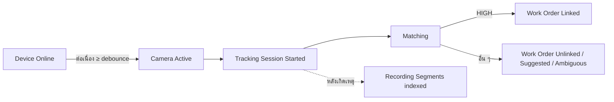

---

## 3.1 Bodycam Activation

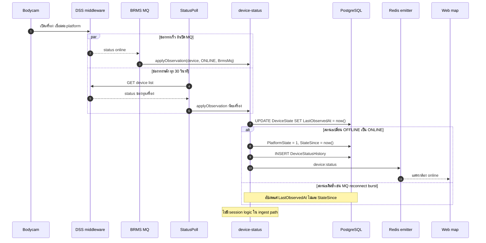

กติกา:
- `applyObservation` เป็น `UPDATE` เดียว ใช้ `IS DISTINCT FROM` ตรวจ transition · เวลาใช้ DB `now()`
- **ไม่ล้างสถานะเป็น null** เมื่อ MQ หลุด/worker restart (ต่างจาก `clearPlatformStatuses()` ของ reference) — ความเก่าของข้อมูลถูกตีความเป็น UNKNOWN เอง
- GPS fix ที่สดถือเป็น ONLINE observation ด้วย (source = DssLocation)
- **หลาย source ขัดกัน — ใช้ลำดับความน่าเชื่อถือ ไม่ใช่ last-write-wins**: BRMS MQ (เมื่อเชื่อมต่ออยู่) > DSS device list > DSS `/location` online flag / GPS fix > webhook · observation จาก source ที่ลำดับต่ำกว่า **เปลี่ยน state ไม่ได้** ถ้า source ที่ตั้ง state ปัจจุบัน (`DeviceState.StateSource`) ยังสดอยู่ (`StateSourceObservedAt` ไม่เก่ากว่า `status.unknown-after-seconds`) — แค่ bump `LastObservedAt` · ป้องกัน "online หลุดมา 1 ครั้ง" รีเซ็ตนาฬิกา merge gap หรือ "offline หลุดมา 1 ครั้ง" รีเซ็ต debounce

---

## 3.2 Automatic Work Order Creation

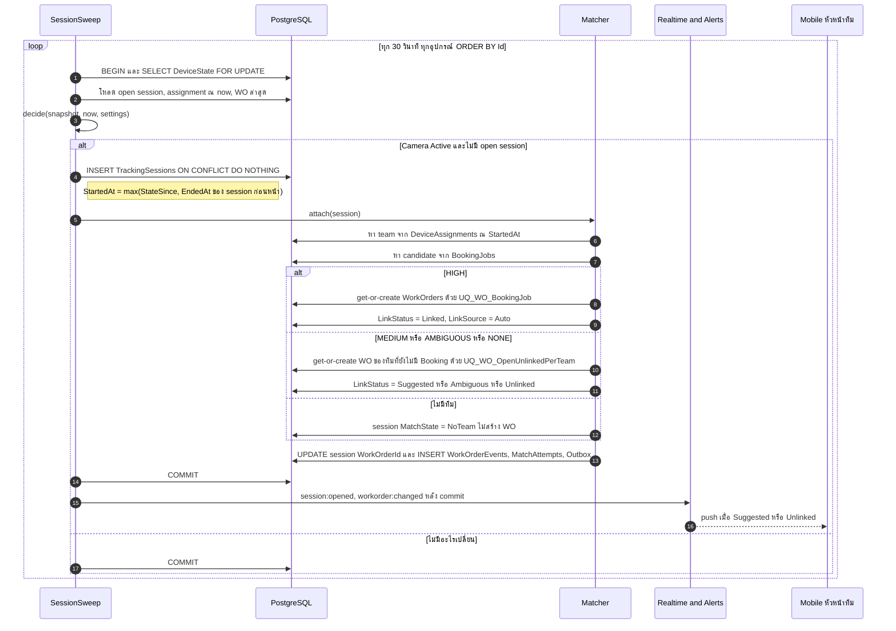

ข้อกำหนดที่ flow นี้ตอบ:
- **ไม่สร้าง WO ซ้ำจาก event เดิม**: session เปิดได้ตัวเดียวต่ออุปกรณ์ (`UQ_TS_OpenPerDevice` + `EX_TS_NoOverlap`) · WO ต่อ Booking ได้ใบเดียว (`UQ_WO_BookingJob`) · WO ที่ยังไม่มี Booking ต่อทีมได้ใบเดียว (`UQ_WO_OpenUnlinkedPerTeam`) · sweep ซ้ำ/worker 2 ตัว/observation ซ้ำ → ผลเหมือนเดิม
- **เปิดกล้องแต่ไม่พบ Booking**: สร้าง WO `Unlinked` (ตาม setting `workorder.create-when-unmatched`, default `true`) แล้วจับคู่ภายหลังได้ · ถ้าตั้ง `false` session จะค้างเป็น `AwaitingMatch` ในคิว exception (เลือกได้เพื่อลดใบงานขยะจากกล้องที่ชาร์จค้าง)
- **เลขใบงาน** `WO-YYYYMM-NNNNN` จาก `WorkOrderCounters` (atomic)
- **Title**: link แล้วใช้ชื่องานจาก Booking · ไม่ link = `ใบงานอัตโนมัติ {TeamCode} {DeviceCode}`

---

## 3.3 Booking Work Order Matching

### 3.3.1 Algorithm (`matchAt(session, t)`) — pure function, versioned (`AlgoVersion`)

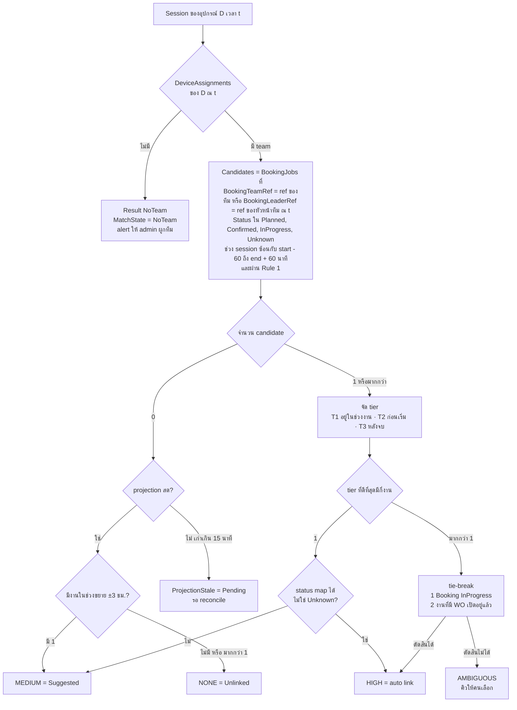

| ผล | การกระทำ | LinkStatus ของ WO |
|---|---|---|
| HIGH | get-or-create WO ของ Booking job แล้ว attach session | Linked (Auto) |
| MEDIUM | attach เข้า WO ที่ยังไม่มี Booking ของทีม + เก็บ candidate · push หัวหน้าทีม + คิว review | Suggested |
| AMBIGUOUS | เหมือน MEDIUM แต่ไม่มี candidate ที่แนะนำ (แสดงทุกตัว) | Ambiguous |
| NONE | attach เข้า WO ที่ยังไม่มี Booking ของทีม | Unlinked |
| ProjectionStale | attach เข้า WO ที่ยังไม่มี Booking ของทีม · re-match อัตโนมัติเมื่อ sync สำเร็จ | Pending |
| NoTeam | ไม่สร้าง WO · alert | — (session NoTeam) |

นิยามที่ใช้ในการ match:
- **ทีม** มาจาก `DeviceAssignments` (Primary หรือ Temporary) ณ `StartedAt` ของ session เท่านั้น — session ที่ไม่มีทีม (`NoTeam`) **ไม่ถูก match** จนกว่าจะมีคนผูกทีม (heuristic กล้องสำรองเป็นแค่คำแนะนำ)
- **Matching key = ref ดิบ** (`BookingJobs.BookingTeamRef` เทียบ `Teams.BookingTeamRef` · `BookingJobs.BookingLeaderRef` เทียบ `Employees.BookingEmployeeRef` ของหัวหน้าทีม ณ `StartedAt`) — match ผ่าน ref ทีม **หรือ** ref หัวหน้าทีม ถือว่าเท่ากัน (ทั้งคู่ HIGH ได้) · คอลัมน์ `BookingJobs.TeamId` / `LeaderEmployeeId` เป็น **cache สำหรับแสดงผล/index** · เมื่อ admin แก้ ref ของทีม/พนักงาน หรือเปลี่ยนหัวหน้าทีม ⇒ job `re-resolve` อัปเดต cache + enqueue re-match ของทีมนั้น
- **เวลา**: candidate = ช่วง session `[StartedAt, EndedAt หรือ now]` **ซ้อน** กับ `[PlannedStartAt − before, PlannedEndAt + after]` · tier คิดจาก `StartedAt` (T1 อยู่ในช่วงงาน · T2 ก่อนเริ่ม · T3 หลังจบ) · งานที่ไม่มีเวลาตามแผนใช้ทั้งวัน `ScheduledDate` (Asia/Bangkok) และ confidence สูงสุด MEDIUM
- ระยะห่าง GPS กับ `BookingJobs.SiteLat/SiteLng` เป็นแค่ **ข้อมูลประกอบใน candidate list** ไม่ใช้ตัดสินอัตโนมัติในเวอร์ชันแรก (กล้องส่วนใหญ่ไม่มี fix)
- **Rule 1 (กัน loop)**: Booking job ที่ WO ของมัน **ถูกคนปิด** (CloseReason Leader/Admin), ปิดเพราะ Booking Completed, ปิดเพราะ MaxOpenDuration, Cancelled หรือ Voided **ไม่เป็น auto candidate อีก** — คนยัง link ด้วยมือได้ · WO ที่ **ระบบปิดเพราะ IdleTimeout** ยังเป็น candidate: ถ้า session ใหม่ได้ HIGH ⇒ **ระบบ reopen** WO นั้น (Closed → Open, Source System) ภายใน `workorder.reopen-within-hours`
- `MatchAttempts` เขียนเฉพาะเมื่อ `InputHash` (hash ของ team + candidate ids/versions + projection timestamp) เปลี่ยน · ผล MEDIUM ของ session ล่าสุดถูกเก็บเป็น `WorkOrders.SuggestedBookingJobId` เพื่อแสดงผล

### 3.3.2 Manual link ชนะ auto เสมอ

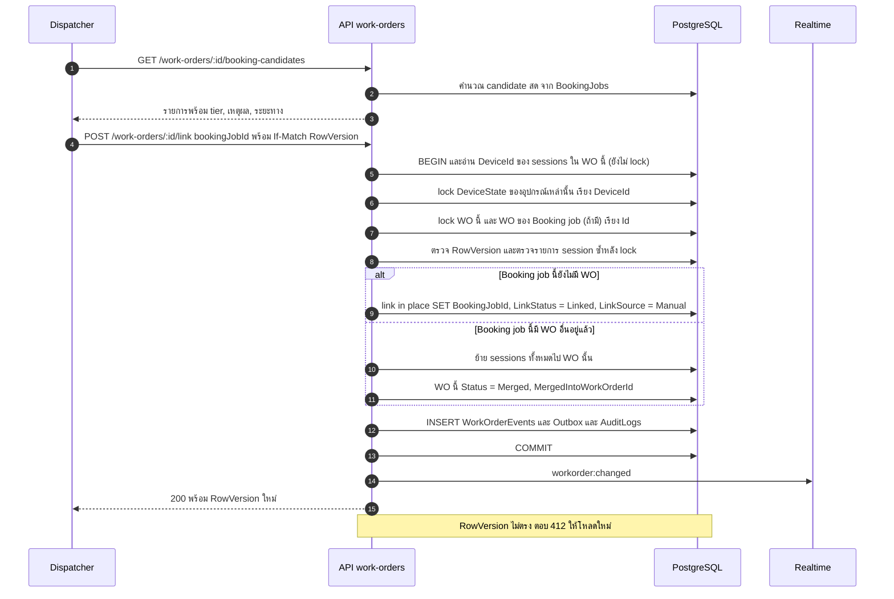

- **Link ทำทั้งใบ** (ทุก session ใน WO) — ถ้าบาง session ไม่เกี่ยวกับงานนั้น ผู้ใช้ย้าย session ออกก่อนด้วย `POST /tracking-sessions/:id/attach` · เพราะ WO ที่ยังไม่มี Booking ถูก idle close หลังว่าง 60 นาที โดยปกติจึงมีแค่ "ช่วงทำงานต่อเนื่องหนึ่งช่วง" ของทีม
- Link ได้ทั้ง WO ที่ Open และ Closed (link ย้อนหลัง) · WO ที่ Closed ที่ merge เข้าใบอื่น ⇒ Closed → Merged
- `LinkSource = Manual` ⇒ matcher **ไม่แตะ** WO นั้นอีก (แม้ Booking เปลี่ยน — จะ flag `NeedsReview` แทน)
- Unlink ด้วยมือ ⇒ `LinkStatus = Unlinked`, `LinkSource = Manual` · WO นี้ **ไม่เป็น "ใบรวมของทีม"** (ไม่นับใน `UQ_WO_OpenUnlinkedPerTeam` และ matcher ไม่เอา session ใหม่มาใส่) — session ใหม่ของทีมไปเข้าใบรวมแบบ Auto ใบอื่น
- **Lock order เดียวทั้งระบบ**: `DeviceState` (DeviceId น้อยไปมาก) → `WorkOrders` (Id น้อยไปมาก) → `TrackingSessions` · retry สูงสุด 3 ครั้งเมื่อ deadlock/serialization error

### 3.3.3 Re-matching

| Trigger | ขอบเขต | กติกา |
|---|---|---|
| Booking job ใหม่/เปลี่ยน (`BookingJobs` upsert ที่ `PayloadHash` เปลี่ยน) | WO ของทีมนั้นในช่วง ±`booking.rematch-horizon-hours` (72) | queue `matching` ด้วย `jobId = team:{id}:{window}` (dedupe) |
| Sync กลับมาสำเร็จหลัง stale | WO ที่ `LinkStatus = Pending` | re-run ทั้งหมด |
| แก้ assignment ย้อนหลัง | session ของอุปกรณ์ในช่วงที่แก้ | re-run |
| Sweep | **session ที่ยังเปิด** ซึ่ง `AwaitingMatch` หรืออยู่ในใบรวมของทีม (Auto) | re-run ทุกรอบ (local, ถูก) |
| แก้ ref ของทีม/พนักงาน หรือเปลี่ยนหัวหน้าทีม | ทีมนั้น ±72 ชม. | job `re-resolve` อัปเดต cache แล้ว enqueue re-match |

ขอบเขตของ re-match:
- **WO ที่เข้าข่าย**: Open ที่ `LinkStatus ∈ {Pending, Suggested, Ambiguous, Unlinked}` และ `LinkSource` ไม่ใช่ Manual · รวม **Closed ที่ระบบปิดเพราะ IdleTimeout** ภายใน horizon (link ย้อนหลังได้) · ไม่รวม WO ที่คนปิด/void
- **ใครเขียนอะไร**: queue `matching` (worker integration) จัดการ **session ที่ปิดแล้ว** และการ link ระดับ WO · **session ที่ยังเปิด** ให้ `SessionSweep` จัดการ (รวมการ split ตาม rule 9) — lifecycle ของ session (เปิด/ปิด/split) มี writer เดียวคือ SessionSweep · ทั้งสองฝั่งถือ lock ตาม lock order เดียวกัน
- WO ที่ link แล้วแบบ Auto **ย้ายไปงานอื่นได้เฉพาะเมื่อ** ยัง Open · ไม่มีคนแตะ · ผลใหม่เป็น HIGH ของงานอื่น — นอกนั้น flag `NeedsReview` อย่างเดียว

### 3.3.4 ใบรวมของทีม (WO ที่ยังไม่มี Booking)

session ที่ match ได้ MEDIUM / AMBIGUOUS / NONE / ProjectionStale ของทีมเดียวกันเข้า **WO เปิดใบเดียวของทีม** (`UQ_WO_OpenUnlinkedPerTeam`, `LinkSource` ไม่ใช่ Manual) — กัน WO ขยะจากกล้องชาร์จ/สัญญาณกระพริบ

| คำถาม | กติกา |
|---|---|
| `LinkStatus` ของใบรวม | ตามผลของ **session ล่าสุดที่ attach**: Pending > Ambiguous > Suggested > Unlinked (ถ้า session ล่าสุดยัง Pending ให้แสดง Pending) · `SuggestedBookingJobId` = คำแนะนำของ session ล่าสุด (ถ้ามี) |
| re-match ได้ HIGH ทุก session ในใบ และเป็นงานเดียวกัน | **link in place** (ใบนี้กลายเป็น WO ของงานนั้น) หรือ merge ถ้างานนั้นมี WO อยู่แล้ว |
| re-match ได้ HIGH แค่บาง session | **ย้ายเฉพาะ session นั้น** ไป WO ของงาน (get-or-create) · ใบรวมที่ไม่เหลือ session ⇒ `Merged` เข้า WO ที่รับ session สุดท้ายไป |
| คนยืนยัน Suggested / เลือก Ambiguous / link ด้วยมือ | link ทั้งใบ (§3.3.2) |
| Unlink ใบที่ link แล้ว ขณะทีมมีใบรวมเปิดอยู่ | ทำได้ — ใบที่ unlink เป็น `LinkSource = Manual` จึงไม่ชน constraint และไม่รับ session ใหม่ |
| Reopen ใบรวมที่ปิดไปแล้ว ขณะทีมมีใบรวมเปิดอยู่ | **409 `TEAM_HAS_OPEN_UNLINKED_WORK_ORDER`** — ให้ link หรือปิดใบที่เปิดอยู่ก่อน |
| session ต่อเนื่องหลังคนปิด WO (`AwaitingMatch`) | attach **เฉพาะเมื่อได้ HIGH** · MEDIUM แสดงเป็นคำแนะนำในหน้า Sessions (แท็บ "ยังไม่ผูกใบงาน") · NONE ค้างเป็น `AwaitingMatch` — **ไม่เข้าใบรวม** (กัน loop) |

---

## 3.4 Tracking Session Lifecycle

### 3.4.1 State diagram

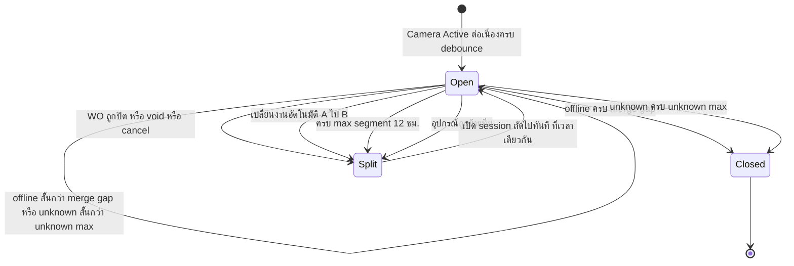

| เหตุการณ์ | EndedAt | EndReason | session ถัดไป |
|---|---|---|---|
| Offline ≥ merge gap (15) | `StateSince` ของ offline | DeviceOffline | — |
| Unknown ≥ 30 นาที | `LastOnlineObservedAt` | StatusUnknown | — |
| WO ถูกปิด/void/cancel ขณะกล้องเปิด | `WorkOrders.ClosedAt` | WorkOrderClosed / WorkOrderVoided | เปิดทันที · `AwaitingMatch` · **ไม่สร้าง WO Unlinked ใหม่** |
| สลับงานอัตโนมัติ A→B | `max(A.PlannedEndAt, B.PlannedStartAt)` | JobSwitched | attach B · WO A `NeedsReview` (AutoSwitched) |
| ครบ `session.max-segment-hours` (12) | เวลาครบ cap | MaxSegment | WO เดิม · `StartInferred = SplitBoundary` |
| ย้ายทีม | เวลาที่ assignment เปลี่ยน | DeviceReassigned | match ใหม่ตามทีมใหม่ |

> max segment 12 ชม. ผูกกับข้อจำกัด playback ≤ 24 ชม. ของ DSS (`PLAYBACK_MAX_RANGE_HOURS` ใน reference) — **ไม่เป็น setting ที่ตั้งเกิน 24 ได้**
> session ถัดไปเริ่ม **ที่เวลาจบของตัวก่อนหน้าพอดี** (ไม่ย้อนไป `StateSince`) — กัน bug "เกิดใหม่พร้อมเวลาเกิน cap" ของ reference

### 3.4.2 Battery swap / พัก / สลับกล้องสำรอง

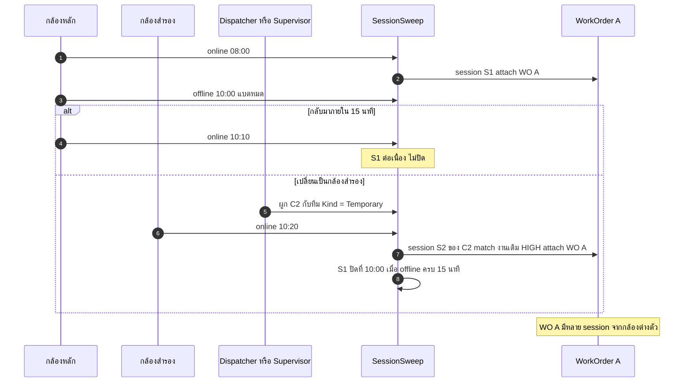

- กล้องสำรองที่ **ยังไม่ผูกทีม** เมื่อ online ⇒ session `NoTeam` + alert "กล้องสำรองถูกเปิดใช้โดยไม่ระบุทีม" + ระบบ **แนะนำ** ทีม (heuristic: ทีมที่กล้องหลัก offline ภายใน 30 นาทีก่อนหน้าและมี WO เปิดอยู่ และมีทีมเดียวที่เข้าเงื่อนไข) — ไม่ผูกอัตโนมัติ
- Temporary assignment ปิดโดย SessionSweep เมื่อกล้องสำรอง offline ≥ merge gap และไม่มี open session · safety cut 04:00 Asia/Bangkok วันถัดไป (ไม่ตัดขณะมี open session — งานข้ามเที่ยงคืนไม่แตกเป็น NoTeam)
- ช่องทางให้หัวหน้าทีมกด "ใช้กล้องสำรอง" ในแอป = **[Open Question]** (เปิด endpoint ไว้แต่ปิดด้วย permission จนกว่าธุรกิจยืนยัน)

### 3.4.3 Decision table ของ `decide()` (ต่ออุปกรณ์ ต่อรอบ)

| # | เงื่อนไข | การกระทำ |
|---|---|---|
| 1 | อุปกรณ์ Retired / Inactive | ปิด open session (ถ้ามี) · ไม่เปิดใหม่ |
| 2 | ไม่มี open session · effective = ONLINE · `now − StateSince ≥ debounce` | เปิด session `StartedAt = max(StateSince, lastSession.EndedAt)` แล้ว attach |
| 3 | ไม่มี open session · อื่น ๆ | ไม่ทำอะไร |
| 4 | มี open session · effective = OFFLINE · `now − StateSince ≥ merge gap` | ปิด `EndedAt = StateSince` |
| 5 | มี open session · effective = UNKNOWN · `now − LastObservedAt ≥ unknown max` | ปิด `EndedAt = LastOnlineObservedAt` |
| 6 | มี open session · WO ของ session ไม่ Open แล้ว | split ที่ `ClosedAt` · successor `AwaitingMatch` |
| 7 | มี open session · `now − StartedAt ≥ max segment` | split · successor WO เดิม |
| 8 | มี open session · assignment ณ now ≠ `session.TeamId` | split · successor match ใหม่ |
| 9 | มี open session `AwaitingMatch` / ในใบรวมของทีม (Auto) · match ได้ HIGH | ถ้า session เริ่มก่อน `PlannedStartAt − window-before`: split ที่จุดนั้น (`StartInferred = PlannedBoundary`) ส่วนแรกคงอยู่ที่เดิม successor attach WO ของงาน · ไม่งั้นย้ายทั้ง session ไป WO ของงาน · ใบรวมที่ว่างลง ⇒ Merged (§3.3.4) |
| 10 | มี open session ใน WO A (Linked) · `now ≥ A.PlannedEndAt` และงาน B ของทีมเดียวกันเป็น HIGH · `matching.auto-switch-enabled` | split ที่ `max(A.PlannedEndAt, B.PlannedStartAt)` |
| 11 | อื่น ๆ | hold |

และใน sweep เดียวกัน (pass ระดับ WO):

| เงื่อนไข WO (Open) | การกระทำ |
|---|---|
| Linked · ไม่มี open session · `now − max(LastActivityAt, PlannedEndAt) ≥ workorder.idle-close-hours` (6) | Closed (IdleTimeout) + `NeedsReview` ถ้า Booking ยังไม่ Completed |
| ยังไม่มี Booking · ไม่มี open session · `now − LastActivityAt ≥ workorder.unlinked-idle-close-minutes` (60) · **`LinkStatus` ไม่ใช่ Pending** | Closed (IdleTimeout) — ยังคง link ย้อนหลังได้ (re-match ครอบ Closed-IdleTimeout ภายใน horizon) |
| `LinkStatus = Pending` (projection เก่า) | **ไม่ idle close** จนกว่า sync กลับมาและ re-match เสร็จ · ยังอยู่ใต้ max-open cap |
| Temporary assignment ที่ active · กล้อง offline ≥ merge gap และไม่มี open session | ปิด assignment (`ValidTo` = เวลา offline) · safety cut 04:00 Asia/Bangkok ของวันถัดไปเฉพาะเมื่อไม่มี open session |
| เปิดนานเกิน `workorder.max-open-hours` (36) | Closed (MaxOpenDuration) + `NeedsReview` + split open session |

---

## 3.5 Manual Close (หัวหน้าทีม / Admin) และการกัน Loop

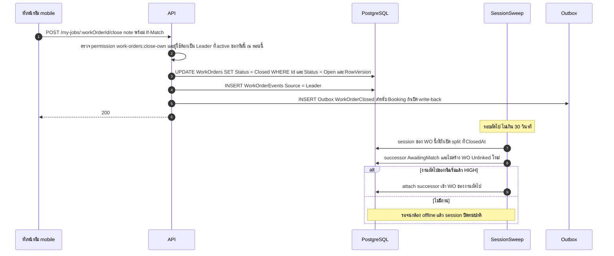

- **Session engine เป็น writer เดียวของ lifecycle session** — API เปลี่ยนแค่ WO แล้ว sweep ทำ split ให้ (เวลาจบ = `ClosedAt` ⇒ deterministic)
- **ผู้ปิดได้ตามที่ผู้ใช้ยืนยัน = หัวหน้าทีม + Admin**: หัวหน้าทีมปิดได้เฉพาะ WO ของทีมที่ตัวเองเป็น **Leader active ณ เวลาที่กด** (ตรวจสดจาก `TeamMembers` — หัวหน้าเดิมที่ถูกเปลี่ยนแล้วปิดไม่ได้แม้ยังมี role `TEAM_LEADER`) · Admin ปิดได้ทุกใบ · Supervisor/Dispatcher **ไม่มีสิทธิ์ปิดเป็นค่าเริ่มต้น** (เพิ่มได้ผ่าน role-permission matrix — Open Question Q17)
- **Reopen** (Closed → Open) โดยคน: Admin/Supervisor ภายใน `workorder.reopen-within-hours` (72) · โดยระบบ: เฉพาะ WO ที่ปิดเพราะ IdleTimeout เมื่อ session ใหม่ได้ HIGH (Rule 1)
- **Void** (Admin/Supervisor): WO ที่ไม่ใช่งานจริง (ทดสอบ/ชาร์จ) · session **ยัง attach อยู่กับ WO ที่ void** (เก็บเป็นหลักฐานว่าเกิดอะไรขึ้น) และบันทึก `Classification` ตามเหตุผล · open session ถูก split (EndReason WorkOrderVoided) · `MatchState = Classified` ใช้เฉพาะ session ที่ไม่มี WO

---

## 3.6 Booking API Failure / Recovery

- **Booking ล่มไม่กระทบ tracking**: real-time path และ session engine ไม่เรียก Booking (กติกา dependency ใน Part 2)
- write-back ไป Booking (ถ้ามี) ค้างใน `IntegrationOutbox` แล้วส่งตามลำดับเมื่อกลับมา (idempotency key เดิม ⇒ ส่งซ้ำปลอดภัย)
- ข้อความที่ fail เกิน 5 ครั้ง ⇒ `Dead` แสดงในหน้า Integration ให้ admin กด retry

---

## 3.7 Booking job ถูกยกเลิก / เสร็จ / เปลี่ยนแปลงหลังปิด

| เหตุการณ์จาก Booking | WO ยังไม่มี | WO Open | WO Closed แล้ว |
|---|---|---|---|
| Cancelled | ไม่ทำอะไร | WO → `Cancelled` · split open session · `NeedsReview` ถ้ามี recording (alert `WORK_ORDER_CANCELLED_WITH_EVIDENCE`) | `NeedsReview` |
| Completed | ไม่ทำอะไร | ถ้า `workorder.close-on-booking-completed` = true **[ต้องยืนยัน]** → `Closed (BookingCompleted)` เวลา = `BookingCompletedAt` ถ้ามี | ไม่ทำอะไร |
| เปลี่ยนทีม / เวลา | re-match ทีมเก่าและใหม่ | Auto + ไม่มีคนแตะ ⇒ re-match · ไม่งั้น `NeedsReview` · **`WorkOrders.TeamId`/`DepartmentId` ไม่เปลี่ยนตาม Booking** (บันทึกทีมที่ใช้กล้องจริง) | `NeedsReview` (alert `BOOKING_JOB_CHANGED_AFTER_CLOSE`) |
| หายจาก full sync | `SourceMissingSince` | `NeedsReview` | `NeedsReview` |

---

## 3.8 State Diagrams ของ Work Order

### Status

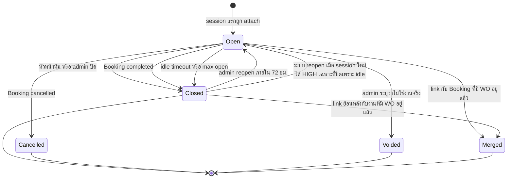

### LinkStatus (มิติแยกจาก Status)

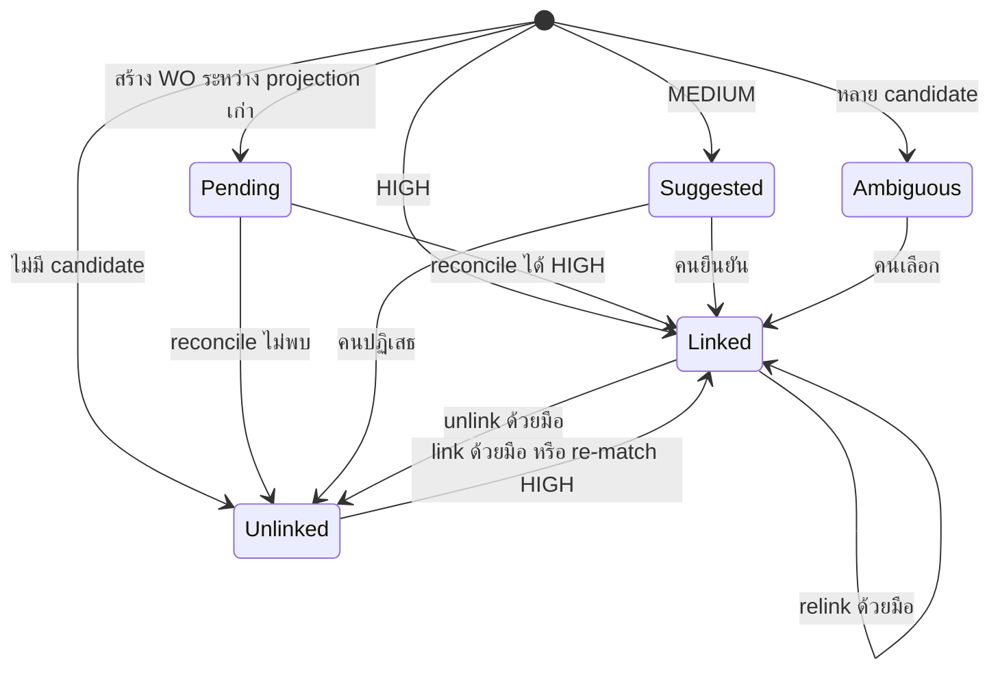

---

## 3.9 Mobile: my-jobs ของหัวหน้าทีม

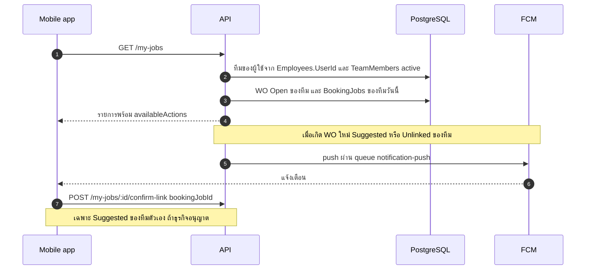

- **Check-in/check-out หน้างาน ยังไม่อยู่ในขอบเขต** (รอทีม Booking) — โครงสร้างรองรับไว้: เพิ่ม `WorkOrderEvents.EventType` ใหม่ + เป็นสัญญาณ HIGH ใน matcher ได้โดยไม่เปลี่ยน schema หลัก

---

## 3.10 Matching rules ที่ต้องได้รับการยืนยัน (สรุปไป Part 9)

1. Booking มอบงานให้ "ทีม" หรือ "หัวหน้าทีม/คนขับ" หรือ "รถ" — กำหนดว่าจะ map ผ่าน `Teams.BookingTeamRef` หรือ `Employees.BookingEmployeeRef`
2. ช่วงเวลา tolerance ก่อน/หลังงาน (60 นาที) และช่วงขยาย (3 ชม.)
3. Booking `Completed` ปิด WO อัตโนมัติหรือไม่
4. สลับงานอัตโนมัติ A→B เมื่อกล้องเปิดค้างยอมรับได้หรือไม่
5. หัวหน้าทีมยืนยัน Suggested เองได้หรือต้องเป็น Dispatcher

---

## 3.11 Settings ที่ใช้ใน workflow (category `session`, `matching`, `workorder`, `booking`)

| Key | Default | Bounds | ใช้ที่ |
|---|---|---|---|
| `status.poll-interval-seconds` | 30 | 10–300 | StatusPoll |
| `status.unknown-after-seconds` | 120 | ≥ 2 × poll | คำนวณ UNKNOWN |
| `gps.poll-interval-seconds` | 15 | 5–300 | GpsPoll (เดิม) |
| `camera.activation-debounce-minutes` | 5 | 1–60 | เปิด session |
| `session.merge-gap-minutes` | 15 | 0–240 | ปิด session เมื่อ offline |
| `session.unknown-max-minutes` | 30 | 5–240 | ปิด session เมื่อ unknown |
| `session.max-segment-hours` | 12 | 1–24 (**ผูกกับ playback 24 ชม.**) | split |
| `matching.window-before-minutes` / `after` | 60 / 60 | 0–240 | candidate window |
| `matching.extended-window-minutes` | 180 | ≥ window | MEDIUM |
| `matching.auto-switch-enabled` | true | bool | A→B |
| `workorder.create-when-unmatched` | true | bool | สร้าง WO Unlinked |
| `workorder.idle-close-hours` | 6 | 1–48 | ปิด WO linked |
| `workorder.unlinked-idle-close-minutes` | 60 | 15–1440 | ปิด WO unlinked |
| `workorder.max-open-hours` | 36 | 12–168 | safety cap |
| `workorder.reopen-within-hours` | 72 | 0–720 | reopen |
| `workorder.close-on-booking-completed` | true | bool | **[ต้องยืนยัน]** |
| `booking.sync-interval-seconds` | 120 | 30–3600 | incremental |
| `booking.stale-after-minutes` | 15 | 5–240 | banner / Pending |
| `booking.rematch-horizon-hours` | 72 | 1–336 | re-match |
| `alert.offline-during-job-minutes` | 10 | 1–120 | alert 5 |

เพิ่ม key = แก้ `SETTING_DEFAULTS` + `SETTING_BOUNDS` (`setting-spec.ts`) + data migration (กติกาเดิมของ reference — ไม่พึ่ง seed)
