# Part 3 — Business Workflows

> ชื่อตาราง/enum ตาม [04-database-design.md](04-database-design.md) · ค่าตัวเลขในวงเล็บคือ default ของ Settings (ดู §3.11)
> กติกาในส่วนนี้ปรับตามคำตอบของผู้ใช้ 2026-11-04 (Part 9 §9.5) — **อาจเปลี่ยนตามข้อมูลจากทีม Booking**

---

## 3.0 แยกความหมายของสถานะ (ห้ามปนกัน)

| คำ | ความหมาย | แหล่งข้อมูล | ใช้ตัดสินอะไร |
|---|---|---|---|
| **Device Online** | กล้องต่อ platform อยู่ (`DeviceState.PlatformState = 1` และข้อมูลไม่เก่าเกิน `status.unknown-after-seconds`) | DSS device list · DSS `/location` online flag · BRMS MQ · webhook | แสดงสถานะบนแผนที่/รายการ |
| **Device Unknown** | ไม่มี observation ใหม่นานเกินกำหนด (คำนวณ ไม่ได้เก็บ) | อายุของ `LastObservedAt` | **hold** — ไม่เปิดและไม่ปิด session จนกว่าจะเกิน `session.unknown-max-minutes` |
| **GPS Active** | มี fix ที่ valid อายุ ≤ 2 นาที | GpsPoll / webhook | แสดงตำแหน่ง · ตรวจว่าอยู่ฐาน (ถ้ามี fix) · ไม่ใช้เป็น trigger |
| **At Base** | fix ล่าสุดอยู่ในรัศมีฐาน/จุดชาร์จ (`Depots` — รองรับหลายจุด) | `DeviceState.LastLat/LastLng` · vendor **ไม่มี** charging state (Q21) | **ไม่เปิดใบงาน** (Q15) |
| **Camera Active (เริ่มใช้งาน)** | Online ต่อเนื่อง ≥ `camera.activation-debounce-minutes` (**15**) และไม่ได้อยู่ฐาน | คำนวณจาก `StateSince` | **trigger เปิด Tracking Session ที่นับเป็นงาน** |
| **Recording Started** | มีไฟล์บันทึกในช่วงเวลานั้นจริง | DSS recording search (หลังเกิดเหตุเท่านั้น) → `RecordingSegments` | แสดงหลักฐาน · auto-void ใบงานขยะ · **ไม่ใช้เป็น trigger และไม่สมมติว่าเปิดกล้อง = อัด** |
| **Tracking Session** | ระเบียน `TrackingSessions` = ช่วงที่กล้อง 1 ตัวเปิดต่อเนื่องและสังกัด WO เดียวกัน | Session engine | หน่วยของ "การใช้งานกล้อง" |
| **Booking Check-in / Check-out** | หัวหน้าทีม (หรือแอดมิน) กดเริ่ม/จบงาน **ในระบบ Booking** | Booking sync **[Assumption ด้านรูปแบบข้อมูล]** | **กำหนดสถานะใบงาน** — check-out = ปิดใบงาน (ผู้ใช้ยืนยัน) |
| **Work Order** | ระเบียนธุรกิจใน `WorkOrders` (PK ของตัวเอง) | Matcher | ผูก Booking (0..1) · รวมหลาย session · **สถานะตาม Booking ไม่ใช่คนในระบบเรากดปิด** |

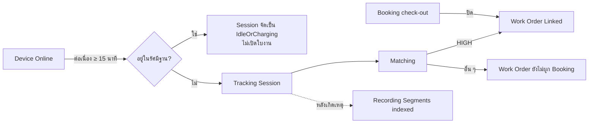

---

## 3.1 Bodycam Activation

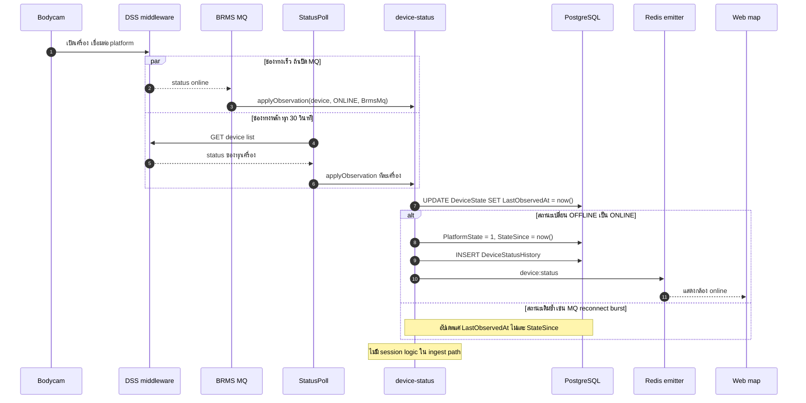

กติกา:
- `applyObservation` เป็น `UPDATE` เดียว ใช้ `IS DISTINCT FROM` ตรวจ transition · เวลาใช้ DB `now()`
- **ไม่ล้างสถานะเป็น null** เมื่อ MQ หลุด/worker restart (ต่างจาก `clearPlatformStatuses()` ของ reference) — ความเก่าของข้อมูลถูกตีความเป็น UNKNOWN เอง
- GPS fix ที่สดถือเป็น ONLINE observation ด้วย (source = DssLocation) · fix ที่ valid ใช้คำนวณ `DeviceState.IsAtDepot`
- **หลาย source ขัดกัน — ใช้ลำดับความน่าเชื่อถือ ไม่ใช่ last-write-wins**: BRMS MQ (เมื่อเชื่อมต่ออยู่) > DSS device list > DSS `/location` online flag / GPS fix > webhook · observation จาก source ที่ลำดับต่ำกว่า **เปลี่ยน state ไม่ได้** ถ้า source ที่ตั้ง state ปัจจุบัน (`DeviceState.StateSource`) ยังสดอยู่ (`StateSourceObservedAt` ไม่เก่ากว่า `status.unknown-after-seconds`) — แค่ bump `LastObservedAt`

---

## 3.2 Automatic Work Order Creation

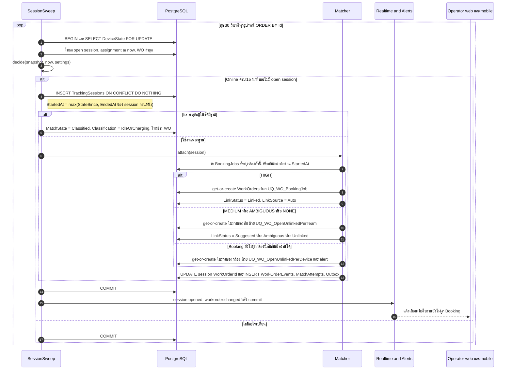

ข้อกำหนดที่ flow นี้ตอบ:
- **ไม่สร้าง WO ซ้ำจาก event เดิม**: session เปิดได้ตัวเดียวต่ออุปกรณ์ (`UQ_TS_OpenPerDevice` + `EX_TS_NoOverlap`) · WO ต่อ Booking ได้ใบเดียว (`UQ_WO_BookingJob`) · ใบรวมเปิดได้ใบเดียวต่อทีม (`UQ_WO_OpenUnlinkedPerTeam`) หรือต่อกล้องที่ยังไม่มีทีม (`UQ_WO_OpenUnlinkedPerDevice`) · sweep ซ้ำ/worker 2 ตัว/observation ซ้ำ → ผลเหมือนเดิม
- **เปิดกล้องแต่ไม่พบ Booking**: สร้าง WO ที่ยังไม่ผูก Booking ไว้ก่อน **[Confirmed — Q11]** แล้วจับคู่ภายหลังได้
- **กล้องชาร์จที่ฐานไม่เปิดใบงาน [Confirmed — Q15]** · vendor ไม่ส่งสถานะชาร์จ **[Confirmed — Q21]** จึงตรวจ 2 ชั้น:
  1. ตอนเปิด session: fix ล่าสุดที่ valid อายุ ≤ `depot.fix-max-age-minutes` (30) อยู่ในรัศมีของ `Depots` (หลายจุด — พิกัด mock ไว้ก่อน, Q22)
  2. หลังเกิดเหตุ: ใบรวมที่ปิดเพราะไม่มีข้อมูล Booking และ **ทุก session ไม่มี recording เลย** ⇒ ระบบ Void อัตโนมัติ (`Classification = IdleOrCharging`) ถ้า `workorder.auto-void-without-recording = true` — ครอบกรณีกล้องในอาคารที่ไม่มี GPS
- **เลขใบงาน** `WO-YYYYMM-NNNNN` จาก `WorkOrderCounters` (atomic)
- **Title**: link แล้วใช้ชื่องานจาก Booking · ไม่ link = `ใบงานอัตโนมัติ {TeamCode} {DeviceCode}`

---

## 3.3 Booking Work Order Matching

### 3.3.1 Algorithm (`matchAt(session)`) — pure function, versioned (`AlgoVersion`)

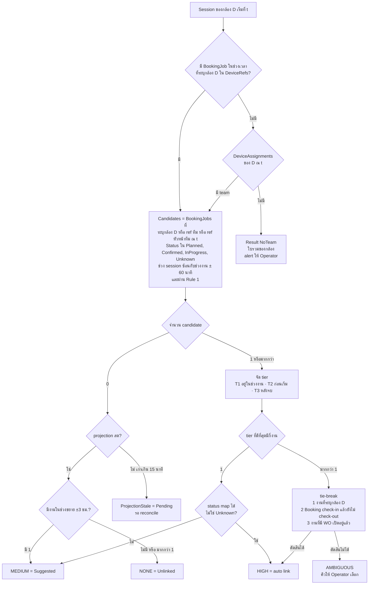

| ผล | การกระทำ | LinkStatus ของ WO |
|---|---|---|
| HIGH | get-or-create WO ของ Booking job แล้ว attach session | Linked (Auto) |
| MEDIUM | attach เข้าใบรวมของทีม + เก็บคำแนะนำ · คิว review ของ Operator | Suggested |
| AMBIGUOUS | เหมือน MEDIUM แต่ไม่มี candidate ที่แนะนำ (แสดงทุกตัว) | Ambiguous |
| NONE | attach เข้าใบรวมของทีม | Unlinked |
| ProjectionStale | attach เข้าใบรวมของทีม · re-match อัตโนมัติเมื่อ sync สำเร็จ | Pending |
| NoTeam | attach เข้า **ใบรวมของกล้อง** (`TeamId` ว่าง — ยังสร้างใบงานไว้ก่อนตาม Q11) · alert `CAMERA_ACTIVE_NO_TEAM` | Unlinked |

นิยามที่ใช้ในการ match:
- **ลำดับแหล่งที่บอกว่ากล้องไปงานไหน**:
  1. **`BookingJobs.DeviceRefs`** — Booking ระบุกล้องที่ใช้กับงาน (รวมกล้องสำรอง) **[Confirmed — Q4, Q20: การผูกกล้องมาจากฝั่ง Booking เท่านั้น · รูปแบบข้อมูลเป็น Assumption]** — match ด้วย `Devices.DeviceCode` / `VendorDeviceId` / `SerialNo` · ไม่ต้องมีทีมก็ match ได้
  2. **ทีม** จาก `DeviceAssignments` ณ `StartedAt` (**sync มาจาก Booking เท่านั้น** ถ้า Booking มีข้อมูลกล้องประจำทีม) แล้วเทียบ `BookingJobs.BookingTeamRef` กับ `Teams.BookingTeamRef` หรือ `BookingJobs.BookingLeaderRef` กับ `Employees.BookingEmployeeRef` ของหัวหน้าทีม — ทั้งสองแบบ HIGH ได้
  - session ที่ไม่มีทั้งข้อ 1 และ 2 = `NoTeam` เข้าใบรวมของกล้อง และ re-match เมื่อ Booking ส่งข้อมูลมา · **ระบบเราไม่มีหน้าจอผูกกล้องกับทีมเอง**
- `BookingJobs.TeamId` / `LeaderEmployeeId` เป็น **cache สำหรับแสดงผล** · เมื่อแก้ ref ของทีม/พนักงาน/กล้อง ⇒ job `re-resolve` อัปเดต cache + enqueue re-match
- **ช่วงเวลางาน** = `[min(PlannedStartAt, BookingCheckInAt), BookingCheckOutAt ?? (check-in แล้ว ⇒ ไม่มีขอบบน) ?? PlannedEndAt]` · candidate = ช่วง session `[StartedAt, EndedAt หรือ now]` **ซ้อน** กับช่วงงาน ± `matching.window-before/after-minutes` (60) · tier คิดจาก `StartedAt` · งานที่ไม่มีเวลาใช้ทั้งวัน `ScheduledDate` (Asia/Bangkok) และ confidence สูงสุด MEDIUM
- **งานที่ check-in แล้วแต่ยังไม่ check-out = ยังเป็นใบเดิม** — กล้องแบตหมด เอาไปชาร์จแล้วเปิดใหม่หลายชั่วโมง session ใหม่ก็ยังเข้า WO เดิม **[Confirmed — Q3]**
- ระยะห่าง GPS กับ `BookingJobs.SiteLat/SiteLng` เป็นแค่ข้อมูลประกอบใน candidate list (กล้องส่วนใหญ่ไม่มี fix)
- **Rule 1 (กัน loop)**: Booking job ที่ WO ถูก **check-out แล้ว** ไม่เป็น auto candidate จนกว่า Booking จะ **check-in ใหม่** (ระบบ reopen ให้) · Cancelled / Voided ไม่เป็น candidate อีก · WO ที่ปิดเพราะ `SafetyTimeout` ยังเป็น candidate (session ใหม่ได้ HIGH ⇒ reopen + `NeedsReview`)
- `MatchAttempts` เขียนเฉพาะเมื่อ `InputHash` เปลี่ยน · คำแนะนำ MEDIUM ของ session ล่าสุดเก็บที่ `WorkOrders.SuggestedBookingJobId`

### 3.3.2 Manual link โดย Operator ชนะ auto เสมอ

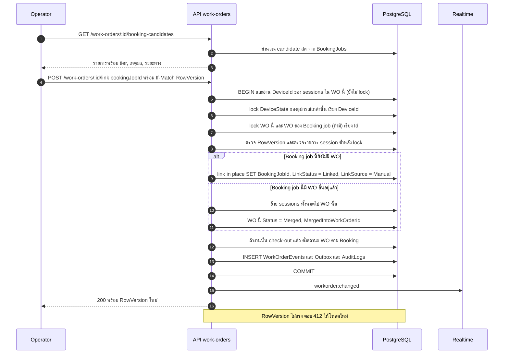

- การ link/unlink เป็น**การจับคู่หลักฐานกับงาน** ไม่ใช่การยืนยันสถานะงาน — สถานะยังตาม Booking check-in/check-out **[Confirmed — Q8: ไม่มีการยืนยันสถานะเองในระบบนี้]**
- **Link ทำทั้งใบ** — ถ้าบาง session ไม่เกี่ยวกับงานนั้น ย้ายออกก่อนด้วย `POST /tracking-sessions/:id/attach`
- Link ได้ทั้ง WO ที่ Open และ Closed (link ย้อนหลัง) · WO ที่ merge เข้าใบอื่น ⇒ Merged
- `LinkSource = Manual` ⇒ matcher **ไม่แตะ** WO นั้นอีก (Booking เปลี่ยน ⇒ flag `NeedsReview`)
- Unlink ด้วยมือ ⇒ `LinkStatus = Unlinked`, `LinkSource = Manual` · ไม่นับเป็นใบรวมของทีม (ไม่ชน `UQ_WO_OpenUnlinkedPerTeam` และไม่รับ session ใหม่)
- **Lock order เดียวทั้งระบบ**: `DeviceState` (DeviceId น้อยไปมาก) → `WorkOrders` (Id น้อยไปมาก) → `TrackingSessions` · retry สูงสุด 3 ครั้งเมื่อ deadlock

### 3.3.3 Re-matching

| Trigger | ขอบเขต | กติกา |
|---|---|---|
| Booking job ใหม่/เปลี่ยน (`PayloadHash` เปลี่ยน รวม check-in/check-out/DeviceRefs) | WO ของทีมและกล้องที่เกี่ยวข้อง ±`booking.rematch-horizon-hours` (72) | queue `matching` ด้วย `jobId = team:{id}:{window}` (dedupe) |
| Sync กลับมาสำเร็จหลัง stale | WO ที่ `LinkStatus = Pending` | re-run ทั้งหมด |
| แก้ assignment / ref ย้อนหลัง | session ในช่วงที่แก้ | job `re-resolve` แล้ว re-run |
| Sweep | **session ที่ยังเปิด** ซึ่ง `AwaitingMatch` หรืออยู่ในใบรวมของทีม (Auto) | re-run ทุกรอบ (local, ถูก) |

- **WO ที่เข้าข่าย**: Open ที่ `LinkStatus ∈ {Pending, Suggested, Ambiguous, Unlinked}` และ `LinkSource` ไม่ใช่ Manual · รวมใบรวมที่ **ปิดเพราะไม่มีข้อมูล Booking (NoBookingData)** ภายใน horizon (link ย้อนหลังได้)
- **ใครเขียนอะไร**: queue `matching` จัดการ session ที่ปิดแล้ว + การ link ระดับ WO · **session ที่ยังเปิด** ให้ `SessionSweep` (writer เดียวของ lifecycle session) · ทั้งสองฝั่งใช้ lock order เดียวกัน
- WO ที่ link แบบ Auto ย้ายไปงานอื่นได้เฉพาะเมื่อยัง Open · ไม่มีคนแตะ · ผลใหม่ HIGH ของงานอื่น — นอกนั้น `NeedsReview`

### 3.3.4 ใบรวมของทีม (WO ที่ยังไม่ผูก Booking)

session ที่ได้ MEDIUM / AMBIGUOUS / NONE / ProjectionStale / NoTeam เข้า **WO เปิดใบเดียว** ต่อทีม (`UQ_WO_OpenUnlinkedPerTeam`) หรือต่อกล้องเมื่อยังไม่รู้ทีม (`UQ_WO_OpenUnlinkedPerDevice`) · `LinkSource` ไม่ใช่ Manual

| คำถาม | กติกา |
|---|---|
| `LinkStatus` ของใบรวม | ตาม session ล่าสุดที่ attach: Pending > Ambiguous > Suggested > Unlinked · `SuggestedBookingJobId` = คำแนะนำของ session ล่าสุด |
| re-match ได้ HIGH ทุก session ในใบ เป็นงานเดียวกัน | **link in place** หรือ merge ถ้างานนั้นมี WO อยู่แล้ว |
| re-match ได้ HIGH แค่บาง session | ย้ายเฉพาะ session นั้นไป WO ของงาน · ใบรวมที่ไม่เหลือ session ⇒ Merged |
| Operator เลือก/ยืนยัน/link ด้วยมือ | link ทั้งใบ (§3.3.2) |
| ปิดเมื่อไร | ระบบ poll Booking ต่อเนื่อง · **ถ้ายังไม่มีข้อมูล Booking ที่ตรงกันภายใน `workorder.unlinked-close-after-minutes` (240) นับจาก `OpenedAt` ⇒ ปิด** (`CloseReason = NoBookingData`) **[Confirmed — Q23]** · ปิดแล้วยัง link ย้อนหลังได้ (re-match ครอบใบที่ปิดแบบนี้ภายใน horizon) และเข้าคิวตรวจสอบ (`NeedsReview`) |
| session ต่อเนื่องหลัง WO ถูก check-out ขณะกล้องยังเปิด (`AwaitingMatch`) | attach **เฉพาะเมื่อได้ HIGH** (เช่นงานถัดไป) · NONE ค้างเป็น `AwaitingMatch` — **ไม่เข้าใบรวม** (กัน loop) |

---

## 3.4 Tracking Session Lifecycle

### 3.4.1 State diagram

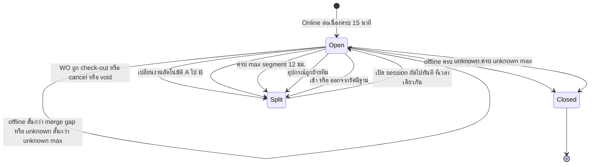

| เหตุการณ์ | EndedAt | EndReason | session ถัดไป |
|---|---|---|---|
| Offline ≥ merge gap (15) | `StateSince` ของ offline | DeviceOffline | — (ถ้ากล้องเปิดใหม่ภายหลังและงานยังไม่ check-out ⇒ session ใหม่เข้า WO เดิม) |
| ใบรวมถูกปิดเพราะไม่มีข้อมูล Booking ครบ 240 นาที ขณะกล้องยังเปิด | เวลาที่ปิด | WorkOrderClosed | `AwaitingMatch` · ไม่สร้างใบรวมใหม่จนกว่ากล้องปิด-เปิดใหม่ · attach เมื่อ Booking ส่งข้อมูลที่ HIGH |
| Unknown ≥ 30 นาที | `LastOnlineObservedAt` | StatusUnknown | — |
| Booking check-out / cancel / admin void ขณะกล้องเปิด | `BookingCheckOutAt` / เวลาที่ cancel / void | WorkOrderClosed / WorkOrderVoided | เปิดทันที · `AwaitingMatch` · **ไม่สร้างใบรวมใหม่** |
| สลับงานอัตโนมัติ A→B (A ยังไม่ check-out) | `max(A.PlannedEndAt, B.BookingCheckInAt ?? B.PlannedStartAt)` | JobSwitched | attach B · WO A `NeedsReview` (AutoSwitched) **[Confirmed — Q5]** |
| ครบ `session.max-segment-hours` (12) | เวลาครบ cap | MaxSegment | WO เดิม · `StartInferred = SplitBoundary` |
| ย้ายทีม | เวลาที่ assignment เปลี่ยน | DeviceReassigned | match ใหม่ |
| เข้าฐาน (หรือออกจากฐาน) | เวลาที่ตรวจพบ | AtBaseChanged | ฝั่งฐาน = Classified IdleOrCharging · ฝั่งนอกฐาน = match ปกติ |

> max segment 12 ชม. ผูกกับข้อจำกัด playback ≤ 24 ชม. ของ DSS — **ไม่เป็น setting ที่ตั้งเกิน 24 ได้**
> session ถัดไปเริ่ม **ที่เวลาจบของตัวก่อนหน้าพอดี** — กัน bug "เกิดใหม่พร้อมเวลาเกิน cap" ของ reference

### 3.4.2 แบตหมด / พัก / กล้องสำรอง

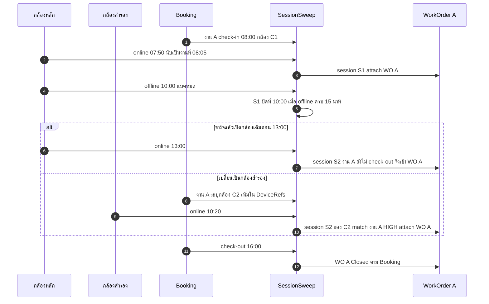

- กล้องสำรองต้อง **ระบุจากฝั่ง Booking เท่านั้น** (`DeviceRefs` ในใบงาน) **[Confirmed — Q4, Q20]** — ระบบเราไม่มีการผูกกล้องเอง
- ถ้า Booking ยังไม่ระบุ: session ของกล้องสำรอง = `NoTeam` เข้าใบรวมของกล้อง + alert `CAMERA_ACTIVE_NO_TEAM` · เมื่อ Booking เพิ่มกล้องในใบงาน ⇒ re-match HIGH ย้ายเข้า WO ของงานอัตโนมัติ · Operator ใช้ `POST /tracking-sessions/:id/attach` ได้ในคิวตรวจสอบ (เป็นการจับคู่หลักฐาน ไม่ใช่การผูกกล้อง)

### 3.4.3 Decision table ของ `decide()` (ต่ออุปกรณ์ ต่อรอบ)

| # | เงื่อนไข | การกระทำ |
|---|---|---|
| 1 | อุปกรณ์ Retired / Inactive | ปิด open session (ถ้ามี) · ไม่เปิดใหม่ |
| 2 | ไม่มี open session · effective = ONLINE · `now − StateSince ≥ debounce (15)` | เปิด session `StartedAt = max(StateSince, lastSession.EndedAt)` · อยู่ในรัศมีฐาน ⇒ Classified IdleOrCharging · ไม่งั้น attach |
| 3 | ไม่มี open session · อื่น ๆ | ไม่ทำอะไร |
| 4 | มี open session · effective = OFFLINE · `now − StateSince ≥ merge gap` | ปิด `EndedAt = StateSince` |
| 5 | มี open session · effective = UNKNOWN · `now − LastObservedAt ≥ unknown max` | ปิด `EndedAt = LastOnlineObservedAt` |
| 6 | มี open session · WO ของ session ไม่ Open แล้ว (check-out / cancel / void) | split ที่เวลานั้น · successor `AwaitingMatch` |
| 7 | มี open session · `now − StartedAt ≥ max segment` | split · successor WO เดิม |
| 8 | มี open session · assignment ณ now ≠ `session.TeamId` | split · successor match ใหม่ |
| 9 | มี open session · สถานะอยู่ในรัศมีฐานเปลี่ยน | split (`AtBaseChanged`) |
| 10 | มี open session `AwaitingMatch` / ในใบรวมของทีม (Auto) · match ได้ HIGH | ถ้า session เริ่มก่อนช่วงงาน − window-before: split ที่จุดนั้น (`StartInferred = PlannedBoundary`) แล้ว attach successor · ไม่งั้นย้ายทั้ง session · ใบรวมที่ว่างลง ⇒ Merged |
| 11 | มี open session ใน WO A (Linked, ยังไม่ check-out) · `now ≥ A.PlannedEndAt` และงาน B ของทีม/กล้องเดียวกันเป็น HIGH · `matching.auto-switch-enabled` | split ที่ `max(A.PlannedEndAt, B.BookingCheckInAt ?? B.PlannedStartAt)` |
| 12 | อื่น ๆ | hold |

pass ระดับ WO ใน sweep เดียวกัน:

| เงื่อนไข WO (Open) | การกระทำ |
|---|---|
| Linked · Booking check-out แล้ว | Closed (`BookingCheckout`) เวลา = `BookingCheckOutAt` — **ทางปิดหลักของใบงานที่ผูก Booking** **[Confirmed — Q1, Q2]** |
| Linked · ยังไม่ check-out · `now − OpenedAt ≥ workorder.stale-open-hours` (**36**) | **ไม่ปิด** · `NeedsReview` + alert `WORK_ORDER_NO_CHECKOUT` **[Confirmed — Q23]** |
| Linked · ยังไม่ check-out · `now − OpenedAt ≥ workorder.force-close-after-hours` (168 = 7 วัน) | Closed (`SafetyTimeout`) + `NeedsReview` — กันใบงานค้างตลอดไป **[Confirmed — Q23]** |
| ใบรวม (ไม่ผูก Booking) · `now − OpenedAt ≥ workorder.unlinked-close-after-minutes` (240) โดยยังไม่มีข้อมูล Booking ที่ตรงกัน | Closed (`NoBookingData`) + `NeedsReview` (ReviewReason NoBookingData) แล้วตรวจ auto-void (ทุก session ไม่มี recording ⇒ Voided IdleOrCharging, ล้าง review) |
| อยู่ในคิวตรวจสอบนานเกิน `review.sla-hours` (**36**) นับจาก `ReviewSince` | alert `REVIEW_QUEUE_OVERDUE` ถึง Operator + Admin (ครั้งเดียวต่อใบ) **[Confirmed — Q7]** |

---

## 3.5 สถานะใบงานตาม Booking Check-in / Check-out

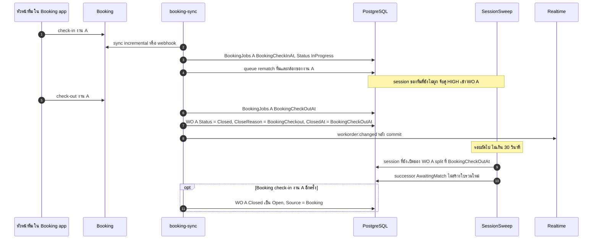

- **ในระบบเราไม่มีปุ่มปิดใบงาน** — สถานะใบงานที่ผูก Booking ตาม check-in/check-out ของ Booking เท่านั้น **[Confirmed — Q2]** · หัวหน้าทีม/แอดมินทำ check-out ฝั่ง Booking (สอดคล้องกับคำตอบเดิมว่า "ปิดได้ทั้งหัวหน้าทีมและแอดมินระบบ" — DL13)
- **Reopen = เปลี่ยนสถานะจาก Closed กลับเป็น Open** ไม่ใช่การเปิดดู · **การเปิดดูใบงานและหลักฐานทำได้ตลอด** ตราบที่ข้อมูลยังอยู่ใน retention (3 เดือน) **[Confirmed — Q9]** · ระบบ reopen เองเฉพาะเมื่อ Booking check-in ใหม่ หรือใบที่ปิดด้วย SafetyTimeout มี session HIGH ใหม่ · ไม่มีปุ่ม reopen ให้คน
- **Void** (`ADMIN` เท่านั้น): ใบงานที่ไม่ใช่งานจริง (ทดสอบ/ชาร์จ) — ระบบ void ให้เองเมื่อใบรวมไม่มี recording — ใช้ได้กับใบที่ยังไม่ผูก Booking (ใบที่ผูก Booking ให้ยกเลิกฝั่ง Booking) · session ยัง attach อยู่และบันทึก `Classification` · open session ถูก split (`WorkOrderVoided`)
- **Session engine เป็น writer เดียวของ lifecycle session** — sync เปลี่ยนแค่ WO แล้ว sweep ทำ split ให้ (เวลาจบ = `BookingCheckOutAt` ⇒ deterministic)

---

## 3.6 Booking API Failure / Recovery

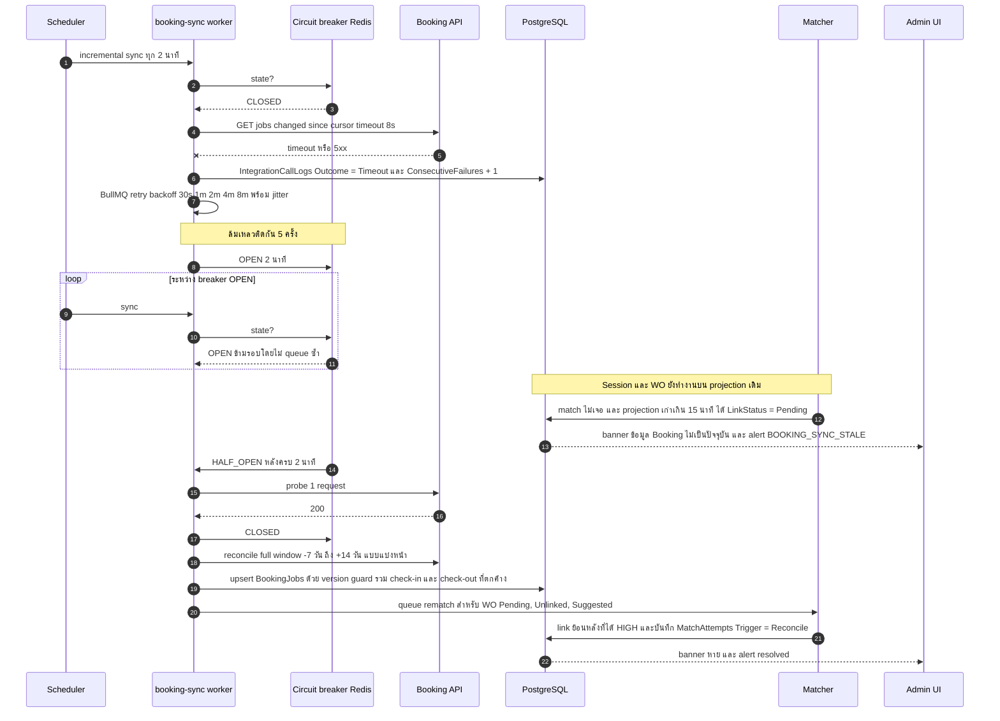

- **Booking ล่มไม่กระทบ tracking**: real-time path และ session engine ไม่เรียก Booking
- ระหว่างล่ม **ใบงานที่ผูก Booking จะไม่ถูกปิด** (ไม่รู้ check-out) — ปิดย้อนหลังด้วยเวลา `BookingCheckOutAt` จริงเมื่อ sync กลับมา
- write-back ไป Booking (ถ้ามี) ค้างใน `IntegrationOutbox` แล้วส่งตามลำดับเมื่อกลับมา
- ข้อความที่ fail เกิน 5 ครั้ง ⇒ `Dead` แสดงในหน้า Integration ให้ admin กด retry

---

## 3.7 เหตุการณ์จาก Booking

| เหตุการณ์จาก Booking | WO ยังไม่มี | WO Open | WO Closed แล้ว |
|---|---|---|---|
| Check-in | re-match session ที่เกี่ยวข้อง (อาจเกิด WO Linked) | อัปเดตข้อมูลแสดงผล | **reopen** (Source Booking) |
| Check-out / Completed | บันทึก — session ย้อนหลังที่ match ภายหลังจะได้ WO สถานะ Closed | **Closed (`BookingCheckout`)** · split open session | อัปเดตเวลา check-out ถ้าเปลี่ยน |
| Cancelled | ไม่ทำอะไร | WO → `Cancelled` · split open session · `NeedsReview` ถ้ามี recording (alert `WORK_ORDER_CANCELLED_WITH_EVIDENCE`) — **ฝั่ง bodycam ตรวจสอบหลักฐานได้** **[Confirmed — Q6]** | `NeedsReview` |
| เปลี่ยนทีม / เวลา / DeviceRefs | re-match | Auto + ไม่มีคนแตะ ⇒ re-match · ไม่งั้น `NeedsReview` · **`WorkOrders.TeamId`/`DepartmentId` ไม่เปลี่ยนตาม Booking** | `NeedsReview` (alert `BOOKING_JOB_CHANGED_AFTER_CLOSE`) |
| หายจาก full sync | `SourceMissingSince` | `NeedsReview` | `NeedsReview` |

---

## 3.8 State Diagrams ของ Work Order

### Status

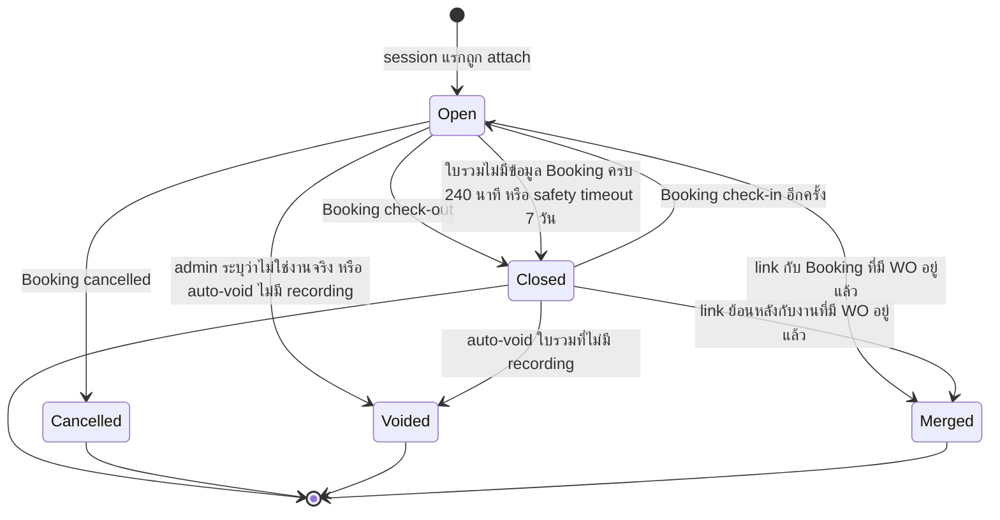

### LinkStatus (มิติแยกจาก Status)

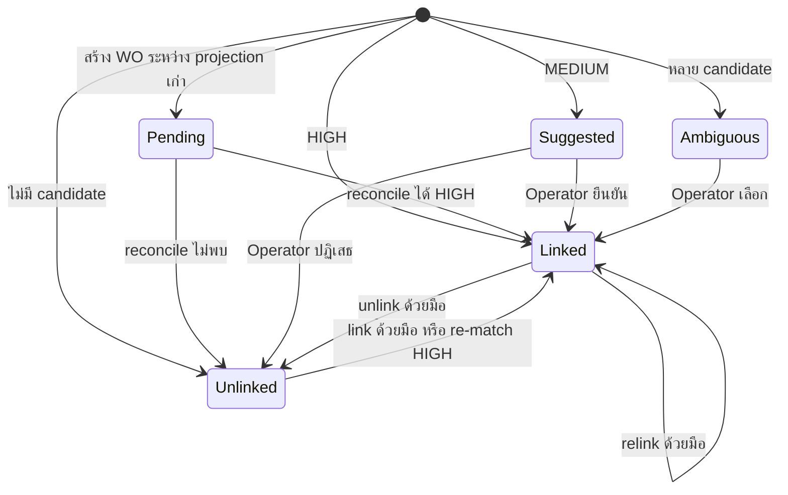

---

## 3.9 Mobile: Monitoring และตรวจสอบหลักฐาน

ผู้ใช้แอปคือ **ฝั่งตรวจสอบใบงาน/หลักฐานและ monitoring** (Operator, Admin, Viewer) — **ไม่ใช่พนักงานภาคสนาม** **[Confirmed — Q18]** · หัวหน้าทีมใช้ Booking app สำหรับ check-in/check-out

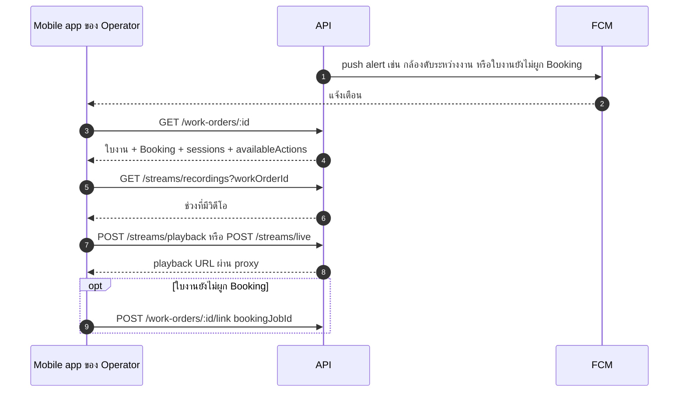

- แอปใช้ API ชุดเดียวกับ web (scope + permission เดียวกัน) + endpoint เฉพาะมือถือ: ทะเบียนเครื่อง, push token, `GET /mobile/overview` (สรุปสั้นสำหรับหน้าแรก)
- Check-in/check-out หน้างาน **อยู่ฝั่ง Booking** — ระบบเรารับเป็นข้อมูลเท่านั้น (Q14 รอทีม Booking เรื่องรูปแบบข้อมูล)

---

## 3.10 สิ่งที่ยังรอจากทีม Booking (สรุปไป Part 9 §9.4)

พัฒนาด้วย **mock adapter ก่อน** แล้วเปลี่ยนเป็นของจริงเมื่อได้ spec **[Confirmed — Q14]**

1. **รูปแบบ check-in/check-out**: มีเวลา check-in/check-out ต่อใบงานไหม · ส่งเป็น event (webhook) หรือ field ในใบงาน · check-in ซ้ำได้ไหม
2. **Booking ระบุกล้องในใบงาน** (`DeviceRefs` รวมกล้องสำรอง) ด้วยรหัสอะไร (DeviceCode / Serial / รหัส DSS) — **เป็นแหล่งเดียวของการผูกกล้อง** (Q20)
3. Booking มอบงานให้ "ทีม" / "หัวหน้าทีม-คนขับ" / "รถ" — ใช้ ref อะไร · มีข้อมูลกล้องประจำทีมให้ sync ไหม

---

## 3.11 Settings ที่ใช้ใน workflow

| Key | Default | Bounds | ใช้ที่ |
|---|---|---|---|
| `status.poll-interval-seconds` | 30 | 10–300 | StatusPoll |
| `status.unknown-after-seconds` | 120 | ≥ 2 × poll | คำนวณ UNKNOWN |
| `gps.poll-interval-seconds` | 15 | 5–300 | GpsPoll (เดิม) |
| `camera.activation-debounce-minutes` | **15** **[Confirmed — Q3]** | 1–60 | เปิด session |
| `session.merge-gap-minutes` | 15 | 0–240 | ตัด session เมื่อ offline (ไม่ใช่การปิดใบงาน) |
| `session.unknown-max-minutes` | 30 | 5–240 | ปิด session เมื่อ unknown |
| `session.max-segment-hours` | 12 | 1–24 (**ผูกกับ playback 24 ชม.**) | split |
| `depot.fix-max-age-minutes` | 30 | 5–240 | ตรวจอยู่ฐาน |
| `matching.window-before-minutes` / `after` | 60 / 60 **[Confirmed — Q3]** | 0–240 | candidate window |
| `matching.extended-window-minutes` | 180 **[Confirmed — Q3]** | ≥ window | MEDIUM |
| `matching.auto-switch-enabled` | true **[Confirmed — Q5]** | bool | A→B |
| `workorder.create-when-unmatched` | true **[Confirmed — Q11]** | bool | สร้างใบรวม |
| `workorder.unlinked-close-after-minutes` | 240 **[Confirmed — Q23]** | 30–1440 | ปิดใบรวมที่ไม่มีข้อมูล Booking (นับจาก `OpenedAt`) |
| `workorder.auto-void-without-recording` | true | bool | Q15 ชั้นที่ 3 |
| `workorder.stale-open-hours` | 36 **[Confirmed — Q23]** | 12–336 | alert ไม่มี check-out |
| `workorder.force-close-after-hours` | 168 **[Confirmed — Q23]** | 24–720 | SafetyTimeout |
| `review.sla-hours` | 36 **[Confirmed — Q7]** | 1–336 | alert คิวตรวจสอบเกินเวลา |
| `booking.sync-interval-seconds` | 120 | 30–3600 | incremental |
| `booking.stale-after-minutes` | 15 | 5–240 | banner / Pending |
| `booking.rematch-horizon-hours` | 72 | 1–336 | re-match |
| `alert.offline-during-job-minutes` | 10 | 1–120 | alert 5 |

เพิ่ม key = แก้ `SETTING_DEFAULTS` + `SETTING_BOUNDS` (`setting-spec.ts`) + data migration (กติกาเดิมของ reference — ไม่พึ่ง seed)
