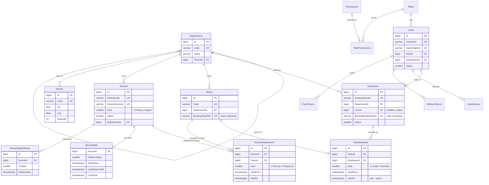
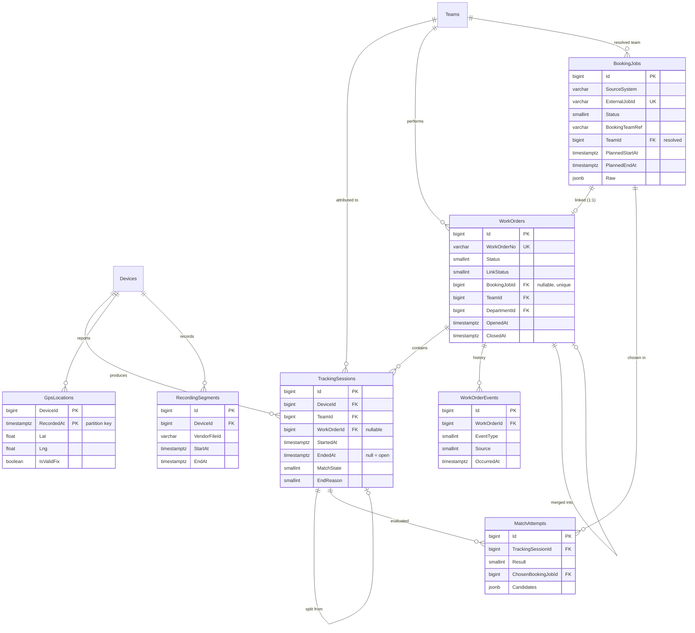
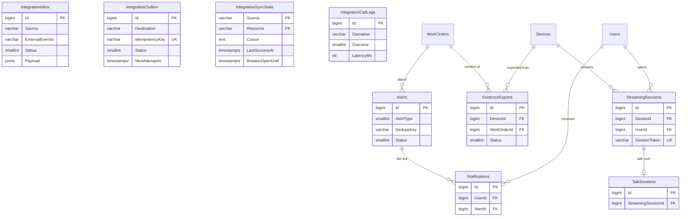

# Part 4 — Database Design

> เอกสารนี้เป็น **แหล่งอ้างอิงหลักของชื่อตาราง / คอลัมน์ / enum** — Part อื่นใช้ชื่อตามนี้
> Engine: **PostgreSQL 16** · ORM: **Drizzle ORM 0.45 + drizzle-kit** · driver: postgres.js (เหมือน reference)

---

## 4.1 หลักการออกแบบ (Design Decisions)

| # | Decision | เหตุผล |
|---|---|---|
| D1 | คง convention ของ reference: ตาราง/คอลัมน์ **PascalCase (quoted)**, PK `bigint GENERATED ALWAYS AS IDENTITY`, `timestamptz` (UTC), enum = `smallint` append-only | port โค้ดจาก reference ได้ตรง (`server/src/db/schema.ts`, `scope.predicates.ts`) · ทีมคุ้นเคย |
| D2 | **JSON ใช้ `jsonb`** (reference ใช้ `text`) | query/index ได้, validate ได้ |
| D3 | **แยก observed fact ออกจาก business record**: `TrackingSessions` = กล้องถูกใช้งานจริง · `WorkOrders` = ใบงานธุรกิจ | แก้ design smell pseudo work order (`WorkType = 5` + `CAM-AUTO`/`SITE-CAM`) ของ reference |
| D4 | **Booking เป็น external reference**: `WorkOrders.BookingJobId` → `BookingJobs` (projection ที่ sync มา) · nullable · partial unique = 1 Booking ↔ 1 WO | WO มี PK ของตัวเอง · รองรับ WO ที่ยัง link ไม่ได้ · matching ไม่ต้องเรียก API สด |
| D5 | เก็บข้อมูล Booking **เท่าที่ต้องใช้ match + แสดงผล** + `Raw jsonb` สำหรับ audit/debug | หลีกเลี่ยง duplicate ข้อมูล Booking โดยไม่จำเป็น · ลด PDPA exposure |
| D6 | **Invariant บังคับที่ DB**: partial unique, exclusion constraint (`btree_gist`), CHECK | race condition ระหว่าง API/worker ไม่สามารถสร้างข้อมูลผิด invariant ได้ แม้ logic มี bug |
| D7 | Hot state แยกตาราง: `DeviceState` (อัปเดตทุก poll) ออกจาก `Devices` (master) | ลด row churn / lock contention บน master |
| D8 | Soft delete เฉพาะ **master data** (Users, Employees, Teams, Devices, Departments) · fact/log tables **ไม่มี soft delete** (ใช้ status เช่น `Voided`) | ประวัติหลักฐานต้องไม่หาย |
| D9 | ไม่มี `CompanyId` (บริษัทเดียว) · scope ผ่าน `DepartmentId` (subtree) หรือ `all` (ไม่มีผู้ใช้ภาคสนาม — DL14, DL16) | ตัดปัญหา `CompanyId = null` 3 ความหมายของ reference |
| D10 | `GpsLocations` และ `AuditLogs` **partition รายเดือน** · retention = `DROP PARTITION` | แทน batched ctid DELETE ของ reference (`retention.service.ts`) |
| D11 | เลขใบงานจาก **counter table** (`WorkOrderCounters`) แบบ atomic upsert | แทน `SELECT max + 1` + retry ของ reference |

Extensions ที่ต้องมี: `btree_gist` (exclusion constraint) — ถ้า managed Postgres ไม่อนุญาต ดู fallback ใน 4.6

---

## 4.2 ERD

### 4.2.1 Organization, Teams, Devices



### 4.2.2 Tracking, Work Orders, Booking



### 4.2.3 Integration, Media, System



### 4.2.4 Cardinality สรุป

| ความสัมพันธ์ | Cardinality | บังคับด้วย |
|---|---|---|
| Team ↔ Leader (active) | 1 : 1 | `UQ_TeamMembers_ActiveLeader` |
| Employee ↔ Team (active) | N : 1 (1 คน 1 ทีม ณ เวลาหนึ่ง) | `UQ_TeamMembers_ActiveEmployee` |
| Team ↔ Primary camera (active) | 1 : 1 | `UQ_DevAsg_TeamActivePrimary` |
| Device ↔ Team ณ เวลาใด ๆ | N : 1 (ไม่ซ้อนเวลา) | `EX_DevAsg_NoOverlap` |
| Device ↔ Open session | 1 : 0..1 | `UQ_TS_OpenPerDevice` + `EX_TS_NoOverlap` |
| WorkOrder ↔ TrackingSession | 1 : N | FK `TrackingSessions.WorkOrderId` |
| BookingJob ↔ WorkOrder | 1 : 0..1 | `UQ_WO_BookingJob` |
| Team ↔ Open WO ที่ยังไม่มี Booking (ใบรวม) | 1 : 0..1 | `UQ_WO_OpenUnlinkedPerTeam` |
| กล้องที่ยังไม่รู้ทีม ↔ Open ใบรวม | 1 : 0..1 | `UQ_WO_OpenUnlinkedPerDevice` |
| Employee ↔ User | 0..1 : 0..1 | `UQ_Employees_User` |

---

## 4.3 Enums (smallint, append-only — ห้าม renumber)

| Enum | ค่า |
|---|---|
| `Users.Status` | 1 Active · 2 Inactive (admin ปิด) · 3 Locked (ระบบล็อกชั่วคราว ดู `LockedUntil`) |
| `Employees.Status` | 1 Active · 2 Suspended · 3 Resigned |
| `TeamMembers.Role` | 1 Leader · 2 Member |
| `Devices.Kind` | 1 Primary · 2 Spare |
| `Devices.Status` | 1 Active · 2 Inactive · 3 Maintenance · 4 Retired |
| `DeviceState.PlatformState` | 1 Online · 2 Offline (UNKNOWN **ไม่เก็บ** — คำนวณจาก `LastObservedAt` เก่ากว่า `status.unknown-after-seconds`) |
| `DeviceState.LastSource` / `StateSource` / `DeviceStatusHistory.Source` | 1 DssDeviceList · 2 DssLocation · 3 BrmsMq · 4 Webhook · 5 Manual · ลำดับความน่าเชื่อถือ (สูง→ต่ำ): BrmsMq > DssDeviceList > DssLocation > Webhook (Part 3 §3.1) |
| `DeviceAssignments.Kind` | 1 Primary · 2 Temporary (กล้องสำรอง) |
| `TrackingSessions.MatchState` | 1 Attached (มี WO — รวม WO ที่ void) · 2 AwaitingMatch (ยังไม่มี WO รอ match) · 3 NoTeam (กล้องไม่ได้ผูกทีม) · 4 Classified (ไม่มี WO และ admin ระบุว่าไม่ใช่งาน) · `Classification` บันทึกได้ทั้งกรณี 1 และ 4 |
| `TrackingSessions.StartInferred` | 1 Observed (StateSince) · 2 SplitBoundary · 3 PlannedBoundary (สลับงานอัตโนมัติ) |
| `TrackingSessions.EndReason` | 1 DeviceOffline · 2 StatusUnknown · 3 WorkOrderClosed (Booking check-out/cancel) · 4 JobSwitched · 5 MaxSegment · 6 DeviceReassigned · 7 AdminSplit · 8 WorkOrderVoided · 9 AtBaseChanged |
| `TrackingSessions.Classification` | 1 IdleOrCharging (ระบบตั้งเองเมื่ออยู่ในรัศมีฐาน หรือ auto-void) · 2 Test · 3 Training · 9 Other |
| `WorkOrders.Status` | 1 Open · 2 Closed · 3 Cancelled (Booking ยกเลิก) · 4 Voided (admin หรือ auto-void: ไม่ใช่งานจริง) · 5 Merged |
| `WorkOrders.CloseReason` | 1 BookingCheckout (check-out หรือ Completed จาก Booking — ทางปิดหลัก) · 2 NoBookingData (ใบรวมที่ไม่มีข้อมูล Booking ครบ 240 นาที) · 3 SafetyTimeout (ผูก Booking แต่ไม่ check-out ครบ 7 วัน) · **ไม่มีการปิดโดยคนในระบบนี้** |
| `WorkOrders.LinkStatus` | 1 Pending (กำลัง match) · 2 Linked · 3 Suggested (MEDIUM รอยืนยัน) · 4 Ambiguous (หลาย candidate) · 5 Unlinked |
| `WorkOrders.LinkSource` | 1 Auto · 2 Manual |
| `WorkOrders.LinkConfidence` / `MatchAttempts.Confidence` | 1 High · 2 Medium · 3 Low |
| `WorkOrderEvents.EventType` | 1 Created · 2 StatusChanged · 3 Linked · 4 Unlinked · 5 Relinked · 6 SessionAttached · 7 SessionDetached · 8 MergedInto · 9 NoteUpdated · 10 ReviewFlagged · 11 ReviewCleared |
| `WorkOrderEvents.Source` | 1 System · 2 Booking · 3 Operator · 4 Admin |
| `BookingJobs.Status` (canonical) | 1 Planned · 2 Confirmed · 3 InProgress · 4 Completed · 5 Cancelled · 9 Unknown (raw status map ไม่ได้) |
| `MatchAttempts.Trigger` | 1 SessionOpened · 2 Sweep · 3 BookingChanged · 4 AssignmentChanged · 5 Manual · 6 Reconcile |
| `MatchAttempts.Result` | 1 Linked · 2 Suggested · 3 Ambiguous · 4 NoCandidate · 5 NoTeam · 6 SkippedManual · 7 ProjectionStale |
| `IntegrationInbox.Status` | 1 Pending · 2 Processed · 3 Failed · 4 Ignored (version เก่า/ซ้ำ) · 5 Dead |
| `IntegrationOutbox.Status` | 1 Pending · 2 Sent · 3 Failed (รอ retry) · 4 Dead · 5 Skipped (destination ปิดอยู่) |
| `IntegrationCallLogs.Outcome` | 1 Success · 2 HttpError · 3 Timeout · 4 NetworkError · 5 CircuitOpen · 6 InvalidResponse |
| `Alerts.Severity` / `Alerts.Status` | 1 Info · 2 Warning · 3 Critical / 1 New · 2 Acknowledged · 3 Resolved · 4 Dismissed |
| `Alerts.AlertType` | ดู [05-api-design.md §5.6](05-api-design.md#56-alert-types) |
| Streaming / Talk / Evidence | คงค่าจาก reference (`server/src/modules/streaming/streaming-constants.ts`, `talk/talk-constants.ts`) · Protocol 1 HLS · SessionType 1 Live 2 Playback · Evidence 1 Queued 2 Processing 3 Ready 4 Failed 5 Expired |

---

## 4.4 Table Definitions

> คอลัมน์ audit มาตรฐาน (เรียกว่า **AUDIT**) = `CreatedAt timestamptz NN default now()`, `CreatedBy bigint FK Users`, `UpdatedAt timestamptz`, `UpdatedBy bigint FK Users`
> **SOFT** = `IsDeleted boolean NN default false`, `DeletedAt timestamptz`, `DeletedBy bigint FK Users` และ unique ทุกตัวเป็น partial `WHERE "IsDeleted" = false`
> NN = NOT NULL

### A. Identity & Access

**Departments** — แผนก (tree)
| Column | Type | Null | หมายเหตุ |
|---|---|---|---|
| Id | bigint identity | PK | |
| Code | varchar(30) | NN | `UQ_Departments_Code` partial |
| Name | varchar(200) | NN | |
| ParentId | bigint | | FK → Departments.Id |
| IsActive | boolean | NN | default true |
| AUDIT, SOFT | | | |

**Employees** — พนักงาน
| Column | Type | Null | หมายเหตุ |
|---|---|---|---|
| Id | bigint identity | PK | |
| EmployeeCode | varchar(30) | NN | `UQ_Employees_Code` partial |
| FirstName / LastName | varchar(100) | NN | |
| Phone | varchar(30) | | |
| DepartmentId | bigint | NN | FK → Departments |
| UserId | bigint | | FK → Users · `UQ_Employees_User` WHERE UserId IS NOT NULL AND IsDeleted = false |
| BookingEmployeeRef | varchar(64) | | รหัสพนักงานใน Booking · `UQ_Employees_BookingRef` partial **[Assumption: Booking มี employee id]** |
| Status | smallint | NN | default 1 |
| AUDIT, SOFT | | | IX `IX_Employees_Department` |

**Users** — บัญชีเข้าระบบ (port จาก reference ตัด `CompanyId`)
| Column | Type | Null | หมายเหตุ |
|---|---|---|---|
| Id | bigint identity | PK | |
| Username | varchar(50) | NN | `UQ_Users_Username` partial |
| PasswordHash | varchar(255) | | null = SSO-only · argon2 |
| Email | varchar(200) | | `UQ_Users_Email` on `lower(Email)` partial |
| FullName | varchar(200) | NN | |
| AzureObjectId | varchar(64) | | `UQ_Users_AzureObjectId` partial · null = ยังไม่เคย link (ไม่ใช่ "ห้ามเข้า") |
| RoleId | bigint | NN | FK → Roles |
| DepartmentId | bigint | | FK → Departments (null ได้เฉพาะ role scope `all`) |
| Status | smallint | NN | default 1 |
| FailedLoginCount | smallint | NN | default 0 |
| LockedUntil | timestamptz | | |
| LastLoginAt | timestamptz | | |
| AUDIT, SOFT | | | |

**Roles** (`Id`, `Code varchar(30) UQ`, `Name`, `IsSystem boolean`) · **Permissions** (`Id`, `Code varchar(100) UQ` รูปแบบ `resource:action`, `Resource`, `Action`, `Description`) · **RolePermissions** (`RoleId`, `PermissionId`, PK composite)

**RefreshTokens** — port ตรงจาก reference: `Id`, `UserId NN`, `TokenHash char(64) UQ`, `ExpiresAt NN`, `RevokedAt`, `ReplacedByTokenId FK self`, `UserDeviceId FK`, `CreatedAt` · IX `(UserId, ExpiresAt)`

**UserDevices** — ทะเบียนเครื่องมือถือ (**ไม่มี PIN/biometric**)
| Column | Type | Null | หมายเหตุ |
|---|---|---|---|
| Id | bigint identity | PK | |
| UserId | bigint | NN | FK → Users |
| InstallationId | varchar(100) | NN | id ที่แอปสร้าง (reference ใช้ชื่อ `DeviceId` ชนกับกล้อง — เปลี่ยนชื่อ) · `UQ_UserDevices_User_Installation (UserId, InstallationId)` |
| Platform | smallint | NN | 1 Android · 2 iOS · 3 Web |
| DeviceName | varchar(100) | | |
| PushEnabled | boolean | NN | default true |
| IsRevoked | boolean | NN | default false |
| LastSeenAt | timestamptz | | |
| CreatedAt | timestamptz | NN | |

**PushTokens** — `Id`, `UserId NN`, `UserDeviceId FK`, `Token varchar(512) UQ` (global unique — login ใหม่บนเครื่องเดิมโอนเจ้าของ), `Platform`, `IsRevoked`, `FailureCount`, `LastUsedAt`, `CreatedAt` · IX `(UserId, IsRevoked)`

### B. Teams

**Teams**
| Column | Type | Null | หมายเหตุ |
|---|---|---|---|
| Id | bigint identity | PK | |
| Code | varchar(30) | NN | `UQ_Teams_Code` partial |
| Name | varchar(200) | NN | |
| DepartmentId | bigint | NN | FK → Departments (scope) |
| BookingTeamRef | varchar(64) | | รหัสทีม/รถ/กะใน Booking · `UQ_Teams_BookingRef` partial **[Assumption]** |
| IsActive | boolean | NN | default true |
| AUDIT, SOFT | | | |

**TeamMembers** — ประวัติสมาชิก (ไม่มี DELETE — ปิดด้วย `ValidTo`)
| Column | Type | Null | หมายเหตุ |
|---|---|---|---|
| Id | bigint identity | PK | |
| TeamId | bigint | NN | FK → Teams |
| EmployeeId | bigint | NN | FK → Employees |
| Role | smallint | NN | 1 Leader · 2 Member |
| ValidFrom | timestamptz | NN | |
| ValidTo | timestamptz | | null = ยัง active |
| AssignedBy | bigint | | FK → Users |
| Note | varchar(500) | | |
| CreatedAt | timestamptz | NN | |

Constraints: `CK_TeamMembers_Window` (`ValidTo IS NULL OR ValidTo > ValidFrom`) · `UQ_TeamMembers_ActiveLeader (TeamId) WHERE Role = 1 AND ValidTo IS NULL` · `UQ_TeamMembers_ActiveEmployee (EmployeeId) WHERE ValidTo IS NULL` · `EX_TeamMembers_LeaderNoOverlap` EXCLUDE gist (`TeamId =`, `tstzrange(ValidFrom, ValidTo) &&`) WHERE Role = 1 · IX `(TeamId, ValidFrom DESC)`

### C. Devices

**Devices** — master ของ bodycam
| Column | Type | Null | หมายเหตุ |
|---|---|---|---|
| Id | bigint identity | PK | |
| DeviceCode | varchar(30) | NN | รหัสภายใน · `UQ_Devices_Code` partial |
| VendorDeviceId | varchar(64) | NN | = DSS `deviceCode` · `UQ_Devices_VendorId` **ไม่ filter IsDeleted** (เหมือน reference — vendor id ต้องไม่ซ้ำตลอดกาล) |
| Name | varchar(200) | | |
| Model / SerialNo / Firmware | varchar(100) | | |
| SimNumber | varchar(30) | | |
| Kind | smallint | NN | 1 Primary · 2 Spare |
| Status | smallint | NN | default 1 |
| DepartmentId | bigint | NN | FK → Departments (เจ้าของ — ใช้ scope กล้องที่ยังไม่ผูกทีม) |
| StreamingEnabled | boolean | NN | default true (toggle ต่ออุปกรณ์จาก reference) |
| VendorSeenAt / VendorMissingSince | timestamptz | | จาก device sync |
| AUDIT, SOFT | | | IX `(Status)`, `(DepartmentId)` |

**DeviceState** — hot row 1:1 (UPDATE ทุก observation)
| Column | Type | Null | หมายเหตุ |
|---|---|---|---|
| DeviceId | bigint | PK | FK → Devices |
| PlatformState | smallint | | 1 Online · 2 Offline · null = ยังไม่เคยเห็น |
| StateSince | timestamptz | | เวลา observation แรกของสถานะปัจจุบัน (เปลี่ยนเฉพาะตอน state เปลี่ยน) |
| LastObservedAt | timestamptz | | DB `now()` ตอนได้รับ observation ล่าสุด (ใช้คำนวณ UNKNOWN) |
| LastOnlineObservedAt | timestamptz | | observation ล่าสุดที่บอกว่า Online (ใช้เป็น EndedAt เมื่อ UNKNOWN นาน) |
| LastSource | smallint | | source ของ observation ล่าสุด |
| StateSource | smallint | | source ที่ตั้ง `PlatformState` ปัจจุบัน |
| StateSourceObservedAt | timestamptz | | observation ล่าสุดจาก `StateSource` — source ลำดับต่ำกว่าเปลี่ยน state ไม่ได้ขณะค่านี้ยังสด |
| LastFixAt | timestamptz | | |
| LastLat / LastLng | double precision | | |
| LastSpeedKph | real | | |
| LastHeading | smallint | | |
| LastFixValid | boolean | | |
| LastBatteryPercent | smallint | | ถ้า vendor ส่ง (DSS `/location` ปัจจุบันไม่ส่ง) |
| IsAtDepot | boolean | | คำนวณตอน observation: fix valid อายุ ≤ `depot.fix-max-age-minutes` อยู่ในรัศมี `Depots` · null = ไม่มี fix · (vendor ไม่มี charging state — Q21) |
| UpdatedAt | timestamptz | NN | |

IX `IX_DeviceState_PlatformState (PlatformState)`

**DeviceStatusHistory** — append-only, เขียนเฉพาะตอน transition
`Id`, `DeviceId NN`, `FromState smallint`, `ToState smallint NN`, `ObservedAt timestamptz NN`, `Source smallint NN`, `CreatedAt` · IX `(DeviceId, ObservedAt DESC)` · retention 12 เดือน

**DeviceAssignments** — ประวัติผูกกล้อง → ทีม (ไม่มี DELETE) · **projection ของข้อมูลจาก Booking** ถ้า Booking มีข้อมูลกล้องประจำทีม — ถ้าไม่มี ตารางนี้ว่างและการจับคู่ใช้ `BookingJobs.DeviceRefs` อย่างเดียว
| Column | Type | Null | หมายเหตุ |
|---|---|---|---|
| Id | bigint identity | PK | |
| DeviceId | bigint | NN | FK → Devices |
| TeamId | bigint | NN | FK → Teams |
| Kind | smallint | NN | 1 Primary · 2 Temporary (สำรอง — SessionSweep ปิดเมื่อ offline ≥ merge gap และไม่มี open session · safety cut 04:00 Asia/Bangkok วันถัดไป) |
| ValidFrom | timestamptz | NN | |
| ValidTo | timestamptz | | null = active |
| Source | smallint | NN | 2 BookingSync เท่านั้น — **การผูกกล้องมาจาก Booking เท่านั้น (Q20)** ระบบเราไม่มีการผูกเอง (ค่า 1 สงวนไว้) |
| AssignedBy | bigint | | FK → Users (null = ระบบ) |
| Reason | varchar(500) | | |
| CreatedAt | timestamptz | NN | |

Constraints: `CK_DevAsg_Window` · `EX_DevAsg_NoOverlap` EXCLUDE gist (`DeviceId =`, `tstzrange(ValidFrom, ValidTo) &&`) · `UQ_DevAsg_DeviceActive (DeviceId) WHERE ValidTo IS NULL` (fallback ถ้าไม่มี gist) · `UQ_DevAsg_TeamActivePrimary (TeamId) WHERE Kind = 1 AND ValidTo IS NULL` · IX `(TeamId, ValidFrom DESC)`

**Depots** — ฐาน/จุดชาร์จกล้อง (ใช้ตรวจ "อยู่ฐาน" ตาม Q15) — ใหม่ · **รองรับหลายจุด · dev seed พิกัด mock ไว้ก่อน (Q22)**
| Column | Type | Null | หมายเหตุ |
|---|---|---|---|
| Id | bigint identity | PK | |
| Code | varchar(30) | NN | `UQ_Depots_Code` partial |
| Name | varchar(200) | NN | |
| DepartmentId | bigint | | FK → Departments (null = ใช้ร่วมทุกแผนก) |
| Lat / Lng | double precision | NN | |
| RadiusM | integer | NN | default 150 · `CK_Depots_Radius` 20–2000 |
| IsActive | boolean | NN | default true |
| AUDIT, SOFT | | | |

### D. Tracking

**GpsLocations** — partitioned `RANGE (RecordedAt)` รายเดือน (UTC boundary)
| Column | Type | Null | หมายเหตุ |
|---|---|---|---|
| DeviceId | bigint | NN | **ไม่มี FK** (volume — เหมือน reference) |
| RecordedAt | timestamptz | NN | เวลาจากอุปกรณ์ · partition key |
| ReceivedAt | timestamptz | NN | default now() |
| Lat / Lng | double precision | NN | |
| SpeedKph | real | | |
| Heading | smallint | | |
| AltitudeM | real | | |
| SatelliteCount | smallint | | |
| IsValidFix | boolean | NN | drift filter >200 km/h ⇒ false (ไม่ทิ้ง) |
| BatteryPercent | smallint | | |

PK `PK_GpsLocations (DeviceId, RecordedAt)` (รวม partition key ⇒ `ON CONFLICT DO NOTHING` ใช้ได้, แทน unique + index ซ้ำซ้อนของ reference) · BRIN `(RecordedAt)` ต่อ partition · ไม่มี surrogate Id

**TrackingSessions** — ช่วงที่กล้องเปิดต่อเนื่องและสังกัด WO เดียวกัน
| Column | Type | Null | หมายเหตุ |
|---|---|---|---|
| Id | bigint identity | PK | |
| DeviceId | bigint | NN | FK → Devices |
| TeamId | bigint | | FK → Teams (ทีม ณ เวลาเริ่ม · null = กล้องไม่ผูกทีม) |
| DepartmentId | bigint | NN | FK → Departments (snapshot สำหรับ scope) |
| WorkOrderId | bigint | | FK → WorkOrders |
| StartedAt | timestamptz | NN | |
| EndedAt | timestamptz | | null = เปิดอยู่ |
| StartInferred | smallint | NN | |
| EndReason | smallint | | |
| MatchState | smallint | NN | |
| LinkSource | smallint | | 1 Auto · 2 Manual (session ถูก attach โดยคน) |
| Classification | smallint | | ใช้เมื่อ MatchState = 4 |
| ClassifiedBy / ClassifiedAt | bigint / timestamptz | | |
| PrevSessionId | bigint | | FK self (session ก่อนหน้าที่ถูก split) |
| RecordedSeconds | integer | | รวมความยาว recording ที่ index ได้ |
| RecordingIndexedAt | timestamptz | | |
| CreatedAt / UpdatedAt | timestamptz | NN | |

Constraints: `CK_TS_Window` (`EndedAt IS NULL OR EndedAt > StartedAt`) · `CK_TS_Attached` (`(MatchState = 1) = (WorkOrderId IS NOT NULL)`) · **`UQ_TS_OpenPerDevice (DeviceId) WHERE EndedAt IS NULL`** · **`EX_TS_NoOverlap`** EXCLUDE gist (`DeviceId =`, `tstzrange(StartedAt, EndedAt, '[)') &&`) · IX `(WorkOrderId)`, `(DeviceId, StartedAt DESC)`, `(TeamId, StartedAt DESC)`, `IX_TS_Unresolved (StartedAt) WHERE MatchState IN (2,3)`

**RecordingSegments** — cache รายการไฟล์บันทึกจาก DSS recording search (แทน `PlaybackRecords`)
`Id`, `DeviceId NN`, `Channel smallint NN default 1`, `VendorFileId varchar(128) NN`, `StartAt NN`, `EndAt NN`, `DurationSeconds integer`, `SourceType smallint`, `IndexedAt NN` · `UQ_RecSeg_File (DeviceId, Channel, VendorFileId)` (reference ลืม Channel) · IX `(DeviceId, StartAt)`

### E. Work Orders

**WorkOrders**
| Column | Type | Null | หมายเหตุ |
|---|---|---|---|
| Id | bigint identity | PK | |
| WorkOrderNo | varchar(30) | NN | `WO-YYYYMM-NNNNN` · `UQ_WO_No` |
| Title | varchar(300) | NN | จาก Booking เมื่อ link · ไม่ link = `ใบงานอัตโนมัติ {TeamCode} {DeviceCode}` |
| Status | smallint | NN | default 1 |
| CloseReason | smallint | | |
| LinkStatus | smallint | NN | default 1 Pending |
| LinkSource | smallint | | null/1 Auto = ระบบจัดการได้ · 2 Manual = matcher ไม่แตะ (และ WO ที่ unlink ด้วยมือไม่เป็นใบรวมของทีม) |
| LinkConfidence | smallint | | |
| BookingJobId | bigint | | FK → BookingJobs |
| SuggestedBookingJobId | bigint | | FK → BookingJobs · คำแนะนำ (MEDIUM) ของ session ล่าสุด — แสดงผลเท่านั้น |
| LinkedAt / LinkedBy | timestamptz / bigint | | |
| TeamId | bigint | | FK → Teams · ทีมของ session แรกที่ทำให้เกิด WO (ไม่เปลี่ยนตาม Booking) · **ว่างได้** เมื่อกล้องยังไม่มีข้อมูลทีมจาก Booking (ใบรวมของกล้อง) — เติมเมื่อ link กับงาน |
| SourceDeviceId | bigint | NN | FK → Devices · กล้องของ session แรก (ใช้เป็น key ของใบรวมของกล้อง) |
| DepartmentId | bigint | NN | FK → Departments (snapshot จากทีม หรือจาก `Devices.DepartmentId` ถ้าไม่มีทีม · ไม่เปลี่ยนภายหลัง) |
| LeaderEmployeeId | bigint | | FK → Employees (snapshot หัวหน้าทีม ณ ตอนสร้าง) |
| OpenedAt | timestamptz | NN | = `StartedAt` ของ session แรก |
| LastActivityAt | timestamptz | NN | session ล่าสุดยังเปิด = now / ปิด = EndedAt (ใช้ idle timeout) |
| ClosedAt / ClosedBy | timestamptz / bigint | | ClosedBy null = ระบบ |
| CloseNote | varchar(1000) | | |
| MergedIntoWorkOrderId | bigint | | FK self |
| NeedsReview | boolean | NN | default false |
| ReviewSince | timestamptz | | เวลาที่เข้าคิวตรวจสอบ (ใช้วัด SLA `review.sla-hours` = 36 — Q7) · null เมื่อออกจากคิว |
| ReviewOverdueAlertedAt | timestamptz | | กัน alert SLA ซ้ำ |
| ReviewReasons | smallint[] | | 1 BookingChangedAfterClose · 2 CancelledWithEvidence · 3 NoCheckout (ไม่มี check-out เกิน 36 ชม.) · 4 AutoSwitched · 5 SourceMissing · 6 SafetyTimeout · 7 NoBookingData (ใบรวมปิดโดยไม่มีข้อมูล Booking) |
| Note | varchar(2000) | | หมายเหตุจากผู้ใช้ |
| RowVersion | integer | NN | default 1 · optimistic concurrency (`If-Match`) |
| CreatedAt / UpdatedAt | timestamptz | NN | |

Constraints:
- `CK_WO_LinkConsistency` — `(LinkStatus = 2) = (BookingJobId IS NOT NULL)`
- `CK_WO_Merged` — `(Status = 5) = (MergedIntoWorkOrderId IS NOT NULL)`
- `CK_WO_Closed` — `Status = 1 OR ClosedAt IS NOT NULL`
- **`UQ_WO_BookingJob (BookingJobId) WHERE BookingJobId IS NOT NULL`** — 1 Booking ↔ 1 WO
- **`UQ_WO_OpenUnlinkedPerTeam (TeamId) WHERE Status = 1 AND BookingJobId IS NULL AND TeamId IS NOT NULL AND LinkSource IS DISTINCT FROM 2`** — "ใบรวมของทีม" เปิดได้ใบเดียว (WO ที่ unlink ด้วยมือไม่นับ) — กติกาการใช้ดู Part 3 §3.3.4
- **`UQ_WO_OpenUnlinkedPerDevice (SourceDeviceId) WHERE Status = 1 AND BookingJobId IS NULL AND TeamId IS NULL AND LinkSource IS DISTINCT FROM 2`** — ใบรวมของกล้องที่ยังไม่รู้ทีม
- `CK_WO_LinkedHasTeam` — `BookingJobId IS NULL OR TeamId IS NOT NULL OR LinkSource = 2` (link อัตโนมัติต้องรู้ทีม — ถ้าจับคู่ผ่าน DeviceRefs ใช้ทีมจาก Booking job)
- IX `(Status, OpenedAt DESC)`, `(TeamId, OpenedAt DESC)`, `(DepartmentId, OpenedAt DESC)`, `IX_WO_ReviewQueue (OpenedAt) WHERE (Status = 1 AND LinkStatus IN (1,3,4,5)) OR NeedsReview` — คิวตรวจสอบ = WO ที่ยังเปิดและยังไม่ Linked + ทุก WO ที่ `NeedsReview` (WO ใบรวมที่ปิดไปแล้วไม่ค้างในคิว — ค้นได้จาก list filter)

**WorkOrderEvents** — timeline/audit ของใบงาน (append-only)
`Id`, `WorkOrderId NN`, `EventType NN`, `FromStatus`, `ToStatus`, `Source NN`, `ActorUserId`, `TrackingSessionId`, `BookingJobId`, `Reason varchar(500)`, `Detail jsonb`, `OccurredAt NN` · IX `(WorkOrderId, OccurredAt)`

**WorkOrderCounters** — `Period char(6) PK` (`YYYYMM` Asia/Bangkok), `LastValue integer NN`
```sql
INSERT INTO "WorkOrderCounters" ("Period","LastValue") VALUES ($1, 1)
ON CONFLICT ("Period") DO UPDATE SET "LastValue" = "WorkOrderCounters"."LastValue" + 1
RETURNING "LastValue";
```

### F. Booking Integration

**BookingJobs** — local projection ของใบงาน Booking (**ทุก field ฝั่ง Booking = [Assumption]** จนกว่าจะได้ spec)
| Column | Type | Null | หมายเหตุ |
|---|---|---|---|
| Id | bigint identity | PK | |
| SourceSystem | varchar(30) | NN | default `'BOOKING'` (รองรับหลายระบบในอนาคต) |
| ExternalJobId | varchar(100) | NN | `UQ_BookingJobs_External (SourceSystem, ExternalJobId)` |
| ExternalJobNo | varchar(50) | | เลขที่แสดงต่อผู้ใช้ |
| ExternalVersion | varchar(100) | | version/etag ถ้ามี |
| ExternalUpdatedAt | timestamptz | | ใช้ version guard (ข้อมูลเก่ากว่าห้ามทับ) |
| Status | smallint | NN | canonical |
| RawStatus | varchar(50) | | ค่าดิบจาก Booking |
| Title | varchar(300) | | |
| BookingTeamRef | varchar(64) | | **matching key** |
| TeamId | bigint | | FK → Teams · **cache** ที่ resolve จาก `Teams.BookingTeamRef` (อัปเดตโดย job re-resolve เมื่อ ref เปลี่ยน) |
| BookingLeaderRef | varchar(64) | | **matching key** |
| LeaderEmployeeId | bigint | | FK → Employees · **cache** ที่ resolve จาก `Employees.BookingEmployeeRef` |
| ScheduledDate | date | | วันที่ของงาน (Asia/Bangkok) — fallback เมื่อไม่มีเวลาตามแผน |
| PlannedStartAt / PlannedEndAt | timestamptz | | `CK_BookingJobs_Window` |
| BookingCheckInAt / BookingCheckOutAt | timestamptz | | **เวลา check-in / check-out ใน Booking — กำหนดสถานะใบงาน** **[Assumption ด้านรูปแบบ]** |
| DeviceRefs | varchar(64)[] | | รหัสกล้องที่ Booking ระบุให้งานนี้ (รวมกล้องสำรอง) — matching key อันดับ 1 **[Assumption]** · GIN index |
| SiteName | varchar(300) | | |
| SiteAddress | varchar(1000) | | |
| SiteLat / SiteLng | double precision | | ใช้เป็น tie-breaker เท่านั้น |
| Raw | jsonb | NN | payload ล่าสุด (redact ข้อมูลส่วนบุคคลที่ไม่จำเป็นก่อนเก็บ) |
| PayloadHash | char(64) | NN | SHA-256 — ไม่เปลี่ยน = ไม่ต้อง re-match |
| MappingIssues | smallint[] | | 1 UnknownTeamRef · 2 UnknownLeaderRef · 3 UnmappedStatus · 4 MissingWindow · 5 UnknownDeviceRef |
| FirstSyncedAt / LastSyncedAt | timestamptz | NN | |
| SourceMissingSince | timestamptz | | หายจาก full sync (ไม่ลบ) |

IX GIN `(DeviceRefs)`, `(BookingTeamRef, PlannedStartAt)`, `(BookingLeaderRef, PlannedStartAt)`, `(TeamId, PlannedStartAt)`, `(Status, PlannedStartAt)`, `(ScheduledDate)`, `(LastSyncedAt)`, GIN ไม่จำเป็นในเฟสแรก

**MatchAttempts** — บันทึกการตัดสินใจ matching (เขียนเฉพาะเมื่อ `InputHash` เปลี่ยน)
`Id`, `TrackingSessionId NN`, `WorkOrderId`, `Trigger NN`, `Result NN`, `Confidence`, `ChosenBookingJobId`, `Candidates jsonb` (`[{bookingJobId, tier, score, reasons[]}]`), `InputHash char(64) NN`, `AlgoVersion smallint NN`, `ProjectionSyncedAt`, `AttemptedAt NN` · IX `(TrackingSessionId, AttemptedAt DESC)`, `(WorkOrderId, AttemptedAt DESC)` · retention 180 วัน

**IntegrationInbox** — ข้อความขาเข้า (webhook หรือ poll) — dedupe + process แบบ async
`Id`, `Source varchar(30) NN`, `ExternalEventId varchar(200) NN` (webhook event id หรือ `{jobId}:{version}` ของ poll), `EventType varchar(50)`, `Payload jsonb NN`, `ReceivedAt NN`, `Status NN`, `Attempts smallint NN default 0`, `LastError text`, `ProcessedAt` · `UQ_Inbox_Event (Source, ExternalEventId)` · IX `(Status, ReceivedAt) WHERE Status IN (1,3)`

**IntegrationOutbox** — ข้อความขาออก (เขียนใน transaction เดียวกับ domain change)
`Id`, `Destination varchar(30) NN` (`BOOKING` — push FCM **ไม่ผ่าน outbox** แต่ใช้ `Notifications.Status` + queue `notification-push` แบบ reference), `AggregateType varchar(30) NN`, `AggregateId bigint NN`, `EventType varchar(50) NN`, `Payload jsonb NN`, `IdempotencyKey varchar(100) NN UQ`, `Status NN`, `Attempts smallint`, `NextAttemptAt NN`, `LastError text`, `CreatedAt`, `SentAt` · IX `(Status, NextAttemptAt) WHERE Status IN (1,3)`, `(AggregateType, AggregateId, Id)`

**IntegrationSyncState** — สถานะ sync + circuit breaker snapshot
PK `(Source, Resource)` · `Cursor text`, `LastAttemptAt`, `LastSuccessAt`, `LastFullSyncAt`, `LastErrorAt`, `LastError text`, `ConsecutiveFailures integer NN default 0`, `BreakerOpenUntil`

**IntegrationCallLogs** — log ทุก request ไป/มาจาก Booking (redacted, ตัดที่ 4 KB)
`Id`, `Source NN`, `Direction smallint NN` (1 Outbound · 2 Inbound), `Operation varchar(50) NN`, `HttpMethod varchar(10)`, `Url varchar(500)` (ไม่มี secret/query token), `HttpStatus smallint`, `LatencyMs integer`, `CorrelationId varchar(64)`, `Outcome NN`, `ErrorMessage varchar(1000)`, `RequestExcerpt text`, `ResponseExcerpt text`, `OccurredAt NN` · IX `(Source, OccurredAt DESC)`, `(Outcome, OccurredAt DESC)` · retention 30 วัน

### G. Media (port จาก reference)

- **StreamingSessions** — `Id`, `DeviceId NN`, `Channel`, `UserId NN`, `SessionToken varchar(64) UQ`, `Protocol`, `SessionType`, `PlaybackStartAt`, `PlaybackEndAt`, `Status`, `VendorSessionId`, `StartedAt`, `LastAccessAt`, `EndedAt`, `EndReason` · IX `(UserId, Status)`, `(DeviceId, StartedAt DESC)`
- **TalkSessions** — คงโครงสร้าง reference: `StreamingSessionId NN`, `DeviceId NN`, `VendorTalkId`, `TicketHash char(64) UQ`, `Status`, `EndReason`, … · `UX_Talk_Device_Open (DeviceId) WHERE Status IN (1,2)`
- **EvidenceExports** — reference + `WorkOrderId FK`, `TrackingSessionId FK` (บริบท) · `Status`, `Progress`, `FilePath`, `Checksum char(64)`, `RequestedBy`, `ExpiresAt` · ไฟล์ลบหลัง 24 ชม. แถวเก็บไว้เป็นหลักฐานว่าใครดึงอะไร

### H. Notifications & System

- **Alerts** — `Id`, `AlertType NN`, `Severity NN`, `Status NN`, `DeviceId`, `TeamId`, `WorkOrderId`, `TrackingSessionId`, `BookingJobId`, `Title`, `Message`, `Data jsonb`, `DedupeKey varchar(150)`, `OccurredAt NN`, `AcknowledgedAt/By`, `ResolvedAt/By` · **`UQ_Alerts_OpenDedupe (DedupeKey) WHERE Status IN (1,2)`** (กัน alert ซ้ำ — reference ใช้ logic ในโค้ด) · IX `(Status, Severity, OccurredAt DESC)`
- **Notifications** — port จาก reference (`UserId`, `AlertId`, `Channel`, `Title`, `Body`, `Data jsonb`, `Status`, `SentAt`, `ReadAt`) · `IX_Notif_Unread (UserId) WHERE ReadAt IS NULL`
- **AuditLogs** — partitioned รายเดือนตาม `OccurredAt` · คอลัมน์ตาม reference (`UserId`, `ActorUsername`, `ActorRole`, `Action`, `ResourceType`, `ResourceId`, `Changes jsonb`, `HttpMethod`, `RequestPath`, `Result`, `Ip`, `UserAgent`, `OccurredAt`) + `CorrelationId` · PK `(OccurredAt, Id)`
- **Settings** — port ตรง (`SettingKey UQ`, `SettingValue text`, `ValueType`, `Category`, `IsSystem`) · bounds อยู่ในโค้ด (`setting-spec.ts`)

รวม **35 ตาราง** (reference 33) — ตัด 11 ตารางที่ผูก dashcam/approval/company/site และเพิ่ม 15 ตารางสำหรับ team, depot, session, Booking integration

---

## 4.5 Data Lifecycle, Retention & Archiving

Retention ตามที่ผู้ใช้ยืนยัน **[Confirmed — Q12]**: GPS 3 เดือน · ใบงาน 3 เดือน · audit log 12 เดือน · วิดีโอบน DSS 3 เดือน (infra จัดการ) — **ไม่มี archive** (ลบตามกำหนด ลดภาระ PDPA)

| ข้อมูล | เก็บใน DB | วิธีลบ | หมายเหตุ |
|---|---|---|---|
| GpsLocations | 3 เดือน (เดือนปัจจุบัน + 3 partition ก่อนหน้า) | `DROP PARTITION` | worker สร้าง partition ล่วงหน้า 2 เดือน |
| DeviceStatusHistory | 3 เดือน | DELETE batch รายวัน | |
| WorkOrders + WorkOrderEvents + TrackingSessions + MatchAttempts | 3 เดือนนับจาก `ClosedAt` (ใบที่ยัง Open ไม่ลบ) | job `WorkOrderRetention` รายวัน ลบเป็นชุดตามลำดับ FK: MatchAttempts → sessions → events → WO | session ที่ไม่มี WO ลบเมื่อ `EndedAt` เกิน 3 เดือน |
| BookingJobs | 3 เดือนหลังงานจบ (และไม่มี WO ที่ยังเก็บอยู่อ้างถึง) | DELETE batch | |
| RecordingSegments | 3 เดือน (ตรงกับ DSS) | DELETE batch | วิดีโอจริงอยู่ที่ DSS — infra จัดการ retention |
| AuditLogs | 12 เดือน | `DROP PARTITION` | |
| StreamingSessions / TalkSessions / EvidenceExports (แถว) | 12 เดือน (ตาม audit) | DELETE batch | ใครดู/ดึงอะไรเมื่อไร · ไฟล์ MP4 ลบหลัง 24 ชม. |
| Notifications / Alerts | 90 วัน | DELETE batch | |
| IntegrationInbox / Outbox | 30 วัน (Dead เก็บจนกว่าจะ resolve) | DELETE batch | |
| IntegrationCallLogs | 30 วัน | DELETE batch | |

> หลักฐานที่ต้องเก็บนานกว่า 3 เดือน ให้ export MP4 ออกไปเก็บนอกระบบก่อนครบกำหนด — ระบบแสดงวันที่ข้อมูลจะถูกลบในหน้าใบงาน

ประมาณปริมาณ GPS: 300 กล้อง × poll ทุก 15s ⇒ สูงสุด ~1.7M แถว/วัน ถ้าทุกตัวมี fix ตลอด 24 ชม. · ใช้งานจริง (≈30% มี fix ~10 ชม./วัน) ≈ 0.2M แถว/วัน ≈ 6–7M แถว/เดือน — partition รายเดือนเหมาะสม

---

## 4.6 Index & Constraint Strategy

1. **ทุก query ของ list page มี index นำด้วยคอลัมน์ filter หลัก + เวลา DESC** (`(TeamId, OpenedAt DESC)` ฯลฯ) — pagination แบบ offset ได้ในเฟสแรก, เปลี่ยนเป็น keyset เมื่อเกิน 100k แถว
2. **Partial index สำหรับ queue** (`IX_WO_ReviewQueue`, `IX_TS_Unresolved`, inbox/outbox pending) — เล็กและเร็ว
3. **Exclusion constraint ต้องใช้ `btree_gist`** · Fallback ถ้าไม่ได้: คง partial unique "active ≤ 1" (`UQ_DevAsg_DeviceActive`, `UQ_TS_OpenPerDevice`) + ตรวจ overlap ใน service ภายใต้ `SELECT … FOR UPDATE` ของ `DeviceState` (lock order เดียวกันทั้งระบบ)
4. **GpsLocations**: PK `(DeviceId, RecordedAt)` ตอบ query history ต่ออุปกรณ์ · BRIN `(RecordedAt)` สำหรับ scan ข้ามอุปกรณ์ · ไม่สร้าง index อื่น
5. **ไม่สร้าง FK จาก `GpsLocations`** (insert volume) — ความถูกต้องของ `DeviceId` มาจาก ingestion pipeline

---

## 4.7 Migration Strategy

1. **Baseline** `0000_baseline` จาก `drizzle-kit generate` (ทุกตารางยกเว้น partitioned)
2. **`0001_extensions_partitions` (custom SQL)**: `CREATE EXTENSION btree_gist` · `GpsLocations` + `AuditLogs` แบบ `PARTITION BY RANGE` + partition เดือนปัจจุบันและ 2 เดือนถัดไป · exclusion constraints ทั้งหมด
3. **Reference data ผ่าน custom data migration** (`npm run db:generate -- --custom`, ทุก statement `ON CONFLICT DO NOTHING`): roles, permissions, role-permissions, settings defaults — **seed ใช้เฉพาะ dev** (แก้กับดัก "ห้ามรัน seed ใน production" ของ reference)
4. **Partitioned tables** ประกาศ `pgTable` ใน `server/src/db/schema.partitioned.ts` ซึ่ง **ไม่อยู่ใน `schema` path ของ `drizzle.config.ts`** ⇒ drizzle-kit ไม่ generate DDL ให้ แต่ query แบบ typed ได้
5. **Drift gate**: port `guardMigrationsOrExit()` (`server/src/db/migration-status.ts`, `assert-migrations.ts`) + advisory lock ตอน migrate · production รัน migrate เป็น step แยกก่อน deploy (reference ยังไม่มีใน Dockerfile — ต้องทำ)
6. **ไม่ย้ายข้อมูลจากระบบเดิม** **[Confirmed — Q13]** — เป็นระบบใหม่ทั้งหมด ระบบเดิมใช้เป็น reference เท่านั้น · master data (อุปกรณ์ ผ่าน vendor sync, พนักงาน, ผู้ใช้, ทีม, ฐาน) ตั้งใหม่ในระบบนี้

---

## 4.8 ตัวอย่าง Drizzle Schema

```ts
// server/src/db/schema.ts (ตัดตอน)
import { sql } from 'drizzle-orm';
import {
  pgTable, bigint, varchar, smallint, boolean, integer, jsonb, char,
  doublePrecision, timestamp, date, uniqueIndex, index, check, type AnyPgColumn,
} from 'drizzle-orm/pg-core';

const id = () => bigint('Id', { mode: 'bigint' }).primaryKey().generatedAlwaysAsIdentity();
const ref = (name: string) => bigint(name, { mode: 'bigint' });
const tstz = (name: string) => timestamp(name, { withTimezone: true, mode: 'date' });

export const teams = pgTable('Teams', {
  Id: id(),
  Code: varchar('Code', { length: 30 }).notNull(),
  Name: varchar('Name', { length: 200 }).notNull(),
  DepartmentId: ref('DepartmentId').notNull().references(() => departments.Id),
  BookingTeamRef: varchar('BookingTeamRef', { length: 64 }),
  IsActive: boolean('IsActive').notNull().default(true),
  CreatedAt: tstz('CreatedAt').notNull().defaultNow(),
  UpdatedAt: tstz('UpdatedAt').$onUpdate(() => new Date()),
  IsDeleted: boolean('IsDeleted').notNull().default(false),
  DeletedAt: tstz('DeletedAt'),
}, (t) => [
  uniqueIndex('UQ_Teams_Code').on(t.Code).where(sql`"IsDeleted" = false`),
  uniqueIndex('UQ_Teams_BookingRef').on(t.BookingTeamRef)
    .where(sql`"BookingTeamRef" IS NOT NULL AND "IsDeleted" = false`),
]);

export const bookingJobs = pgTable('BookingJobs', {
  Id: id(),
  SourceSystem: varchar('SourceSystem', { length: 30 }).notNull().default('BOOKING'),
  ExternalJobId: varchar('ExternalJobId', { length: 100 }).notNull(),
  ExternalJobNo: varchar('ExternalJobNo', { length: 50 }),
  ExternalUpdatedAt: tstz('ExternalUpdatedAt'),
  Status: smallint('Status').notNull(),
  RawStatus: varchar('RawStatus', { length: 50 }),
  Title: varchar('Title', { length: 300 }),
  BookingTeamRef: varchar('BookingTeamRef', { length: 64 }),
  TeamId: ref('TeamId').references(() => teams.Id),
  BookingLeaderRef: varchar('BookingLeaderRef', { length: 64 }),
  LeaderEmployeeId: ref('LeaderEmployeeId').references(() => employees.Id),
  ScheduledDate: date('ScheduledDate', { mode: 'string' }),
  PlannedStartAt: tstz('PlannedStartAt'),
  PlannedEndAt: tstz('PlannedEndAt'),
  SiteLat: doublePrecision('SiteLat'),
  SiteLng: doublePrecision('SiteLng'),
  Raw: jsonb('Raw').notNull(),
  PayloadHash: char('PayloadHash', { length: 64 }).notNull(),
  MappingIssues: smallint('MappingIssues').array(),
  FirstSyncedAt: tstz('FirstSyncedAt').notNull().defaultNow(),
  LastSyncedAt: tstz('LastSyncedAt').notNull().defaultNow(),
  SourceMissingSince: tstz('SourceMissingSince'),
}, (t) => [
  uniqueIndex('UQ_BookingJobs_External').on(t.SourceSystem, t.ExternalJobId),
  index('IX_BookingJobs_TeamRef_Start').on(t.BookingTeamRef, t.PlannedStartAt),
  index('IX_BookingJobs_LeaderRef_Start').on(t.BookingLeaderRef, t.PlannedStartAt),
  index('IX_BookingJobs_Team_Start').on(t.TeamId, t.PlannedStartAt),
  check('CK_BookingJobs_Window',
    sql`"PlannedEndAt" IS NULL OR "PlannedStartAt" IS NULL OR "PlannedEndAt" >= "PlannedStartAt"`),
]);

export const workOrders = pgTable('WorkOrders', {
  Id: id(),
  WorkOrderNo: varchar('WorkOrderNo', { length: 30 }).notNull(),
  Title: varchar('Title', { length: 300 }).notNull(),
  Status: smallint('Status').notNull().default(1),
  CloseReason: smallint('CloseReason'),
  LinkStatus: smallint('LinkStatus').notNull().default(1),
  LinkSource: smallint('LinkSource'),
  LinkConfidence: smallint('LinkConfidence'),
  BookingJobId: ref('BookingJobId').references(() => bookingJobs.Id),
  SuggestedBookingJobId: ref('SuggestedBookingJobId').references(() => bookingJobs.Id),
  LinkedAt: tstz('LinkedAt'),
  LinkedBy: ref('LinkedBy').references(() => users.Id),
  TeamId: ref('TeamId').references(() => teams.Id),
  SourceDeviceId: ref('SourceDeviceId').notNull().references(() => devices.Id),
  DepartmentId: ref('DepartmentId').notNull().references(() => departments.Id),
  LeaderEmployeeId: ref('LeaderEmployeeId').references(() => employees.Id),
  OpenedAt: tstz('OpenedAt').notNull(),
  LastActivityAt: tstz('LastActivityAt').notNull(),
  ClosedAt: tstz('ClosedAt'),
  ClosedBy: ref('ClosedBy').references(() => users.Id),
  CloseNote: varchar('CloseNote', { length: 1000 }),
  MergedIntoWorkOrderId: ref('MergedIntoWorkOrderId').references((): AnyPgColumn => workOrders.Id),
  NeedsReview: boolean('NeedsReview').notNull().default(false),
  ReviewSince: tstz('ReviewSince'),
  ReviewOverdueAlertedAt: tstz('ReviewOverdueAlertedAt'),
  ReviewReasons: smallint('ReviewReasons').array(),
  Note: varchar('Note', { length: 2000 }),
  RowVersion: integer('RowVersion').notNull().default(1),
  CreatedAt: tstz('CreatedAt').notNull().defaultNow(),
  UpdatedAt: tstz('UpdatedAt').notNull().defaultNow(),
}, (t) => [
  uniqueIndex('UQ_WO_No').on(t.WorkOrderNo),
  uniqueIndex('UQ_WO_BookingJob').on(t.BookingJobId).where(sql`"BookingJobId" IS NOT NULL`),
  uniqueIndex('UQ_WO_OpenUnlinkedPerTeam').on(t.TeamId)
    .where(sql`"Status" = 1 AND "BookingJobId" IS NULL AND "TeamId" IS NOT NULL AND "LinkSource" IS DISTINCT FROM 2`),
  uniqueIndex('UQ_WO_OpenUnlinkedPerDevice').on(t.SourceDeviceId)
    .where(sql`"Status" = 1 AND "BookingJobId" IS NULL AND "TeamId" IS NULL AND "LinkSource" IS DISTINCT FROM 2`),
  index('IX_WO_Team_Opened').on(t.TeamId, t.OpenedAt.desc()),
  index('IX_WO_Dept_Opened').on(t.DepartmentId, t.OpenedAt.desc()),
  index('IX_WO_ReviewQueue').on(t.OpenedAt)
    .where(sql`("Status" = 1 AND "LinkStatus" IN (1,3,4,5)) OR "NeedsReview" = true`),
  check('CK_WO_LinkConsistency', sql`("LinkStatus" = 2) = ("BookingJobId" IS NOT NULL)`),
  check('CK_WO_Merged', sql`("Status" = 5) = ("MergedIntoWorkOrderId" IS NOT NULL)`),
  check('CK_WO_Closed', sql`"Status" = 1 OR "ClosedAt" IS NOT NULL`),
]);

export const trackingSessions = pgTable('TrackingSessions', {
  Id: id(),
  DeviceId: ref('DeviceId').notNull().references(() => devices.Id),
  TeamId: ref('TeamId').references(() => teams.Id),
  DepartmentId: ref('DepartmentId').notNull().references(() => departments.Id),
  WorkOrderId: ref('WorkOrderId').references(() => workOrders.Id),
  StartedAt: tstz('StartedAt').notNull(),
  EndedAt: tstz('EndedAt'),
  StartInferred: smallint('StartInferred').notNull().default(1),
  EndReason: smallint('EndReason'),
  MatchState: smallint('MatchState').notNull(),
  LinkSource: smallint('LinkSource'),
  Classification: smallint('Classification'),
  PrevSessionId: ref('PrevSessionId').references((): AnyPgColumn => trackingSessions.Id),
  RecordedSeconds: integer('RecordedSeconds'),
  RecordingIndexedAt: tstz('RecordingIndexedAt'),
  CreatedAt: tstz('CreatedAt').notNull().defaultNow(),
  UpdatedAt: tstz('UpdatedAt').notNull().defaultNow(),
}, (t) => [
  uniqueIndex('UQ_TS_OpenPerDevice').on(t.DeviceId).where(sql`"EndedAt" IS NULL`),
  index('IX_TS_WorkOrder').on(t.WorkOrderId),
  index('IX_TS_Device_Started').on(t.DeviceId, t.StartedAt.desc()),
  index('IX_TS_Unresolved').on(t.StartedAt).where(sql`"MatchState" IN (2,3)`),
  check('CK_TS_Window', sql`"EndedAt" IS NULL OR "EndedAt" > "StartedAt"`),
  check('CK_TS_Attached', sql`("MatchState" = 1) = ("WorkOrderId" IS NOT NULL)`),
]);
```

## 4.9 ตัวอย่าง Custom Migration SQL

```sql
-- drizzle/0001_extensions_partitions.sql
CREATE EXTENSION IF NOT EXISTS btree_gist;
--> statement-breakpoint
ALTER TABLE "TrackingSessions" ADD CONSTRAINT "EX_TS_NoOverlap"
  EXCLUDE USING gist ("DeviceId" WITH =, tstzrange("StartedAt", "EndedAt", '[)') WITH &&);
--> statement-breakpoint
ALTER TABLE "DeviceAssignments" ADD CONSTRAINT "EX_DevAsg_NoOverlap"
  EXCLUDE USING gist ("DeviceId" WITH =, tstzrange("ValidFrom", "ValidTo", '[)') WITH &&);
--> statement-breakpoint
ALTER TABLE "TeamMembers" ADD CONSTRAINT "EX_TeamMembers_LeaderNoOverlap"
  EXCLUDE USING gist ("TeamId" WITH =, tstzrange("ValidFrom", "ValidTo", '[)') WITH &&)
  WHERE ("Role" = 1);
--> statement-breakpoint
CREATE TABLE "GpsLocations" (
  "DeviceId"       bigint           NOT NULL,
  "RecordedAt"     timestamptz      NOT NULL,
  "ReceivedAt"     timestamptz      NOT NULL DEFAULT now(),
  "Lat"            double precision NOT NULL,
  "Lng"            double precision NOT NULL,
  "SpeedKph"       real,
  "Heading"        smallint,
  "AltitudeM"      real,
  "SatelliteCount" smallint,
  "IsValidFix"     boolean          NOT NULL DEFAULT true,
  "BatteryPercent" smallint,
  CONSTRAINT "PK_GpsLocations" PRIMARY KEY ("DeviceId", "RecordedAt")
) PARTITION BY RANGE ("RecordedAt");
--> statement-breakpoint
CREATE TABLE "GpsLocations_202611" PARTITION OF "GpsLocations"
  FOR VALUES FROM ('2026-11-01 00:00:00+00') TO ('2026-12-01 00:00:00+00');
--> statement-breakpoint
CREATE INDEX "IX_GpsLocations_202611_RecordedAt_brin"
  ON "GpsLocations_202611" USING brin ("RecordedAt");
```

> หมายเหตุ: `tstzrange(a, NULL)` = ช่วงไม่มีขอบบน จึงไม่ต้อง `COALESCE(EndedAt, 'infinity')` · partition ถัดไปสร้างโดย job `PartitionMaintenance` ใน worker (สร้างล่วงหน้า 2 เดือน, idempotent ด้วย `CREATE TABLE IF NOT EXISTS`)
