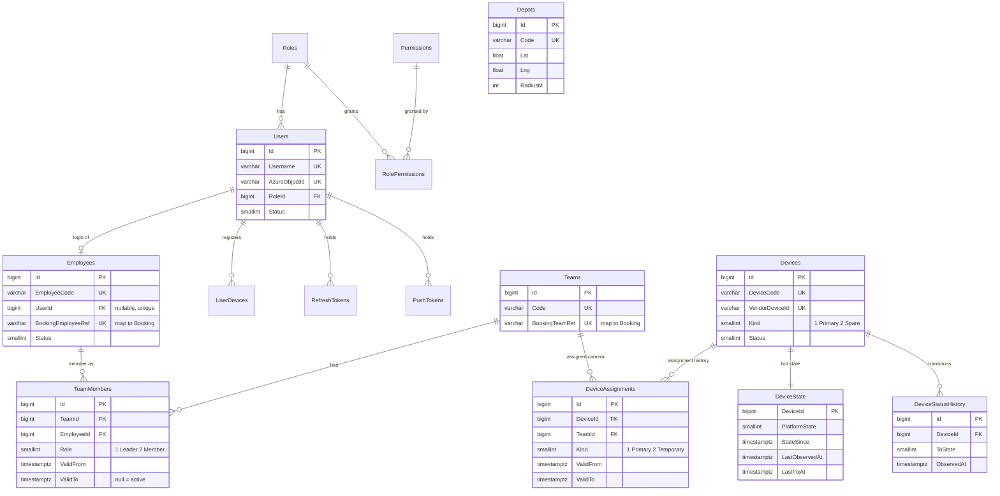
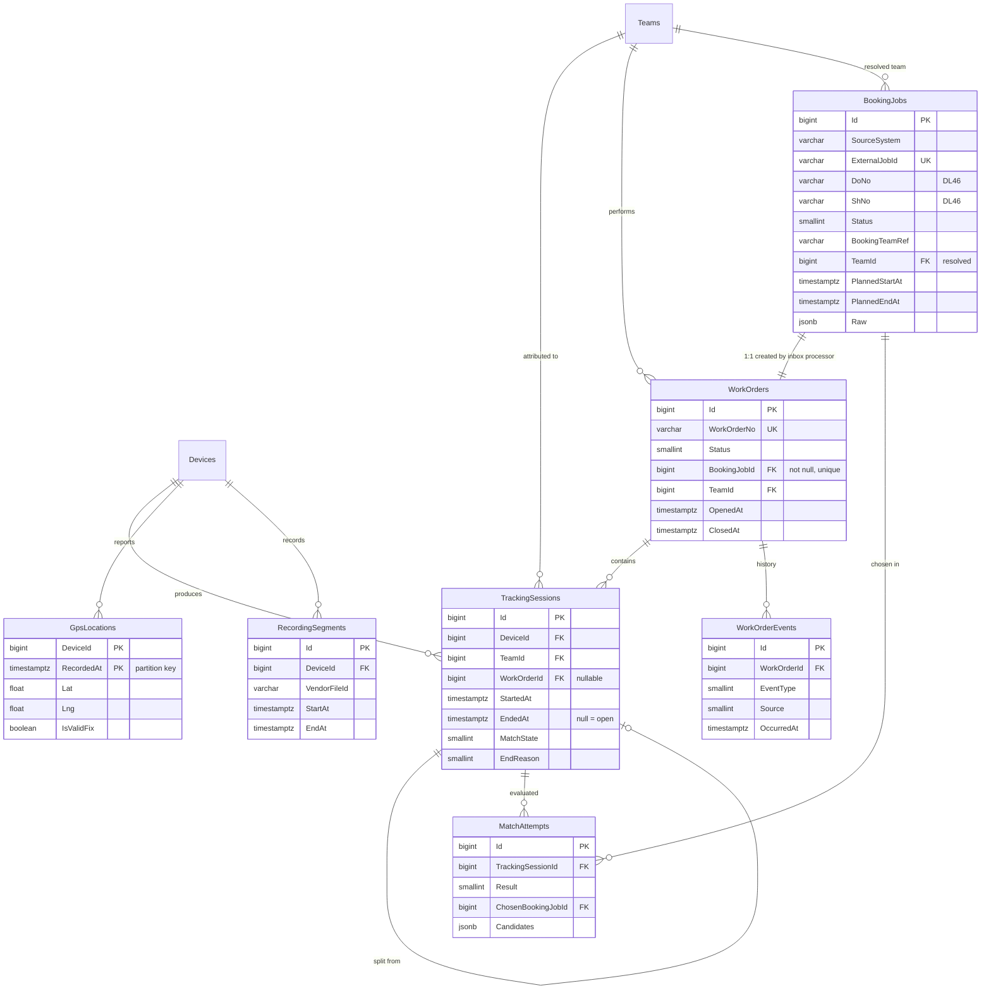
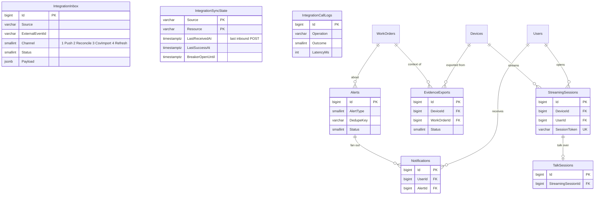

# Part 4 — Database Design

> เอกสารนี้เป็น **แหล่งอ้างอิงหลักของชื่อตาราง / คอลัมน์ / enum** — Part อื่นใช้ชื่อตามนี้
> Engine: **PostgreSQL 16** · ORM: **Drizzle ORM 0.45 + drizzle-kit** · driver: postgres.js (เหมือน reference)

---

## 4.1 หลักการออกแบบ (Design Decisions)

| # | Decision | เหตุผล |
|---|---|---|
| D1 | คง convention ของ reference: ตาราง/คอลัมน์ **PascalCase (quoted)**, PK `bigint GENERATED ALWAYS AS IDENTITY`, `timestamptz` (UTC), enum = `smallint` append-only | port โค้ดจาก reference ได้ตรง (`server/src/db/schema.ts`, `scope.predicates.ts`) · ทีมคุ้นเคย |
| D2 | **JSON ใช้ `jsonb`** (reference ใช้ `text`) | query/index ได้, validate ได้ |
| D3 | **แยก observed fact ออกจาก business record**: `TrackingSessions` = กล้องถูกใช้งานจริง · `WorkOrders` = ใบงานธุรกิจ | แก้ design smell pseudo work order (`WorkType = 5` + `CAM-AUTO`/`SITE-CAM`) ของ reference |
| D4 | **ใบงานมาจาก Booking เท่านั้น**: `WorkOrders.BookingJobId` → `BookingJobs` (projection ของงานที่ Smart Booking POST เข้ามา — DL46) · **NOT NULL** · unique = 1 Booking ↔ 1 WO · WO สร้าง/อัปเดตโดย inbox processor เท่านั้น (DL33) | WO มี PK / เลขใบงาน / timeline ของตัวเอง · matching ไม่ต้องเรียก API สด · session ที่ match ไม่ได้รอข้อมูล Booking โดยไม่สร้างใบงาน |
| D5 | เก็บข้อมูล Booking **เท่าที่ต้องใช้ match + แสดงผล** + `Raw jsonb` สำหรับ audit/debug | หลีกเลี่ยง duplicate ข้อมูล Booking โดยไม่จำเป็น · ลด PDPA exposure |
| D6 | **Invariant บังคับที่ DB**: partial unique, exclusion constraint (`btree_gist`), CHECK | race condition ระหว่าง API/worker ไม่สามารถสร้างข้อมูลผิด invariant ได้ แม้ logic มี bug |
| D7 | Hot state แยกตาราง: `DeviceState` (อัปเดตทุก poll) ออกจาก `Devices` (master) | ลด row churn / lock contention บน master |
| D8 | Soft delete เฉพาะ **master data** (Users, Employees, Teams, Devices) · fact/log tables **ไม่มี soft delete** (ใช้ status เช่น `Cancelled`) | ประวัติหลักฐานต้องไม่หาย |
| D9 | ไม่มี `CompanyId` (บริษัทเดียว) และ**ไม่มีแผนก** (ระบบใช้กับฝ่าย จป. ฝ่ายเดียว — DL53 ตัด `Departments` และคอลัมน์ `DepartmentId` ทุกตาราง) · scope มี 2 ระดับ: `all` (ทุก role web) และ `team` (`TEAM_LEADER` บนแอปมือถือ = ทีมที่ตนเป็นหัวหน้า active ผ่าน `Employees.UserId` → `TeamMembers` — DL47) | ตัดปัญหา `CompanyId = null` 3 ความหมายของ reference · scope `team` คำนวณจากข้อมูลที่มีอยู่ ไม่ต้องเพิ่มคอลัมน์ |
| D10 | `GpsLocations` และ `AuditLogs` **partition รายเดือน** · retention = `DROP PARTITION` | แทน batched ctid DELETE ของ reference (`retention.service.ts`) |
| D11 | เลขใบงานจาก **counter table** (`WorkOrderCounters`) แบบ atomic upsert | แทน `SELECT max + 1` + retry ของ reference |

Extensions ที่ต้องมี: `btree_gist` (exclusion constraint) — ถ้า managed Postgres ไม่อนุญาต ดู fallback ใน 4.6

---

## 4.2 ERD

> ฉบับ draw.io (ทุกตาราง ทุกคอลัมน์ + เส้นความสัมพันธ์): `docs/diagrams/database-erd.drawio` — หน้า 1 ภาพรวม PK/FK · หน้า 2–4 รายละเอียดตามกลุ่มเดียวกับ §4.2.1–4.2.3 · ใช้นำเสนอลูกค้า จึงไม่มีโน้ตภายใน/สถานะ phase

### 4.2.1 Organization, Teams, Devices



### 4.2.2 Tracking, Work Orders, Booking



### 4.2.3 Integration, Media, System



### 4.2.4 Cardinality สรุป

| ความสัมพันธ์ | Cardinality | บังคับด้วย |
|---|---|---|
| Team ↔ Leader (active) | 1 : 1 | `UQ_TeamMembers_ActiveLeader` |
| Employee ↔ Team (active) | N : 1 (1 คน 1 ทีม ณ เวลาหนึ่ง) | `UQ_TeamMembers_ActiveEmployee` |
| Team ↔ Primary camera (active) | 1 : 1 | `UQ_DevAsg_TeamActivePrimary` |
| Device ↔ Team ณ เวลาใด ๆ | N : 1 (ไม่ซ้อนเวลา) | `EX_DevAsg_NoOverlap` |
| Device ↔ Open session | 1 : 0..1 | `UQ_TS_OpenPerDevice` + `EX_TS_NoOverlap` |
| WorkOrder ↔ TrackingSession | 1 : N (session ที่ยังไม่มี WO ได้ — รอข้อมูล Booking) | FK `TrackingSessions.WorkOrderId` (nullable) |
| BookingJob ↔ WorkOrder | 1 : 1 (inbox processor สร้าง WO เมื่อได้รับงานจาก Smart Booking — DL33, DL46) | `BookingJobId` NOT NULL + `UQ_WO_BookingJob` |
| Employee ↔ User | 0..1 : 0..1 | `UQ_Employees_User` |

---

## 4.3 Enums (smallint, append-only — ห้าม renumber)

| Enum | ค่า |
|---|---|
| `Users.Status` | 1 Active · 2 Inactive (admin ปิด) · 3 Locked (ระบบล็อกชั่วคราว ดู `LockedUntil`) |
| `Employees.Status` | 1 Active · 2 Suspended · 3 Resigned |
| `TeamMembers.Role` | 1 Leader · 2 Member |
| `Devices.Kind` | 1 Primary · 2 Spare |
| `Devices.Status` | 1 Active · 2 Inactive · 3 Maintenance · 4 Retired |
| `DeviceState.PlatformState` | 1 Online · 2 Offline (UNKNOWN **ไม่เก็บ** — คำนวณจาก `LastObservedAt` เก่ากว่า `status.unknown-after-seconds`) |
| `DeviceState.LastSource` / `StateSource` / `DeviceStatusHistory.Source` | 1 *(สงวน — เดิม DssDeviceList · เลิกใช้ DL32)* · 2 DssLocation · 3 *(สงวน — เดิม BrmsMq · เลิกใช้ DL30)* · 4 *(สงวน — เดิม Webhook · เลิกใช้ DL32)* · 5 Manual · ห้ามใช้เลขที่สงวนซ้ำ · แหล่งสถานะปกติคือ DssLocation อย่างเดียว (Part 3 §3.1) |
| `DeviceAssignments.Kind` | 1 Primary · 2 Temporary (กล้องสำรอง) |
| `TrackingSessions.MatchState` | 1 Attached (มี WO) · 2 AwaitingMatch (ยังไม่มี WO — รอข้อมูล Booking, re-match อัตโนมัติ) · 3 NoTeam (กล้องไม่ได้ผูกทีม) · 4 Classified (ไม่มี WO — **ระบบตั้งเองเท่านั้น** เมื่อชาร์จที่ฐาน, `Classification = 1`) · match ไม่ได้ ⇒ ไม่สร้าง WO · ไม่มีการตั้งค่าโดยคน (DL33) |
| `TrackingSessions.StartInferred` | 1 Observed (StateSince) · 2 SplitBoundary · 3 PlannedBoundary (สลับงานอัตโนมัติ) |
| `TrackingSessions.EndReason` | 1 DeviceOffline · 2 StatusUnknown · 3 WorkOrderClosed (Booking check-out/cancel) · 4 JobSwitched · 5 MaxSegment · 6 DeviceReassigned · 7 AdminSplit · 8 *(สงวน — เดิม WorkOrderVoided · เลิกใช้ DL33)* · 9 AtBaseChanged · ห้ามใช้เลขที่สงวนซ้ำ |
| `TrackingSessions.Classification` | 1 IdleOrCharging (ระบบตั้งเองเมื่ออยู่ในรัศมีฐาน) · 2 *(สงวน — เดิม Test · เลิกใช้ DL33)* · 3 *(สงวน — เดิม Training · เลิกใช้ DL33)* · 9 *(สงวน — เดิม Other · เลิกใช้ DL33)* · ห้ามใช้เลขที่สงวนซ้ำ |
| `WorkOrders.Status` | 1 Open (Booking check-in) · 2 Closed · 3 Cancelled (Booking ยกเลิก — ยังดูหลักฐานได้) · 4 *(สงวน — เดิม Voided · เลิกใช้ DL33)* · 5 *(สงวน — เดิม Merged · เลิกใช้ DL33)* · 6 Planned (รอเริ่ม — ได้รับงานแล้วแต่ยังไม่ check-in · DL37) · ห้ามใช้เลขที่สงวนซ้ำ · **สถานะตาม Booking เท่านั้น** |
| `WorkOrders.CloseReason` | 1 BookingCheckout (check-out หรือ Completed จาก Booking — ทางปิดหลัก) · 2 *(สงวน — เดิม NoBookingData · เลิกใช้ DL33)* · 3 SafetyTimeout (ไม่ check-out ครบ 7 วัน — `workorder.force-close-after-hours`) · ห้ามใช้เลขที่สงวนซ้ำ · **ไม่มีการปิดโดยคนในระบบนี้** |
| `MatchAttempts.Confidence` | 1 High · 2 Medium · 3 Low |
| `WorkOrderEvents.EventType` | 1 Created · 2 StatusChanged · 3 *(สงวน — เดิม Linked · เลิกใช้ DL33)* · 4 *(สงวน — เดิม Unlinked · เลิกใช้ DL33)* · 5 *(สงวน — เดิม Relinked · เลิกใช้ DL33)* · 6 SessionAttached · 7 SessionDetached · 8 *(สงวน — เดิม MergedInto · เลิกใช้ DL33)* · 9 NoteUpdated · 10 ReviewFlagged (ตั้ง badge `NeedsReview`) · 11 *(สงวน — เดิม ReviewCleared · เลิกใช้ DL33)* · ห้ามใช้เลขที่สงวนซ้ำ |
| `WorkOrderEvents.Source` | 1 System · 2 Booking · 3 Operator · 4 Admin |
| `BookingJobs.Status` (canonical) | 1 Planned · 2 Confirmed · 3 InProgress · 4 Completed · 5 Cancelled · 9 Unknown (raw status map ไม่ได้) |
| `MatchAttempts.Trigger` | 1 SessionOpened · 2 Sweep · 3 BookingChanged · 4 AssignmentChanged · 5 *(สงวน — เดิม Manual · เลิกใช้ DL33)* · 6 Reconcile · ห้ามใช้เลขที่สงวนซ้ำ |
| `MatchAttempts.Result` | 1 Linked (attach เข้า WO ของ Booking job) · 2 *(สงวน — เดิม Suggested · เลิกใช้ DL33)* · 3 Ambiguous (หลาย candidate ⇒ `AwaitingMatch`) · 4 NoCandidate · 5 NoTeam · 6 *(สงวน — เดิม SkippedManual · เลิกใช้ DL33)* · 7 ProjectionStale · ห้ามใช้เลขที่สงวนซ้ำ |
| `IntegrationInbox.Status` | 1 Pending · 2 Processed · 3 Failed · 4 Ignored (version เก่า/ซ้ำ) · 5 Dead |
| `IntegrationInbox.Channel` | 1 Push (Smart Booking POST เข้ามา) · 2 Reconcile (read API ตอนกลางคืน — optional) · 3 CsvImport (admin upload CSV — ระยะแรกยังไม่มีหน้า upload · DL53) · 4 Refresh (refresh ต่องานผ่าน read API — optional) (DL46) |
| `IntegrationCallLogs.Outcome` | 1 Success · 2 HttpError · 3 Timeout · 4 NetworkError · 5 CircuitOpen · 6 InvalidResponse |
| `Alerts.Severity` / `Alerts.Status` | 1 Info · 2 Warning · 3 Critical / 1 New · 2 Acknowledged · 3 Resolved · 4 Dismissed |
| `Alerts.AlertType` | ดู [05-api-design.md §5.6](05-api-design.md#56-alert-types) |
| Streaming / Talk / Evidence | คงค่าจาก reference (`server/src/modules/streaming/streaming-constants.ts`, `talk/talk-constants.ts`) · Protocol 1 HLS · SessionType 1 Live 2 Playback · Evidence 1 Queued 2 Processing 3 Ready 4 Failed 5 Expired |

> `WorkOrders.LinkStatus` / `LinkSource` / `LinkConfidence` และ `TrackingSessions.LinkSource` ถูกตัดทั้งคอลัมน์พร้อม enum (DL33 — ยังไม่มีโค้ด จึงไม่ต้องสงวนเลข) · รายการที่ตัดทั้งหมดดู §4.4 E

---

## 4.4 Table Definitions

> คอลัมน์ audit มาตรฐาน (เรียกว่า **AUDIT**) = `CreatedAt timestamptz NN default now()`, `CreatedBy bigint FK Users`, `UpdatedAt timestamptz NN default now()` (ORM ตั้งค่าใหม่ทุกครั้งที่ update), `UpdatedBy bigint FK Users` · helper `createdAt()` / `updatedAt()` / `auditActor()` ใน `server/src/db/columns.ts`
> **SOFT** = `IsDeleted boolean NN default false`, `DeletedAt timestamptz`, `DeletedBy bigint FK Users` และ unique ทุกตัวเป็น partial `WHERE "IsDeleted" = false` · helper `softDelete()` + `notDeleted(t)`
> NN = NOT NULL

### A. Identity & Access

> ไม่มีตาราง `Departments` (DL53 — ไม่มีแผนก · migration `0002_drop_departments` ลบตารางเดิมพร้อม `Users.DepartmentId` / `Employees.DepartmentId`)

**Employees** — พนักงาน (จัดการที่หน้า พนักงาน `/employees`)
| Column | Type | Null | หมายเหตุ |
|---|---|---|---|
| Id | bigint identity | PK | |
| EmployeeCode | varchar(30) | NN | `UQ_Employees_Code` partial |
| FirstName / LastName | varchar(100) | NN | |
| Phone | varchar(30) | | |
| UserId | bigint | | FK → Users · `UQ_Employees_User` WHERE UserId IS NOT NULL AND IsDeleted = false |
| BookingEmployeeRef | varchar(64) | | รหัสพนักงานใน Booking · `UQ_Employees_BookingRef` partial · ใช้ map `leaderRef` ของใบงานเป็นหัวหน้าทีม (DL53) **[Assumption: Booking มี employee id]** |
| Status | smallint | NN | default 1 |
| AUDIT, SOFT | | | |

**Users** — บัญชีเข้าระบบ (port จาก reference ตัด `CompanyId`)
| Column | Type | Null | หมายเหตุ |
|---|---|---|---|
| Id | bigint identity | PK | |
| Username | varchar(50) | NN | `UQ_Users_Username` partial |
| PasswordHash | varchar(255) | | null = SSO-only · argon2 |
| Email | varchar(200) | | `UQ_Users_Email` on `lower(Email)` partial |
| FullName | varchar(200) | NN | |
| AzureObjectId | varchar(64) | | `UQ_Users_AzureObjectId` partial · null = ยังไม่เคย link (ไม่ใช่ "ห้ามเข้า") |
| RoleId | bigint | NN | FK → Roles · role `TEAM_LEADER` (scope `team`) ต้องผูกพนักงานผ่าน `Employees.UserId` — **บังคับใน service ไม่ใช่ DB** (DL47) |
| Status | smallint | NN | default 1 |
| FailedLoginCount | smallint | NN | default 0 |
| LockedUntil | timestamptz | | |
| LastLoginAt | timestamptz | | |
| AUDIT, SOFT | | | |

**Roles** (`Id`, `Code varchar(30) UQ`, `Name`, `IsSystem boolean`) — `ADMIN` · `COMPANY_ADMIN` (DL51 — scope `all`, web · เพิ่มด้วย data migration) · `OPERATOR` · `VIEWER` · `TEAM_LEADER` (DL47 — เพิ่มด้วย data migration) · data scope มาจาก `Code` (ไม่มีคอลัมน์ scope — Part 2 §2.8) · permission สงวนของ `ADMIN` (DL51) เป็นค่าคงที่ในโค้ด ไม่ใช่ข้อมูลใน DB · **Permissions** (`Id`, `Code varchar(100) UQ` รูปแบบ `resource:action`, `Resource`, `Action`, `Description`) · **RolePermissions** (`RoleId`, `PermissionId`, PK composite)

**RefreshTokens** — port ตรงจาก reference: `Id`, `UserId NN`, `TokenHash char(64) UQ`, `ExpiresAt NN`, `RevokedAt`, `ReplacedByTokenId FK self`, `UserDeviceId FK`, `CreatedAt` · IX `(UserId, ExpiresAt)`

**UserDevices** — ทะเบียนเครื่องมือถือ (**ไม่มี PIN/biometric**)
| Column | Type | Null | หมายเหตุ |
|---|---|---|---|
| Id | bigint identity | PK | |
| UserId | bigint | NN | FK → Users |
| InstallationId | varchar(100) | NN | id ที่แอปสร้าง (reference ใช้ชื่อ `DeviceId` ชนกับกล้อง — เปลี่ยนชื่อ) · `UQ_UserDevices_User_Installation (UserId, InstallationId)` |
| Platform | smallint | NN | 1 Android · 2 iOS · 3 Web |
| DeviceName | varchar(100) | | |
| PushEnabled | boolean | NN | default true |
| IsRevoked | boolean | NN | default false |
| LastSeenAt | timestamptz | | |
| CreatedAt | timestamptz | NN | |

**PushTokens** — `Id`, `UserId NN`, `UserDeviceId FK`, `Token varchar(512) UQ` (global unique — login ใหม่บนเครื่องเดิมโอนเจ้าของ), `Platform`, `IsRevoked`, `FailureCount`, `LastUsedAt`, `CreatedAt` · IX `(UserId, IsRevoked)`

### B. Teams

> **ไม่มีหน้าจัดการทีม** (DL53) — inbox processor สร้าง/อัปเดต `Teams` จาก `teamRef` และหัวหน้าทีม (`TeamMembers` Role 1) จาก leader ref ของใบงานที่ Smart Booking POST มา **[Assumption — Booking ส่งรหัสทีมและหัวหน้ามากับทุกใบ]** (Part 7 §7.5.2)

**Teams**
| Column | Type | Null | หมายเหตุ |
|---|---|---|---|
| Id | bigint identity | PK | |
| Code | varchar(30) | NN | `UQ_Teams_Code` partial · ทีมที่ระบบสร้างเองใช้ค่า `teamRef` |
| Name | varchar(200) | NN | ทีมที่ระบบสร้างเองใช้ค่า `teamRef` |
| BookingTeamRef | varchar(64) | | รหัสทีม/รถ/กะใน Booking · `UQ_Teams_BookingRef` partial · ไม่พบแถวที่ตรง ⇒ inbox processor สร้างทีมใหม่ (DL53) **[Assumption]** |
| IsActive | boolean | NN | default true |
| AUDIT, SOFT | | | |

**TeamMembers** — ประวัติสมาชิก (ไม่มี DELETE — ปิดด้วย `ValidTo`) · หัวหน้าทีมเปลี่ยนตาม leader ref ของใบงาน: ปิดแถว Leader เดิม + เปิดแถวใหม่ใน transaction เดียว (DL53)
| Column | Type | Null | หมายเหตุ |
|---|---|---|---|
| Id | bigint identity | PK | |
| TeamId | bigint | NN | FK → Teams |
| EmployeeId | bigint | NN | FK → Employees |
| Role | smallint | NN | 1 Leader · 2 Member |
| ValidFrom | timestamptz | NN | |
| ValidTo | timestamptz | | null = ยัง active |
| AssignedBy | bigint | | FK → Users (null = ระบบ — inbox processor) |
| Note | varchar(500) | | |
| CreatedAt | timestamptz | NN | |

Constraints: `CK_TeamMembers_Window` (`ValidTo IS NULL OR ValidTo > ValidFrom`) · `UQ_TeamMembers_ActiveLeader (TeamId) WHERE Role = 1 AND ValidTo IS NULL` · `UQ_TeamMembers_ActiveEmployee (EmployeeId) WHERE ValidTo IS NULL` · `EX_TeamMembers_LeaderNoOverlap` EXCLUDE gist (`TeamId =`, `tstzrange(ValidFrom, ValidTo) &&`) WHERE Role = 1 · IX `(TeamId, ValidFrom DESC)`

### C. Devices

**Devices** — master ของ bodycam · **สร้าง/อัปเดตโดย job `DeviceSync` ใน worker เท่านั้น** (DSS device list + `device-sync.plan.ts` · ไม่มีหน้าแก้ไข / sync ด้วยมือ / ปลดระวาง — DL53)
| Column | Type | Null | หมายเหตุ |
|---|---|---|---|
| Id | bigint identity | PK | |
| DeviceCode | varchar(30) | NN | รหัสภายใน · `UQ_Devices_Code` partial |
| VendorDeviceId | varchar(64) | NN | = DSS `deviceCode` · `UQ_Devices_VendorId` **ไม่ filter IsDeleted** (เหมือน reference — vendor id ต้องไม่ซ้ำตลอดกาล) |
| Name | varchar(200) | | |
| Model / SerialNo / Firmware | varchar(100) | | |
| SimNumber | varchar(30) | | |
| Kind | smallint | NN | 1 Primary · 2 Spare |
| Status | smallint | NN | default 1 |
| StreamingEnabled | boolean | NN | default true (toggle ต่ออุปกรณ์จาก reference · ระยะแรกไม่มีหน้าแก้ไข — คงค่า default · DL53) |
| VendorSeenAt / VendorMissingSince | timestamptz | | จาก `DeviceSync` · DSS ไม่ส่งเครื่องนี้มา ⇒ ตั้ง `VendorMissingSince` (ไม่ลบ) + alert `DEVICE_VENDOR_MISSING` |
| AUDIT, SOFT | | | IX `(Status)` |

**DeviceState** — hot row 1:1 (UPDATE ทุก observation)
| Column | Type | Null | หมายเหตุ |
|---|---|---|---|
| DeviceId | bigint | PK | FK → Devices |
| PlatformState | smallint | | 1 Online · 2 Offline · null = ยังไม่เคยเห็น |
| StateSince | timestamptz | | เวลา observation แรกของสถานะปัจจุบัน (เปลี่ยนเฉพาะตอน state เปลี่ยน) |
| LastObservedAt | timestamptz | | DB `now()` ตอนได้รับ observation ล่าสุด (ใช้คำนวณ UNKNOWN) |
| LastOnlineObservedAt | timestamptz | | observation ล่าสุดที่บอกว่า Online (ใช้เป็น EndedAt เมื่อ UNKNOWN นาน) |
| LastSource | smallint | | source ของ observation ล่าสุด |
| StateSource | smallint | | source ที่ตั้ง `PlatformState` ปัจจุบัน |
| StateSourceObservedAt | timestamptz | | observation ล่าสุดจาก `StateSource` — source ลำดับต่ำกว่าเปลี่ยน state ไม่ได้ขณะค่านี้ยังสด |
| LastFixAt | timestamptz | | |
| LastLat / LastLng | double precision | | |
| LastSpeedKph | real | | |
| LastHeading | smallint | | |
| LastFixValid | boolean | | |
| LastBatteryPercent | smallint | | ถ้า vendor ส่ง (DSS `/location` ปัจจุบันไม่ส่ง) |
| IsAtDepot | boolean | | คำนวณตอน observation: fix valid อายุ ≤ `depot.fix-max-age-minutes` อยู่ในรัศมี `Depots` · null = ไม่มี fix · (vendor ไม่มี charging state — Q21) |
| UpdatedAt | timestamptz | NN | |

IX `IX_DeviceState_PlatformState (PlatformState)`

**DeviceStatusHistory** — append-only, เขียนเฉพาะตอน transition
`Id`, `DeviceId NN`, `FromState smallint`, `ToState smallint NN`, `ObservedAt timestamptz NN`, `Source smallint NN`, `CreatedAt` · IX `(DeviceId, ObservedAt DESC)` · retention 12 เดือน

**DeviceAssignments** — ประวัติผูกกล้อง → ทีม (ไม่มี DELETE) · **projection ของข้อมูลจาก Booking** ถ้า Booking มีข้อมูลกล้องประจำทีม — ถ้าไม่มี ตารางนี้ว่างและการจับคู่ใช้ `BookingJobs.DeviceRefs` อย่างเดียว
| Column | Type | Null | หมายเหตุ |
|---|---|---|---|
| Id | bigint identity | PK | |
| DeviceId | bigint | NN | FK → Devices |
| TeamId | bigint | NN | FK → Teams |
| Kind | smallint | NN | 1 Primary · 2 Temporary (สำรอง — SessionSweep ปิดเมื่อ offline ≥ merge gap และไม่มี open session · safety cut 04:00 Asia/Bangkok วันถัดไป) |
| ValidFrom | timestamptz | NN | |
| ValidTo | timestamptz | | null = active |
| Source | smallint | NN | 2 BookingSync เท่านั้น — **การผูกกล้องมาจาก Booking เท่านั้น (Q20)** ระบบเราไม่มีการผูกเอง (ค่า 1 สงวนไว้) |
| AssignedBy | bigint | | FK → Users (null = ระบบ) |
| Reason | varchar(500) | | |
| CreatedAt | timestamptz | NN | |

Constraints: `CK_DevAsg_Window` · `EX_DevAsg_NoOverlap` EXCLUDE gist (`DeviceId =`, `tstzrange(ValidFrom, ValidTo) &&`) · `UQ_DevAsg_DeviceActive (DeviceId) WHERE ValidTo IS NULL` (fallback ถ้าไม่มี gist) · `UQ_DevAsg_TeamActivePrimary (TeamId) WHERE Kind = 1 AND ValidTo IS NULL` · IX `(TeamId, ValidFrom DESC)`

**Depots** — ฐาน/จุดชาร์จกล้อง (ใช้ตรวจ "อยู่ฐาน" ตาม Q15) — ใหม่ · รองรับหลายจุด · **ระยะแรกไม่มีหน้าจัดการ ⇒ ตารางว่างใน production ⇒ กฎ `IdleOrCharging` ยังไม่ทำงาน** (DL53) · dev seed พิกัด mock ไว้ทดสอบ (Q22)
| Column | Type | Null | หมายเหตุ |
|---|---|---|---|
| Id | bigint identity | PK | |
| Code | varchar(30) | NN | `UQ_Depots_Code` partial |
| Name | varchar(200) | NN | |
| Lat / Lng | double precision | NN | |
| RadiusM | integer | NN | default 150 · `CK_Depots_Radius` 20–2000 |
| IsActive | boolean | NN | default true |
| AUDIT, SOFT | | | |

### D. Tracking

**GpsLocations** — partitioned `RANGE (RecordedAt)` รายเดือน (UTC boundary)
| Column | Type | Null | หมายเหตุ |
|---|---|---|---|
| DeviceId | bigint | NN | **ไม่มี FK** (volume — เหมือน reference) |
| RecordedAt | timestamptz | NN | เวลาจากอุปกรณ์ · partition key |
| ReceivedAt | timestamptz | NN | default now() |
| Lat / Lng | double precision | NN | |
| SpeedKph | real | | |
| Heading | smallint | | |
| AltitudeM | real | | |
| SatelliteCount | smallint | | |
| IsValidFix | boolean | NN | drift filter >200 km/h ⇒ false (ไม่ทิ้ง) |
| BatteryPercent | smallint | | |

PK `PK_GpsLocations (DeviceId, RecordedAt)` (รวม partition key ⇒ `ON CONFLICT DO NOTHING` ใช้ได้, แทน unique + index ซ้ำซ้อนของ reference) · BRIN `(RecordedAt)` ต่อ partition · ไม่มี surrogate Id

**TrackingSessions** — ช่วงที่กล้องเปิดต่อเนื่องและสังกัด WO เดียวกัน
| Column | Type | Null | หมายเหตุ |
|---|---|---|---|
| Id | bigint identity | PK | |
| DeviceId | bigint | NN | FK → Devices |
| TeamId | bigint | | FK → Teams (ทีม ณ เวลาเริ่ม · null = กล้องไม่ผูกทีม) |
| WorkOrderId | bigint | | FK → WorkOrders · null = ยังไม่มีใบงาน (รอข้อมูล Booking — ไม่มีหน้าค้นวิดีโอย้อนหลังรายกล้อง ดูได้เฉพาะภาพสดเมื่อกล้องออนไลน์ · DL53) |
| StartedAt | timestamptz | NN | |
| EndedAt | timestamptz | | null = เปิดอยู่ |
| StartInferred | smallint | NN | |
| EndReason | smallint | | |
| MatchState | smallint | NN | attach โดย matching อัตโนมัติเท่านั้น (DL33) |
| Classification | smallint | | ใช้เมื่อ MatchState = 4 · ระบบตั้งเท่านั้น |
| ClassifiedAt | timestamptz | | เวลาที่ระบบจัดประเภท |
| PrevSessionId | bigint | | FK self (session ก่อนหน้าที่ถูก split) |
| RecordedSeconds | integer | | รวมความยาว recording ที่ index ได้ |
| RecordingIndexedAt | timestamptz | | |
| CreatedAt / UpdatedAt | timestamptz | NN | |

Constraints: `CK_TS_Window` (`EndedAt IS NULL OR EndedAt > StartedAt`) · `CK_TS_Attached` (`(MatchState = 1) = (WorkOrderId IS NOT NULL)`) · **`UQ_TS_OpenPerDevice (DeviceId) WHERE EndedAt IS NULL`** · **`EX_TS_NoOverlap`** EXCLUDE gist (`DeviceId =`, `tstzrange(StartedAt, EndedAt, '[)') &&`) · IX `(WorkOrderId)`, `(DeviceId, StartedAt DESC)`, `(TeamId, StartedAt DESC)`, `IX_TS_Unresolved (StartedAt) WHERE MatchState IN (2,3)` (session ที่รอ re-match อัตโนมัติ)

**RecordingSegments** — cache รายการไฟล์บันทึกจาก DSS recording search (แทน `PlaybackRecords`)
`Id`, `DeviceId NN`, `Channel smallint NN default 1`, `VendorFileId varchar(128) NN`, `StartAt NN`, `EndAt NN`, `DurationSeconds integer`, `SourceType smallint`, `IndexedAt NN` · `UQ_RecSeg_File (DeviceId, Channel, VendorFileId)` (reference ลืม Channel) · IX `(DeviceId, StartAt)`

### E. Work Orders

**WorkOrders** — ใบงาน 1:1 กับ `BookingJobs` · **สร้าง/อัปเดตโดย inbox processor เท่านั้น** (worker role `integration`) ทันทีที่ได้รับงานจาก Smart Booking (DL46) — ไม่มี code path อื่นสร้างใบงาน · ไม่มีการผูก/ยกเลิกผูก/รวม/void ด้วยมือ (DL33)
| Column | Type | Null | หมายเหตุ |
|---|---|---|---|
| Id | bigint identity | PK | |
| WorkOrderNo | varchar(30) | NN | `WO-YYYYMM-NNNNN` · `UQ_WO_No` |
| Title | varchar(300) | NN | จาก Booking job · อัปเดตทุกครั้งที่ได้รับงาน |
| Status | smallint | NN | default 6 Planned · ตาม Booking เท่านั้น (DL37) |
| CloseReason | smallint | | |
| BookingJobId | bigint | NN | FK → BookingJobs · `UQ_WO_BookingJob` (1 Booking ↔ 1 WO) |
| TeamId | bigint | | FK → Teams · ทีมจาก Booking job (`BookingJobs.TeamId`) · ว่างได้เมื่อ ref ทีมยัง map ไม่ได้ (matching ผ่าน `DeviceRefs` ไม่ต้องรู้ทีม) |
| LeaderEmployeeId | bigint | | FK → Employees (จาก Booking job — `BookingJobs.LeaderEmployeeId`) |
| OpenedAt | timestamptz | | เวลา check-in ตาม Booking · null ขณะ `Planned` (DL37) · ใช้นับ `workorder.stale-open-hours` / `workorder.force-close-after-hours` |
| LastActivityAt | timestamptz | | session ล่าสุดใน WO ยังเปิด = now / ปิด = EndedAt (แสดงผล/เรียงลำดับ) · null = ยังไม่มี session |
| ClosedAt | timestamptz | | ปิดโดยระบบเท่านั้น (Booking check-out/cancel หรือ `SafetyTimeout`) |
| NeedsReview | boolean | NN | default false · **badge ข้อมูล** แสดงในหน้าใบงาน + alert ถึง Admin — ไม่มีคิวตรวจสอบ / ปุ่มล้าง / SLA (DL33) |
| ReviewReasons | smallint[] | | เหตุผลของ badge: 1 BookingChangedAfterClose · 2 CancelledWithEvidence · 3 NoCheckout (ไม่มี check-out เกิน 36 ชม.) · 4 AutoSwitched · 5 SourceMissing (งานหายจาก Booking) · 6 SafetyTimeout · 7 *(สงวน — เดิม NoBookingData · เลิกใช้ DL33)* · ห้ามใช้เลขที่สงวนซ้ำ |
| Note | varchar(2000) | | หมายเหตุจากผู้ใช้ |
| RowVersion | integer | NN | default 1 · optimistic concurrency (`If-Match`) |
| CreatedAt / UpdatedAt | timestamptz | NN | |

Constraints:
- `CK_WO_Closed` — `Status = 1 OR ClosedAt IS NOT NULL`
- **`UQ_WO_BookingJob (BookingJobId)`** — unique ธรรมดา (ไม่มี `WHERE`) — 1 Booking ↔ 1 WO
- IX `(Status, OpenedAt DESC)`, `(TeamId, OpenedAt DESC)`

> ตัดออกตาม DL53 (ยังไม่มีโค้ด): `WorkOrders.DepartmentId` + `IX_WO_Dept_Opened` · `TrackingSessions.DepartmentId` · `Teams.DepartmentId` · `Devices.DepartmentId` · `Depots.DepartmentId` · `BookingJobs.BookingDepartmentRef` / `DepartmentId`

> ตัดออกตาม DL33 (ยังไม่มีโค้ด จึงไม่ต้อง migrate): คอลัมน์ `LinkStatus`, `LinkSource`, `LinkConfidence`, `SuggestedBookingJobId`, `LinkedAt`, `LinkedBy`, `SourceDeviceId`, `ClosedBy`, `CloseNote`, `MergedIntoWorkOrderId`, `ReviewSince`, `ReviewOverdueAlertedAt` · constraint `CK_WO_LinkConsistency`, `CK_WO_Merged`, `CK_WO_LinkedHasTeam`, `UQ_WO_OpenUnlinkedPerTeam`, `UQ_WO_OpenUnlinkedPerDevice` · index `IX_WO_ReviewQueue` · `TrackingSessions.LinkSource`, `TrackingSessions.ClassifiedBy`

**WorkOrderEvents** — timeline/audit ของใบงาน (append-only)
`Id`, `WorkOrderId NN`, `EventType NN`, `FromStatus`, `ToStatus`, `Source NN`, `ActorUserId`, `TrackingSessionId`, `BookingJobId`, `Reason varchar(500)`, `Detail jsonb`, `OccurredAt NN` · IX `(WorkOrderId, OccurredAt)`

**WorkOrderCounters** — `Period char(6) PK` (`YYYYMM` Asia/Bangkok), `LastValue integer NN`
```sql
INSERT INTO "WorkOrderCounters" ("Period","LastValue") VALUES ($1, 1)
ON CONFLICT ("Period") DO UPDATE SET "LastValue" = "WorkOrderCounters"."LastValue" + 1
RETURNING "LastValue";
```

### F. Booking Integration

**BookingJobs** — local projection ของใบงานที่ Smart Booking POST เข้ามา (DL46) — upsert โดย inbox processor (**ทุก field ฝั่ง Booking = [Assumption]** จนกว่าจะได้ spec)
| Column | Type | Null | หมายเหตุ |
|---|---|---|---|
| Id | bigint identity | PK | |
| SourceSystem | varchar(30) | NN | default `'BOOKING'` (รองรับหลายระบบในอนาคต) |
| ExternalJobId | varchar(100) | NN | `UQ_BookingJobs_External (SourceSystem, ExternalJobId)` |
| ExternalJobNo | varchar(50) | | เลขที่แสดงต่อผู้ใช้ |
| DoNo | varchar(50) | | เลข DO จาก Smart Booking (`job.doNo`) — มีใน job **[Confirmed — DL46]** · ความหมาย (คาดว่า Delivery Order) **[Assumption]** · แสดงผล + ค้นหาเท่านั้น ไม่ใช่ matching key |
| ShNo | varchar(50) | | เลข SH จาก Smart Booking (`job.shNo`) — มีใน job **[Confirmed — DL46]** · ความหมาย (คาดว่า Shipment) **[Assumption]** · แสดงผล + ค้นหาเท่านั้น ไม่ใช่ matching key |
| ExternalVersion | varchar(100) | | version/etag ถ้ามี |
| ExternalUpdatedAt | timestamptz | | ใช้ version guard (ข้อมูลเก่ากว่าห้ามทับ) |
| Status | smallint | NN | canonical |
| RawStatus | varchar(50) | | ค่าดิบจาก Booking |
| Title | varchar(300) | | |
| BookingTeamRef | varchar(64) | | **matching key** |
| TeamId | bigint | | FK → Teams · **cache** ที่ resolve จาก `Teams.BookingTeamRef` · ไม่พบทีม ⇒ inbox processor สร้างทีมจาก `teamRef` ก่อน (DL53) |
| BookingLeaderRef | varchar(64) | | **matching key** |
| LeaderEmployeeId | bigint | | FK → Employees · **cache** ที่ resolve จาก `Employees.BookingEmployeeRef` |
| ScheduledDate | date | | วันที่ของงาน (Asia/Bangkok) — fallback เมื่อไม่มีเวลาตามแผน |
| PlannedStartAt / PlannedEndAt | timestamptz | | `CK_BookingJobs_Window` |
| BookingCheckInAt / BookingCheckOutAt | timestamptz | | **เวลา check-in / check-out ใน Booking — กำหนดสถานะใบงาน** **[Assumption ด้านรูปแบบ]** |
| DeviceRefs | varchar(64)[] | | รหัสกล้องที่ Booking ระบุให้งานนี้ (รวมกล้องสำรอง) — matching key อันดับ 1 **[Assumption]** · GIN index |
| SiteName | varchar(300) | | |
| SiteAddress | varchar(1000) | | |
| SiteLat / SiteLng | double precision | | ใช้เป็น tie-breaker เท่านั้น |
| Raw | jsonb | NN | payload ล่าสุด (redact ข้อมูลส่วนบุคคลที่ไม่จำเป็นก่อนเก็บ) |
| PayloadHash | char(64) | NN | SHA-256 — ไม่เปลี่ยน = ไม่ต้อง re-match |
| MappingIssues | smallint[] | | 1 *(สงวน — เดิม UnknownTeamRef · เลิกใช้ DL53: ไม่พบทีม ⇒ สร้างจาก `teamRef`)* · 2 UnknownLeaderRef (ไม่มีพนักงานที่ `BookingEmployeeRef` ตรง ⇒ ไม่ตั้งหัวหน้าทีม) · 3 UnmappedStatus · 4 MissingWindow · 5 UnknownDeviceRef · 6 *(สงวน — เดิม UnknownDepartmentRef · เลิกใช้ DL53)* · ห้ามใช้เลขที่สงวนซ้ำ |
| FirstSyncedAt / LastSyncedAt | timestamptz | NN | ครั้งแรก / ครั้งล่าสุดที่ได้รับข้อมูลงานนี้ (POST / reconcile / CSV) · ชื่อคอลัมน์คงเดิม |
| SourceMissingSince | timestamptz | | หายจาก reconcile ตอนกลางคืน (ไม่ลบ) — ตั้งได้เฉพาะเมื่อมี read API (`BOOKING_PROVIDER_DRIVER` ≠ `none` — DL46) |

IX GIN `(DeviceRefs)`, `(BookingTeamRef, PlannedStartAt)`, `(BookingLeaderRef, PlannedStartAt)`, `(TeamId, PlannedStartAt)`, `(Status, PlannedStartAt)`, `(ScheduledDate)`, `(LastSyncedAt)`, `IX_BookingJobs_DoNo (DoNo) WHERE "DoNo" IS NOT NULL`, `IX_BookingJobs_ShNo (ShNo) WHERE "ShNo" IS NOT NULL` (ค้นหาด้วยเลข DO / SH — DL46), GIN ไม่จำเป็นในเฟสแรก

**MatchAttempts** — บันทึกการตัดสินใจ matching (เขียนเฉพาะเมื่อ `InputHash` เปลี่ยน)
`Id`, `TrackingSessionId NN`, `WorkOrderId`, `Trigger NN`, `Result NN`, `Confidence`, `ChosenBookingJobId`, `Candidates jsonb` (`[{bookingJobId, tier, score, reasons[]}]`), `InputHash char(64) NN`, `AlgoVersion smallint NN`, `ProjectionSyncedAt`, `AttemptedAt NN` · IX `(TrackingSessionId, AttemptedAt DESC)`, `(WorkOrderId, AttemptedAt DESC)` · retention 180 วัน

**IntegrationInbox** — ข้อมูลที่ Smart Booking POST เข้ามา + ที่ดึงจาก read API (ถ้ามี) + CSV import (DL46) — dedupe + process แบบ async · process `api` เขียนแถว `Channel = 1 Push` แล้ว enqueue `booking-inbox` หลัง commit · inbox processor (worker `integration`) map + upsert
`Id`, `Source varchar(30) NN`, `ExternalEventId varchar(200) NN` (body `eventId` ถ้ามี ไม่งั้น `{jobId}:{version ?? updatedAt}`), `EventType varchar(50)` (`job.created` / `job.updated` / `job.checked-in` / `job.checked-out` / `job.cancelled` — ข้อมูลประกอบเท่านั้น), `Channel smallint NN default 1` (1 Push · 2 Reconcile · 3 CsvImport · 4 Refresh — DL46), `Payload jsonb NN` (raw body — field ที่ไม่รู้จักเก็บไว้และไม่ใช้), `ReceivedAt NN`, `Status NN`, `Attempts smallint NN default 0`, `LastError text`, `ProcessedAt` · `UQ_Inbox_Event (Source, ExternalEventId)` · IX `(Status, ReceivedAt) WHERE Status IN (1,3)` (ใช้ทั้ง retry sweep — `Pending` เก่ากว่า 1 นาที + `Failed` — และวัดอายุ backlog สำหรับ `booking.stale-after-minutes`)

**IntegrationSyncState** — สถานะรับข้อมูลขาเข้า + read API (optional) + circuit breaker snapshot
PK `(Source, Resource)` · `LastReceivedAt` (POST ขาเข้าล่าสุดที่รับได้ — ใช้ alert `BOOKING_INBOUND_SILENT` · DL46), `LastAttemptAt`, `LastSuccessAt` (เรียก read API ล่าสุด — outbound), `LastFullSyncAt` (reconcile ล่าสุด), `LastErrorAt`, `LastError text`, `ConsecutiveFailures integer NN default 0`, `BreakerOpenUntil` · ตัด `Cursor` แล้ว (ไม่มี change feed — DL46 · ยังไม่มีโค้ด จึงลบได้เลย)

**IntegrationCallLogs** — log ทุก request ไป/มาจาก Booking (redacted, ตัดที่ 4 KB) · **ทุก POST ขาเข้าเขียน 1 แถว** `Direction = 2 Inbound`, `Operation = 'inbound.job'` (รวมที่ตอบ 400 / 401 — ใช้นับ inbound failure ใน metrics / dashboard · ไม่มีหน้า Integration — DL53) · ห้ามเก็บ secret / signature / body เต็ม (DL46)
`Id`, `Source NN`, `Direction smallint NN` (1 Outbound · 2 Inbound), `Operation varchar(50) NN`, `HttpMethod varchar(10)`, `Url varchar(500)` (ไม่มี secret/query token), `HttpStatus smallint`, `LatencyMs integer`, `CorrelationId varchar(64)`, `Outcome NN`, `ErrorMessage varchar(1000)`, `RequestExcerpt text`, `ResponseExcerpt text`, `OccurredAt NN` · IX `(Source, OccurredAt DESC)`, `(Outcome, OccurredAt DESC)` · retention 30 วัน

### G. Media (port จาก reference)

- **StreamingSessions** — `Id`, `DeviceId NN`, `Channel`, `UserId NN`, `SessionToken varchar(64) UQ`, `Protocol`, `SessionType`, `PlaybackStartAt`, `PlaybackEndAt`, `Status`, `VendorSessionId`, `StartedAt`, `LastAccessAt`, `EndedAt`, `EndReason` · IX `(UserId, Status)`, `(DeviceId, StartedAt DESC)`
- **TalkSessions** — คงโครงสร้าง reference: `StreamingSessionId NN`, `DeviceId NN`, `VendorTalkId`, `TicketHash char(64) UQ`, `Status`, `EndReason`, … · `UX_Talk_Device_Open (DeviceId) WHERE Status IN (1,2)`
- **EvidenceExports** — reference + `WorkOrderId FK`, `TrackingSessionId FK` (บริบท) · `Status`, `Progress`, `FilePath`, `Checksum char(64)`, `RequestedBy`, `ExpiresAt` · `FilePath` = path บน **Local disk PVC** (`STORAGE_DRIVER=local`) ที่ `worker-media` เขียนและ `api` stream ให้ดาวน์โหลด (DL34) · ไฟล์ลบหลัง 24 ชม. (`EvidenceCleanup`) · แถวเก็บ 12 เดือนเป็นหลักฐานว่าใครดึงอะไร

### H. Notifications & System

- **Alerts** — `Id`, `AlertType NN`, `Severity NN`, `Status NN`, `DeviceId`, `TeamId`, `WorkOrderId`, `TrackingSessionId`, `BookingJobId`, `Title`, `Message`, `Data jsonb`, `DedupeKey varchar(150)`, `OccurredAt NN`, `AcknowledgedAt/By`, `ResolvedAt/By` · **`UQ_Alerts_OpenDedupe (DedupeKey) WHERE Status IN (1,2)`** (กัน alert ซ้ำ — reference ใช้ logic ในโค้ด) · IX `(Status, Severity, OccurredAt DESC)`
- **Notifications** — port จาก reference (`UserId`, `AlertId`, `Channel`, `Title`, `Body`, `Data jsonb`, `Status`, `SentAt`, `ReadAt`) · `IX_Notif_Unread (UserId) WHERE ReadAt IS NULL`
- **AuditLogs** — partitioned รายเดือนตาม `OccurredAt` · คอลัมน์ตาม reference (`UserId`, `ActorUsername`, `ActorRole`, `Action`, `ResourceType`, `ResourceId`, `Changes jsonb`, `HttpMethod`, `RequestPath`, `Result`, `Ip`, `UserAgent`, `OccurredAt`) + `CorrelationId` · PK `(OccurredAt, Id)`
- **Settings** — port ตรง (`SettingKey UQ`, `SettingValue text`, `ValueType`, `Category`, `IsSystem`) · bounds อยู่ในโค้ด (`setting-spec.ts`)

รวม **33 ตาราง** (reference 33) — ตัดตารางที่ผูก dashcam/approval/company/site/แผนก (`Departments` — DL53) และเพิ่มตารางสำหรับ team, depot, session, Booking integration · ไม่มี `IntegrationOutbox` (ไม่มี write-back ไป Booking — DL31, DL46) · ไม่มีตารางใหม่จาก DL46/DL47 (เพิ่มแค่คอลัมน์) · รายการครบอยู่ใน README (Recommended Database Schema)

### I. DSS middleware (schema `dss` — ไม่ใช่ของ NestJS)

- **`dss."RequestLogs"`** — ประวัติ request หลักที่เข้า DSS middleware (`psd-bwc-dss-services`) สำหรับดูสถิติการใช้งานและ monitor · DSS middleware เป็นผู้สร้างและเขียนเองผ่าน `REQUEST_LOG_DATABASE_URL` (ว่าง = ไม่เก็บ) · NestJS ไม่อ่าน/ไม่เขียน และ**ไม่นับรวมใน 33 ตารางข้างบน**
- คอลัมน์: `Id bigint identity PK`, `OccurredAt timestamptz NN`, `Client varchar(50)` (ชื่อผู้เรียกจาก JWT `kid` เช่น `smart-booking`), `Method varchar(10) NN` (`WS` = WebSocket), `Path varchar(300) NN`, `DeviceCode varchar(64)`, `StatusCode smallint NN`, `ResultCode integer` (`code` ของ DSS — DSS ตอบ HTTP 200 แม้ล้มเหลว), `DurationMs integer NN`, `ClientIp varchar(45)`, `UserAgent varchar(300)`, `Detail varchar(300)` · IX `IX_RequestLogs_Occurred (OccurredAt DESC)`, `IX_RequestLogs_Device (DeviceCode, OccurredAt DESC)`
- ไม่เก็บ polling / request ที่ถี่มาก: `/health`, `/body-camera/proxy` (HLS), `/api/v1/location` (GpsPoll ทุก 15s) — ตั้งได้ที่ `REQUEST_LOG_EXCLUDE_PATHS` · DDL อยู่ที่ `psd-bwc-dss-services/deploy/request-logs.sql`

---

## 4.5 Data Lifecycle, Retention & Archiving

Retention ตามที่ผู้ใช้ยืนยัน **[Confirmed — Q12]**: GPS 3 เดือน · ใบงาน 3 เดือน · audit log 12 เดือน · วิดีโอบน DSS 3 เดือน (infra จัดการ) — **ไม่มี archive** (ลบตามกำหนด ลดภาระ PDPA)

| ข้อมูล | เก็บใน DB | วิธีลบ | หมายเหตุ |
|---|---|---|---|
| GpsLocations | 3 เดือน (เดือนปัจจุบัน + 3 partition ก่อนหน้า) | `DROP PARTITION` | worker สร้าง partition ล่วงหน้า 2 เดือน |
| DeviceStatusHistory | 3 เดือน | DELETE batch รายวัน | |
| WorkOrders + WorkOrderEvents + TrackingSessions + MatchAttempts | 3 เดือนนับจาก `ClosedAt` (ใบที่ยัง Open ไม่ลบ) | job `WorkOrderRetention` รายวัน ลบเป็นชุดตามลำดับ FK: MatchAttempts → sessions → events → WO | session ที่ไม่มี WO ลบเมื่อ `EndedAt` เกิน 3 เดือน |
| BookingJobs | 3 เดือนหลังงานจบ (และไม่มี WO ที่ยังเก็บอยู่อ้างถึง) | DELETE batch | |
| RecordingSegments | 3 เดือน (ตรงกับ DSS) | DELETE batch | วิดีโอจริงอยู่ที่ DSS — infra จัดการ retention |
| AuditLogs | 12 เดือน | `DROP PARTITION` | |
| StreamingSessions / TalkSessions / EvidenceExports (แถว) | 12 เดือน (ตาม audit) | DELETE batch | ใครดู/ดึงอะไรเมื่อไร · ไฟล์ MP4 บน Local disk PVC ลบหลัง 24 ชม. (`EvidenceCleanup` — DL34) |
| Notifications / Alerts | 90 วัน | DELETE batch | |
| IntegrationInbox | 30 วัน (Dead เก็บจนกว่าจะ resolve — ประมวลผลใหม่จาก `Payload` ได้ DL54) | DELETE batch | |
| IntegrationCallLogs | 30 วัน | DELETE batch | |
| `dss."RequestLogs"` | 90 วัน (`REQUEST_LOG_RETENTION_DAYS`) | DELETE batch รายวัน (ชุดละ 5000) โดย DSS middleware | ไม่ใช่ job ของ NestJS · `0` = ไม่ลบ |

> หลักฐานที่ต้องเก็บนานกว่า 3 เดือน ให้ export MP4 ออกไปเก็บนอกระบบก่อนครบกำหนด — ระบบแสดงวันที่ข้อมูลจะถูกลบในหน้าใบงาน

ประมาณปริมาณ GPS: 100 กล้อง (DL56) × poll ทุก 15s ⇒ สูงสุด ~0.58M แถว/วัน ถ้าทุกตัวมี fix ตลอด 24 ชม. · ใช้งานจริง (≈30% มี fix ~10 ชม./วัน) ≈ 72k แถว/วัน ≈ 2.2M แถว/เดือน — partition รายเดือนเหมาะสม

---

## 4.6 Index & Constraint Strategy

1. **ทุก query ของ list page มี index นำด้วยคอลัมน์ filter หลัก + เวลา DESC** (`(TeamId, OpenedAt DESC)` ฯลฯ) — pagination แบบ offset ได้ในเฟสแรก, เปลี่ยนเป็น keyset เมื่อเกิน 100k แถว
2. **Partial index สำหรับงานค้างของ worker** (`IX_TS_Unresolved` — session รอ re-match, inbox pending) — เล็กและเร็ว
3. **Exclusion constraint ต้องใช้ `btree_gist`** · Fallback ถ้าไม่ได้: คง partial unique "active ≤ 1" (`UQ_DevAsg_DeviceActive`, `UQ_TS_OpenPerDevice`) + ตรวจ overlap ใน service ภายใต้ `SELECT … FOR UPDATE` ของ `DeviceState` (lock order เดียวกันทั้งระบบ)
4. **GpsLocations**: PK `(DeviceId, RecordedAt)` ตอบ query history ต่ออุปกรณ์ · BRIN `(RecordedAt)` สำหรับ scan ข้ามอุปกรณ์ · ไม่สร้าง index อื่น
5. **ไม่สร้าง FK จาก `GpsLocations`** (insert volume) — ความถูกต้องของ `DeviceId` มาจาก ingestion pipeline

---

## 4.7 Migration Strategy

1. **Baseline** `0000_baseline` จาก `drizzle-kit generate` — ตารางของ P0 ใน `schema.ts` (Roles, Users, Employees, Permissions, RolePermissions, UserDevices, RefreshTokens, PushTokens, Settings + `Departments` เดิม) · **`0002_drop_departments`** (DL53): ลบ FK / index / คอลัมน์ `Users.DepartmentId`, `Employees.DepartmentId` แล้ว `DROP TABLE "Departments"` (ไม่ใช้ `CASCADE` — มี object อื่นอ้างถึงให้ migration fail แทนการลบเงียบ) · **ช่วง dev (ก่อน go-live production ครั้งแรก) ข้อมูลใน DB ทิ้งได้** — แก้ / รวม / generate migration ใหม่ทั้งชุด และ drop-recreate DB ได้ (DL50) · **หลัง go-live: append-only** ไม่แก้ไฟล์ที่ apply แล้ว เพิ่มไฟล์ใหม่ต่อท้ายเท่านั้น
2. **`0001_extensions_partitions` (custom SQL — P0)**: `CREATE EXTENSION btree_gist` · `AuditLogs` แบบ `PARTITION BY RANGE ("OccurredAt")` (PK `(OccurredAt, Id)`, `Id` ใช้ sequence `AuditLogs_Id_seq`) + partition `AuditLogs_default` + block `DO $$` สร้าง `AuditLogs_YYYYMM` ของเดือนปัจจุบันและ 2 เดือนถัดไป (ขอบเดือน UTC) + index `IX_AuditLogs_Occurred (OccurredAt DESC)`, `IX_AuditLogs_User (UserId, OccurredAt DESC)` บนตารางแม่
3. **Custom SQL ของ phase ถัดไป** (ช่วง dev จะเพิ่มลง `0001` เดิมแล้ว reset DB หรือแยกไฟล์ใหม่ก็ได้ — DL50): `GpsLocations` partitioned + BRIN — P1 (pattern เดียวกับ `AuditLogs`) · exclusion constraints ใส่ใน migration ของ phase ที่สร้างตารางนั้น เพราะ drizzle-kit generate `EXCLUDE` ไม่ได้: `EX_TeamMembers_LeaderNoOverlap` (P1) · `EX_TS_NoOverlap` (P2) · `EX_DevAsg_NoOverlap` (phase ที่สร้าง `DeviceAssignments`) — ตัวอย่างใน §4.9
4. **Reference data ผ่าน custom data migration** (`npm run db:generate -- --custom`, ทุก statement `ON CONFLICT DO NOTHING`): roles, permissions, role-permissions, settings defaults — **seed ใช้เฉพาะ dev** (แก้กับดัก "ห้ามรัน seed ใน production" ของ reference)
5. **Partitioned tables** ประกาศ `pgTable` ใน `server/src/db/schema.partitioned.ts` ซึ่ง **ไม่อยู่ใน `schema` path ของ `drizzle.config.ts`** ⇒ drizzle-kit ไม่ generate DDL ให้ แต่ query แบบ typed ได้ · ตอนนี้มี `AuditLogs` · `GpsLocations` เพิ่มใน P1
6. **Drift gate**: port `guardMigrationsOrExit()` (`server/src/db/migration-status.ts`, `assert-migrations.ts`) + advisory lock ตอน migrate · production รัน migrate เป็น step แยกก่อน deploy (reference ยังไม่มีใน Dockerfile — ต้องทำ)
7. **ไม่ย้ายข้อมูลจากระบบเดิม** **[Confirmed — Q13]** — เป็นระบบใหม่ทั้งหมด ระบบเดิมใช้เป็น reference เท่านั้น · master data ตั้งใหม่ในระบบนี้: พนักงาน, ผู้ใช้ (รวมสร้างจาก Entra) ตั้งผ่านหน้าจอ · อุปกรณ์ sync จาก DSS อัตโนมัติ · ทีม / หัวหน้าทีมเกิดจากใบงาน Booking · ฐานยังไม่มีหน้าจัดการ (DL53)
8. **Schema `dss` อยู่นอก drizzle** — `drizzle.config.ts` ไม่ได้ตั้ง `schemaFilter` ⇒ drizzle-kit ดูแค่ `public` จึงไม่ยุ่งกับ `dss."RequestLogs"` · **อย่าเพิ่ม `dss` ใน `schemaFilter`** (drizzle-kit จะเห็นตารางนี้เป็นส่วนเกินและเสนอให้ลบ) · DSS middleware สร้าง schema + ตารางเองตอนเขียนครั้งแรก (`CREATE SCHEMA/TABLE IF NOT EXISTS`) และสร้างใหม่เองถ้าตารางหายระหว่างรัน ⇒ drop-recreate DB ช่วง dev (DL50) ไม่ต้อง restart DSS middleware · ถ้า DB user ไม่มีสิทธิ์ `CREATE` ให้ DBA รัน `deploy/request-logs.sql` ของ `psd-bwc-dss-services` และ GRANT ก่อน

---

## 4.8 ตัวอย่าง Drizzle Schema

```ts
// server/src/db/schema.ts (ตัดตอน · ตารางของ phase หลัง P0 — เขียนตาม convention ของ code จริง:
// export ชื่อ PascalCase ตรงกับชื่อตาราง + helper จาก ./columns)
import { sql } from 'drizzle-orm';
import {
  pgTable, varchar, smallint, boolean, integer, jsonb, char,
  doublePrecision, date, unique, uniqueIndex, index, check, type AnyPgColumn,
} from 'drizzle-orm/pg-core';
import {
  pkId, ref, tstz, createdAt, updatedAt, auditActor, softDelete, notDeleted,
} from './columns';
// pkId() = bigint identity PK · ref(name, () => T.Id) = bigint FK · tstz(name) = timestamptz

export const Teams = pgTable('Teams', {
  Id: pkId(),
  Code: varchar('Code', { length: 30 }).notNull(),
  Name: varchar('Name', { length: 200 }).notNull(),
  BookingTeamRef: varchar('BookingTeamRef', { length: 64 }), // inbox processor สร้างทีมจาก teamRef (DL53)
  IsActive: boolean('IsActive').notNull().default(true),
  CreatedAt: createdAt(),
  UpdatedAt: updatedAt(),
  ...auditActor(),
  ...softDelete(),
}, (t) => [
  uniqueIndex('UQ_Teams_Code').on(t.Code).where(notDeleted(t)),
  uniqueIndex('UQ_Teams_BookingRef').on(t.BookingTeamRef)
    .where(sql`"BookingTeamRef" IS NOT NULL AND "IsDeleted" = false`),
]);

export const BookingJobs = pgTable('BookingJobs', {
  Id: pkId(),
  SourceSystem: varchar('SourceSystem', { length: 30 }).notNull().default('BOOKING'),
  ExternalJobId: varchar('ExternalJobId', { length: 100 }).notNull(),
  ExternalJobNo: varchar('ExternalJobNo', { length: 50 }),
  DoNo: varchar('DoNo', { length: 50 }), // DL46 — แสดงผล + ค้นหา ไม่ใช่ matching key
  ShNo: varchar('ShNo', { length: 50 }), // DL46
  ExternalUpdatedAt: tstz('ExternalUpdatedAt'),
  Status: smallint('Status').notNull(),
  RawStatus: varchar('RawStatus', { length: 50 }),
  Title: varchar('Title', { length: 300 }),
  BookingTeamRef: varchar('BookingTeamRef', { length: 64 }),
  TeamId: ref('TeamId', () => Teams.Id),
  BookingLeaderRef: varchar('BookingLeaderRef', { length: 64 }),
  LeaderEmployeeId: ref('LeaderEmployeeId', () => Employees.Id),
  ScheduledDate: date('ScheduledDate', { mode: 'string' }),
  PlannedStartAt: tstz('PlannedStartAt'),
  PlannedEndAt: tstz('PlannedEndAt'),
  SiteLat: doublePrecision('SiteLat'),
  SiteLng: doublePrecision('SiteLng'),
  Raw: jsonb('Raw').notNull(),
  PayloadHash: char('PayloadHash', { length: 64 }).notNull(),
  MappingIssues: smallint('MappingIssues').array(),
  FirstSyncedAt: tstz('FirstSyncedAt').notNull().defaultNow(), // ได้รับข้อมูลครั้งแรก
  LastSyncedAt: tstz('LastSyncedAt').notNull().defaultNow(),   // ได้รับข้อมูลครั้งล่าสุด
  SourceMissingSince: tstz('SourceMissingSince'),              // เฉพาะ reconcile (read API — optional)
}, (t) => [
  uniqueIndex('UQ_BookingJobs_External').on(t.SourceSystem, t.ExternalJobId),
  index('IX_BookingJobs_TeamRef_Start').on(t.BookingTeamRef, t.PlannedStartAt),
  index('IX_BookingJobs_LeaderRef_Start').on(t.BookingLeaderRef, t.PlannedStartAt),
  index('IX_BookingJobs_Team_Start').on(t.TeamId, t.PlannedStartAt),
  index('IX_BookingJobs_DoNo').on(t.DoNo).where(sql`"DoNo" IS NOT NULL`),
  index('IX_BookingJobs_ShNo').on(t.ShNo).where(sql`"ShNo" IS NOT NULL`),
  check('CK_BookingJobs_Window',
    sql`"PlannedEndAt" IS NULL OR "PlannedStartAt" IS NULL OR "PlannedEndAt" >= "PlannedStartAt"`),
]);

export const WorkOrders = pgTable('WorkOrders', {
  Id: pkId(),
  WorkOrderNo: varchar('WorkOrderNo', { length: 30 }).notNull(),
  Title: varchar('Title', { length: 300 }).notNull(),
  Status: smallint('Status').notNull().default(6), // 6 Planned (DL37)
  CloseReason: smallint('CloseReason'),
  BookingJobId: ref('BookingJobId', () => BookingJobs.Id).notNull(),
  TeamId: ref('TeamId', () => Teams.Id),
  LeaderEmployeeId: ref('LeaderEmployeeId', () => Employees.Id),
  OpenedAt: tstz('OpenedAt'),
  LastActivityAt: tstz('LastActivityAt'),
  ClosedAt: tstz('ClosedAt'),
  NeedsReview: boolean('NeedsReview').notNull().default(false),
  ReviewReasons: smallint('ReviewReasons').array(),
  Note: varchar('Note', { length: 2000 }),
  RowVersion: integer('RowVersion').notNull().default(1),
  CreatedAt: createdAt(),
  UpdatedAt: updatedAt(),
}, (t) => [
  uniqueIndex('UQ_WO_No').on(t.WorkOrderNo),
  unique('UQ_WO_BookingJob').on(t.BookingJobId),
  index('IX_WO_Team_Opened').on(t.TeamId, t.OpenedAt.desc()),
  check('CK_WO_Closed', sql`"Status" = 1 OR "ClosedAt" IS NOT NULL`),
]);

export const TrackingSessions = pgTable('TrackingSessions', {
  Id: pkId(),
  DeviceId: ref('DeviceId', () => Devices.Id).notNull(),
  TeamId: ref('TeamId', () => Teams.Id),
  WorkOrderId: ref('WorkOrderId', () => WorkOrders.Id),
  StartedAt: tstz('StartedAt').notNull(),
  EndedAt: tstz('EndedAt'),
  StartInferred: smallint('StartInferred').notNull().default(1),
  EndReason: smallint('EndReason'),
  MatchState: smallint('MatchState').notNull(),
  Classification: smallint('Classification'),
  ClassifiedAt: tstz('ClassifiedAt'),
  PrevSessionId: ref('PrevSessionId', (): AnyPgColumn => TrackingSessions.Id),
  RecordedSeconds: integer('RecordedSeconds'),
  RecordingIndexedAt: tstz('RecordingIndexedAt'),
  CreatedAt: createdAt(),
  UpdatedAt: updatedAt(),
}, (t) => [
  uniqueIndex('UQ_TS_OpenPerDevice').on(t.DeviceId).where(sql`"EndedAt" IS NULL`),
  index('IX_TS_WorkOrder').on(t.WorkOrderId),
  index('IX_TS_Device_Started').on(t.DeviceId, t.StartedAt.desc()),
  index('IX_TS_Unresolved').on(t.StartedAt).where(sql`"MatchState" IN (2,3)`),
  check('CK_TS_Window', sql`"EndedAt" IS NULL OR "EndedAt" > "StartedAt"`),
  check('CK_TS_Attached', sql`("MatchState" = 1) = ("WorkOrderId" IS NOT NULL)`),
]);
```

## 4.9 ตัวอย่าง Custom Migration SQL

**P0 (มีแล้ว)** — `server/drizzle/0001_extensions_partitions.sql` (ตัดตอน · ดูไฟล์จริงสำหรับคอลัมน์ครบ)

```sql
CREATE EXTENSION IF NOT EXISTS btree_gist;
--> statement-breakpoint
CREATE SEQUENCE IF NOT EXISTS "AuditLogs_Id_seq" AS bigint;
--> statement-breakpoint
CREATE TABLE "AuditLogs" (
  "Id"         bigint      NOT NULL DEFAULT nextval('"AuditLogs_Id_seq"'),
  -- ... คอลัมน์ตาม §4.4 ...
  "OccurredAt" timestamptz NOT NULL DEFAULT now(),
  CONSTRAINT "PK_AuditLogs" PRIMARY KEY ("OccurredAt", "Id")
) PARTITION BY RANGE ("OccurredAt");
--> statement-breakpoint
ALTER SEQUENCE "AuditLogs_Id_seq" OWNED BY "AuditLogs"."Id";
--> statement-breakpoint
CREATE TABLE IF NOT EXISTS "AuditLogs_default" PARTITION OF "AuditLogs" DEFAULT;
--> statement-breakpoint
DO $$
DECLARE
  month_start timestamp := date_trunc('month', now() AT TIME ZONE 'UTC');
  i int;
  from_ts timestamptz;
  to_ts timestamptz;
BEGIN
  FOR i IN 0..2 LOOP
    from_ts := (month_start + make_interval(months => i)) AT TIME ZONE 'UTC';
    to_ts := (month_start + make_interval(months => i + 1)) AT TIME ZONE 'UTC';
    EXECUTE format(
      'CREATE TABLE IF NOT EXISTS %I PARTITION OF "AuditLogs" FOR VALUES FROM (%L) TO (%L)',
      'AuditLogs_' || to_char(month_start + make_interval(months => i), 'YYYYMM'),
      from_ts,
      to_ts
    );
  END LOOP;
END
$$;
--> statement-breakpoint
CREATE INDEX "IX_AuditLogs_Occurred" ON "AuditLogs" ("OccurredAt" DESC);
--> statement-breakpoint
CREATE INDEX "IX_AuditLogs_User" ON "AuditLogs" ("UserId", "OccurredAt" DESC);
```

**P1 / P2 (แผน — ยังไม่มีใน code)** — custom SQL ของแต่ละ phase · ช่วง dev ต่อท้าย `0001` หรือแยกไฟล์ใหม่ (`npm run db:generate -- --custom --name=<ชื่อ>`) ก็ได้ (DL50)

```sql
-- P1: exclusion constraint ของ TeamMembers (ตารางสร้างใน migration ที่ generate ของ P1)
ALTER TABLE "TeamMembers" ADD CONSTRAINT "EX_TeamMembers_LeaderNoOverlap"
  EXCLUDE USING gist ("TeamId" WITH =, tstzrange("ValidFrom", "ValidTo", '[)') WITH &&)
  WHERE ("Role" = 1);
--> statement-breakpoint
-- P2: exclusion constraint ของ TrackingSessions
ALTER TABLE "TrackingSessions" ADD CONSTRAINT "EX_TS_NoOverlap"
  EXCLUDE USING gist ("DeviceId" WITH =, tstzrange("StartedAt", "EndedAt", '[)') WITH &&);
--> statement-breakpoint
-- phase ที่สร้าง DeviceAssignments
ALTER TABLE "DeviceAssignments" ADD CONSTRAINT "EX_DevAsg_NoOverlap"
  EXCLUDE USING gist ("DeviceId" WITH =, tstzrange("ValidFrom", "ValidTo", '[)') WITH &&);
--> statement-breakpoint
-- P1: GpsLocations partitioned (pattern เดียวกับ AuditLogs)
CREATE TABLE "GpsLocations" (
  "DeviceId"       bigint           NOT NULL,
  "RecordedAt"     timestamptz      NOT NULL,
  "ReceivedAt"     timestamptz      NOT NULL DEFAULT now(),
  "Lat"            double precision NOT NULL,
  "Lng"            double precision NOT NULL,
  "SpeedKph"       real,
  "Heading"        smallint,
  "AltitudeM"      real,
  "SatelliteCount" smallint,
  "IsValidFix"     boolean          NOT NULL DEFAULT true,
  "BatteryPercent" smallint,
  CONSTRAINT "PK_GpsLocations" PRIMARY KEY ("DeviceId", "RecordedAt")
) PARTITION BY RANGE ("RecordedAt");
--> statement-breakpoint
CREATE TABLE IF NOT EXISTS "GpsLocations_default" PARTITION OF "GpsLocations" DEFAULT;
--> statement-breakpoint
-- ละไว้: block DO $$ แบบเดียวกับ AuditLogs สร้าง GpsLocations_YYYYMM เดือนปัจจุบัน + 2 เดือนถัดไป
-- (ขอบเดือน UTC) เป็น statement แยกของตัวเอง
CREATE INDEX "IX_GpsLocations_RecordedAt_brin"
  ON "GpsLocations" USING brin ("RecordedAt"); -- สร้างบนตารางแม่ ⇒ ทุก partition ได้ index อัตโนมัติ
```

> หมายเหตุ: `tstzrange(a, NULL)` = ช่วงไม่มีขอบบน จึงไม่ต้อง `COALESCE(EndedAt, 'infinity')` · partition ถัดไปสร้างโดย job `PartitionMaintenance` ใน worker (สร้างล่วงหน้า 2 เดือน, idempotent ด้วย `CREATE TABLE IF NOT EXISTS`) · index บนตารางแม่ถูกสร้างให้ partition ใหม่เอง job จึงไม่ต้องสร้าง index · partition `_default` รับแถวที่ไม่มี partition เดือนนั้นรองรับ: แถวใน `_default` **ไม่ถูกลบด้วย `DROP PARTITION`** และถ้า `_default` มีแถวในช่วงเดือนที่จะสร้าง `CREATE TABLE … PARTITION OF` จะ error ⇒ `PartitionMaintenance` ต้องสร้างล่วงหน้าให้ทันเพื่อให้ `_default` ว่างอยู่เสมอ
