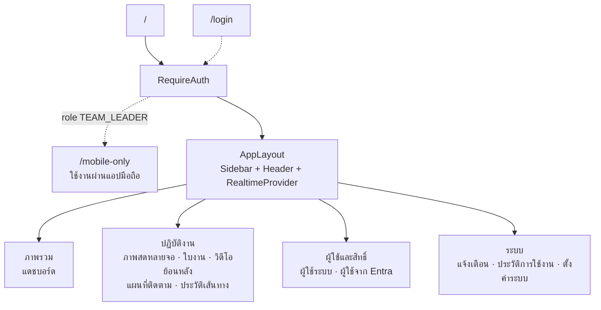
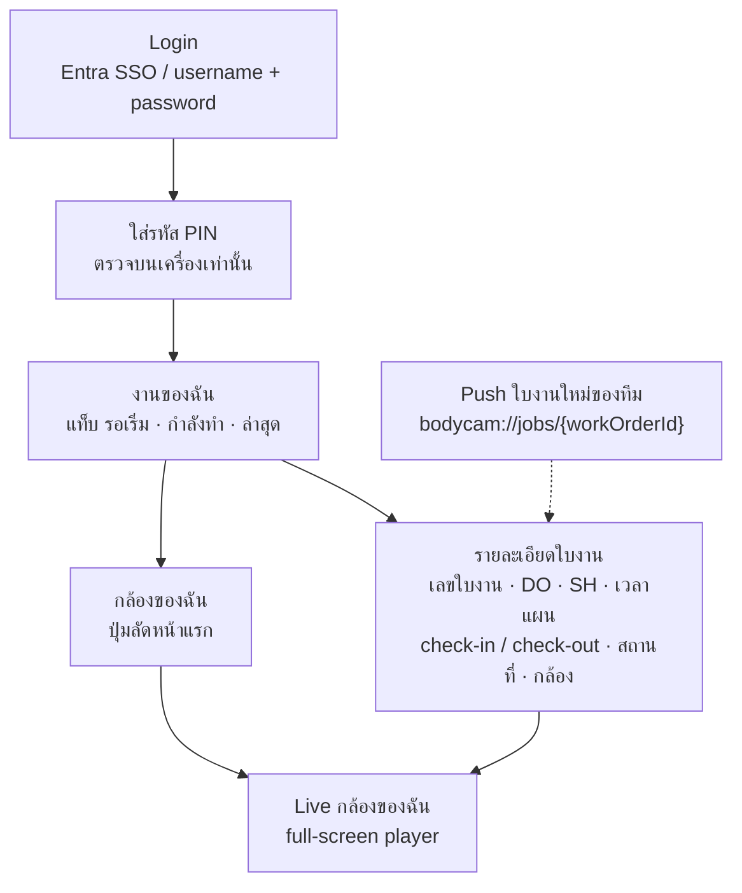

# Part 6 — Frontend Architecture

> หลักการ: **รักษา design system และ interaction pattern ของ reference** (`client/DESIGN.md`, `client/src/styles/tailwind.css`) · port shell + primitives · เขียนใหม่เฉพาะหน้าที่ domain เปลี่ยน

---

## 6.1 Stack

| ส่วน | ใช้ | หมายเหตุ |
|---|---|---|
| Core | React 18.3 · Vite 6 · TypeScript 5.5 strict | ตาม reference |
| Styling | Tailwind 3.4 + `tailwindcss-animate` + shadcn (Radix) + lucide | copy `tailwind.config.cjs` + `src/styles/tailwind.css` (OKLCH tokens) |
| Routing | react-router-dom 7 (`createBrowserRouter` + route `lazy`) | เพิ่ม `errorElement` + 404 (reference ไม่มี) |
| Server state | TanStack Query 5 | |
| Client state | Zustand เฉพาะ auth (`stores/authStore.ts`) · Context สำหรับ Realtime/Theme/Language | ตาม reference |
| HTTP | axios + single-flight refresh (`lib/apiClient.ts`) | port ตรง |
| Realtime | socket.io-client 4 (`lib/socket.ts`, `providers/RealtimeProvider.tsx`) | port + event ใหม่ |
| Map | Leaflet 1.9 + react-leaflet 4 | เพิ่ม `leaflet.markercluster` (กล้องประมาณ 100 ตัว — DL56) · tile ตั้งด้วย env `VITE_MAP_TILE_URL` / `VITE_MAP_TILE_ATTRIBUTION` (`components/map/mapConfig.ts`) · ไม่ตั้ง ⇒ tile สาธารณะของ OpenStreetMap ซึ่งใช้ได้เฉพาะ dev — production ต้องตั้งเป็น tile server ของเราหรือผู้ให้บริการที่มี SLA (public OSM ไม่รองรับโหลด) · ค่าของ production อยู่ใน `client/.env.production` ที่ commit (pipeline ไม่ส่ง build arg — ตัวอย่าง `client/.env.production.example`) |
| Video | hls.js (dynamic import) | port `StreamPlayer` |
| Talk | AudioWorklet + raw WebSocket | port `features/talk` |
| Auth SSO | `@azure/msal-browser` (lazy) | port `msalClient.ts` |
| Charts | echarts 6 (dashboard) | port `EChart.tsx` |
| i18n | custom (`src/i18n`, th/en) · default `th` | แยกไฟล์ locale ต่อ feature (reference เป็นไฟล์เดียว ~2.1k บรรทัด) |
| Quality | Vitest + Testing Library · **เพิ่ม ESLint + `tsc --noEmit` ใน build/CI** | reference build ไม่ typecheck |

---

## 6.2 Feature-based Folder Structure

```
client/src/
  main.tsx
  app/
    router.tsx              # createBrowserRouter + lazy routes
    routeAccess.ts          # path → permission (port lib/routeAccess.ts)
    nav.ts                  # เมนู 11 รายการ 4 กลุ่ม (port lib/nav.ts · DL53)
    providers.tsx           # QueryClient, Theme, Language, Realtime, Motion
    RequireAuth.tsx  RequirePermission.tsx  NotFoundPage.tsx  RouteErrorPage.tsx
    MobileOnlyPage.tsx      # "ใช้งานผ่านแอปมือถือ" สำหรับ TEAM_LEADER (DL47 — ไม่มี web UI)
  components/
    ui/                     # shadcn primitives (port ทั้งหมด)
    command-center/         # AsyncState, DataPagination, DataTableFrame, DataToolbar, PageHeader,
                            # RowActionsMenu, StatusBadge, ToolButton, MetricSummary, EntitySummary (port)
    layout/                 # AppLayout, AppHeader, AppSidebar, BranchedNav, Breadcrumb, ThemeToggle, LanguageSwitcher
    map/                    # MapCanvas, MarkerClusterLayer, mapConfig (tile จาก env)
    status/                 # DeviceStateBadge + deviceStateTone (P1), WorkOrderStatusBadge, SessionStateBadge (ใหม่ — รวมการ map สถานะ → tone ไว้ที่เดียว)
    charts/                 # EChart (port)
    booking/                # BookingJobCard, BookingStaleBanner (ใหม่ — ใช้ข้ามหลาย feature)
    evidence/               # EvidencePlaybackDialog, RecordingSegmentsPanel, useEvidenceDownload, evidenceExports.api.ts
                            # (port จาก features/evidence ของ reference — player, panel ไฟล์ และ export ใช้ร่วมกันระหว่าง dialog ของใบงาน (work-orders/) และหน้า evidence/ — DL59)
  features/
    auth/                   # LoginPage, msalClient, loginDestination, sessionRevoked (port)
    dashboard/
    tracking/               # LiveMapPage, useLivePositions, liveMerge, positionAge, CameraListPanel, CameraCard (port + refactor)
    tracking-history/       # HistoryPage, historyRange, historyTimeline, RouteLayers (port, ตัด roadMatch)
    live-wall/              # LiveWallPage — ภาพสดหลายจอ (port)
    streaming/              # StreamPlayer, LiveStreamDialog, streamStops (port — LiveStreamDialog ใช้กับปุ่ม ดูสด ทุกจุด: หน้า ใบงาน, รายละเอียดใบงาน, การ์ดกล้องบนแผนที่ติดตาม · มีปุ่ม talk ในตัวเมื่อผู้ใช้มี `streaming:talk` · ปิด dialog = หยุด talk + หยุดสตรีม — DL62)
    talk/                   # (port)
    work-orders/            # WorkOrdersPage (ตาราง + แท็บสถานะ + คอลัมน์กล้อง — DL53), WorkOrderDetailPage, workOrders.api.ts, workOrderActions.ts
                            # (อ่านอย่างเดียว — ใบงานและสถานะมาจาก Booking · DL33)
    evidence/               # EvidencePage — วิดีโอย้อนหลัง รายกล้อง (เลือกกล้อง + วัน → ไฟล์ทุกช่วง + ป้ายใบงาน — DL59), evidenceCameras.ts (กล้องของใบงาน: sessions + DeviceRefs), evidenceRange.ts (ช่วง ≤ 24 ชม. · ตัดให้อยู่ใน workWindow เมื่อเปิดจากใบงาน)
    users/                  # UsersPage (port, ตัด company / แผนก) + EntraUsersPage, entraSync.ts, entraBulk.ts (port — ผู้ใช้จาก Entra · DL53)
    notifications/  audit/  settings/
                            # ไม่มี sessions/, recordings/, devices/, teams/, integration/, departments/ (DL53)
  lib/                      # apiClient, apiError, authEndpoints, socket, realtimeUrl, queryClient,
                            # paged.ts (Paged<T>), usePermission.ts (ใหม่), time.ts, utils
  i18n/
    locales/th/*.ts  locales/en/*.ts     # แยกตาม feature
  styles/  tailwind.css  global.css
  test/    setup.ts  fixtures/
```

กติกาในแต่ละ feature (ตาม reference): `Page.tsx` · `x.api.ts` (query/mutation + query keys) · pure logic `*.ts` + unit test · `components/` · ไม่ import ข้าม feature ยกเว้นผ่าน `components/` หรือ `lib/`

`client/` คือ web เท่านั้น — แอปมือถือของหัวหน้าทีมเป็น codebase แยก ทีมเราพัฒนาเอง (§6.10 · DL49)

---

## 6.3 Routing

| Path | หน้าจอ | Permission (`anyOf` / `allOf`) | Layout |
|---|---|---|---|
| `/login` | Login (password + Entra) | Public | auth |
| `/mobile-only` | "ใช้งานผ่านแอปมือถือ" — ข้อความ + ปุ่มออกจากระบบ ไม่มีเมนู (DL47) | login + role `TEAM_LEADER` | auth |
| `/` | แดชบอร์ด | `dashboard:view` (ไม่มี ⇒ redirect ไปเมนูแรกที่เห็น) | shell |
| `/live-wall` | ภาพสดหลายจอ 1/4/6/9/16 + talk — ทางเดียวที่ดูวิดีโอของกล้องที่ไม่มีใบงาน (ภาพสดเมื่อออนไลน์ — DL53) | `streaming:live-wall` + `streaming:view-live` | shell full-bleed |
| `/work-orders` | ใบงาน — ตารางใบงานจาก Booking (แท็บสถานะ · คอลัมน์กล้อง + ปุ่ม ดูสด เมื่อกล้องออนไลน์ · ปุ่ม ดูย้อนหลัง เปิด dialog เดียวกับหน้า วิดีโอย้อนหลัง — DL53) | `work-orders:read` (ดูสด ต้องมี `streaming:view-live` · ดูย้อนหลัง ต้องมี `playback:view` · `VIEWER` ดูตารางอย่างเดียว) | shell |
| `/work-orders/by-booking/:externalJobId` | deep link จาก Booking app → redirect `/work-orders/:id` (Part 7 §7.9 — ผู้ใช้ web เท่านั้น) | `work-orders:read` | shell |
| `/work-orders/:id` | รายละเอียดใบงาน (เปิดจากแถวในหน้า ใบงาน / วิดีโอย้อนหลัง · เมนูที่ active = ใบงาน) | `work-orders:read` | shell |
| `/evidence` | วิดีโอย้อนหลัง (หน้า หลักฐาน เดิม — DL53) — ค้นรายกล้อง: เลือกกล้อง + วัน → ไฟล์ทุกช่วง (ป้ายใบงาน / ไม่ผูกใบงาน) → ดูย้อนหลัง / ดาวน์โหลด MP4 (DL59) | `playback:view` + `devices:read` (export / download ต้องมี `evidence:export` / `evidence:download`) | shell |
| `/tracking` | แผนที่ติดตาม | `tracking:view` | shell full-bleed |
| `/tracking/history` | ประวัติเส้นทาง (`?deviceId&from&to`) | `tracking:history` | shell full-bleed |
| `/users` | ผู้ใช้ระบบ (+ matrix สิทธิ์) | `users:read` | shell |
| `/entra-users` | ผู้ใช้จาก Entra (port หน้าเดียวกันของ reference — DL53) | `users:manage` | shell |
| `/notifications` | แจ้งเตือน (notifications + alerts) | `notifications:read` หรือ `alerts:view` | shell |
| `/audit-logs` | ประวัติการใช้งาน | `audit:view` | shell |
| `/settings` | ตั้งค่าระบบ (+ stream access ต่อ role) | `settings:manage` | shell |
| `*` | 404 | — | shell |

ไม่มี route `/sessions`, `/recordings`, `/devices`, `/devices/:id`, `/teams`, `/depots`, `/integration`, `/booking-jobs` และหน้าแผนก (DL53 — ตัดทั้งเมนูและโค้ด) · `/work-orders` เป็นหน้ารายการจริงแล้ว ไม่ redirect ไป `/evidence` (แก้ DL52) · การค้นวิดีโอรายกล้องอยู่ที่ `/evidence` ไม่ใช่ `/recordings` (DL59)

- ทุก route `lazy` + `HydrateFallback = LoadingSkeleton` (pattern เดิม) · `errorElement = RouteErrorPage`
- **ใช้ path จริงสำหรับ detail** (`/work-orders/:id`) — แทน `?open=<id>` dialog ของ reference เพื่อให้ deep link จาก alert / การแจ้งเตือน / Booking app ใช้ได้
- `RequirePermission` แสดงการ์ด "ไม่มีสิทธิ์" พร้อมรายชื่อ permission (พฤติกรรมเดิม)
- เมนู / route: `SUPER_ADMIN` เห็นทุกอย่าง (bypass) · role อื่นตาม permission — `ADMIN` (DL51) จึงไม่เห็น ประวัติการใช้งาน และ ตั้งค่าระบบ (เห็น 10 จาก 11 เมนู) และเปิด URL ตรงได้การ์ด "ไม่มีสิทธิ์" · ตารางเมนู × role อยู่ใน [`docs/design/2026-11-17-paper-ui-brief.md`](../design/2026-11-17-paper-ui-brief.md) §4.2
- **`TEAM_LEADER` ไม่มี web UI (DL47)**: `RequireAuth` อ่าน role จาก `/auth/me` · role = `TEAM_LEADER` ⇒ redirect ไป `/mobile-only` ทุก route (รวม deep link `/work-orders/by-booking/...`) · ไม่โหลด shell / `RealtimeProvider` · ไม่ใช้การ์ด "ไม่มีสิทธิ์" เพราะผู้ใช้ไม่ได้ผิดสิทธิ์ แค่ใช้ผิดช่องทาง



### Navigation groups (`app/nav.ts`)

เมนู web มี **11 รายการ 4 กลุ่ม** เท่านั้น (DL53 · แทนเมนูหลัก Live + หลักฐาน ของ DL36)

| กลุ่ม | รายการ |
|---|---|
| ภาพรวม | แดชบอร์ด (`/`) |
| ปฏิบัติงาน | ภาพสดหลายจอ (`/live-wall`) · ใบงาน (`/work-orders`) · วิดีโอย้อนหลัง (`/evidence`) · แผนที่ติดตาม (`/tracking`) · ประวัติเส้นทาง (`/tracking/history`) |
| ผู้ใช้และสิทธิ์ | ผู้ใช้ระบบ (`/users`) · ผู้ใช้จาก Entra (`/entra-users`) |
| ระบบ | แจ้งเตือน (`/notifications`) · ประวัติการใช้งาน (`/audit-logs`) · ตั้งค่าระบบ (`/settings`) |

- ไม่มีเมนู Live รายกล้อง (ใช้ ภาพสดหลายจอ หรือปุ่ม ดูสด ในหน้า ใบงาน) · ไม่มีเมนู Bodycam, ทีม, ฐาน/จุดชาร์จ, สถานะการเชื่อมต่อ, Tracking sessions, บันทึกวิดีโอรายกล้อง, งานจาก Booking, แผนก (DL53)
- สถานะการเชื่อมต่อ Booking เหลือแถบ stale (`BookingStaleBanner`) + alert ถึง `SUPER_ADMIN` ในหน้า แจ้งเตือน (DL53)

---

## 6.4 Screen List

| หน้าจอ | เนื้อหาหลัก | Data | Realtime |
|---|---|---|---|
| **แดชบอร์ด** | MetricSummary: กล้อง online / unknown / offline · session เปิดอยู่ · WO วันนี้ (เปิด / ปิด) · session รอจับคู่ · match rate วันนี้ · สถานะรับข้อมูล Smart Booking (POST ล่าสุด + backlog — DL46) · alert ล่าสุด | `/dashboard/overview` | `session:*`, `workorder:changed`, `integration:status` |
| **แผนที่ติดตาม** | แผนที่ Leaflet + `leaflet.markercluster` · marker 3 สถานะ (online/offline/unknown — ค่าจาก snapshot ตอนเปิดหน้า, DL35) · marker จางเมื่อ fix เก่ากว่า `fixActiveSeconds` ของ snapshot · panel รายการกล้อง (ค้นหา + filter สถานะ) · คลิก = การ์ดกล้อง + ลิงก์ ประวัติเส้นทาง (เมื่อมี `tracking:history`) · `gps:batch` รวมแล้วใช้ทีละ 1 วินาที · snapshot poll ทุก 60 วินาทีเฉพาะตอน socket หลุด · reconnect ⇒ refetch — ที่มีใน P1 (`features/tracking/LiveMapPage.tsx`) · phase ถัดไปเพิ่ม: halo เมื่อมี session, filter ทีม / มีงาน, ทีม / WO ปัจจุบัน / Booking บนการ์ด และวงรัศมีสถานที่ Booking (P2 / P3a) · ปุ่ม ดูสด (`LiveStreamDialog` + talk — DL62 · P4) | `/tracking/positions` | `gps:batch` (ตำแหน่ง), `session:*` (P2) |
| **ใบงาน** (DL53) | ตารางใบงานจาก Booking · แท็บสถานะ (ทั้งหมด / รอเริ่ม / กำลังดำเนินการ / ปิดแล้ว / ยกเลิก) · คอลัมน์: ใบงาน (เลข WO + DO / SH) · รายการ (ชื่องาน · "ปฏิบัติงานจริง" `workWindow` หรือ "รอเริ่ม" + เวลาแผน · สถานที่) · ผู้ปฏิบัติงาน (ทีม / หัวหน้าตาม Booking) · **กล้องของใบงาน** (`cameras[]` + สถานะ + ปุ่ม **ดูสด** เมื่อออนไลน์ → `LiveStreamDialog` · ต้องมี `streaming:view-live` · ปุ่ม talk ใน dialog ต้องมี `streaming:talk` — DL62) · สถานะ (+ ป้าย NeedsReview) · ปุ่ม **ดูย้อนหลัง** (`playback:view` · เฉพาะใบที่ check-in แล้ว) เปิด `EvidencePlaybackDialog` ที่แสดงเฉพาะไฟล์ในช่วง `workWindow` (DL59) · filter ทีม, ช่วงเวลา, ต้องตรวจสอบ · ค้นหาเลข WO / Booking / DO / SH · คลิกแถว = `/work-orders/:id` · `VIEWER` เห็นตารางอย่างเดียว (ไม่มีปุ่ม) | `/work-orders`, `/streams/live`, `/work-orders/:id/sessions`, `/streams/recordings` | `workorder:changed`, `session:*` |
| **รายละเอียดใบงาน** | อ่านอย่างเดียว — Header: เลข, สถานะ (ตาม Booking), ป้าย NeedsReview + เหตุผล (ข้อมูลเท่านั้น), ปุ่มตาม `availableActions` (หมายเหตุ, ดูวิดีโอ — เปิด `EvidencePlaybackDialog` ของใบงาน เฉพาะช่วง `workWindow` · DL59) · **Booking Reference panel** (รวมเลข DO / SH — DL46) · Timeline (`events`) · Sessions (กล้อง, ช่วงเวลา, เหตุผลจบ) · แผนที่เส้นทางของช่วง WO · Recordings ในช่วงใบงาน + ปุ่มดูย้อนหลัง/Export MP4 · Match attempts (เหตุผลที่ระบบผูก session) · หมายเหตุ · ไม่มี link / unlink / void (DL33) | `/work-orders/:id` + sub-resources | `workorder:changed`, `session:*` |
| **Booking Reference Information** | (1) panel ใน WO detail: เลข/ชื่องาน, **เลข DO / SH** (DL46), สถานะ Booking (raw + canonical), **เวลา check-in / check-out** (เป็นตัวกำหนดสถานะใบงาน), กล้องที่ Booking ระบุ (`deviceRefs`), แผนเวลา, สถานที่, ทีม/หัวหน้าตาม Booking, `lastSyncedAt` (ได้รับข้อมูลล่าสุดเมื่อ) + ป้าย stale, ปุ่ม refresh เฉพาะเมื่อมี `refreshBooking` ใน `availableActions` (มี read API — DL46) · ไม่มีปุ่ม "ดูข้อมูลดิบ" และไม่มีหน้า `/booking-jobs` แยก (DL52, DL53) · mapping issue แจ้ง `SUPER_ADMIN` ด้วย alert รายวัน (ไม่มีหน้า integration — DL53) | `/work-orders/:id` | `integration:status` |
| **ประวัติเส้นทาง** | port HistoryPage: เลือกกล้อง + ช่วง เริ่ม–สิ้นสุด (วัน + เวลา Asia/Bangkok) ≤ 36 ชม. ข้ามวันได้ (DL77) — ค่าเริ่มต้นทั้งวัน 00:00–24:00 · ช่องเป็นร่าง: โหลดเมื่อกด ดูเส้นทาง / ทั้งวัน / วันก่อน–ถัดไป (เลื่อนทั้งช่วง 24 ชม.) / เปลี่ยนกล้อง · ช่วงผิด (ไม่ครบ, สิ้นสุดก่อนเริ่ม, เกิน 36 ชม., เริ่มในอนาคต) กดดูไม่ได้ · ช่องที่แก้แล้วยังไม่โหลดขึ้น "ช่วงในช่องยังไม่ได้โหลด" · ใต้ช่องแสดง "ช่วงที่แสดง" (ช่วงที่โหลดจริง) เสมอ · กด ดูเส้นทาง ซ้ำบนช่วงเดิม = โหลดใหม่ (ลองใหม่ / ดูยอดล่าสุดของวันนี้) · แถวลำดับเหตุการณ์มีวันเมื่อช่วงคร่อมวัน · URL `?deviceId&from&to` · polyline + จุดหยุด + gap, timeline คลิกโฟกัส · ระยะทางรวมของช่วงที่เลือกในสรุป และระยะจากจุดแวะก่อนหน้า (จุดแวะแรกนับจากจุดเริ่ม) ในแถวจุดแวะ · gap แสดงระยะเส้นตรง · ระยะที่ข้ามช่วงไม่มีสัญญาณขึ้น `≈` (DL76) · ต่ำกว่า 1 กม. แสดงเป็นเมตร · **ไม่ refetch เอง** (ทุกคำขอถูก audit `VIEW_GPS_HISTORY`) — โหลดเฉพาะเมื่อผู้ใช้สั่ง (ปุ่ม / เปลี่ยนกล้อง) เท่านั้น · phase ถัดไปเพิ่ม: แถบ session/WO บน timeline (P2) · ตัด road-match | `/devices`, `/tracking/devices/:id/history` | — |
| **วิดีโอย้อนหลัง (Evidence)** — หน้า หลักฐาน เดิมเปลี่ยนชื่อ (DL53) · ค้นรายกล้อง (DL59) | (1) toolbar: เลือกกล้อง (ทุกกล้อง · ค้นรหัส / ชื่อ) + วัน (ย้อนหลังได้ 3 เดือน · ค้นครั้งละ ≤ 24 ชม.) → (2) panel ไฟล์บันทึกทุกช่วงของกล้อง: ช่วงเวลา + ระยะเวลา + ป้ายใบงาน (เลข WO คลิกไป `/work-orders/:id`) หรือ "ไม่ผูกใบงาน" → (3) player + ปรับช่วง (≤ 24 ชม., `evidenceRange`) → ดูย้อนหลัง หรือดาวน์โหลด MP4 (ใช้ export job เดิมเมื่อ device + channel + start/end ตรงกันและยังไม่หมดอายุ — ไม่งั้นสร้าง job ใหม่) · player / panel / export ใช้ component เดียวกับ `EvidencePlaybackDialog` (port `features/evidence` ของ reference) · alert `RECORDING_OUTSIDE_WORK` ลิงก์มาหน้านี้พร้อมกล้อง + วัน | `/devices`, `/streams/recordings`, `/streams/playback`, `/evidence-exports*` | `stream:status` |
| **dialog ดูวิดีโอของใบงาน** (`EvidencePlaybackDialog` — จากหน้า ใบงาน / รายละเอียดใบงาน · DL59) | เลือกกล้อง (กล้องจาก sessions ของใบงาน + กล้องใน `DeviceRefs` ที่ไม่มี session · `evidenceCameras`) + บรรทัด "ใช้ในใบงานนี้" (ช่วง session ของกล้อง) · panel เฉพาะไฟล์ที่ทับ `workWindow` (ส่วนที่อยู่นอกช่วงตัดออก) · ปรับช่วงได้เฉพาะใน `workWindow` (≤ 24 ชม.) → ดูย้อนหลัง / ดาวน์โหลด MP4 · เปิดได้เฉพาะใบที่ check-in แล้ว | `/work-orders/:id/sessions`, `/streams/recordings?workOrderId=`, `/streams/playback`, `/evidence-exports*` | `stream:status`, `workorder:changed` |
| **ภาพสดหลายจอ** (live wall — DL53 แทนเมนู Live ของ DL36) | port ทั้งหน้า (1/4/6/9/16, drag-drop, slot ใน URL, talk) · รายการกล้องจัดกลุ่มตามทีม · สถานะกล้องดึงตอนเปิดหน้า (DL35) · เป็นทางเดียวที่ดูวิดีโอของกล้องที่ไม่มีใบงาน — ภาพสดเมื่อออนไลน์ ไม่มีย้อนหลังรายกล้อง (DL53) | `/streams/*`, `/devices` | `stream:status` |
| **ผู้ใช้ระบบ** | port `/users` (ตัด company / แผนก) + role-permission matrix + ระงับบัญชี · **`ADMIN` (DL51)**: ไม่เห็นบัญชี `SUPER_ADMIN` ในรายการเลย (server ไม่คืน — DL55) · ปุ่มต่อแถวตาม `availableActions` · dropdown บทบาทไม่มี `SUPER_ADMIN` · matrix: คอลัมน์ `SUPER_ADMIN` ล็อก, ช่อง `reservedPermissions` ล็อกในคอลัมน์ role อื่น, ผู้ไม่มี `roles:manage` เห็นแบบอ่านอย่างเดียว (ไม่มีปุ่มบันทึก) · แบบหน้าจอ [`docs/design/2026-11-17-paper-ui-brief.md`](../design/2026-11-17-paper-ui-brief.md) §5.5–5.7 | `/users`, `/roles` | `session:revoked` |
| **ผู้ใช้จาก Entra** (DL53) | port `EntraUsersPage` ของ reference: ตารางผู้ใช้จาก Microsoft Entra เทียบกับบัญชีในระบบ (สถานะ อัปเดตได้ / ผูกแล้ว / ยังไม่มีบัญชี / ขัดแย้ง · ตัวกรอง "เฉพาะที่ยังไม่มีบัญชี") · ปุ่มอัปเดตข้อมูลจาก Entra (`sync-entra` — dry run ก่อนแล้วยืนยัน · ตัวเลือกจับคู่ด้วย username) · **สร้างบัญชี**จากแถวที่ยังไม่มีบัญชี: ทีละรายการ (ฟอร์มผู้ใช้ที่เติมค่าจาก Entra) หรือเลือกหลายรายการ ≤ 50 แล้วกำหนดบทบาทเดียวกัน · `ADMIN` เลือกบทบาท `SUPER_ADMIN` ไม่ได้ (DL51) · ไม่ได้ตั้งค่า Graph ⇒ แสดงข้อความ env ที่ขาด | `/users/entra-directory`, `/users/sync-entra`, `POST /users`, `/roles` | — |
| แจ้งเตือน, ประวัติการใช้งาน, ตั้งค่าระบบ | port (notifications + alerts · audit log · settings + stream access ต่อ role) | | `alert:new` |
| **ใช้งานผ่านแอปมือถือ** (`/mobile-only`) | สำหรับ `TEAM_LEADER` ที่ login web (DL47): ข้อความว่าบัญชีนี้ใช้กับแอปมือถือ + ปุ่มออกจากระบบ · ไม่มีเมนู ไม่มีข้อมูลงาน | `/auth/me` | — |

---

## 6.5 Component Reuse Strategy

หน้าผู้ใช้ระบบมีคอลัมน์เบอร์โทร (ว่างแสดง `—`) · ช่องชื่อผู้ใช้แก้ได้เมื่อยังไม่เชื่อม Microsoft แม้มีอีเมล ส่วนบัญชีที่เชื่อมแล้วและฟอร์มเพิ่มจาก Entra ยังคง disabled พร้อมเหตุผล · เปลี่ยนชื่อบัญชีตนเองแล้ว header แสดงชื่อใหม่ทันที · dropdown บทบาทในฟอร์มเพิ่ม/แก้ไขและเพิ่มจาก Entra หลายบัญชีกรอง `SUPER_ADMIN` สำหรับผู้ที่ไม่ใช่ `SUPER_ADMIN` และแยก cache ตามผู้เรียก (DL83)

| ระดับ | Component | ที่มา | การกระทำ |
|---|---|---|---|
| Tokens & base CSS | `tailwind.css`, `tailwind.config.cjs`, `global.css` (`.tracking-marker*`, `.route-*`, `.stream-stage`, `.voice-pill*`, `.branched-nav*`) | reference | copy · ลบ `.nwl-*` prefix เก่า · ลบ font ที่ไม่ใช้ |
| Primitives | `components/ui/*` (button, dialog, dropdown-menu, search-select, table, tabs, field, form-field, confirm-dialog, skeleton, sonner …) | reference | copy ทั้งชุด · ใช้ toast ระบบเดียว (sonner) |
| Composites | `components/command-center/*` | reference | copy · `DeviceIdentity` ปรับให้แสดงทีม |
| Shell | AppLayout, AppHeader, AppSidebar, BranchedNav, Breadcrumb, ThemeToggle, LanguageSwitcher | reference | copy · nav ใหม่ |
| Infra | apiClient, apiError, authEndpoints, socket, realtimeUrl, RealtimeProvider, authStore, msalClient | reference | copy |
| Feature-level port | StreamPlayer, LiveStreamDialog, live wall, talk, evidence (`EvidencePage` + export flow), HistoryPage, useLivePositions/liveMerge, `EntraUsersPage` + `entraSync` / `entraBulk` (DL53) | reference | port + ตัด dashcam / vehicle / company / แผนก |
| ใหม่ | `status/*Badge`, `booking/BookingJobCard`, `BookingStaleBanner`, `SessionTimeline`, `WorkOrderTimeline`, `MarkerCluster`, `usePermission()` | — | เขียนใหม่ตาม DESIGN.md |

### Status → tone (ไว้ที่ `components/status/` ที่เดียว)

| ค่า | Tone (`StatusBadge`) | ข้อความ (th) |
|---|---|---|
| Device online / offline / unknown | success / neutral / warning (`StatusTone` ไม่มีค่า `unknown` — DL74 · `components/status/deviceStateTone.ts`) | ออนไลน์ / ออฟไลน์ / ไม่ทราบสถานะ |
| WO Planned / Open / Closed / Cancelled | neutral / info / success / neutral | รอเริ่ม / กำลังดำเนินการ / ปิดแล้ว / ยกเลิก |
| Session open / closed / awaiting / no team / charging | info / neutral / warning / warning / neutral | กำลังใช้งาน / สิ้นสุด / รอข้อมูลใบงาน / กล้องยังไม่ผูกทีม / ชาร์จที่ฐาน |

กติกาจาก `client/DESIGN.md` ที่ต้องรักษา: สีคู่ข้อความเสมอ · cobalt เฉพาะ action/selection/link/focus · 1 primary action ต่อหน้า · ปุ่ม disabled ต้องบอกเหตุผล · row tools 3+ ยุบ `•••` · ตาราง scroll ในกรอบ · skeleton ตาม layout จริง · empty ≠ filtered-empty · สำเร็จ = toast, ล้มเหลว = toast + Alert ค้าง · target ≥ 44px

**ข้อความบนจอไม่บอกที่มาของข้อมูล (DL64)**: สถานะ หัวข้อ คำอธิบาย เหตุผล และข้อความแจ้งเตือน ไม่เขียน "จาก Booking" / "โดย Booking" / "ใน Booking" / "Smart Booking" — เช่น สถานะ "ยกเลิก" (ไม่ใช่ "ยกเลิกโดย Booking"), panel "ข้อมูลงาน", แถบ "ได้รับข้อมูลใบงานล่าสุดเมื่อ …", คอลัมน์ "ทีม" · คงไว้เฉพาะชื่อช่องที่เป็นเลขอ้างอิงที่ผู้ใช้ต้องใช้ค้นหรือเทียบ: "เลข Booking", "รหัสอ้างอิง Booking" และคำว่า Booking ในช่องค้นหา "เลขใบงาน / Booking / DO / SH" · ชื่อใน code / blueprint (`BookingStaleBanner`, Booking Reference panel) ไม่ต้องเปลี่ยน

---

## 6.6 State & Data Fetching

- Query keys แบบ root ตาม feature: `['work-orders', 'list', filters]`, `['recordings', deviceId, from, to]` (หน้า วิดีโอย้อนหลัง — DL59), `['work-orders', 'detail', id]`, `['devices', 'list', filters]`, `['evidence-exports', id]`, `['users', 'entra-directory']`
- Mutation ที่ต้องใช้ `If-Match` อ่าน `rowVersion` จาก cache ของ detail · 412 ⇒ toast "ข้อมูลถูกแก้โดยผู้อื่น" + refetch
- `availableActions` จาก server เป็นตัวกำหนดปุ่ม (ไม่คำนวณกติกาซ้ำที่ client)
- `usePermission(code | code[])` + `<Can permission>` แทน `permissions.includes()` กระจาย (refactor จาก reference)
- `Paged<T>` ย้ายไป `lib/paged.ts`

## 6.7 Realtime ฝั่ง client

- `RealtimeProvider` เดียว (port) · event ใหม่ `session:opened/closed`, `workorder:changed`, `integration:status`
- แผนที่: queue `gps:batch` flush ทุก 1s (pattern `liveMerge.ts`) · REST snapshot เมื่อ reconnect · poll 60s เฉพาะตอน socket หลุด · ประวัติเส้นทางไม่ refetch เอง (ทุกคำขอถูก audit)
- **ไม่มี `device:status`** (DL35) — ไม่ subscribe สถานะ online/offline · ภาพสดหลายจอ / คอลัมน์กล้องในหน้า ใบงาน / แผนที่ติดตาม / ก่อนเปิด live ดึงสถานะจาก API ตอนเปิดหน้า (`GET /devices`, `GET /work-orders`, `GET /tracking/positions` — api ถาม DSS device list ผ่าน cache Redis 10s, DL45, DL69) · แสดงเวลาอัปเดตจาก `platformStatusFetchedAt`
- รายการใบงาน: event ⇒ `invalidateQueries` (debounce 800ms) — ไม่ patch cache เอง ลดความเสี่ยงข้อมูลเพี้ยน
- `integration:status` (`{ source, isStale, lastReceivedAt }` — DL46) ⇒ `BookingStaleBanner` ทุกหน้าที่แสดงข้อมูล Booking · แสดงเมื่อ `isStale` (inbox backlog เกิน `booking.stale-after-minutes`) พร้อม "ได้รับข้อมูลจาก Smart Booking ล่าสุดเมื่อ {`lastReceivedAt`}"

## 6.8 i18n

- key แบบ namespace ต่อ feature (`workOrders.status.open`) · ข้อความไทยเป็นภาษาหลัก · ข้อความ error จาก backend แสดงตามที่ส่งมา (ภาษาไทย)
- ลบ key vehicle/dashcam ทั้งหมด (~110 ต่อภาษาใน reference)

## 6.9 Testing

- Unit: pure logic ทุกไฟล์ (`workOrderActions.ts`, `evidenceCameras.ts`, `evidenceRange.ts` รวม `inWorkWindow` — ทับบางส่วน / ขอบพอดี / `to = null` / ไม่มี `workWindow`, status mapping, filters) · component test ด้วย Testing Library (pattern เดิม, `src/test/setup.ts` บล็อก XHR จริง)
- Design guard tests ของ reference (`design-foundation.test.ts`, `design-system-source-rules.test.ts`) — port มาด้วยเพื่อกันการหลุด design rules
- E2E (Playwright) ชุดเล็กเฉพาะ flow หลัก: login → map → (`booking-simulator` POST check-in) → หน้า ใบงาน แสดงใบงาน + กล้อง (ปุ่ม ดูสด เมื่อออนไลน์) → รายละเอียดใบงานแสดง session ที่ระบบผูก + เลข DO / SH → ดูย้อนหลังจากใบงาน: เลือกกล้อง + ช่วงเวลาในช่วงใบงาน → playback / export → หน้า วิดีโอย้อนหลัง: เลือกกล้อง + วัน เห็นทั้งไฟล์ที่ผูกใบงานและไม่ผูก → (`booking-simulator` POST check-out) → ใบงานปิด · sidebar มี 11 เมนูสำหรับ `SUPER_ADMIN` และ 10 เมนูสำหรับ `ADMIN` (DL53) · login ด้วยบัญชี `TEAM_LEADER` ⇒ เห็นหน้า `/mobile-only` (DL46, DL47)

---

## 6.10 Mobile app (หัวหน้าทีม)

- ผู้ใช้ = role `TEAM_LEADER` เท่านั้น (DL47) · ขอบเขตตาม requirement ฉบับ 2026-11-12 §4: **live กล้องของตัวเอง + รายละเอียดใบงานจาก Smart Booking** · ไม่มี playback, GPS, สถานะกล้อง, talk, alert, user management — อยู่บน web (DL48)
- **codebase แยกจาก `client/`** ใช้ backend ชุดเดียวกับ web ผ่าน `/api/mobile/*`, `/api/streams/live`, `/api/auth/*`, `/api/notifications/push-tokens` (Part 5 §5.4) · **ทีมเราพัฒนาเอง** (DL49) — stack และที่เก็บโค้ดทีมเลือกเอง · หน้าจอด้านล่างเป็นขอบเขตเริ่มต้น ทีมปรับ / เพิ่ม / ลดได้ (เพิ่มฟังก์ชันที่ต้องใช้ข้อมูลใหม่ = เพิ่ม endpoint `/api/mobile/*` + permission ของ `TEAM_LEADER`)
- ใช้คำและสีสถานะเดียวกับ web (Status → tone §6.5) · ข้อความไทยเป็นหลัก · target ≥ 44px · เล่น HLS บน iOS ต้องทดสอบเร็ว (Part 9 R9)

| หน้าจอ | เนื้อหา | API | Realtime / Push |
|---|---|---|---|
| Login | ปุ่ม Entra SSO (มีบัญชี Entra) + ฟอร์ม username/password (ไม่มี Entra) — ทั้งสองแบบ (DL49) · หลัง login ลงทะเบียนเครื่อง + FCM token | `/auth/login`, `/auth/azure`, `/auth/devices`, `/notifications/push-tokens` | `session:revoked` ⇒ logout |
| **ใส่รหัส PIN** (DL61) | ตั้ง PIN 6 หลักหลัง login ครั้งแรก · เปิดแอปครั้งถัดไปใส่ PIN (หรือ biometric) ก่อนเข้าหน้าแรก · ตรวจในแอปเท่านั้น (Keystore / Keychain ปลดล็อก refresh token) · ลืม PIN / "ออกจากระบบ" ⇒ ล้าง token กลับหน้า Login · refresh ได้ 401 ⇒ ไปหน้า Login ทันที ไม่วนหน้า PIN | — (ไม่เรียก API · `/auth/refresh` หลังปลดล็อก) | — |
| **งานของฉัน** (หน้าแรก) | ชื่อทีม + ปุ่มลัด "กล้องของฉัน" · แท็บ **รอเริ่ม** (`Planned`) / **กำลังทำ** (`Open`) / **ล่าสุด** (`Closed` / `Cancelled` ≤ 7 วัน) · การ์ด: เลขใบงาน, ชื่องาน, DO / SH, เวลาแผน, สถานที่ · ไม่มีทีม / ไม่ได้เป็นหัวหน้า ⇒ empty state | `/mobile/me`, `/mobile/jobs?status=planned\|open\|recent` | `workorder:changed` (room `team:{id}`) ⇒ refetch |
| **รายละเอียดใบงาน** | เลขใบงาน, เลข Booking, DO, SH, สถานะ, เวลาแผน, check-in / check-out, สถานที่, กล้อง + ปุ่ม Live (ตาม `availableActions`), ช่วงเวลาที่กล้องเปิด (session เริ่ม/จบ) | `/mobile/jobs/:workOrderId` | `workorder:changed` · push "ใบงานใหม่ของทีม" เปิดหน้านี้ (`bodycam://jobs/{workOrderId}`) |
| **Live กล้องของฉัน** | full-screen player (HLS) · หยุดสตรีมเมื่อออกจากหน้า (`/streams/:token/stop`) | `POST /streams/live` | — |
| กล้องของฉัน (ปุ่มลัด) | รายการกล้องของทีมจาก `/mobile/me` → Live | `/mobile/me` | — |


