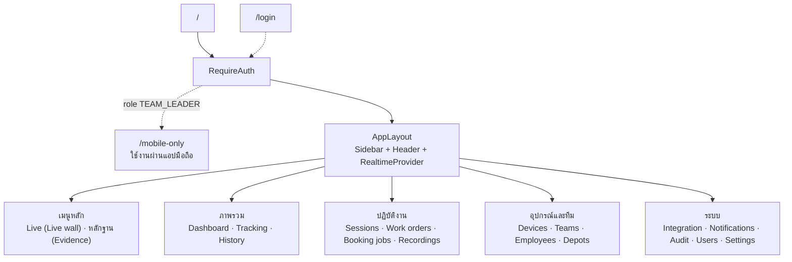
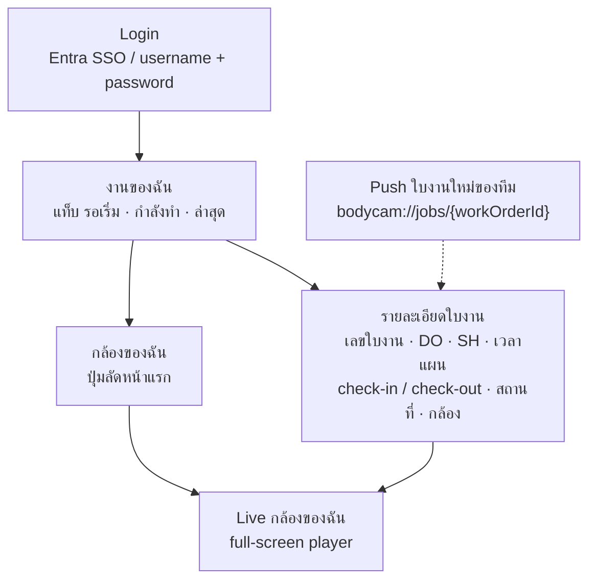

# Part 6 — Frontend Architecture

> หลักการ: **รักษา design system และ interaction pattern ของ reference** (`client/DESIGN.md`, `client/src/styles/tailwind.css`) · port shell + primitives · เขียนใหม่เฉพาะหน้าที่ domain เปลี่ยน

---

## 6.1 Stack

| ส่วน | ใช้ | หมายเหตุ |
|---|---|---|
| Core | React 18.3 · Vite 6 · TypeScript 5.5 strict | ตาม reference |
| Styling | Tailwind 3.4 + `tailwindcss-animate` + shadcn (Radix) + lucide | copy `tailwind.config.cjs` + `src/styles/tailwind.css` (OKLCH tokens) |
| Routing | react-router-dom 7 (`createBrowserRouter` + route `lazy`) | เพิ่ม `errorElement` + 404 (reference ไม่มี) |
| Server state | TanStack Query 5 | |
| Client state | Zustand เฉพาะ auth (`stores/authStore.ts`) · Context สำหรับ Realtime/Theme/Language | ตาม reference |
| HTTP | axios + single-flight refresh (`lib/apiClient.ts`) | port ตรง |
| Realtime | socket.io-client 4 (`lib/socket.ts`, `providers/RealtimeProvider.tsx`) | port + event ใหม่ |
| Map | Leaflet 1.9 + react-leaflet 4 | เพิ่ม `leaflet.markercluster` (กล้อง 300 ตัว) · tile server ต้องเป็นของเราหรือผู้ให้บริการที่มี SLA ใน production (public OSM ไม่รองรับโหลด) |
| Video | hls.js (dynamic import) | port `StreamPlayer` |
| Talk | AudioWorklet + raw WebSocket | port `features/talk` |
| Auth SSO | `@azure/msal-browser` (lazy) | port `msalClient.ts` |
| Charts | echarts 6 (dashboard) | port `EChart.tsx` |
| i18n | custom (`src/i18n`, th/en) · default `th` | แยกไฟล์ locale ต่อ feature (reference เป็นไฟล์เดียว ~2.1k บรรทัด) |
| Quality | Vitest + Testing Library · **เพิ่ม ESLint + `tsc --noEmit` ใน build/CI** | reference build ไม่ typecheck |

---

## 6.2 Feature-based Folder Structure

```
client/src/
  main.tsx
  app/
    router.tsx              # createBrowserRouter + lazy routes
    routeAccess.ts          # path → permission (port lib/routeAccess.ts)
    nav.ts                  # เมนู + กลุ่ม (port lib/nav.ts)
    providers.tsx           # QueryClient, Theme, Language, Realtime, Motion
    RequireAuth.tsx  RequirePermission.tsx  NotFoundPage.tsx  RouteErrorPage.tsx
    MobileOnlyPage.tsx      # "ใช้งานผ่านแอปมือถือ" สำหรับ TEAM_LEADER (DL47 — ไม่มี web UI)
  components/
    ui/                     # shadcn primitives (port ทั้งหมด)
    command-center/         # AsyncState, DataPagination, DataTableFrame, DataToolbar, PageHeader,
                            # RowActionsMenu, StatusBadge, ToolButton, MetricSummary, EntitySummary (port)
    layout/                 # AppLayout, AppHeader, AppSidebar, BranchedNav, Breadcrumb, ThemeToggle, LanguageSwitcher
    map/                    # MapCanvas, DeviceMarker, MarkerCluster, RoutePolyline
    status/                 # DeviceStateBadge, WorkOrderStatusBadge, SessionStateBadge (ใหม่ — รวมการ map สถานะ → tone ไว้ที่เดียว)
    charts/                 # EChart (port)
    booking/                # BookingJobCard, BookingStaleBanner (ใหม่ — ใช้ข้ามหลาย feature)
    evidence/               # EvidencePlaybackDialog, RecordingSegmentsPanel, useEvidenceDownload, evidenceExports.api.ts
                            # (port จาก features/evidence ของ reference — ใช้ร่วมกันระหว่าง evidence/ และ recordings/)
  features/
    auth/                   # LoginPage, msalClient, loginDestination, sessionRevoked (port)
    dashboard/
    tracking/               # LiveMapPage, useLivePositions, liveMerge (port + refactor)
    tracking-history/       # HistoryPage (port, ตัด roadMatch)
    live-wall/              # LiveWallPage (port)
    streaming/              # StreamPlayer, LiveStreamDialog, streamStops (port)
    talk/                   # (port)
    sessions/               # ActiveSessionsPage, SessionDetailDrawer, sessions.api.ts (อ่านอย่างเดียว)
    work-orders/            # WorkOrderListPage, WorkOrderDetailPage, workOrders.api.ts, workOrderActions.ts
                            # (อ่านอย่างเดียว — ใบงานและสถานะมาจาก Booking · DL33)
    evidence/               # EvidencePage, evidenceCameras.ts, evidenceRange.ts (port + refactor: กล้อง/ช่วงเวลาจาก sessions ของใบงาน · DL36)
    booking/                # BookingJobsPage, BookingJobDetailPage, booking.api.ts
    recordings/             # RecordingsPage (ค้นหา recording รายกล้อง + playback + export — รวม session ที่ไม่มีใบงาน)
    devices/                # DevicesPage, DeviceDetailPage, DeviceFormDialog, devices.api.ts (ไม่มีหน้าผูกทีม — ข้อมูลจาก Booking)
    teams/                  # TeamsPage, TeamDetailPage, MemberDialog, ChangeLeaderDialog
    employees/  users/      # (port, ตัด company)
    integration/            # IntegrationStatusPage (monitor การรับ POST จาก Smart Booking — DL46), InboxTable, CallLogsTable, MappingIssues
    notifications/  audit/  settings/
  lib/                      # apiClient, apiError, authEndpoints, socket, realtimeUrl, queryClient,
                            # paged.ts (Paged<T>), usePermission.ts (ใหม่), time.ts, utils
  i18n/
    locales/th/*.ts  locales/en/*.ts     # แยกตาม feature
  styles/  tailwind.css  global.css
  test/    setup.ts  fixtures/
```

กติกาในแต่ละ feature (ตาม reference): `Page.tsx` · `x.api.ts` (query/mutation + query keys) · pure logic `*.ts` + unit test · `components/` · ไม่ import ข้าม feature ยกเว้นผ่าน `components/` หรือ `lib/`

`client/` คือ web เท่านั้น — แอปมือถือของหัวหน้าทีมเป็น codebase แยก ทีมเราพัฒนาเอง (§6.10 · DL49)

---

## 6.3 Routing

| Path | หน้าจอ | Permission (`anyOf` / `allOf`) | Layout |
|---|---|---|---|
| `/login` | Login (password + Entra) | Public | auth |
| `/mobile-only` | "ใช้งานผ่านแอปมือถือ" — ข้อความ + ปุ่มออกจากระบบ ไม่มีเมนู (DL47) | login + role `TEAM_LEADER` | auth |
| `/` | Dashboard Overview | `dashboard:view` (ไม่มี ⇒ redirect ไปเมนูแรกที่เห็น) | shell |
| `/tracking` | Live Bodycam Tracking Map | `tracking:view` | shell full-bleed |
| `/tracking/history` | Tracking History (`?deviceId&from&to`) | `tracking:history` | shell full-bleed |
| `/live-wall` | Live wall 1/4/6/9/16 (เมนูหลัก Live — DL36) | `streaming:live-wall` + `streaming:view-live` | shell full-bleed |
| `/evidence` | หลักฐาน — ตารางใบงานจาก Booking → เลือกกล้อง + ช่วงเวลา → ดูย้อนหลัง / ดาวน์โหลด MP4 (เมนูหลัก — DL36) | `playback:view` + `work-orders:read` (ปุ่ม export/download ต้องมี `evidence:export` / `evidence:download`) | shell |
| `/sessions` | Active Tracking Sessions (+ แท็บประวัติ) | `sessions:read` | shell |
| `/work-orders` | Work Order List | `work-orders:read` | shell |
| `/work-orders/by-booking/:externalJobId` | deep link จาก Booking app → redirect `/work-orders/:id` (Part 7 §7.9 — ผู้ใช้ web เท่านั้น) | `work-orders:read` | shell |
| `/work-orders/:id` | Work Order Detail | `work-orders:read` | shell |
| `/booking-jobs` | Booking Reference List | `booking:read` | shell |
| `/booking-jobs/:id` | Booking Reference Detail | `booking:read` | shell |
| `/recordings` | บันทึกวิดีโอรายกล้อง — ค้นหาตามกล้อง + ช่วงเวลา / Playback / Export (ใช้กับ session ที่ไม่มีใบงาน) | `playback:view` | shell |
| `/devices` | Device Management | `devices:read` | shell |
| `/devices/:id` | Device Detail | `devices:read` | shell |
| `/teams`, `/teams/:id` | Teams | `teams:read` | shell |
| `/depots` | ฐาน/จุดชาร์จกล้อง (แผนที่ + รัศมี) | `devices:read` (แก้ไข `devices:manage`) | shell |
| `/employees` | Employees | `org:read` | shell |
| `/users` | Users & Roles | `users:read` | shell |
| `/integration` | Integration Status / Error Monitoring | `integration:view` | shell |
| `/notifications` | Notifications & Alerts | `notifications:read` หรือ `alerts:view` | shell |
| `/audit-logs` | Audit log | `audit:view` | shell |
| `/settings` | Settings (+ stream access ต่อ role) | `settings:manage` | shell |
| `*` | 404 | — | shell |

- ทุก route `lazy` + `HydrateFallback = LoadingSkeleton` (pattern เดิม) · `errorElement = RouteErrorPage`
- **ใช้ path จริงสำหรับ detail** (`/work-orders/:id`) — แทน `?open=<id>` dialog ของ reference เพื่อให้ deep link จาก alert / การแจ้งเตือน / Booking app ใช้ได้
- `RequirePermission` แสดงการ์ด "ไม่มีสิทธิ์" พร้อมรายชื่อ permission (พฤติกรรมเดิม)
- **`TEAM_LEADER` ไม่มี web UI (DL47)**: `RequireAuth` อ่าน role จาก `/auth/me` · role = `TEAM_LEADER` ⇒ redirect ไป `/mobile-only` ทุก route (รวม deep link `/work-orders/by-booking/...`) · ไม่โหลด shell / `RealtimeProvider` · ไม่ใช้การ์ด "ไม่มีสิทธิ์" เพราะผู้ใช้ไม่ได้ผิดสิทธิ์ แค่ใช้ผิดช่องทาง



### Navigation groups (`app/nav.ts`)

| กลุ่ม | รายการ |
|---|---|
| **เมนูหลัก** (DL36 — อยู่บนสุดของ sidebar) | **Live** (`/live-wall` — สตรีมสด + talk · ดูสดรายกล้องจากหน้า Bodycam ด้วย) · **หลักฐาน** (`/evidence`) |
| ภาพรวม | Dashboard · แผนที่ติดตาม · ประวัติเส้นทาง |
| ปฏิบัติงาน | Tracking sessions · ใบงาน · งานจาก Booking · บันทึกวิดีโอรายกล้อง |
| อุปกรณ์และทีม | Bodycam · ทีม · พนักงาน · ฐาน/จุดชาร์จ |
| ระบบ | สถานะการเชื่อมต่อ (badge เมื่อ stale / dead / ไม่ได้รับ POST นาน — DL46) · การแจ้งเตือน · Audit · ผู้ใช้และสิทธิ์ · ตั้งค่า |

---

## 6.4 Screen List

| หน้าจอ | เนื้อหาหลัก | Data | Realtime |
|---|---|---|---|
| **Dashboard Overview** | MetricSummary: กล้อง online / unknown / offline · session เปิดอยู่ · WO วันนี้ (เปิด / ปิด) · session รอจับคู่ · match rate วันนี้ · สถานะรับข้อมูล Smart Booking (POST ล่าสุด + backlog — DL46) · alert ล่าสุด | `/dashboard/overview` | `session:*`, `workorder:changed`, `integration:status` |
| **Live Bodycam Tracking Map** | แผนที่ + cluster · marker 3 สถานะ (online/offline/unknown — ค่าจาก snapshot ตอนเปิดหน้า, DL35) + halo เมื่อมี session · panel รายการกล้อง (ค้นหา, filter สถานะ/ทีม/มีงาน) · คลิก = การ์ดกล้อง: ทีม, WO ปัจจุบัน, Booking, ปุ่ม Live / History · วงรัศมีสถานที่ Booking (ถ้ามีพิกัด) | `/tracking/positions` | `gps:batch` (ตำแหน่ง), `session:*` |
| **Bodycam Device Management** | ตาราง: รหัส, ชื่อ, ประเภท (หลัก/สำรอง), ทีมปัจจุบัน (จาก Booking), สถานะ platform (ดึงจาก DSS ตอนเปิดหน้า — DL35), fix ล่าสุด, อยู่ฐาน, สถานะอุปกรณ์ · tools: ดูสด, แก้ไข, `•••` (ปิดการดูภาพ, Retire) · ปุ่ม sync จาก vendor (dry-run preview) | `/devices` | — |
| **Bodycam Device Detail** | ข้อมูลอุปกรณ์ · สถานะ (ดึงจาก DSS ตอนเปิดหน้า — DL35) + timeline (`status-history`) · ประวัติผูกทีม (จาก Booking) · sessions ล่าสุด · recordings · ปุ่ม Live/Playback/History | `/devices/:id`, `/devices/:id/status-history`, `/devices/:id/assignments`, `/tracking-sessions?deviceId` | `session:*` |
| **Active Tracking Sessions** | ตาราง session เปิดอยู่: กล้อง, ทีม, เริ่มเมื่อ, ระยะเวลา (live), สถานะกล้อง, WO (เลข WO / Booking) · แท็บ "ยังไม่มีใบงาน" (AwaitingMatch/NoTeam) อ่านอย่างเดียว — แสดงเหตุผลจาก match attempts + ลิงก์ไป `/recordings` ของกล้อง (รอ Booking — DL33) · แท็บประวัติ | `/tracking-sessions` | `session:*` |
| **Work Order List** | อ่านอย่างเดียว (ใบงานมาจาก Booking — DL33) · ตาราง: เลข WO, ชื่องาน, ทีม/หัวหน้า, Booking no., DO / SH, Status, เริ่ม, ล่าสุด, กล้อง, ป้าย NeedsReview · filter: สถานะ, ทีม, ช่วงเวลา, ต้องตรวจสอบ · ค้นหาเลข WO / Booking / DO / SH (`q` — DL46) | `/work-orders` | `workorder:changed` |
| **Work Order Detail** | อ่านอย่างเดียว — Header: เลข, สถานะ (ตาม Booking), ป้าย NeedsReview + เหตุผล (ข้อมูลเท่านั้น), ปุ่มตาม `availableActions` (หมายเหตุ, ไปหน้า หลักฐาน) · **Booking Reference panel** (รวมเลข DO / SH — DL46) · Timeline (`events`) · Sessions (กล้อง, ช่วงเวลา, เหตุผลจบ) · แผนที่เส้นทางของช่วง WO · Recordings + ปุ่มดูย้อนหลัง/Export MP4 · Match attempts (เหตุผลที่ระบบผูก session) · หมายเหตุ · ไม่มี link / unlink / void (DL33) | `/work-orders/:id` + sub-resources | `workorder:changed`, `session:*` |
| **Booking Reference Information** | (1) panel ใน WO detail: เลข/ชื่องาน, **เลข DO / SH** (DL46), สถานะ Booking (raw + canonical), **เวลา check-in / check-out** (เป็นตัวกำหนดสถานะใบงาน), กล้องที่ Booking ระบุ (`deviceRefs`), แผนเวลา, สถานที่, ทีม/หัวหน้าตาม Booking, `lastSyncedAt` (ได้รับข้อมูลล่าสุดเมื่อ) + ป้าย stale, ปุ่ม refresh เฉพาะเมื่อมี `refreshBooking` ใน `availableActions` (มี read API — DL46) · (2) หน้า `/booking-jobs`: รายการใบงานที่ได้รับจาก Smart Booking + ค้นหาเลข Booking / DO / SH + ลิงก์ไปใบงาน + mapping issue | `/booking-jobs`, `/booking-jobs/:id` | `integration:status` |
| **Tracking History** | port HistoryPage: เลือกกล้อง + ช่วงวัน, polyline + จุดหยุด + gap, timeline คลิกโฟกัส · เพิ่ม: แถบ session/WO บน timeline · ตัด road-match | `/tracking/devices/:id/history` | — |
| **หลักฐาน (Evidence)** — เมนูหลัก DL36 | port `EvidencePage` ของ reference: (1) ตารางใบงานจาก Booking แสดงเลข DO / SH ด้วย (ค้นหาเลข WO / Booking / DO / SH, ทีม, ช่วงเวลา — DL46) → (2) เลือกใบ → รายการกล้อง + ช่วงเวลาจาก sessions ของใบนั้น (`evidenceCameras`) → (3) ปรับช่วง (≤ 24 ชม., `evidenceRange`) → ดูย้อนหลัง หรือดาวน์โหลด MP4 (ใช้ export job เดิมเมื่อ device + channel + start/end ตรงกันและยังไม่หมดอายุ — ไม่งั้นสร้าง job ใหม่) | `/work-orders`, `/work-orders/:id/sessions`, `/streams/recordings?workOrderId`, `/streams/playback`, `/evidence-exports*` | `stream:status`, `workorder:changed` |
| **Recording / Playback** | ค้นหาตามกล้อง + ช่วงเวลา → `RecordingSegments` (รวม session ที่ไม่มีใบงาน — DL33) · เล่นย้อนหลัง (≤ 24 ชม.) · Export MP4 (policy, progress, download ticket) | `/streams/recordings`, `/streams/playback`, `/evidence-exports` | `stream:status` |
| **Live wall** — เมนูหลัก Live (DL36) | port ทั้งหน้า (1/4/6/9/16, drag-drop, slot ใน URL, talk) · รายการกล้องจัดกลุ่มตามทีม · สถานะกล้องดึงตอนเปิดหน้า (DL35) | `/streams/*`, `/devices` | `stream:status` |
| **Integration Status / Error Monitoring** | monitor การรับ POST จาก Smart Booking (DL46): การ์ด POST ล่าสุด (`lastReceivedAt`) + เตือนเมื่อเงียบนาน (alert 17) · inbound 24 ชม. แยก accepted / duplicate / invalid (400) / unauthorized (401) · inbox backlog Pending / Failed / Dead + ปุ่ม retry Dead · call logs (inbound + outbound) · mapping issues · **ส่วน read API** (breaker, ปุ่ม full reconcile, refresh รายใบ) แสดงเฉพาะเมื่อ `BOOKING_PROVIDER_DRIVER ≠ none` (`readApi` ≠ null) | `/integration/*` | `integration:status` |
| **Teams** | ตารางทีม (หัวหน้า, จำนวนสมาชิก, กล้องหลัก, `BookingTeamRef`) · detail: สมาชิก + ประวัติ, เปลี่ยนหัวหน้า, กล้องที่ผูก | `/teams/*` | — |
| **Users / Roles** | port `/users` (ตัด company) + role-permission matrix + ระงับบัญชี | `/users`, `/roles` | `session:revoked` |
| Notifications, Audit, Settings | port | | `alert:new` |
| **ใช้งานผ่านแอปมือถือ** (`/mobile-only`) | สำหรับ `TEAM_LEADER` ที่ login web (DL47): ข้อความว่าบัญชีนี้ใช้กับแอปมือถือ + ปุ่มออกจากระบบ · ไม่มีเมนู ไม่มีข้อมูลงาน | `/auth/me` | — |

---

## 6.5 Component Reuse Strategy

| ระดับ | Component | ที่มา | การกระทำ |
|---|---|---|---|
| Tokens & base CSS | `tailwind.css`, `tailwind.config.cjs`, `global.css` (`.tracking-marker*`, `.route-*`, `.stream-stage`, `.voice-pill*`, `.branched-nav*`) | reference | copy · ลบ `.nwl-*` prefix เก่า · ลบ font ที่ไม่ใช้ |
| Primitives | `components/ui/*` (button, dialog, dropdown-menu, search-select, table, tabs, field, form-field, confirm-dialog, skeleton, sonner …) | reference | copy ทั้งชุด · ใช้ toast ระบบเดียว (sonner) |
| Composites | `components/command-center/*` | reference | copy · `DeviceIdentity` ปรับให้แสดงทีม |
| Shell | AppLayout, AppHeader, AppSidebar, BranchedNav, Breadcrumb, ThemeToggle, LanguageSwitcher | reference | copy · nav ใหม่ |
| Infra | apiClient, apiError, authEndpoints, socket, realtimeUrl, RealtimeProvider, authStore, msalClient | reference | copy |
| Feature-level port | StreamPlayer, LiveStreamDialog, live wall, talk, evidence (`EvidencePage` + export flow), HistoryPage, useLivePositions/liveMerge | reference | port + ตัด dashcam / vehicle |
| ใหม่ | `status/*Badge`, `booking/BookingJobCard`, `BookingStaleBanner`, `SessionTimeline`, `WorkOrderTimeline`, `MarkerCluster`, `usePermission()` | — | เขียนใหม่ตาม DESIGN.md |

### Status → tone (ไว้ที่ `components/status/` ที่เดียว)

| ค่า | Tone (`StatusBadge`) | ข้อความ (th) |
|---|---|---|
| Device online / offline / unknown | success / neutral / `unknown` token | ออนไลน์ / ออฟไลน์ / ไม่ทราบสถานะ |
| WO Planned / Open / Closed / Cancelled | neutral / info / success / neutral | รอเริ่ม / กำลังดำเนินการ / ปิดแล้ว / ยกเลิกโดย Booking |
| Session open / closed / awaiting / no team / charging | info / neutral / warning / warning / neutral | กำลังใช้งาน / สิ้นสุด / รอข้อมูล Booking / กล้องยังไม่ผูกทีม / ชาร์จที่ฐาน |

กติกาจาก `client/DESIGN.md` ที่ต้องรักษา: สีคู่ข้อความเสมอ · cobalt เฉพาะ action/selection/link/focus · 1 primary action ต่อหน้า · ปุ่ม disabled ต้องบอกเหตุผล · row tools 3+ ยุบ `•••` · ตาราง scroll ในกรอบ · skeleton ตาม layout จริง · empty ≠ filtered-empty · สำเร็จ = toast, ล้มเหลว = toast + Alert ค้าง · target ≥ 44px

---

## 6.6 State & Data Fetching

- Query keys แบบ root ตาม feature: `['work-orders', 'list', filters]`, `['work-orders', 'detail', id]`, `['sessions', 'open']`, `['devices', 'list', filters]`, `['booking-jobs', ...]`, `['evidence-exports', id]`, `['integration', 'status']`
- Mutation ที่ต้องใช้ `If-Match` อ่าน `rowVersion` จาก cache ของ detail · 412 ⇒ toast "ข้อมูลถูกแก้โดยผู้อื่น" + refetch
- `availableActions` จาก server เป็นตัวกำหนดปุ่ม (ไม่คำนวณกติกาซ้ำที่ client)
- `usePermission(code | code[])` + `<Can permission>` แทน `permissions.includes()` กระจาย (refactor จาก reference)
- `Paged<T>` ย้ายไป `lib/paged.ts`

## 6.7 Realtime ฝั่ง client

- `RealtimeProvider` เดียว (port) · event ใหม่ `session:opened/closed`, `workorder:changed`, `integration:status`
- แผนที่: queue `gps:batch` flush ทุก 1s (pattern `liveMerge.ts`) · REST snapshot เมื่อ reconnect · poll 60s เฉพาะตอน socket หลุด
- **ไม่มี `device:status`** (DL35) — ไม่ subscribe สถานะ online/offline · หน้า device list / device detail / ก่อนเปิด live ดึงสถานะจาก API ตอนเปิดหน้า (`GET /devices`, `GET /devices/:id` — api ถาม DSS ผ่าน cache Redis 10s, DL45) · แสดงเวลาอัปเดตจาก `platformStatusFetchedAt`
- WO/Session list: event ⇒ `invalidateQueries` (debounce 800ms) — ไม่ patch cache เอง ลดความเสี่ยงข้อมูลเพี้ยน
- `integration:status` (`{ source, isStale, lastReceivedAt }` — DL46) ⇒ `BookingStaleBanner` ทุกหน้าที่แสดงข้อมูล Booking · แสดงเมื่อ `isStale` (inbox backlog เกิน `booking.stale-after-minutes`) พร้อม "ได้รับข้อมูลจาก Smart Booking ล่าสุดเมื่อ {`lastReceivedAt`}"

## 6.8 i18n

- key แบบ namespace ต่อ feature (`workOrders.status.open`) · ข้อความไทยเป็นภาษาหลัก · ข้อความ error จาก backend แสดงตามที่ส่งมา (ภาษาไทย)
- ลบ key vehicle/dashcam ทั้งหมด (~110 ต่อภาษาใน reference)

## 6.9 Testing

- Unit: pure logic ทุกไฟล์ (`workOrderActions.ts`, `evidenceCameras.ts`, `evidenceRange.ts`, status mapping, filters) · component test ด้วย Testing Library (pattern เดิม, `src/test/setup.ts` บล็อก XHR จริง)
- Design guard tests ของ reference (`design-foundation.test.ts`, `design-system-source-rules.test.ts`) — port มาด้วยเพื่อกันการหลุด design rules
- E2E (Playwright) ชุดเล็กเฉพาะ flow หลัก: login → map → (`booking-simulator` POST check-in) → WO detail แสดง session ที่ระบบผูก + เลข DO / SH → หน้า หลักฐาน เลือกกล้อง + ช่วงเวลา → ดูย้อนหลัง / export → (`booking-simulator` POST check-out) → ใบงานปิด · login ด้วยบัญชี `TEAM_LEADER` ⇒ เห็นหน้า `/mobile-only` (DL46, DL47)

---

## 6.10 Mobile app (หัวหน้าทีม)

- ผู้ใช้ = role `TEAM_LEADER` เท่านั้น (DL47) · ขอบเขตตาม requirement ฉบับ 2026-11-12 §4: **live กล้องของตัวเอง + รายละเอียดใบงานจาก Smart Booking** · ไม่มี playback, GPS, สถานะกล้อง, talk, alert, user management — อยู่บน web (DL48)
- **codebase แยกจาก `client/`** ใช้ backend ชุดเดียวกับ web ผ่าน `/api/mobile/*`, `/api/streams/live`, `/api/auth/*`, `/api/notifications/push-tokens` (Part 5 §5.4) · **ทีมเราพัฒนาเอง** (DL49) — stack และที่เก็บโค้ดทีมเลือกเอง · หน้าจอด้านล่างเป็นขอบเขตเริ่มต้น ทีมปรับ / เพิ่ม / ลดได้ (เพิ่มฟังก์ชันที่ต้องใช้ข้อมูลใหม่ = เพิ่ม endpoint `/api/mobile/*` + permission ของ `TEAM_LEADER`)
- ใช้คำและสีสถานะเดียวกับ web (Status → tone §6.5) · ข้อความไทยเป็นหลัก · target ≥ 44px · เล่น HLS บน iOS ต้องทดสอบเร็ว (Part 9 R9)

| หน้าจอ | เนื้อหา | API | Realtime / Push |
|---|---|---|---|
| Login | ปุ่ม Entra SSO (มีบัญชี Entra) + ฟอร์ม username/password (ไม่มี Entra) — ทั้งสองแบบ (DL49) · หลัง login ลงทะเบียนเครื่อง + FCM token | `/auth/login`, `/auth/azure`, `/auth/devices`, `/notifications/push-tokens` | `session:revoked` ⇒ logout |
| **งานของฉัน** (หน้าแรก) | ชื่อทีม + ปุ่มลัด "กล้องของฉัน" · แท็บ **รอเริ่ม** (`Planned`) / **กำลังทำ** (`Open`) / **ล่าสุด** (`Closed` / `Cancelled` ≤ 7 วัน) · การ์ด: เลขใบงาน, ชื่องาน, DO / SH, เวลาแผน, สถานที่ · ไม่มีทีม / ไม่ได้เป็นหัวหน้า ⇒ empty state | `/mobile/me`, `/mobile/jobs?status=planned\|open\|recent` | `workorder:changed` (room `team:{id}`) ⇒ refetch |
| **รายละเอียดใบงาน** | เลขใบงาน, เลข Booking, DO, SH, สถานะ, เวลาแผน, check-in / check-out, สถานที่, กล้อง + ปุ่ม Live (ตาม `availableActions`), ช่วงเวลาที่กล้องเปิด (session เริ่ม/จบ) | `/mobile/jobs/:workOrderId` | `workorder:changed` · push "ใบงานใหม่ของทีม" เปิดหน้านี้ (`bodycam://jobs/{workOrderId}`) |
| **Live กล้องของฉัน** | full-screen player (HLS) · หยุดสตรีมเมื่อออกจากหน้า (`/streams/:token/stop`) | `POST /streams/live` | — |
| กล้องของฉัน (ปุ่มลัด) | รายการกล้องของทีมจาก `/mobile/me` → Live | `/mobile/me` | — |


