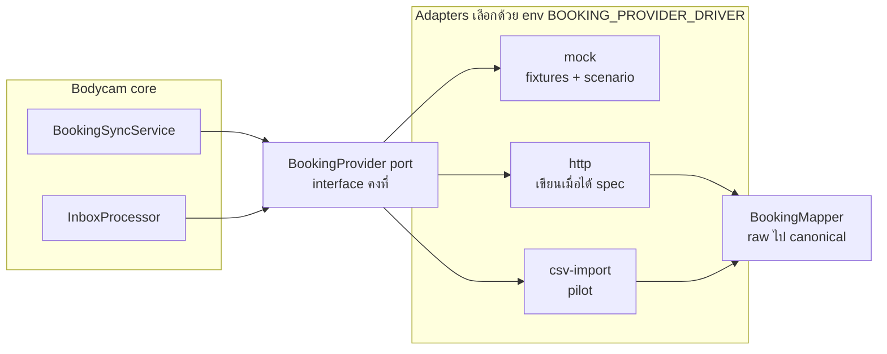

# Part 7 — Booking Integration Strategy

> **ยังไม่มีรายละเอียด Booking API** — ทุกอย่างที่เกี่ยวกับ endpoint, event, field, auth ของ Booking ในเอกสารนี้เป็น **[Assumption]** จนกว่าทีม Booking ยืนยัน
> หลักการ: ออกแบบ **port (interface ฝั่งเรา) ให้คงที่** แล้วเปลี่ยนเฉพาะ **adapter** เมื่อได้ spec จริง

---

## 7.1 Confirmed vs Assumption

| หัวข้อ | สถานะ | รายละเอียด |
|---|---|---|
| Booking เป็นต้นทางใบงาน | **[Confirmed]** ผู้ใช้ยืนยัน | ระบบใหม่ไม่มี flow สร้าง/อนุมัติ/มอบหมายใบงาน |
| 1 Booking job = 1 Work Order | **[Confirmed]** ผู้ใช้ยืนยัน | WO มีหลาย session ได้ |
| ใบงานมาจาก Booking **เท่านั้น** — ระบบไม่สร้างใบงานเอง · ไม่มีการผูกด้วยมือ | **[Confirmed]** ผู้ใช้ยืนยัน (DL33) | inbox processor upsert `WorkOrders` 1:1 กับ `BookingJobs` (§7.5.2) · session ที่จับคู่ไม่ได้ค้าง `AwaitingMatch` รอ Booking |
| ทีมมีหัวหน้า 1 คน (คนขับ) · กล้อง 1 ตัว/ทีม | **[Confirmed]** ผู้ใช้ยืนยัน | |
| **สถานะใบงานตาม Booking check-in/check-out** · check-out = ปิดใบงาน · ไม่มีการปิดในระบบเรา | **[Confirmed]** ผู้ใช้ยืนยัน (Q1, Q2, Q8) | รูปแบบข้อมูล check-in/check-out = **[Assumption]** — ข้อมูลสำคัญที่สุดที่ต้องได้จาก Booking |
| การผูกกล้องกับงาน/ทีม (รวมกล้องสำรอง) มาจาก Booking **เท่านั้น** | **[Confirmed]** (Q4, Q20) | field `DeviceRefs` / ข้อมูลกล้องประจำทีม = **[Assumption]** |
| พัฒนาด้วย mock adapter ก่อน แล้วเปลี่ยนเป็นของจริงเมื่อได้ spec | **[Confirmed]** (Q14) | mock ครอบ check-in/check-out, DeviceRefs, กล้องประจำทีม |
| Booking ยกเลิกงาน ⇒ ใบงาน "ยกเลิกโดย Booking" และตรวจหลักฐานได้ | **[Confirmed]** (Q6) | |
| Retention: ใบงาน 3 เดือน · GPS 3 เดือน · audit 12 เดือน · DSS 3 เดือน | **[Confirmed]** (Q12) | |
| ไม่ย้ายข้อมูลจากระบบเดิม | **[Confirmed]** (Q13) | |
| ทุกข้อข้างบนอาจเปลี่ยนตามทีม Booking | **[Note]** ผู้ใช้ระบุ | |
| เชื่อม Booking แบบ **pull อย่างเดียว** — Booking ไม่ยิง webhook เข้ามา · เราไม่ส่งข้อมูลกลับ | **[Confirmed]** ผู้ใช้เลือก (DL31) | §7.2 |
| Booking ทำ API ให้ดึงได้ตามที่เราขอ (change feed + ดึงรายใบ + ดึงตามช่วงเวลา) | [Assumption] | สเปกที่ขอ §7.2.1 · มีแค่ query ตามช่วงเวลา ⇒ ใช้ `fetchWindow` ทุกรอบ |
| Booking job มี identifier ของทีม/หัวหน้าทีม/รถ | [Assumption] — **ความเสี่ยงอันดับ 1** | ถ้าไม่มี matching อัตโนมัติทำไม่ได้ ⇒ session ค้าง `AwaitingMatch` / `NoTeam` (ไม่มี manual link — DL33) |
| Booking job มีเวลาเริ่ม/จบตามแผน | [Assumption] | ไม่มี ⇒ ใช้ทั้งวันของ `ScheduledDate` (confidence ลดเป็น MEDIUM) |
| Booking app เปิดดูหลักฐานของใบงานผ่าน deep link | [Assumption] (DL31) | §7.9 · ผู้เปิดต้องมีบัญชีในระบบนี้ |
| Auth ระหว่างระบบ (เรา → Booking) | [Assumption] | รองรับ OAuth2 client credentials / API key / mTLS |

---

## 7.2 รูปแบบการเชื่อมต่อ — pull อย่างเดียว (DL31)

ระบบเรา **ดึงข้อมูลจาก Booking ฝ่ายเดียว** · Booking ไม่ต้องยิงอะไรเข้ามา และเราไม่ส่งข้อมูลกลับ

| ช่องทาง | ทำอะไร | รอบ |
|---|---|---|
| **Incremental (change feed)** | ดึงงานที่เปลี่ยนตั้งแต่ cursor — **ตัวหลัก** | ทุก 2 นาที |
| **Full window reconcile** | ดึงทั้งช่วงเวลา เก็บงานที่ตกหล่นทุกกรณี | รายคืน 02:00 + ทันทีที่ breaker ปิด |
| **Fetch รายใบ** | ปุ่ม refresh บนหน้าจอ | เมื่อผู้ใช้กด |
| **File import (CSV)** | ใช้ได้แม้ Booking ยังไม่มี API | pilot / fallback ช่วงแรก |

เหตุผลที่เลือก pull อย่างเดียว:
- งานหลักของระบบคือ live, playback และหลักฐาน — ใบงานมาช้าสุด ~2 นาทีไม่กระทบ · session ที่เปิดก่อนใบงานมาถึง rematch เองในรอบ sync ถัดไป
- ไม่ต้องเปิด endpoint สาธารณะให้ Booking · ไม่มี HMAC secret ให้ rotate · ไม่ต้องจัดการ event หายหรือสลับลำดับ
- ทีม Booking ทำแค่ API ให้ดึง · sync ปกติกับ reconcile ใช้ API ชุดเดียวกัน ต่างกันแค่ช่วงเวลา
- ผู้ใช้ฝั่ง Booking เปิดดูหลักฐานผ่าน deep link (§7.9) แทน write-back

ถ้าภายหลังต้องการความเร็วระดับวินาที (เช่น check-out แล้ว alert ทันที): ขอ Booking ส่ง event สั้น `{ eventId, jobId, version }` ที่ retry ได้ แล้วเราเรียก `fetchJob` เอง (ไม่เชื่อ payload) — เพิ่มเป็น adapter method ได้โดยไม่แตะ core

### 7.2.1 API ที่ขอจาก Booking [Assumption — รอทีม Booking ยืนยัน]

| # | Endpoint | ใช้กับ | เงื่อนไข |
|---|---|---|---|
| 1 | `GET /jobs/changes?since={cursor}&limit=200` → `{ items, nextCursor, hasMore }` | `fetchChangedSince` | cursor เรียงลำดับแน่นอน (ถ้าใช้ `updatedAt` ต้องมี id ตัดสินเมื่อเวลาเท่ากัน) · งานที่ยกเลิก/ลบต้องยังอยู่ใน feed พร้อมสถานะ ห้ามหายไปเฉย ๆ |
| 2 | `GET /jobs/{jobId}` | `fetchJob` (ปุ่ม refresh) | |
| 3 | `GET /jobs?from=&to=` หรือ change feed ที่กรองช่วงเวลาได้ | `fetchWindow` (full reconcile) | pagination แบบ cursor |

ข้อมูลในใบงาน:
- `jobId` ถาวร + เลขใบงานที่แสดงผล · `status` · `version` (ตัวเลขที่เพิ่มทุกครั้งที่ใบเปลี่ยน) หรือ `updatedAt`
- เวลาตามแผน + เวลา **check-in / check-out จริง** (check-in ได้หลายรอบ ⇒ ส่งเป็นรายการ)
- ทีม + หัวหน้าทีม ด้วยรหัสที่ตรงกับรหัสพนักงาน HR
- **แผนกเจ้าของงาน** (`departmentRef`) — ใช้เป็นแผนกของใบงานและคุม data scope (DL38)
- **`deviceRefs`** = `deviceCode` ของ DSS ของกล้องทุกตัวที่ใช้กับงาน รวมกล้องสำรอง
- เวลาทั้งหมดเป็น ISO 8601 ระบุ timezone

ข้อตกลงระบบ: auth แบบ server-to-server (OAuth2 client credentials หรือ API key) · rate limit รับการดึงทุก 2 นาที + full reconcile รายคืน · มี sandbox พร้อมข้อมูลทดสอบ

---

## 7.3 Port & Adapter



```ts
// server/src/modules/booking-integration/booking-provider.port.ts
export const BOOKING_PROVIDER = Symbol('BOOKING_PROVIDER');

/** รูปแบบกลางที่ core รู้จัก — adapter ต้องแปลงข้อมูล Booking มาเป็นแบบนี้ */
export interface BookingJobSnapshot {
  externalJobId: string;            // [Assumption] รหัสถาวรของงาน
  externalJobNo?: string;
  version?: string;                 // etag / revision ถ้ามี
  updatedAt?: Date;                 // ใช้ version guard ถ้าไม่มี version
  status: BookingJobStatus;         // canonical (Planned, Confirmed, InProgress, Completed, Cancelled, Unknown)
  rawStatus: string;
  title?: string;
  departmentRef?: string;           // [Assumption] map → Departments.BookingDepartmentRef → WorkOrders.DepartmentId (DL38)
  teamRef?: string;                 // [Assumption] map → Teams.BookingTeamRef
  leaderRef?: string;               // [Assumption] map → Employees.BookingEmployeeRef
  scheduledDate?: string;           // 'YYYY-MM-DD' Asia/Bangkok — fallback เมื่อไม่มีเวลาตามแผน
  plannedStartAt?: Date;
  plannedEndAt?: Date;
  checkInAt?: Date;                 // [Assumption] เวลา check-in ใน Booking — ใช้กำหนดสถานะใบงาน
  checkOutAt?: Date;                // [Assumption] เวลา check-out — ปิดใบงาน
  deviceRefs?: string[];            // [Assumption] รหัสกล้องที่ใช้กับงาน (รวมกล้องสำรอง)
  site?: { name?: string; address?: string; lat?: number; lng?: number };
  raw: unknown;                     // payload เดิม (ถูก redact ก่อนเก็บ)
}

export interface BookingPage {
  items: BookingJobSnapshot[];
  nextCursor?: string;              // ไม่มี = หมดแล้ว
}

export interface BookingProvider {
  readonly name: string;
  /** incremental: งานที่เปลี่ยนตั้งแต่ cursor */
  fetchChangedSince(cursor: string | undefined, signal: AbortSignal): Promise<BookingPage>;
  /** full reconcile: งานในช่วงเวลา */
  fetchWindow(from: Date, to: Date, cursor: string | undefined, signal: AbortSignal): Promise<BookingPage>;
  /** ดึงงานเดียว (ปุ่ม refresh) */
  fetchJob(externalJobId: string, signal: AbortSignal): Promise<BookingJobSnapshot | null>;
  /** กล้องประจำทีม (optional — ถ้า Booking มี) → upsert DeviceAssignments (Source = BookingSync) */
  fetchCameraAssignments?(cursor: string | undefined, signal: AbortSignal): Promise<{ items: { deviceRef: string; teamRef: string; validFrom: Date; validTo?: Date }[]; nextCursor?: string }>;
}
```

- เลือก adapter ด้วย env `BOOKING_PROVIDER_DRIVER=mock|http|csv` (pattern เดียวกับ `DEVICE_INVENTORY_DRIVER`, `STREAM_PROVIDER_DRIVER` ของ reference)
- `mock` adapter มี scenario (งานซ้อนเวลา, งานยกเลิก, API ล่ม, ช้า, ส่ง version เก่า) ใช้ใน integration test และ demo — ทำให้ Phase 2–3 เดินได้ก่อนได้ spec จริง
- **Anti-corruption layer**: field/สถานะของ Booking ไม่หลุดเข้า domain — core เห็นแค่ `BookingJobSnapshot`

---

## 7.4 Authentication ระหว่างระบบ

| ทิศทาง | วิธีที่รองรับ | หมายเหตุ |
|---|---|---|
| เรา → Booking | OAuth2 client credentials (แนะนำ) · API key header · mTLS | token cache ใน memory + refresh ก่อนหมดอายุ 60s · secret ใน Kubernetes Secret · ไม่ log header |

ทิศทางเดียว — Booking ไม่เรียกเข้าระบบเรา (DL31) จึงไม่มี endpoint สาธารณะหรือ secret ขาเข้า

---

## 7.5 Data Synchronization

### 7.5.1 Incremental

1. อ่าน `IntegrationSyncState (BOOKING, jobs)` → `Cursor`
2. เรียก `fetchChangedSince(cursor)` ทีละหน้า (timeout 8s/หน้า)
3. ทุก item → `INSERT IntegrationInbox (Source='BOOKING', ExternalEventId = '{externalJobId}:{version ?? updatedAt}')` `ON CONFLICT DO NOTHING`
4. บันทึก cursor ใหม่ **หลัง** inbox insert สำเร็จทั้งหน้า (at-least-once)
5. `LastSuccessAt = now()` · `ConsecutiveFailures = 0`

ถ้า Booking ไม่มี changed-since ⇒ ใช้ `fetchWindow(now − 1 วัน, now + 14 วัน)` ทุกรอบแทน (PayloadHash ช่วยตัดงานที่ไม่เปลี่ยน)

### 7.5.2 Inbox processing + version guard

```sql
-- upsert projection เฉพาะเมื่อข้อมูลใหม่กว่า (กัน out-of-order)
INSERT INTO "BookingJobs" ("SourceSystem","ExternalJobId","ExternalVersion","ExternalUpdatedAt","Status",
                           "RawStatus","TeamId","PlannedStartAt","PlannedEndAt","Raw","PayloadHash","LastSyncedAt", ...)
VALUES ($1,$2,$3,$4,$5,$6,$7,$8,$9,$10,$11, now(), ...)
ON CONFLICT ("SourceSystem","ExternalJobId") DO UPDATE SET
  "ExternalVersion"   = EXCLUDED."ExternalVersion",
  "ExternalUpdatedAt" = EXCLUDED."ExternalUpdatedAt",
  "Status"            = EXCLUDED."Status",
  -- ... คอลัมน์อื่น
  "PayloadHash"       = EXCLUDED."PayloadHash",
  "LastSyncedAt"      = now(),
  "SourceMissingSince"= NULL
WHERE "BookingJobs"."ExternalUpdatedAt" IS NULL
   OR EXCLUDED."ExternalUpdatedAt" >= "BookingJobs"."ExternalUpdatedAt"
RETURNING "Id", (xmax = 0) AS inserted;
```

- ไม่มีแถวคืน ⇒ ข้อมูลเก่ากว่า ⇒ inbox `Ignored`
- **upsert `WorkOrders` 1:1** ใน transaction เดียวกัน (`INSERT … ON CONFLICT ("BookingJobId") DO UPDATE`): งานใหม่ ⇒ สร้าง WO · งานเดิม ⇒ อัปเดตข้อมูลที่แสดง + สถานะตาม Booking (§7.6) · **เป็นทางเดียวที่สร้างใบงานในระบบ** (DL33) · emit `workorder:changed` หลัง commit
- `PayloadHash` เปลี่ยน ⇒ enqueue `matching.rematch` (`jobId = team:{TeamId}:{yyyyMMdd}` dedupe) ของทั้งทีมเก่าและทีมใหม่ถ้าย้ายทีม
- resolve `TeamId` / `LeaderEmployeeId` ตอน upsert · map ไม่ได้ ⇒ บันทึก `MappingIssues` (ไม่ fail ข้อความ) และแสดงในหน้า Integration

### 7.5.3 Refresh รายใบ

ปุ่ม refresh (`POST /api/booking-jobs/:id/refresh`, `booking:refresh`) → `fetchJob(externalJobId)` (timeout 5s) → `INSERT IntegrationInbox` (`ExternalEventId` = `{externalJobId}:{version ?? updatedAt}`) → processor ตามปกติ · Booking ล่ม ⇒ ตอบ 503 และใช้ข้อมูลเดิม

### 7.5.4 Full reconcile

- รายคืน 02:00 และทันทีที่ breaker ปิดหลังเปิด: `fetchWindow(now − 7 วัน, now + 14 วัน)`
- งานที่มีใน DB (ช่วงเดียวกัน) แต่ไม่อยู่ในผล ⇒ `SourceMissingSince = now()` (**ไม่ลบ**) · WO ของงานนั้นได้ badge `NeedsReview` (ReviewReasons 5 SourceMissing) + alert Admin (ไม่มีคิวตรวจสอบ — DL33)
- จบแล้ว rematch session `AwaitingMatch` / `NoTeam` ในช่วงนั้น (ภายใน `booking.rematch-horizon-hours`)

### 7.5.5 Source of truth ต่อข้อมูล

| ข้อมูล | เจ้าของ | ระบบเราเก็บ |
|---|---|---|
| รายละเอียดงาน, ลูกค้า, สถานที่, แผนเวลา, สถานะงาน | Booking | projection บางส่วน + `Raw` (read-only) |
| ทีม, หัวหน้าทีม, สมาชิก | ระบบเรา (map ref กับ Booking) | เต็ม |
| อุปกรณ์, สถานะ, GPS, session, recording index | ระบบเรา / DSS | เต็ม |
| Work Order (ใบงาน + หลักฐานกล้องที่ผูก) | Booking — ระบบเราสร้าง/อัปเดต 1:1 จาก `BookingJobs` เท่านั้น (DL33) | เต็ม + session / หลักฐานที่ผูก · Booking เปิดดูผ่าน deep link (§7.9) |

---

## 7.6 Mapping

| Booking (ตัวอย่าง [Assumption]) | Canonical `BookingJobs.Status` | เป็น candidate? |
|---|---|---|
| `NEW`, `SCHEDULED` | 1 Planned | ใช่ |
| `CONFIRMED`, `ASSIGNED` | 2 Confirmed | ใช่ |
| `IN_PROGRESS`, `ON_SITE` | 3 InProgress | ใช่ (tie-break อันดับ 1) |
| `DONE`, `COMPLETED`, `CLOSED` | 4 Completed | ไม่ |
| `CANCELLED`, `REJECTED` | 5 Cancelled | ไม่ |
| อื่น ๆ | 9 Unknown | ใช่ แต่ confidence สูงสุด MEDIUM + `MappingIssues` 3 |

- ตาราง map อยู่ในโค้ดของ adapter (versioned + unit test) และ override ได้ด้วย setting `booking.status-map` (JSON) โดยไม่ต้อง deploy
- **กล้อง**: `BookingJobSnapshot.deviceRefs` → เทียบ `Devices.DeviceCode` / `VendorDeviceId` / `SerialNo` — matching key อันดับ 1 (Part 3 §3.3.1) · ref ที่ map ไม่ได้บันทึกเป็น `MappingIssues` 5 UnknownDeviceRef
- **ใบงาน**: ทุกแถว `BookingJobs` มี `WorkOrders` 1 แถว (upsert ใน processor §7.5.2) · ไม่มีใบงานที่ไม่ผูก Booking (DL33)
- **check-in / check-out / ยกเลิก**: upsert แล้ว apply สถานะใบงานทันทีใน inbox processor (ยังไม่ check-in ⇒ Planned (DL37), check-in ⇒ Open, check-out / Completed ⇒ Closed `BookingCheckout`, check-in หลังปิด ⇒ reopen, Booking ยกเลิก ⇒ Cancelled) — ไม่ต้องรอ sweep
- **Matching key คือ ref ดิบ** (`BookingJobs.BookingTeamRef`, `BookingLeaderRef`) — matcher เทียบกับ `Teams.BookingTeamRef` และ `Employees.BookingEmployeeRef` ของหัวหน้าทีม **ณ เวลาเริ่ม session** (Part 3 §3.3.1) · `BookingJobs.TeamId` / `LeaderEmployeeId` เป็น cache สำหรับแสดงผล
- admin แก้ ref ของทีม/พนักงาน หรือเปลี่ยนหัวหน้าทีม ⇒ job `re-resolve` อัปเดต cache + ล้าง `MappingIssues` ที่แก้แล้ว + enqueue re-match ของทีมนั้น (ไม่ต้องรอ `PayloadHash` เปลี่ยน)
- ถ้า Booking ใช้ "ทะเบียนรถ" เป็นตัวระบุทีม (หัวหน้าทีม = คนขับ) ⇒ ใส่ทะเบียนรถใน `Teams.BookingTeamRef` ได้ทันทีโดยไม่ต้องมีตารางรถ

---

## 7.7 Retry, Timeout, Circuit Breaker

| Operation | Timeout | Retry | หลังล้มเหลวครบ |
|---|---|---|---|
| sync หน้า (fetchChangedSince/Window) | 8s | BullMQ 5 ครั้ง: 30s, 1m, 2m, 4m, 8m + jitter ±20% | job fail · รอบถัดไปเริ่มจาก cursor เดิม |
| inbox processing | — | retry sweep ทุก 5 นาที | `Dead` หลัง 10 ครั้ง + alert `INTEGRATION_DEAD_LETTER` |
| ปุ่ม refresh จากหน้าจอ (sync call ใน API) | 5s | ไม่ retry | ตอบ 503 พร้อมข้อความว่าใช้ข้อมูลเดิม |

**Circuit breaker** (state ใน Redis key `breaker:booking` ใช้ร่วม API + worker, mirror ลง `IntegrationSyncState.BreakerOpenUntil` เพื่อแสดงผล):
- CLOSED → OPEN เมื่อ fail ติดกัน 5 ครั้ง (timeout/5xx/network — 4xx ไม่นับ ยกเว้น 401/429)
- OPEN 2 นาที (ทวีคูณถึงสูงสุด 15 นาทีถ้าเปิดซ้ำ) → HALF_OPEN ปล่อย probe 1 request → สำเร็จ = CLOSED + trigger full reconcile
- ระหว่าง OPEN: sync job **ข้าม** (ไม่ queue สะสม)
- `429` เคารพ `Retry-After`

---

## 7.8 Idempotency

| จุด | กลไก |
|---|---|
| ข้อมูลที่ดึงมา (poll / refresh) | `UQ_Inbox_Event (Source, ExternalEventId)` |
| อัปเดต projection | version guard (`ExternalUpdatedAt`) + `PayloadHash` |
| สร้าง/อัปเดต WO จาก Booking job | `UQ_WO_BookingJob` (unique ธรรมดา · `BookingJobId` NOT NULL) + `INSERT … ON CONFLICT ("BookingJobId") DO UPDATE SET … RETURNING "Id"` ใน inbox processor เท่านั้น (DL33) |
| Push FCM | `Notifications` เขียนใน transaction แล้ว enqueue `notification-push` หลัง commit · enqueue ล้มเหลว ⇒ `Notifications.Status = Pending` และ sweep ส่งซ้ำ (pattern reference) |
| Session | `UQ_TS_OpenPerDevice` + `EX_TS_NoOverlap` + compare-and-set ตอนปิด |
| Rematch job | BullMQ `jobId` deterministic (`team:{id}:{date}`) |
| คำสั่งจากผู้ใช้ | `If-Match: RowVersion` (412 เมื่อชน) · `Idempotency-Key` header สำหรับ POST ที่เปลี่ยนสถานะ (เก็บผลใน Redis 24 ชม.) |

---

## 7.9 Deep link จาก Booking (แทน write-back) [Assumption]

ไม่มีการส่งข้อมูลกลับ Booking (DL31) · Booking app ใส่ลิงก์ไปที่ใบงานของเราแทน:

```
https://{host}/work-orders/by-booking/{externalJobId}
```

- SPA เรียก `GET /api/work-orders/by-booking/:externalJobId` → ได้ `{ id }` แล้ว redirect ไป `/work-orders/:id` (Part 5 §5.2, Part 6 §6.3)
- ผู้เปิดต้อง login และมีบัญชีในระบบนี้ (`ADMIN` / `OPERATOR` / `VIEWER`) + data scope ตามปกติ · ไม่พบหรือนอก scope = 404 · หัวหน้าทีมไม่มีบัญชี (DL16) จึงเปิดไม่ได้
- ระบบเราไม่ต้องรู้ URL ของ Booking และไม่ต้องเก็บ token ขาออกเพิ่ม

---

## 7.10 Reconciliation

| Job | รอบ | ทำอะไร | ผลลัพธ์ที่ตรวจได้ |
|---|---|---|---|
| Incremental sync | 2 นาที | 7.5.1 | `LastSuccessAt` |
| Full reconcile | รายคืน + หลัง breaker ปิด | 7.5.4 | จำนวน upsert / missing |
| Rematch session ที่ค้าง | ทุก sync สำเร็จ | session `AwaitingMatch` / `NoTeam` ภายใน `booking.rematch-horizon-hours` → re-run | `MatchAttempts` Trigger = Reconcile |
| Inbox retry | 5 นาที | `Failed` → ลองใหม่ | ไป `Processed` หรือ `Dead` |
| Mapping report | รายวัน | สรุป departmentRef / teamRef / leaderRef ที่ map ไม่ได้ | alert ให้ admin เติม `BookingDepartmentRef` / `BookingTeamRef` |

---

## 7.11 Integration Monitoring

**หน้า `/integration`** (permission `integration:view`):
- การ์ดสถานะ: breaker state · `LastSuccessAt` · lag (now − LastSuccessAt) · ConsecutiveFailures · ข้อความ Pending/Failed/Dead ใน inbox
- ตาราง call logs (filter outcome / operation / ช่วงเวลา) — ไม่มี secret
- รายการ `MappingIssues` (teamRef/leaderRef/status ที่ map ไม่ได้)
- ปุ่ม: retry ข้อความ Dead · สั่ง incremental/full sync · refresh งานเดียว (`integration:manage`)

**Metrics (Prometheus)**: `booking_sync_lag_seconds`, `booking_sync_failures_total`, `booking_breaker_state`, `booking_inbox_pending`, `booking_inbox_dead`, `booking_http_latency_seconds{op}`, `matching_results_total{result}`

**Alerts**: `BOOKING_SYNC_STALE` (lag > 15 นาที, Warning; > 60 นาที, Critical) · `INTEGRATION_DEAD_LETTER` · `BOOKING_MAPPING_ISSUES` (รายวัน)

---

## 7.12 Data Consistency Model

- **Eventual consistency** ระหว่าง Booking กับระบบเรา (ปกติ ≤ 2 นาที, ระหว่างล่ม = จนกว่า reconcile สำเร็จ)
- **Strong consistency ภายในระบบเรา** สำหรับ invariant หลัก (DB constraint)
- การตัดสินใจ matching ทุกครั้งบันทึก "ข้อมูลที่รู้ ณ ตอนนั้น" (`MatchAttempts.ProjectionSyncedAt`, `Candidates`) ⇒ อธิบายย้อนหลังได้ว่าทำไม session ถูก attach หรือค้าง `AwaitingMatch`

---

## 7.13 Contract Testing & Onboarding Booking

1. ได้ spec จริง ⇒ เขียน `http` adapter + mapper + fixture จาก response จริง (redact)
2. Contract test: adapter test กับ fixture · consumer contract (เช่น Pact หรือ JSON schema) ส่งให้ทีม Booking
3. Sandbox ของ Booking ⇒ run `mock`-scenario เดียวกันกับ sandbox
4. Pilot: เปิด `BOOKING_PROVIDER_DRIVER=http` ใน staging · ดู match rate (session `Attached` / session ที่ไม่ใช่ `IdleOrCharging`) ≥ 90% ก่อนเปิดใช้งานจริง
