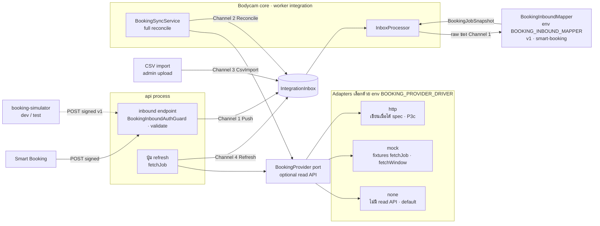

# Part 7 — Booking Integration Strategy

> ระบบต้นทางใบงานคือ **Smart Booking** (ในเอกสารนี้เรียกสั้น ๆ ว่า Booking · ชื่อในโค้ดยังเป็น `booking` / `BOOKING`)
> **Smart Booking POST ใบงานเข้ามาที่ endpoint ของเรา (DL46)** — contract ขาเข้า v1 (§7.2.1) เป็น **ร่างที่ระบบเรากำหนด** · รูปแบบ body, auth, retry และ read API ของ Booking ทั้งหมดเป็น **[Assumption]** จนกว่าทีม Smart Booking ยืนยัน (requirement ฉบับ 2026-11-12: ห้ามถือรายละเอียด API ของ Smart Booking เป็นข้อเท็จจริง — DL48)
> หลักการ: ออกแบบ **contract ขาเข้า + port (interface ฝั่งเรา) ให้คงที่** แล้วเปลี่ยนเฉพาะ **mapper / adapter** เมื่อได้ spec จริง

---

## 7.1 Confirmed vs Assumption

| หัวข้อ | สถานะ | รายละเอียด |
|---|---|---|
| Booking เป็นต้นทางใบงาน | **[Confirmed]** ผู้ใช้ยืนยัน | ระบบใหม่ไม่มี flow สร้าง/อนุมัติ/มอบหมายใบงาน |
| 1 Booking job = 1 Work Order | **[Confirmed]** ผู้ใช้ยืนยัน | WO มีหลาย session ได้ |
| ใบงานมาจาก Booking **เท่านั้น** — ระบบไม่สร้างใบงานเอง · ไม่มีการผูกด้วยมือ | **[Confirmed]** ผู้ใช้ยืนยัน (DL33) | inbox processor upsert `WorkOrders` 1:1 กับ `BookingJobs` (§7.5.2) · session ที่จับคู่ไม่ได้ค้าง `AwaitingMatch` รอ Booking |
| ทีมมีหัวหน้า 1 คน (คนขับ) · กล้อง 1 ตัว/ทีม | **[Confirmed]** ผู้ใช้ยืนยัน | |
| **สถานะใบงานตาม Booking check-in/check-out** · check-out = ปิดใบงาน · ไม่มีการปิดในระบบเรา | **[Confirmed]** ผู้ใช้ยืนยัน (Q1, Q2, Q8) | ใบงานมีเวลา check-in / check-out **[Confirmed]** (DL46) · ชื่อ field / รูปแบบ = **[Assumption]** (§7.2.1) |
| การผูกกล้องกับงาน/ทีม (รวมกล้องสำรอง) มาจาก Booking **เท่านั้น** | **[Confirmed]** (Q4, Q20) | field `DeviceRefs` / ข้อมูลกล้องประจำทีม = **[Assumption]** |
| พัฒนาด้วย mock adapter ก่อน แล้วเปลี่ยนเป็นของจริงเมื่อได้ spec | **[Confirmed]** (Q14) | `booking-simulator` ยิง POST ตาม contract v1 ครอบ งานใหม่, check-in, check-out, ยกเลิก, DeviceRefs, กล้องประจำทีม · `mock` driver ให้ข้อมูล read API (§7.3) |
| Booking ยกเลิกงาน ⇒ ใบงาน "ยกเลิกโดย Booking" และตรวจหลักฐานได้ | **[Confirmed]** (Q6) | |
| Retention: ใบงาน 3 เดือน · GPS 3 เดือน · audit 12 เดือน · DSS 3 เดือน | **[Confirmed]** (Q12) | |
| ไม่ย้ายข้อมูลจากระบบเดิม | **[Confirmed]** (Q13) | |
| ทุกข้อข้างบนอาจเปลี่ยนตามทีม Booking | **[Note]** ผู้ใช้ระบุ | |
| **Smart Booking POST ใบงานเข้ามาเมื่อสร้างใบงาน** — ไม่ pull ทุก 2 นาทีแล้ว | **[Confirmed]** ผู้ใช้ (DL46 แทน DL31) | `POST /api/integration/booking/jobs` (§7.2) |
| Smart Booking POST ทั้งใบซ้ำ **ทุกครั้งที่ใบงานเปลี่ยน** (check-in, check-out, ยกเลิก, แก้ไข) | [Assumption] — **ข้อแรกใน checklist Booking** | endpoint เดียวกัน = upsert · ถ้า POST แค่ตอนสร้าง สถานะใบงานจะตาม check-in / check-out ไม่ได้ |
| ใบงานมีเลข DO, เลข SH, เวลา check-in, เวลา check-out | **[Confirmed]** ผู้ใช้ (DL46) | ความหมายของ DO / SH = [Assumption] (น่าจะเป็น Delivery Order / Shipment — ต้องถาม Booking) · ใช้แสดงผล + ค้นหาเท่านั้น **ไม่ใช่ matching key** |
| body / ชื่อ field / header ตาม contract v1 ของเรา | [Assumption] — รอ Smart Booking ตกลง | §7.2.1 · ถ้า Smart Booking ใช้ body ของตัวเอง ⇒ เขียน mapper `smart-booking` (§7.3) |
| Booking retry เมื่อ timeout / non-2xx (backoff ≥ 24 ชม.) และส่งใบงานซ้ำได้เมื่อขอ | [Assumption] — ขอจาก Booking | §7.2.2 · ถ้าไม่ retry ⇒ POST ที่หายระหว่างระบบเราล่มกู้ได้เฉพาะผ่าน read API / CSV |
| เราไม่ส่งข้อมูลกลับ Booking (ไม่มี write-back / `IntegrationOutbox`) | **[Confirmed]** ผู้ใช้เลือก (DL31 · ส่วนนี้คงเดิม) | Booking เปิดดูหลักฐานผ่าน deep link (§7.9) |
| Smart Booking มี read API (`GET /jobs/{jobId}`, `GET /jobs?from&to`) | [Assumption] — **optional** | §7.2.3 · ไม่มี ⇒ `BOOKING_PROVIDER_DRIVER=none` (ไม่มีปุ่ม refresh / full reconcile) |
| Booking job มี identifier ของทีม/หัวหน้าทีม/รถ | [Assumption] — **ความเสี่ยงอันดับ 1** | ถ้าไม่มี matching อัตโนมัติทำไม่ได้ ⇒ session ค้าง `AwaitingMatch` / `NoTeam` (ไม่มี manual link — DL33) |
| Booking job มีเวลาเริ่ม/จบตามแผน | [Assumption] | ไม่มี ⇒ ใช้ทั้งวันของ `ScheduledDate` (confidence ลดเป็น MEDIUM) |
| หัวหน้าทีมดูใบงานของทีมในแอปมือถือของระบบนี้ | **[Confirmed]** requirement ฉบับ 2026-11-12 (DL47) | scope `team` อาศัย `BookingJobs.TeamId` / `LeaderEmployeeId` ที่ resolve จาก `teamRef` / `leaderRef` ⇒ ref ที่ map ไม่ได้ = หัวหน้าทีมไม่เห็นใบงานนั้น (`MappingIssues`) |
| Booking app เปิดดูหลักฐานของใบงานผ่าน deep link | [Assumption] (DL31 · คงเดิม) | §7.9 · ผู้เปิดต้องมีบัญชีเว็บ (`ADMIN` / `OPERATOR` / `VIEWER`) |
| Auth ขาเข้า (Booking → เรา) | [Assumption] — ตกลงกับ Booking | HMAC-SHA256 (default) หรือ API key · §7.4 |
| Auth ขาออก (เรา → Booking เฉพาะ read API) | [Assumption] | OAuth2 client credentials / API key / mTLS |

---

## 7.2 รูปแบบการเชื่อมต่อ — Smart Booking push เข้ามา (DL46)

Smart Booking **POST ใบงานทั้งใบเข้ามา** ที่ endpoint ของเรา · เราไม่ส่งข้อมูลกลับ · การดึงจาก read API ของ Booking เป็นทางเสริม (optional) เท่านั้น

| ช่องทาง | ทำอะไร | รอบ | `IntegrationInbox.Channel` |
|---|---|---|---|
| **Inbound push** `POST /api/integration/booking/jobs` | Smart Booking ส่ง snapshot ใบงานทั้งใบ — **ตัวหลัก** | เมื่อสร้างใบงาน **[Confirmed]** · ทุกครั้งที่ใบงานเปลี่ยน [Assumption] | 1 Push |
| **Full window reconcile** (optional — ต้องมี read API) | `fetchWindow` เก็บใบงานที่ POST หาย | รายคืน 02:00 + ทันทีที่ breaker ปิด | 2 Reconcile |
| **Fetch รายใบ** (optional — ต้องมี read API) | ปุ่ม refresh บนหน้าจอ (`fetchJob`) | เมื่อผู้ใช้กด | 4 Refresh |
| **File import (CSV)** | admin upload ไฟล์ — fallback ด้วยมือ | เมื่อ admin upload | 3 CsvImport |

เหตุผลที่เปลี่ยนจาก pull ทุก 2 นาที (DL31) เป็น push (DL46):
- ทีม Smart Booking จะ POST มาเมื่อสร้างใบงาน (ผู้ใช้ยืนยัน 2026-11-12) และผู้ใช้ยึด requirement ฉบับ 2026-11-12 ทั้งฉบับ (DL48)
- ใบงานมาถึงในระดับวินาทีแทน ~2 นาที · session ที่เปิดก่อนใบงานมาถึง rematch เองเมื่อ processor upsert ใบงานนั้น (`matching.rematch`)
- ทีม Booking ไม่ต้องทำ change feed · read API เป็นแค่ข้อขอเสริมเพื่อ reconcile
- ผู้ใช้ฝั่ง Booking ยังเปิดดูหลักฐานผ่าน deep link (§7.9) แทน write-back เหมือนเดิม

สิ่งที่ต้องรับเพิ่มเมื่อเป็น push (pull ไม่มีปัญหาเหล่านี้):
- ต้องเปิด endpoint ให้ Booking เรียกเข้ามาได้ + auth ขาเข้า + rotate secret (§7.4)
- POST ซ้ำ / สลับลำดับ ⇒ กันด้วย inbox dedupe (`ExternalEventId`) + version guard (§7.5.2, §7.8)
- POST หายระหว่างระบบเราล่ม ⇒ พึ่ง Booking retry [Assumption] · หายฝั่งผู้ส่ง ⇒ **เรามองไม่เห็น** — มีแค่ alert 17 `BOOKING_INBOUND_SILENT` + full reconcile ถ้ามี read API (§7.10)

### 7.2.1 Inbound endpoint — contract v1 (ร่างที่ระบบเรากำหนด) [Assumption — รอ Smart Booking ตกลง]

ตัวอย่าง request / response แบบเต็มดู Part 5 §5.3

| หัวข้อ | ค่า |
|---|---|
| Method / path | `POST /api/integration/booking/jobs` |
| Process | **`api`** (ไม่ใช่ worker) · เส้นทาง ingress → nginx `web` → api เดิม (DL29) |
| Auth | ไม่ใช้ JWT: `@Public()` + `BookingInboundAuthGuard` (§7.4) |
| Rate limit | group `booking-inbound` default 600 req/min · เกิน ⇒ 429 + `Retry-After` |
| Body | `Content-Type: application/json` · ≤ 256 KB |
| Audit | `@Audit` เขียน `IntegrationCallLogs` (`Direction = 2 Inbound`, `Operation = 'inbound.job'`) ทุกคำขอ รวมที่ถูกปฏิเสธ (excerpt ที่ redact แล้ว ≤ 4 KB) |

**Headers**

| Header | ใช้เมื่อ | ค่า |
|---|---|---|
| `Content-Type` | ทุกคำขอ | `application/json` (อื่น ⇒ 415) |
| `X-Booking-Timestamp` | `BOOKING_INBOUND_AUTH=hmac` | unix seconds · คลาดจากเวลา server เกิน ±300 s ⇒ 401 |
| `X-Booking-Signature` | `hmac` | `sha256=<hex>` = HMAC-SHA256(secret, `{timestamp}.{rawBody}`) |
| `X-Api-Key` | `BOOKING_INBOUND_AUTH=api-key` | secret |
| `X-Correlation-Id` | optional | ไม่ส่งมา ⇒ ระบบสร้างให้และคืนใน response |

**Request body (ร่าง v1 · field ทุกตัว = [Assumption])**

```json
{
  "eventId": "evt_01HZX…",
  "eventType": "job.created",
  "occurredAt": "2026-11-12T01:58:00+07:00",
  "job": {
    "jobId": "c1f0a9e2",
    "jobNo": "BK-2026-001234",
    "doNo": "DO-6911-0042",
    "shNo": "SH-6911-0107",
    "status": "SCHEDULED",
    "version": 3,
    "updatedAt": "2026-11-12T01:58:00+07:00",
    "title": "ติดตั้งระบบ ลูกค้า A",
    "departmentRef": "D-OPS-01",
    "teamRef": "T-07",
    "leaderRef": "EMP-1182",
    "scheduledDate": "2026-11-12",
    "plannedStartAt": "2026-11-12T08:00:00+07:00",
    "plannedEndAt": "2026-11-12T17:00:00+07:00",
    "checkInAt": null,
    "checkOutAt": null,
    "deviceRefs": ["BWC-0031"],
    "site": { "name": "คลังสินค้า บางนา", "address": "…", "lat": 13.66, "lng": 100.63 }
  }
}
```

- **บังคับ**: `job.jobId`, `job.status` และ `job.version` หรือ `job.updatedAt` อย่างน้อยหนึ่งตัว · ที่เหลือ optional
- `job` = **snapshot ทั้งใบ ณ ตอนส่ง** (ไม่ใช่ diff) — processor upsert ทั้งแถวเสมอ
- `eventId` optional · ใช้เป็น `ExternalEventId` ถ้ามี ไม่งั้น `{jobId}:{version ?? updatedAt}`
- `eventType` = `job.created` · `job.updated` · `job.checked-in` · `job.checked-out` · `job.cancelled` — ใช้เป็นข้อมูล / log เท่านั้น ไม่แยก logic ตาม eventType
- field ที่ไม่รู้จัก **ไม่ reject** — เก็บไว้ใน raw (`IntegrationInbox.Payload`, `BookingJobs.Raw`) แล้วข้าม ⇒ Smart Booking เพิ่ม field ได้โดยไม่ต้องรอเรา
- เวลาเป็น ISO 8601 พร้อม offset · `scheduledDate` = `YYYY-MM-DD` (Asia/Bangkok)
- `checkInAt` / `checkOutAt` = ของรอบล่าสุด · check-in ใหม่หลัง check-out ⇒ `checkInAt` ใหม่กว่า `checkOutAt` (ระบบ reopen — §7.6) [Assumption]
- `doNo` / `shNo` ยาวไม่เกิน 50 ตัวอักษร (`BookingJobs.DoNo` / `ShNo`)

**Responses** (error ใช้ format มาตรฐาน `{ statusCode, code, message, details?, correlationId }`)

| Status | body / code | เมื่อ | Smart Booking ควรทำ |
|---|---|---|---|
| 202 | `{ "status": "accepted", "externalJobId", "correlationId" }` | เก็บ event ใหม่ลง inbox แล้ว | จบ (สำเร็จ) |
| 200 | `{ "status": "duplicate", "externalJobId", "correlationId" }` | `ExternalEventId` นี้เคยเก็บแล้ว | จบ (สำเร็จเหมือน 202 · ไม่ต้อง retry) |
| 400 | `VALIDATION_FAILED` | ขาด `job.jobId` / `job.status` / ขาดทั้ง `job.version` และ `job.updatedAt` · วันเวลาผิดรูปแบบ | แก้ข้อมูลแล้วส่งใหม่ |
| 401 | `INBOUND_AUTH_FAILED` | signature / timestamp / api key / IP ไม่ผ่าน (ไม่บอกว่าผิดข้อไหน) | ตรวจ secret / นาฬิกา |
| 413 / 415 | — | body > 256 KB / ไม่ใช่ JSON | แก้ฝั่งผู้ส่ง |
| 429 | — + `Retry-After` | เกิน `booking-inbound` | retry ตาม `Retry-After` |
| 503 | `SERVICE_UNAVAILABLE` | ฐานข้อมูลของเราไม่พร้อม — **ยังไม่ได้เก็บ** | retry แบบ backoff |

- insert inbox สำเร็จแต่ enqueue Redis ไม่ได้ ⇒ **ยังตอบ 202** · retry sweep เก็บแถว `Pending` ที่เก่ากว่า 1 นาที (§7.7)
- idempotency: ส่งซ้ำกี่ครั้งก็ได้ผลเดียวกัน (§7.8)

### 7.2.2 สิ่งที่ขอจาก Smart Booking ฝั่งส่ง [Assumption — ขอจาก Booking]

- POST เมื่อสร้างใบงาน **[Confirmed]** **และทุกครั้งที่ใบงานเปลี่ยน** (check-in, check-out, ยกเลิก, แก้ไข) ด้วย snapshot ทั้งใบ — ข้อแรกใน checklist
- มี `version` ที่เพิ่มทุกครั้งที่ใบเปลี่ยน หรือ `updatedAt` ที่ละเอียดพอ — ใช้ทำ version guard
- retry เมื่อ timeout / non-2xx แบบ exponential backoff **อย่างน้อย 24 ชม.** · 200 `duplicate` = สำเร็จ · 400 / 401 / 413 / 415 retry ซ้ำก็ไม่ผ่านจนกว่าจะแก้ข้อมูลหรือ config
- ทุกครั้งที่ retry ต้อง**เซ็นใหม่ด้วย `X-Booking-Timestamp` ปัจจุบัน** (body และ `eventId` เดิม) — ใช้ timestamp เดิมเกิน ±300 s จะได้ 401
- ส่งตามลำดับต่อใบงานเท่าที่ทำได้ (เรายังกันด้วย version / `updatedAt`)
- ส่งใบงานซ้ำตามคำขอได้ (manual resend) ถ้ามี — ใช้กู้ POST ที่หายเมื่อไม่มี read API
- แจ้ง egress IP ของ Smart Booking (firewall + allowlist) · มี sandbox / staging ที่ POST เข้า staging ของเราได้

### 7.2.3 Read API ที่ขอจาก Smart Booking (optional) [Assumption — รอทีม Booking ยืนยัน]

| # | Endpoint | ใช้กับ | เงื่อนไข |
|---|---|---|---|
| 1 | `GET /jobs/{jobId}` | `fetchJob` (ปุ่ม refresh) | คืน snapshot รูปเดียวกับ `job` ใน contract v1 |
| 2 | `GET /jobs?from=&to=` | `fetchWindow` (full reconcile รายคืน) | pagination แบบ cursor · งานที่ยกเลิก/ลบต้องยังอยู่ในผลพร้อมสถานะ ห้ามหายไปเฉย ๆ |

**ข้อแนะนำ**: ขอทั้ง 2 ข้อ เพื่อ reconcile ได้ — ถ้าไม่มี read API ใบงานที่ POST หายจะกลับมาได้เฉพาะเมื่อ Booking ส่งซ้ำ (หรือ admin import CSV) · ไม่มี ⇒ `BOOKING_PROVIDER_DRIVER=none`

ข้อมูลในใบงาน (ทั้ง POST และ read API):
- `jobId` ถาวร + เลขใบงานที่แสดงผล · `status` · `version` (ตัวเลขที่เพิ่มทุกครั้งที่ใบเปลี่ยน) หรือ `updatedAt`
- **เลข DO / เลข SH** **[Confirmed]** ว่ามี · ความหมาย [Assumption] — แสดงผล + ค้นหา
- เวลาตามแผน + เวลา **check-in / check-out จริง** **[Confirmed]** ว่ามี (รอบล่าสุด — §7.2.1)
- ทีม + หัวหน้าทีม ด้วยรหัสที่ตรงกับรหัสพนักงาน HR
- **แผนกเจ้าของงาน** (`departmentRef`) — ใช้เป็นแผนกของใบงานและคุม data scope (DL38)
- **`deviceRefs`** = `deviceCode` ของ DSS ของกล้องทุกตัวที่ใช้กับงาน รวมกล้องสำรอง
- เวลาทั้งหมดเป็น ISO 8601 ระบุ timezone

ข้อตกลงระบบ: auth ขาเข้าตาม §7.4 · read API (ถ้ามี) ใช้ server-to-server auth (OAuth2 client credentials หรือ API key) · rate limit รับ full reconcile รายคืน + refresh เป็นครั้งคราว · มี sandbox พร้อมข้อมูลทดสอบ

---

## 7.3 Port, Mapper & Adapter



```ts
// server/src/modules/booking-integration/booking-provider.port.ts
export const BOOKING_PROVIDER = Symbol('BOOKING_PROVIDER');
export const BOOKING_INBOUND_MAPPER = Symbol('BOOKING_INBOUND_MAPPER');

/** รูปแบบกลางที่ core รู้จัก — mapper / adapter ต้องแปลงข้อมูล Booking มาเป็นแบบนี้ */
export interface BookingJobSnapshot {
  externalJobId: string;            // [Assumption] รหัสถาวรของงาน
  externalJobNo?: string;
  doNo?: string;                    // [Assumption] เลข DO — แสดงผล + ค้นหา ไม่ใช่ matching key
  shNo?: string;                    // [Assumption] เลข SH — แสดงผล + ค้นหา ไม่ใช่ matching key
  version?: string;                 // etag / revision ถ้ามี
  updatedAt?: Date;                 // ใช้ version guard ถ้าไม่มี version
  status: BookingJobStatus;         // canonical (Planned, Confirmed, InProgress, Completed, Cancelled, Unknown)
  rawStatus: string;
  title?: string;
  departmentRef?: string;           // [Assumption] map → Departments.BookingDepartmentRef → WorkOrders.DepartmentId (DL38)
  teamRef?: string;                 // [Assumption] map → Teams.BookingTeamRef
  leaderRef?: string;               // [Assumption] map → Employees.BookingEmployeeRef
  scheduledDate?: string;           // 'YYYY-MM-DD' Asia/Bangkok — fallback เมื่อไม่มีเวลาตามแผน
  plannedStartAt?: Date;
  plannedEndAt?: Date;
  checkInAt?: Date;                 // [Assumption] เวลา check-in ใน Booking — ใช้กำหนดสถานะใบงาน
  checkOutAt?: Date;                // [Assumption] เวลา check-out — ปิดใบงาน
  deviceRefs?: string[];            // [Assumption] รหัสกล้องที่ใช้กับงาน (รวมกล้องสำรอง)
  site?: { name?: string; address?: string; lat?: number; lng?: number };
  raw: unknown;                     // payload เดิม (ถูก redact ก่อนเก็บ)
}

/** แปลง body ที่ Smart Booking POST เข้ามา (เก็บดิบใน IntegrationInbox.Payload) เป็นรูปแบบกลาง (DL46) */
export interface BookingInboundMapper {
  readonly name: string;            // 'v1' (contract ของเรา) | 'smart-booking' (body ของ Booking เอง — P3c)
  toSnapshot(raw: unknown): BookingJobSnapshot;
}

export interface BookingPage {
  items: BookingJobSnapshot[];
  nextCursor?: string;              // ไม่มี = หมดแล้ว
}

/** read API ขาออก — optional ทั้งหมด (DL46) · driver `none` ไม่มี method ใดเลย */
export interface BookingProvider {
  readonly name: string;            // 'none' | 'mock' | 'http'
  /** ดึงงานเดียว (ปุ่ม refresh) */
  fetchJob?(externalJobId: string, signal: AbortSignal): Promise<BookingJobSnapshot | null>;
  /** full reconcile: งานในช่วงเวลา (รายคืน 02:00 — เก็บ POST ที่หาย) */
  fetchWindow?(from: Date, to: Date, cursor: string | undefined, signal: AbortSignal): Promise<BookingPage>;
  /** กล้องประจำทีม (optional — ถ้า Booking มี) → upsert DeviceAssignments (Source = BookingSync) */
  fetchCameraAssignments?(cursor: string | undefined, signal: AbortSignal): Promise<{ items: { deviceRef: string; teamRef: string; validFrom: Date; validTo?: Date }[]; nextCursor?: string }>;
}
```

- **`BOOKING_INBOUND_MAPPER=v1|smart-booking`** (default `v1` = contract §7.2.1) — ถ้า Smart Booking ยืนยันใช้ body ของตัวเอง ⇒ เขียน mapper `smart-booking` ใน P3c · mapper ที่เลือกกำหนด DTO ที่ `api` ใช้ validate ด้วย
- **`BOOKING_PROVIDER_DRIVER=none|mock|http`** (default `none` · pattern เดียวกับ `DEVICE_INVENTORY_DRIVER`, `STREAM_PROVIDER_DRIVER` ของ reference) — `none` ⇒ ปุ่ม refresh ไม่อยู่ใน `availableActions`, full reconcile รายคืนปิด, `POST /integration/booking/sync` (mode `full` เท่านั้น) และ `POST /booking-jobs/:id/refresh` ตอบ 409 `INTEGRATION_READ_API_DISABLED`
- **CSV import** ไม่ใช่ adapter ของ port แล้ว — admin upload ⇒ แถวเข้า `IntegrationInbox` (`Channel = 3 CsvImport`) แล้วผ่าน processor เดียวกัน (pilot / fallback ด้วยมือ)
- **`booking-simulator`** (`npm run booking:simulate -- <scenario>`) POST payload v1 ที่เซ็นแล้วเข้า endpoint จริง — scenario: งานใหม่, check-in, check-out, ยกเลิก, ส่งซ้ำ, สลับลำดับ (version เก่ามาทีหลัง), ลายเซ็นผิด, burst · แทน scenario แบบ pull-mock เดิม · ใช้ใน integration test และ demo ทำให้ Phase 2–3 เดินได้ก่อนได้ spec จริง
- `mock` driver ให้ fixture ของ `fetchJob` / `fetchWindow` + scenario ของ read API (API ล่ม, ช้า, ส่ง version เก่า)
- **Anti-corruption layer**: field/สถานะของ Booking ไม่หลุดเข้า domain — core เห็นแค่ `BookingJobSnapshot` (ทั้งจาก mapper ขาเข้าและ adapter read API)

---

## 7.4 Authentication ระหว่างระบบ

| ทิศทาง | วิธีที่รองรับ | หมายเหตุ |
|---|---|---|
| **Smart Booking → เรา** (ตัวหลัก — DL46) | env `BOOKING_INBOUND_AUTH=hmac\|api-key` (default `hmac`) **[Assumption — ตกลงกับ Booking]** · `hmac`: `X-Booking-Timestamp` + `X-Booking-Signature: sha256=<hex>` = HMAC-SHA256(secret, `{timestamp}.{rawBody}`) คลาดได้ ±300 s · `api-key`: `X-Api-Key` | เทียบแบบ constant-time · secret ใน env `BOOKING_INBOUND_SECRETS` (คั่นด้วย comma, ใช้พร้อมกันได้ 2 ตัว ⇒ rotate ไม่ดับ) จาก Kubernetes Secret · optional `BOOKING_INBOUND_ALLOWED_CIDRS` (IP allowlist — ต้องตั้ง `TRUST_PROXY` ให้ถูก) · ไม่ log secret / signature / body เต็ม |
| เรา → Smart Booking (optional — read API เท่านั้น) | OAuth2 client credentials (แนะนำ) · API key header · mTLS **[Assumption]** | ใช้เมื่อ `BOOKING_PROVIDER_DRIVER=http` · token cache ใน memory + refresh ก่อนหมดอายุ 60s · secret ใน Kubernetes Secret · ไม่ log header |

- แนะนำ `hmac` เพราะกันการแก้ body และ replay (timestamp ±300 s) ได้ · `api-key` สำหรับกรณี Booking เซ็นไม่ได้ (ควรคู่กับ IP allowlist)
- ลำดับตรวจใน `BookingInboundAuthGuard`: IP allowlist (ถ้าตั้ง) → timestamp → signature / key กับทุก secret ที่ active · ไม่ผ่าน ⇒ 401 `INBOUND_AUTH_FAILED` โดยไม่บอกว่าผิดข้อไหน
- **Rotate secret**: เพิ่ม secret ใหม่เป็นตัวที่ 2 → Booking เปลี่ยนไปใช้ตัวใหม่ → ลบตัวเก่า
- **Network**: route `/api/integration/booking/*` ต้องเข้าถึงได้จาก Smart Booking ผ่าน ingress → nginx `web` → api (เส้นทาง DL29 — ไม่มีอะไรใหม่ใน K8s) · firewall เปิด **ขาเข้า** จาก egress IP ของ Booking · ขาออกไป Booking (DL43) ต้องเปิดเฉพาะเมื่อใช้ read API

---

## 7.5 Data Synchronization

### 7.5.1 Inbound (push) — แทน incremental pull เดิม

1. Smart Booking `POST /api/integration/booking/jobs` (process `api`)
2. `BookingInboundAuthGuard` ตรวจ auth (§7.4) ⇒ ไม่ผ่าน 401 `INBOUND_AUTH_FAILED` · rate limit `booking-inbound` ⇒ 429
3. validate DTO ตาม mapper ที่เลือก (field ที่ไม่รู้จักเก็บใน raw แล้วข้าม) ⇒ ไม่ผ่าน 400 `VALIDATION_FAILED`
4. transaction: `INSERT IntegrationInbox (Source='BOOKING', ExternalEventId, EventType, Payload=raw, Channel=1 Push)` `ON CONFLICT DO NOTHING` + `IntegrationSyncState (BOOKING, jobs).LastReceivedAt = now()` (POST ล่าสุดที่ผ่าน auth) · DB ไม่พร้อม ⇒ 503 `SERVICE_UNAVAILABLE` (Booking retry)
5. **หลัง commit** enqueue BullMQ `booking-inbox` → ตอบ 202 `accepted` (แถวใหม่) / 200 `duplicate` (ชน `UQ_Inbox_Event`) · enqueue ไม่ได้ ⇒ ยังตอบ 202 แล้วให้ retry sweep เก็บ
6. ทุกคำขอ (รวม 400 / 401) เขียน `IntegrationCallLogs` (`Direction = 2 Inbound`, `Operation = 'inbound.job'`)

- `api` **ไม่ map และไม่แตะ `BookingJobs` / `WorkOrders`** — ตอบเร็วโดยไม่รอ processor · map + upsert เป็นงานของ inbox processor ใน worker `integration` (§7.5.2)

### 7.5.2 Inbox processing + version guard

- processor แปลง `Payload` เป็น `BookingJobSnapshot` ตาม `Channel`: 1 Push ⇒ `BookingInboundMapper.toSnapshot(raw)` · 2 Reconcile / 4 Refresh ⇒ adapter ของ `BookingProvider` แปลงไว้แล้ว · 3 CsvImport ⇒ แปลงตอน import · แปลงไม่ได้ ⇒ inbox `Failed` (retry sweep §7.7)
- logic upsert เหมือนกันทุก channel:

```sql
-- upsert projection เฉพาะเมื่อข้อมูลใหม่กว่า (กัน out-of-order)
INSERT INTO "BookingJobs" ("SourceSystem","ExternalJobId","ExternalVersion","ExternalUpdatedAt","Status",
                           "RawStatus","DoNo","ShNo","TeamId","PlannedStartAt","PlannedEndAt","Raw","PayloadHash","LastSyncedAt", ...)
VALUES ($1,$2,$3,$4,$5,$6,$7,$8,$9,$10,$11,$12,$13, now(), ...)
ON CONFLICT ("SourceSystem","ExternalJobId") DO UPDATE SET
  "ExternalVersion"   = EXCLUDED."ExternalVersion",
  "ExternalUpdatedAt" = EXCLUDED."ExternalUpdatedAt",
  "Status"            = EXCLUDED."Status",
  -- ... คอลัมน์อื่น
  "PayloadHash"       = EXCLUDED."PayloadHash",
  "LastSyncedAt"      = now(),
  "SourceMissingSince"= NULL
WHERE "BookingJobs"."ExternalUpdatedAt" IS NULL
   OR EXCLUDED."ExternalUpdatedAt" >= "BookingJobs"."ExternalUpdatedAt"
RETURNING "Id", (xmax = 0) AS inserted;
```

- ไม่มีแถวคืน ⇒ ข้อมูลเก่ากว่า ⇒ inbox `Ignored`
- payload มีแค่ `version` (ไม่มี `updatedAt`) ⇒ guard เทียบ `version` แบบตัวเลขแทน (`EXCLUDED."ExternalVersion"::bigint >= "BookingJobs"."ExternalVersion"::bigint`) · มีทั้งคู่ใช้ `updatedAt` · v1 กำหนดให้ `version` เป็นจำนวนเต็มที่เพิ่มขึ้นเท่านั้น
- **upsert `WorkOrders` 1:1** ใน transaction เดียวกัน (`INSERT … ON CONFLICT ("BookingJobId") DO UPDATE`): งานใหม่ ⇒ สร้าง WO · งานเดิม ⇒ อัปเดตข้อมูลที่แสดง + สถานะตาม Booking (§7.6) · **เป็นทางเดียวที่สร้างใบงานในระบบ** (DL33) · emit `workorder:changed` หลัง commit
- `PayloadHash` เปลี่ยน ⇒ enqueue `matching.rematch` (`jobId = team:{TeamId}:{yyyyMMdd}` dedupe) ของทั้งทีมเก่าและทีมใหม่ถ้าย้ายทีม
- resolve `TeamId` / `LeaderEmployeeId` ตอน upsert · map ไม่ได้ ⇒ บันทึก `MappingIssues` (ไม่ fail ข้อความ) และแสดงในหน้า Integration

### 7.5.3 Refresh รายใบ (optional — ต้องมี read API)

ปุ่ม refresh (`POST /api/booking-jobs/:id/refresh`, `booking:refresh`) → `fetchJob(externalJobId)` (timeout 5s) → `INSERT IntegrationInbox` (`ExternalEventId` = `{externalJobId}:{version ?? updatedAt}`, `Channel = 4 Refresh`) → processor ตามปกติ · Booking ล่ม ⇒ ตอบ 503 และใช้ข้อมูลเดิม · `BOOKING_PROVIDER_DRIVER=none` ⇒ ไม่มีปุ่ม (ไม่อยู่ใน `availableActions`) และ endpoint ตอบ 409 `INTEGRATION_READ_API_DISABLED`

### 7.5.4 Full reconcile (optional — ต้องมี read API)

- รายคืน 02:00 และทันทีที่ breaker ปิดหลังเปิด: `fetchWindow(now − 7 วัน, now + 14 วัน)` → inbox `Channel = 2 Reconcile` — เก็บใบงานที่ POST หาย
- งานที่มีใน DB (ช่วงเดียวกัน) แต่ไม่อยู่ในผล ⇒ `SourceMissingSince = now()` (**ไม่ลบ** · ตั้งค่านี้ได้จาก reconcile เท่านั้น) · WO ของงานนั้นได้ badge `NeedsReview` (ReviewReasons 5 SourceMissing) + alert Admin (ไม่มีคิวตรวจสอบ — DL33)
- จบแล้ว rematch session `AwaitingMatch` / `NoTeam` ในช่วงนั้น (ภายใน `booking.rematch-horizon-hours`)
- `BOOKING_PROVIDER_DRIVER=none` ⇒ ไม่มี reconcile · POST ที่หายกลับมาได้เฉพาะเมื่อ Booking ส่งซ้ำ หรือ admin import CSV

### 7.5.5 Source of truth ต่อข้อมูล

| ข้อมูล | เจ้าของ | ระบบเราเก็บ |
|---|---|---|
| รายละเอียดงาน, เลข DO / SH, ลูกค้า, สถานที่, แผนเวลา, สถานะงาน | Booking | projection บางส่วน + `Raw` (read-only) |
| ทีม, หัวหน้าทีม, สมาชิก | ระบบเรา (map ref กับ Booking) | เต็ม |
| อุปกรณ์, สถานะ, GPS, session, recording index | ระบบเรา / DSS | เต็ม |
| Work Order (ใบงาน + หลักฐานกล้องที่ผูก) | Booking — ระบบเราสร้าง/อัปเดต 1:1 จาก `BookingJobs` เท่านั้น (DL33) | เต็ม + session / หลักฐานที่ผูก · Booking เปิดดูผ่าน deep link (§7.9) |

---

## 7.6 Mapping

| Booking (ตัวอย่าง [Assumption]) | Canonical `BookingJobs.Status` | เป็น candidate? |
|---|---|---|
| `NEW`, `SCHEDULED` | 1 Planned | ใช่ |
| `CONFIRMED`, `ASSIGNED` | 2 Confirmed | ใช่ |
| `IN_PROGRESS`, `ON_SITE` | 3 InProgress | ใช่ (tie-break อันดับ 1) |
| `DONE`, `COMPLETED`, `CLOSED` | 4 Completed | ไม่ |
| `CANCELLED`, `REJECTED` | 5 Cancelled | ไม่ |
| อื่น ๆ | 9 Unknown | ใช่ แต่ confidence สูงสุด MEDIUM + `MappingIssues` 3 |

- ตาราง map อยู่ในโค้ดของ mapper / adapter (versioned + unit test) และ override ได้ด้วย setting `booking.status-map` (JSON) โดยไม่ต้อง deploy
- **กล้อง**: `BookingJobSnapshot.deviceRefs` → เทียบ `Devices.DeviceCode` / `VendorDeviceId` / `SerialNo` — matching key อันดับ 1 (Part 3 §3.3.1) · ref ที่ map ไม่ได้บันทึกเป็น `MappingIssues` 5 UnknownDeviceRef
- **เลข DO / SH**: `doNo` / `shNo` → `BookingJobs.DoNo` / `ShNo` — แสดงผล + ค้นหาเท่านั้น **ไม่ใช้จับคู่** (ความหมาย [Assumption] — DL46)
- **ใบงาน**: ทุกแถว `BookingJobs` มี `WorkOrders` 1 แถว (upsert ใน processor §7.5.2) · ไม่มีใบงานที่ไม่ผูก Booking (DL33)
- **check-in / check-out / ยกเลิก**: upsert แล้ว apply สถานะใบงานทันทีใน inbox processor (ยังไม่ check-in ⇒ Planned (DL37), check-in ⇒ Open, check-out / Completed ⇒ Closed `BookingCheckout`, check-in หลังปิด ⇒ reopen, Booking ยกเลิก ⇒ Cancelled) — ไม่ต้องรอ sweep
- **Matching key คือ ref ดิบ** (`BookingJobs.BookingTeamRef`, `BookingLeaderRef`) — matcher เทียบกับ `Teams.BookingTeamRef` และ `Employees.BookingEmployeeRef` ของหัวหน้าทีม **ณ เวลาเริ่ม session** (Part 3 §3.3.1) · `BookingJobs.TeamId` / `LeaderEmployeeId` เป็น cache สำหรับแสดงผลและ data scope `team` ของ `TEAM_LEADER` (DL47)
- admin แก้ ref ของทีม/พนักงาน หรือเปลี่ยนหัวหน้าทีม ⇒ job `re-resolve` อัปเดต cache + ล้าง `MappingIssues` ที่แก้แล้ว + enqueue re-match ของทีมนั้น (ไม่ต้องรอ `PayloadHash` เปลี่ยน)
- ถ้า Booking ใช้ "ทะเบียนรถ" เป็นตัวระบุทีม (หัวหน้าทีม = คนขับ) ⇒ ใส่ทะเบียนรถใน `Teams.BookingTeamRef` ได้ทันทีโดยไม่ต้องมีตารางรถ

---

## 7.7 Retry, Timeout, Circuit Breaker

| Operation | Timeout | Retry | หลังล้มเหลวครบ |
|---|---|---|---|
| รับ POST ขาเข้า | — (เราไม่เรียก Booking) | Smart Booking retry เองเมื่อได้ timeout / 5xx / 429 **[Assumption]** (§7.2.2) | Booking หยุดส่ง ⇒ เรามองไม่เห็น — alert 17 `BOOKING_INBOUND_SILENT` |
| inbox processing | — | retry sweep ทุก 5 นาที: `Failed` + `Pending` ที่เก่ากว่า 1 นาที (enqueue หาย) | `Dead` หลัง 10 ครั้ง + alert `INTEGRATION_DEAD_LETTER` |
| full reconcile หน้า (`fetchWindow` — optional) | 8s | BullMQ 5 ครั้ง: 30s, 1m, 2m, 4m, 8m + jitter ±20% | job fail · ลองใหม่รอบถัดไป (คืนถัดไป / breaker ปิด) |
| ปุ่ม refresh จากหน้าจอ (`fetchJob` — optional, sync call ใน API) | 5s | ไม่ retry | ตอบ 503 พร้อมข้อความว่าใช้ข้อมูลเดิม |

- ขาเข้า **ไม่มี breaker** — กันโหลดด้วย rate limit `booking-inbound` (429 + `Retry-After`) + body limit 256 KB · ช่วงที่ DB ล่มตอบ 503 ให้ Booking retry

**Circuit breaker — ใช้กับ read API ขาออกเท่านั้น** (state ใน Redis key `breaker:booking` ใช้ร่วม API + worker, mirror ลง `IntegrationSyncState.BreakerOpenUntil` เพื่อแสดงผล · `BOOKING_PROVIDER_DRIVER=none` ⇒ ไม่มี breaker):
- CLOSED → OPEN เมื่อ fail ติดกัน 5 ครั้ง (timeout/5xx/network — 4xx ไม่นับ ยกเว้น 401/429)
- OPEN 2 นาที (ทวีคูณถึงสูงสุด 15 นาทีถ้าเปิดซ้ำ) → HALF_OPEN ปล่อย probe 1 request → สำเร็จ = CLOSED + trigger full reconcile
- ระหว่าง OPEN: full reconcile **ข้าม** (ไม่ queue สะสม) · ปุ่ม refresh ตอบ 503 ทันที
- `429` เคารพ `Retry-After`

---

## 7.8 Idempotency

| จุด | กลไก |
|---|---|
| POST ขาเข้าจาก Smart Booking | `UQ_Inbox_Event (Source, ExternalEventId)` · `ExternalEventId` = `eventId` หรือ `{jobId}:{version ?? updatedAt}` · ซ้ำ ⇒ 200 `duplicate` (Booking ถือว่าสำเร็จ) · `eventId` ใหม่แต่ข้อมูลเดิม ⇒ version guard + `PayloadHash` ตัดทิ้ง (DL46) |
| ข้อมูลที่ดึงมา (reconcile / refresh — optional) และ CSV import | `UQ_Inbox_Event (Source, ExternalEventId)` |
| อัปเดต projection | version guard (`ExternalUpdatedAt`) + `PayloadHash` |
| สร้าง/อัปเดต WO จาก Booking job | `UQ_WO_BookingJob` (unique ธรรมดา · `BookingJobId` NOT NULL) + `INSERT … ON CONFLICT ("BookingJobId") DO UPDATE SET … RETURNING "Id"` ใน inbox processor เท่านั้น (DL33) |
| Push FCM | `Notifications` เขียนใน transaction แล้ว enqueue `notification-push` หลัง commit · enqueue ล้มเหลว ⇒ `Notifications.Status = Pending` และ sweep ส่งซ้ำ (pattern reference) |
| Session | `UQ_TS_OpenPerDevice` + `EX_TS_NoOverlap` + compare-and-set ตอนปิด |
| Rematch job | BullMQ `jobId` deterministic (`team:{id}:{date}`) |
| คำสั่งจากผู้ใช้ | `If-Match: RowVersion` (412 เมื่อชน) · `Idempotency-Key` header สำหรับ POST ที่เปลี่ยนสถานะ (เก็บผลใน Redis 24 ชม.) — ไม่ใช้กับ POST ขาเข้าของ Booking |

---

## 7.9 Deep link จาก Booking (แทน write-back) [Assumption]

ไม่มีการส่งข้อมูลกลับ Booking (คงเดิมจาก DL31 — DL46 เปลี่ยนแค่วิธีรับใบงาน) · Booking app ใส่ลิงก์ไปที่ใบงานของเราแทน:

```
https://{host}/work-orders/by-booking/{externalJobId}
```

- SPA เรียก `GET /api/work-orders/by-booking/:externalJobId` → ได้ `{ id }` แล้ว redirect ไป `/work-orders/:id` (Part 5 §5.2, Part 6 §6.3)
- ใช้กับผู้ใช้ **เว็บ** เท่านั้น: ผู้เปิดต้อง login ด้วยบัญชี `ADMIN` / `OPERATOR` / `VIEWER` + data scope ตามปกติ · ไม่พบหรือนอก scope = 404
- `TEAM_LEADER` ไม่มี web UI (login เว็บแล้วเห็นหน้า "ใช้งานผ่านแอปมือถือ" — DL47) · หัวหน้าทีมดูรายละเอียดใบงานในแอปมือถือแทน (`/mobile/jobs/:workOrderId`)
- deep link ไม่ต้องให้ระบบเรารู้ URL ของ Booking หรือเก็บ token ขาออก

---

## 7.10 Reconciliation

| Job | รอบ | ทำอะไร | ผลลัพธ์ที่ตรวจได้ |
|---|---|---|---|
| Inbound push | ทุกครั้งที่ Smart Booking POST | 7.5.1 | `LastReceivedAt` · `booking_inbound_requests_total{result}` |
| Full reconcile (optional — read API) | รายคืน 02:00 + หลัง breaker ปิด | 7.5.4 | จำนวน upsert / missing · `LastFullSyncAt` |
| Rematch session ที่ค้าง | ทุกครั้งที่ processor upsert ใบงานที่ `PayloadHash` เปลี่ยน + หลัง full reconcile | session `AwaitingMatch` / `NoTeam` ภายใน `booking.rematch-horizon-hours` → re-run | `MatchAttempts.Trigger` = 3 BookingChanged (POST) / 6 Reconcile |
| Inbox retry sweep | 5 นาที | `Failed` + `Pending` ที่เก่ากว่า 1 นาที → enqueue `booking-inbox` ซ้ำ | ไป `Processed` / `Ignored` หรือ `Dead` |
| ตรวจ Booking เงียบ | `AlertSweep` 60s | ไม่มี POST ที่ผ่าน auth นาน `booking.inbound-silence-alert-hours` | alert 17 `BOOKING_INBOUND_SILENT` |
| CSV import | เมื่อ admin upload | แถว CSV → inbox `Channel = 3 CsvImport` (fallback เมื่อ POST หายและไม่มี read API) | จำนวนแถว processed / failed |
| Mapping report | รายวัน | สรุป departmentRef / teamRef / leaderRef ที่ map ไม่ได้ | alert ให้ admin เติม `BookingDepartmentRef` / `BookingTeamRef` |

---

## 7.11 Integration Monitoring

**หน้า `/integration`** (permission `integration:view`):
- การ์ดขาเข้า: POST ล่าสุด (`LastReceivedAt`) · อัตรา POST + จำนวนที่ถูกปฏิเสธ (401 / 400 จาก `IntegrationCallLogs`) · inbox `Pending` / `Failed` / `Dead` + อายุแถวค้างที่เก่าที่สุด
- การ์ด read API (แสดงเมื่อ `BOOKING_PROVIDER_DRIVER` ≠ `none`): breaker state · `LastSuccessAt` · `LastFullSyncAt` · `ConsecutiveFailures`
- ตาราง call logs (filter direction / outcome / operation / ช่วงเวลา) — ไม่มี secret / signature
- รายการ `MappingIssues` (departmentRef/teamRef/leaderRef/status ที่ map ไม่ได้)
- ปุ่ม (`integration:manage`): retry ข้อความ Dead · full reconcile (เฉพาะมี read API) · refresh งานเดียว (เฉพาะมี read API)

**Realtime**: `integration:status` payload `{ source: 'BOOKING', isStale, lastReceivedAt }` · `isStale` ⇒ banner "ข้อมูล Booking ไม่เป็นปัจจุบัน"

**Settings** (เพิ่ม key = `SETTING_DEFAULTS` + `SETTING_BOUNDS` + data migration):

| Key | Default | Bounds | ความหมาย |
|---|---|---|---|
| `booking.stale-after-minutes` | 15 | 5–240 | **ความหมายใหม่ (DL46)**: อายุแถว `IntegrationInbox` ที่ยัง `Pending` / `Failed` ที่เก่าที่สุด (backlog ของ processor) · เกิน ⇒ matching ได้ผล `ProjectionStale` + banner + alert 10 |
| `booking.inbound-silence-alert-hours` | 24 | 0–168 (0 = ปิด) | **ใหม่ (DL46)**: ไม่มี POST ที่ผ่าน auth นานเท่านี้ ⇒ alert 17 |

`booking.sync-interval-seconds` ถูกลบ (ยังไม่มีโค้ด จึงไม่ต้องสงวน key)

**Metrics (Prometheus)**: `booking_inbound_requests_total{result}` (accepted / duplicate / invalid / unauthorized), `booking_inbound_last_received_timestamp`, `booking_inbox_pending`, `booking_inbox_dead`, `booking_inbox_lag_seconds`, `booking_http_latency_seconds{op}` (read API เท่านั้น), `booking_breaker_state`, `matching_results_total{result}`

**Alerts** (Part 5 §5.6):

| # | Type | Severity | ผู้รับ | เงื่อนไข |
|---|---|---|---|---|
| 10 | `BOOKING_SYNC_STALE` (code เดิม) | Warning / Critical | Admin | **ความหมายใหม่ (DL46)**: backlog inbox เก่ากว่า `booking.stale-after-minutes` (Warning) / > 60 นาที (Critical) |
| 11 | `INTEGRATION_DEAD_LETTER` | Warning | Admin | inbox `Dead` (เดิม) |
| 12 | `BOOKING_MAPPING_ISSUES` | Info | Admin | รายวัน (เดิม) |
| 17 | `BOOKING_INBOUND_SILENT` | Warning | Admin | **ใหม่ (DL46)**: ไม่มี POST จาก Smart Booking นาน `booking.inbound-silence-alert-hours` — อาจเป็นปัญหาฝั่งผู้ส่งที่เรามองไม่เห็น |

---

## 7.12 Data Consistency Model

- **Eventual consistency** ระหว่าง Booking กับระบบเรา: ปกติ **ระดับวินาที** (POST → inbox → processor)
  - ระบบเราล่ม: Booking retry จนเรากลับมา **[Assumption]** · POST ที่ได้ 202 แล้วไม่หาย (อยู่ใน inbox)
  - Booking ส่งไม่ออก: เรา**ไม่รู้** ⇒ alert 17 + full reconcile รายคืน (ถ้ามี read API) / ขอ Booking ส่งซ้ำ / CSV import
  - processor ค้าง (worker / Redis): POST ยังรับได้และสะสมใน inbox ⇒ alert 10 + banner + matching ได้ `ProjectionStale` จน backlog หมด
- session ที่เปิดก่อนใบงานมาถึง rematch อัตโนมัติเมื่อ processor upsert ใบงานนั้น (`matching.rematch`) — trigger คือ POST แทนรอบ sync 2 นาทีเดิม
- **Strong consistency ภายในระบบเรา** สำหรับ invariant หลัก (DB constraint)
- การตัดสินใจ matching ทุกครั้งบันทึก "ข้อมูลที่รู้ ณ ตอนนั้น" (`MatchAttempts.ProjectionSyncedAt`, `Candidates`) ⇒ อธิบายย้อนหลังได้ว่าทำไม session ถูก attach หรือค้าง `AwaitingMatch`

---

## 7.13 Contract Testing & Onboarding Booking

1. ส่ง **contract v1** (§7.2.1) + **JSON Schema** ของ contract (สร้างจาก DTO ตัวเดียวกับที่ `api` ใช้ validate) ให้ทีม Smart Booking — เป็น contract test ของทั้งสองฝั่ง · ตกลง auth (`hmac` / `api-key`), egress IP และ checklist §7.2.2
2. ถ้า Smart Booking ใช้ body ของตัวเอง ⇒ ขอตัวอย่างจริง (redact) → เขียน mapper `smart-booking` + fixture + unit test ใน P3c (`BOOKING_INBOUND_MAPPER=smart-booking`)
3. dev / CI: `booking-simulator` ยิงทุก scenario (§7.3) เข้า endpoint จริง — งานใหม่, check-in, check-out, ยกเลิก, ซ้ำ, สลับลำดับ, ลายเซ็นผิด, burst
4. Sandbox / staging ของ Booking POST เข้า staging ของเรา (เปิด firewall จาก egress IP + ตั้ง secret ของ staging) · ตรวจว่า POST มาทั้งตอนสร้าง **และ** ตอน check-in / check-out / ยกเลิก (ข้อแรกใน checklist)
5. ถ้ามี read API ⇒ เขียน `http` adapter + fixture จาก response จริง แล้วเปิด `BOOKING_PROVIDER_DRIVER=http` ใน staging
6. Pilot ใน staging: ดู match rate (session `Attached` / session ที่ไม่ใช่ `IdleOrCharging`) ≥ 90% และไม่มี alert 17 ผิดปกติ ก่อนเปิดใช้งานจริง
