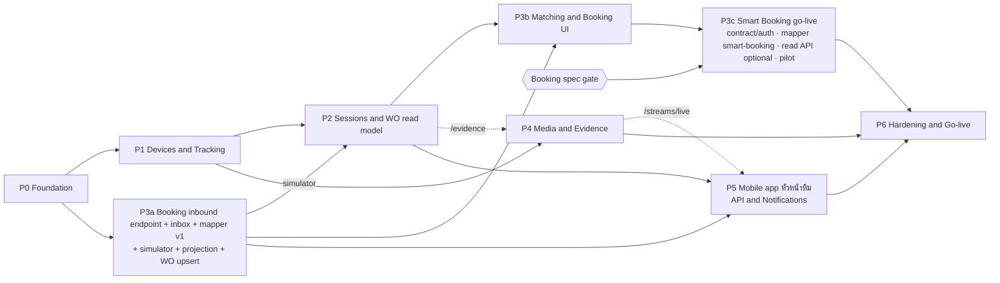

# Part 8 — Implementation Roadmap

> ขนาดงานประมาณจากสมมติฐาน **ทีม 2 Backend + 1–2 Frontend + QA บางเวลา** และ port โค้ดจาก reference ได้ตามแผนใน Part 1 — เป็นกรอบวางแผน ไม่ใช่ commitment

---

## 8.1 Phases & Dependencies

- **Critical path**: P0 → P1 → P2 → P3b → P3c → P6
- **Booking spec gate** = ได้คำตอบครบตาม checklist ใน [Part 9 §9.4](09-risks-open-questions.md#94-booking-information-checklist) ก่อน go-live กับ Smart Booking จริง: Booking POST ซ้ำทุกครั้งที่ใบงานเปลี่ยนหรือไม่, ใช้ contract ขาเข้า v1 ของเราหรือต้องเขียน mapper `smart-booking`, วิธี auth + การส่ง secret, IP ขาออกของ Booking, พฤติกรรม retry / ส่งซ้ำ และมี read API ให้ reconcile หรือไม่ (ทั้งหมด **[Assumption]** จนกว่าจะยืนยัน)
- **ใบงานมาจาก Smart Booking เท่านั้น (DL33) และมาทาง POST (DL46)** ⇒ endpoint รับ POST + การสร้างใบงานอยู่ใน P3a (inbox processor upsert `WorkOrders` 1:1) · P2 พัฒนาและทดสอบ session engine + WO read model กับใบงานที่ `booking-simulator` POST เข้า endpoint จริง (พัฒนาบน mock / simulator ก่อน — DL25)
- ถ้า Smart Booking จริงล่าช้า ระบบยังขึ้น production ได้ในโหมด tracking + evidence: session ถูกบันทึกครบ (ค้าง `AwaitingMatch` / `NoTeam`) และดูหลักฐานรายกล้องได้ที่ `/recordings` — ยังไม่มีใบงานจนกว่า Smart Booking จะเริ่ม POST แล้ว session ในช่วง `booking.rematch-horizon-hours` จะ match อัตโนมัติเมื่อ POST ถูกประมวลผล (`matching.rematch`) · แอปหัวหน้าทีมยังดู live กล้องของทีมได้ (จาก `DeviceAssignments`) แต่รายการใบงานว่าง
- GPS history (P1) และ talk (P4) เป็น **Must** แม้ requirement ฉบับ 2026-11-12 จัดเป็น Optional (DL48)

| Phase | Priority | ขนาด (สัปดาห์) | ขึ้นกับ | ทำขนานได้กับ |
|---|---|---|---|---|
| P0 Foundation | Must | 3 | — | — |
| P1 Devices & Tracking (รวม GPS history — DL48) | Must | 4 | P0 | P3a |
| P2 Sessions & WO read model | Must | 3 | P1, P3a (simulator) | P4 |
| P3a Booking inbound endpoint + inbox + mapper v1 + simulator + projection + WO upsert | Must | 3 | P0 | P1 |
| P3b Matching + Booking UI | Must | 3 | P2, P3a | P4, P5 |
| P3c Smart Booking go-live (ตกลง contract/auth, mapper `smart-booking` ถ้า payload ไม่ใช่ v1, read API adapter (optional), pilot) | Must | 2–3 | P3b + **Booking spec** | P5 |
| P4 Media & Evidence (live, live wall, talk, playback, export, `/evidence`) | Must (เมนูหลัก Live + หลักฐาน — DL36 · talk — DL48) | 3 | P1 (`/evidence` ต้องใช้ WO read model จาก P2) | P2, P3 |
| P5 Mobile app (หัวหน้าทีม) API & Notifications | **Must** (requirement §4: live + รายละเอียดใบงาน = ฟีเจอร์หลักของ mobile — DL47) | 2–3 | P2, P3a · live ใช้ `/streams/live` ของ P4 | P3b, P3c, P4 |
| P6 Hardening & Go-live | Must | 3 | P3c, P4, P5 | — |

---

## 8.2 รายละเอียดแต่ละ Phase

### P0 — Foundation

**Deliverables**
- โครง repo `client/` + `server/` · scripts dev/test/build · Docker images (api, worker+ffmpeg, web) · CI: lint, **typecheck**, unit, integration (Postgres + Redis ใน CI)
- Port `server/src/common/*` (db, scope แบบใหม่ `all` / `department` — `team` เพิ่มใน P5, settings + spec, lock, queue, rate limit, storage, context, audit interceptor, permission check, realtime bus, migration guards, prod-readiness)
- DB baseline + custom migration (extensions, partitions) + data migration ของ roles/permissions/settings · seed dev-only
- Auth: password + Entra SSO + refresh rotation + lockout + ระงับบัญชี · users / roles / departments / employees
- Global exception filter (error format Part 5) · pino logging + correlationId · health endpoints · Swagger
- Client: shell, design tokens, primitives, composites, i18n, auth pages, `usePermission`, router + 404/errorElement · port design guard tests

**Acceptance criteria**
- Login password + Entra ทำงานใน staging · refresh rotation/reuse detection ผ่าน integration test
- endpoint ทุกตัวไม่มี `@RequirePermission` ⇒ test fail (secure by default)
- `npm run build` รวม typecheck · migrate รันซ้ำได้ผลเดิม · drift gate หยุด process เมื่อ migration ค้าง
- design guard tests ผ่าน · หน้าว่างของ shell ตรง DESIGN.md (light/dark)

### P1 — Devices & Real-time Tracking

**Deliverables**
- Devices CRUD + vendor sync (`device-sync.plan.ts` ตัด dashcam) · Teams + TeamMembers · Depots (หลายจุด · dev ใช้พิกัด mock — Q22)
- `device-status` module: port GpsPoll + `ingestLocations` (`/location` ให้ทั้ง GPS และ online/offline — DL32) (ไม่ล้าง state เมื่อ restart) · `DeviceState` + `DeviceStatusHistory`
- `GpsLocations` partitioned + `PartitionMaintenance` job
- Realtime gateway + rooms ใหม่ (ตัด company)
- Client: Live map (cluster · ตำแหน่งสดผ่าน `gps:batch`), Devices list/detail (สถานะกล้องถาม DSS ตอนเปิดหน้า — ไม่มี push `device:status` DL35 · cache Redis `device-status:{deviceId}` DL45), Teams, Tracking history (Must — DL48)

**Acceptance criteria**
- simulator 300 อุปกรณ์: ตำแหน่งบนแผนที่อัปเดตผ่าน `gps:batch` ทุกรอบ GpsPoll · หน้ารายการ/รายละเอียดอุปกรณ์แสดงสถานะที่ได้จาก DSS ตอนเปิด · เปิดหน้ารายการซ้ำภายใน `status.display-cache-seconds` ไม่เรียก DSS ซ้ำ (DL45) · Redis ล่มยังได้สถานะจาก DSS ตรง · ไม่มีอุปกรณ์ถูกข้ามในรอบ poll/sweep
- DSS หลุดแล้วกลับมา / worker restart **ไม่เปลี่ยน `StateSince`** ของอุปกรณ์ที่สถานะไม่เปลี่ยน
- GPS ซ้ำ/เก่า/drift ถูกจัดการตาม pipeline เดิม (port test ของ reference)
- history 24 ชม. ต่ออุปกรณ์ตอบ < 2s ที่ 10M แถว

### P2 — Sessions & WO read model (ใบงานจาก `booking-simulator`)

**Deliverables**
- Session engine: pure `decide()` + sweep (ทุกอุปกรณ์, row lock, DB clock) + split rules ครบตาราง Part 3 §3.4.3 · ไม่มีการสร้างใบงานในเส้นทาง session (DL33)
- กล้องชาร์จที่ฐาน (`Depots` + fix ล่าสุด) ⇒ ระบบตั้ง session เป็น `Classified` + `IdleOrCharging` เอง
- WO read model: list/detail API + `availableActions` + `WorkOrderEvents` timeline · pass ระดับ WO ใน `SessionSweep` (alert ไม่มี check-out 36 ชม. · ปิด `SafetyTimeout` 7 วัน) · ใบงานใน P2 มาจาก `booking-simulator` ที่ POST เข้า inbound endpoint ของ P3a
- Recording index job (ใช้ DSS recording search) · alerts `CAMERA_ACTIVE_NO_TEAM`, `RECORDING_OUTSIDE_WORK`, `WORK_ORDER_NO_CHECKOUT`, `WORK_ORDER_AUTO_CLOSED` (alert ที่ต้องใช้ matching / ช่วงเวลางานจาก Booking ⇒ P3b)
- Client: Active sessions (รวม session ที่ยังไม่มีใบงาน — อ่านอย่างเดียว), WO list/detail (อ่านอย่างเดียว · ยังไม่มี Booking panel)

**Acceptance criteria**
- unit test ของ `decide()` ครอบทุกแถวใน decision table + scenario: battery swap < / ≥ merge gap, สลับกล้องสำรอง, Booking check-out ขณะกล้องเปิด (**ไม่เกิด loop**), กล้องชาร์จที่ฐาน, max segment, status flap, unknown ยาว, worker restart กลางคัน
- รัน 2 worker พร้อมกัน 1,000 รอบ ⇒ ไม่มี session ซ้อน (constraint ไม่ถูกละเมิด, ไม่มี error ค้าง)
- sweep ไม่สร้างแถว `WorkOrders` เลย — จำนวนใบงาน = จำนวน `BookingJobs` ที่รับมาเสมอ
- กล้องชาร์จ/อยู่ฐาน (ทดสอบด้วย Depots) ⇒ session `IdleOrCharging` ไม่นับเป็นงาน
- ใบงานจาก simulator ที่ไม่มี check-out ⇒ alert เมื่อครบ 36 ชม. และปิด `SafetyTimeout` เมื่อครบ 7 วัน (ใช้เวลา DB)

### P3a — Booking inbound endpoint, inbox, mapper v1, simulator, projection, WO upsert

**Deliverables** (DL46 · ยังพัฒนาบน simulator / mock — DL25, Q14)
- **Inbound endpoint** `POST /api/integration/booking/jobs` ใน process `api`: `@Public()` + `BookingInboundAuthGuard` (`BOOKING_INBOUND_AUTH=hmac|api-key` · HMAC-SHA256 บน `{timestamp}.{rawBody}` ±300 s · `BOOKING_INBOUND_SECRETS` ได้ 2 ชุดเพื่อ rotation · `BOOKING_INBOUND_ALLOWED_CIDRS` optional) + rate limit `booking-inbound` (600 req/min) + body limit 256 KB + `@Audit` (`IntegrationCallLogs` `Direction = 2 Inbound`, `Operation = 'inbound.job'`, เก็บ excerpt ที่ redact แล้ว)
- validate DTO (ฟิลด์ที่ไม่รู้จักเก็บใน raw ไม่ reject) → `INSERT IntegrationInbox` (`Channel = 1 Push`, `ExternalEventId` = `eventId` หรือ `{jobId}:{version ?? updatedAt}`, `ON CONFLICT DO NOTHING`) → enqueue `booking-inbox` หลัง commit → 202 `accepted` / 200 `duplicate` · enqueue ไม่สำเร็จยังตอบ 202 · inbox retry sweep เก็บ `Pending` ค้าง > 1 นาที + `Failed`
- `BookingInboundMapper` `v1` (`BOOKING_INBOUND_MAPPER`) → `BookingJobSnapshot` (รวม `doNo` / `shNo`) · `BookingJobs` (+ `DoNo`, `ShNo`), inbox, sync state (`LastReceivedAt`), call logs
- `booking-simulator` (`npm run booking:simulate -- <scenario>`): ใบงานใหม่, check-in, check-out, ยกเลิก, ส่งซ้ำ, สลับลำดับ, signature ผิด, burst — POST payload v1 ที่เซ็นแล้วเข้า endpoint จริง
- `BookingProvider` port แบบ optional outbound (`fetchJob?` / `fetchWindow?` / `fetchCameraAssignments?`) · `BOOKING_PROVIDER_DRIVER=none|mock|http` (ค่าเริ่มต้น `none`) · `mock` เสิร์ฟ fixture ของ `fetchJob` / `fetchWindow` · circuit breaker เฉพาะ call ขาออก · sync `DeviceAssignments` จาก Booking (ถ้ามีข้อมูล)
- mapping (`BookingTeamRef`, `BookingEmployeeRef`, status map) · **WO upsert (DL33)**: inbox processor upsert `WorkOrders` 1:1 กับ `BookingJobs` ใน transaction เดียวกับ projection (`UQ_WO_BookingJob`, `WorkOrderCounters`) + สถานะตาม check-in / check-out / ยกเลิก (logic เดิม: version guard, rematch enqueue)
- Settings: `booking.stale-after-minutes` (ความหมายใหม่ = อายุ inbox `Pending` / `Failed` ที่เก่าสุด) + `booking.inbound-silence-alert-hours` (ใหม่ · 24 · 0–168) — `SETTING_DEFAULTS` + `SETTING_BOUNDS` + data migration · ตัด `booking.sync-interval-seconds`

**Acceptance**: POST ซ้ำ (`ExternalEventId` เดิม) ⇒ 200 `duplicate` ไม่เกิดแถวใหม่ · signature ผิด / timestamp เกิน ±300 s / API key ผิด ⇒ 401 `INBOUND_AUTH_FAILED` · ขาด `job.jobId` / `job.status` / ทั้ง `job.version` และ `job.updatedAt` หรือวันที่ผิดรูปแบบ ⇒ 400 `VALIDATION_FAILED` · ฟิลด์ที่ไม่รู้จักไม่ทำให้ reject · POST สลับลำดับ ⇒ version / `updatedAt` ที่เก่ากว่าถูกข้าม projection ถูก · POST ขณะ worker `integration` ล่ม ⇒ ได้ 202 และถูกประมวลผลภายหลังจาก inbox · Redis ล่มหลัง insert inbox ⇒ ยังได้ 202 และ retry sweep เก็บได้ · DB ล่ม ⇒ 503 `SERVICE_UNAVAILABLE` · ตอบ 202 ภายใน p95 < 200 ms · ใช้ secret 2 ชุดพร้อมกันได้ (rotation ไม่มี downtime) · ทุก Booking job ที่รับมามีใบงาน 1 ใบพอดี (ส่งซ้ำ/สลับลำดับไม่เกิดใบซ้ำ) · เลข WO ไม่ซ้ำภายใต้ concurrent upsert · check-out ⇒ Closed (`BookingCheckout`), check-in ใหม่ ⇒ Open, Booking ยกเลิก ⇒ Cancelled · breaker ของ read API (driver `mock`) เปิด/ปิดตามกติกา · simulator หยุดส่ง / ส่ง burst 30 นาที ⇒ tracking/session ไม่ได้รับผลกระทบ (วัด sweep duration และ GPS lag เท่าเดิม)

### P3b — Matching & Booking UI

**Deliverables**: matcher อัตโนมัติ (`AlgoVersion` 1) + `MatchAttempts` · attach session เข้า WO ของ Booking job ตามลำดับ `DeviceRefs` → team ref → team-leader ref · ไม่มีหรือหลาย candidate ⇒ session ค้าง `AwaitingMatch` · re-match triggers (`matching.rematch` ภายใน `booking.rematch-horizon-hours`) · Booking panel (รวมเลข DO / SH) + `/booking-jobs` + `/integration` (POST ล่าสุด `LastReceivedAt`, จำนวน inbound 401 / 400 จาก CallLogs, inbox Pending / Failed / Dead, breaker ของ read API เฉพาะ driver ≠ `none`, mapping issues · ปุ่ม refresh รายใบ / full reconcile แสดงเฉพาะเมื่อมี read API) · badge `NeedsReview` ในหน้าใบงาน (ข้อมูลเท่านั้น ไม่มีคิว — DL33) · alerts `DEVICE_OFFLINE_DURING_JOB`, `WORK_ORDER_CANCELLED_WITH_EVIDENCE`, `BOOKING_JOB_CHANGED_AFTER_CLOSE`, `BOOKING_SYNC_STALE` (backlog ของ inbox), `BOOKING_INBOUND_SILENT` (17 — ไม่มี POST นาน `booking.inbound-silence-alert-hours`), `INTEGRATION_DEAD_LETTER`, `BOOKING_MAPPING_ISSUES` · `integration:status` `{ source, isStale, lastReceivedAt }` · job `re-resolve` เมื่อ ref ของทีม/พนักงานเปลี่ยน

**Acceptance**: ทุก scenario ใน Part 3 §3.3 ผ่านด้วย simulator · ไม่มี/หลาย candidate ⇒ ไม่เกิดใบงานใหม่ และ session match เองเมื่อ Booking POST ข้อมูลใหม่ · session ที่เปิดก่อนใบงานมาถึง ⇒ match เองเมื่อ POST ถูกประมวลผล (`matching.rematch`) · WO ถูกปิดด้วย check-out (simulator) ⇒ session split ภายใน 1 รอบ sweep และเวลาจบ = `ClosedAt` · simulator หยุดส่งแล้วกลับมาส่ง ⇒ session ที่ค้าง `AwaitingMatch` match ได้ถูก · ไม่มี POST นานเกิน `booking.inbound-silence-alert-hours` ⇒ alert 17 · ทุก attach อธิบายได้จาก `MatchAttempts`

### P3c — Smart Booking go-live + pilot

**Deliverables** (**ติด Booking spec gate**): ตกลง contract ขาเข้ากับทีม Smart Booking (draft v1 ใน Part 7) + วิธี auth / ส่ง secret / IP allowlist · mapper `smart-booking` ถ้า payload ไม่ใช่ v1 (`BOOKING_INBOUND_MAPPER=smart-booking`) · contract test + fixture จาก payload จริง · read API adapter `http` (`fetchJob` สำหรับปุ่ม refresh · `fetchWindow` สำหรับ reconcile รายคืน 02:00) **เฉพาะเมื่อ Booking มี read API** (optional — **[Assumption]**) · เปิด firewall ขาเข้าจาก IP ขาออกของ Booking (route `/api/integration/booking/*` ผ่าน ingress → nginx `web` → `api`) · sandbox run · pilot กับ 1–2 แผนก · deep link จาก Booking app

**Acceptance**: match rate อัตโนมัติ (session ในช่วงงานของ Booking ที่ attach ได้เอง) ≥ 90% ช่วง pilot 2 สัปดาห์ · ใบงาน 1:1 กับ Booking job (ไม่ซ้ำ ไม่ขาด — เทียบรายการกับ Booking ท้าย pilot) · เวลาจาก POST ถึงใบงานปรากฏในระบบ p95 ≤ 1 นาที · ช่วง pilot ไม่มี 401 / 400 จาก Booking ที่ไม่ได้ตั้งใจ · POST ที่หายกู้ได้ด้วย reconcile รายคืน (ถ้ามี read API) หรือ Booking ส่งซ้ำ (ถ้าไม่มี)

### P4 — Media & Evidence

**Deliverables**
- port streaming (live, playback, proxy, quota, role/device access) · live wall · talk (Must — DL48)
- เมนูหลัก (DL36): **Live** (`/live-wall` + ดูสดจากรายการอุปกรณ์ + talk) และ **หลักฐาน** `/evidence` (port `client/src/features/evidence`): ตารางใบงานจาก Booking → เลือกกล้อง + ช่วงเวลาจาก session ของใบงาน → playback / ดาวน์โหลด MP4
- `/recordings` ค้นหาวิดีโอรายกล้อง (ใช้กับ session ที่ไม่มีใบงาน)
- evidence export (BullMQ + ffmpeg) · reuse job เดิมเมื่อ device + channel + start/end ตรงกันและยัง queued / processing / ready ไม่หมดอายุ · ไฟล์บน Local disk PVC ที่ `api` + `worker-media` mount ร่วม · ลบไฟล์หลัง 24 ชม. (DL34)

**Acceptance**: เท่ากับพฤติกรรม reference (live/playback/export/talk) · export มี checksum + audit · `/evidence`: เลือกใบงานแล้ว playback / ดาวน์โหลดได้ตรงช่วงเวลา session · ขอ export ช่วงเดิมซ้ำได้ job เดิม ไม่สร้างใหม่ · `api` ทุก pod stream ไฟล์ที่ `worker-media` เขียนได้ (ทดสอบ PVC access mode ใน staging — Part 9 R16) · สั่ง export พร้อมกันเกิน `EVIDENCE_EXPORT_CONCURRENCY` แล้วงานที่เกินรอคิว และ latency ของ `api` (REST / live / แผนที่) ไม่เพิ่มอย่างมีนัย (DL39)

### P5 — Mobile app (หัวหน้าทีม) API & Notifications

> Priority **Must** — requirement ฉบับ 2026-11-12 §4: live กล้องของตัวเอง + รายละเอียดใบงานจาก Smart Booking เป็นฟีเจอร์หลักของ mobile (DL47) · ผู้ใช้แอป = หัวหน้าทีมเท่านั้น

**Deliverables**
- Role `TEAM_LEADER` + scope level `team` (data migration) · permissions `work-orders:read`, `booking:read`, `devices:read`, `streaming:view-live`, `notifications:read` ทั้งหมดประเมินด้วย scope `team`
- Scope predicate `team`: พนักงานของผู้ใช้ (`Employees.UserId`) → ทีมที่เป็นหัวหน้า active (`TeamMembers.Role = 1 Leader` — เปลี่ยนหัวหน้ามีผลทันที DL22) · ใบงาน = `BookingJobs.TeamId` ของทีม หรือ `BookingJobs.LeaderEmployeeId` = ตัวเอง · กล้อง = `DeviceAssignments` active ของทีม + `DeviceRefs` ของใบงาน `Planned` / `Open`
- `GET /mobile/me` · `GET /mobile/jobs?status=planned|open|recent` · `GET /mobile/jobs/:workOrderId` (Booking reference ไม่มี `raw` · กล้อง · สรุป session · `availableActions`) · `/mobile/overview` ตัดทิ้ง
- Live ผ่าน `POST /streams/live` เดิม จำกัดกล้องใน scope `team`
- Push FCM "ใบงานใหม่ของทีม" เมื่อเกิด WO ของทีม (deep link `bodycam://jobs/{workOrderId}`) · alert ไม่ push ไปมือถือแล้ว
- Socket.IO room `team:{id}` (หัวหน้าทีม join) · `workorder:changed` ส่งเข้า `team:{teamId}` ของใบงานด้วย · ไม่ส่ง `gps:batch` ให้หัวหน้าทีม
- ทะเบียนเครื่อง `/auth/devices` (ไม่มี PIN) · refresh token แบบ body · push tokens + FCM queue · notifications inbox
- Web: login ด้วย `TEAM_LEADER` แสดงหน้า "ใช้งานผ่านแอปมือถือ" (ไม่มีเมนู) · `ADMIN` สร้างบัญชีหัวหน้าทีมใน User Management และผูก `Employees.UserId` (บังคับใน service)
- เอกสาร mobile contract ฉบับใหม่ (ปรับจาก `docs/MOBILE-API-CONTRACT.md` ของ reference) — แอปมือถือทีมเราพัฒนาเอง ปรับ / เพิ่ม / ลดฟังก์ชันได้ (DL49) · login หัวหน้าทีมได้ทั้ง Entra SSO และ username/password แบบ reference (DL49) — acceptance: บัญชีไม่มี Entra login ด้วยรหัสผ่านได้ + lockout ทำงาน

**Acceptance**: หัวหน้าทีมเห็นเฉพาะใบงาน / กล้องของทีมตัวเอง — ของทีมอื่น ⇒ 404 · live เปิดได้เฉพาะกล้องใน scope `team` (กล้องอื่น ⇒ 404) · endpoint ของเมนู web (dashboard, tracking, sessions, playback, evidence, live wall, talk, alerts, users, settings ฯลฯ) ⇒ 403 และ login web ⇒ หน้า "ใช้งานผ่านแอปมือถือ" ไม่มีเมนู · ไม่ผูกพนักงาน / ไม่ใช่หัวหน้า ⇒ รายการว่าง ไม่ error · เปลี่ยนหัวหน้าทีม ⇒ สิทธิ์ย้ายไปคนใหม่ทันที · push "ใบงานใหม่ของทีม" ถึงเครื่องจริงเมื่อ simulator POST ใบงานใหม่ของทีม · ระงับบัญชี ⇒ refresh + push token ถูก revoke · ทีม mobile เชื่อมต่อได้ครบ

### P6 — Hardening & Go-live

**Deliverables**
- Retention ไม่มี archive (`DETACH` → `DROP PARTITION`) · cleanup jobs (รวม `EvidenceCleanup` ไฟล์ export บน PVC)
- Observability: Prometheus metrics + dashboard + alert rules (sweep duration, poll lag, `booking_inbound_requests_total{result}`, `booking_inbound_last_received_timestamp`, `booking_inbox_lag_seconds` / `booking_inbox_pending` / `booking_inbox_dead`, queue depth)
- Security review (OWASP ASVS L2 checklist, secret scan, dependency audit) รวม inbound endpoint (HMAC + replay window ±300 s, rate limit, body limit, ไม่ log secret / signature / body เต็ม) · penetration test เบื้องต้น · PDPA review
- Load test: 300 อุปกรณ์ + 50 ผู้ใช้พร้อมกัน + 16 stream + burst POST จาก `booking-simulator` · backup/restore drill
- Runbooks: Smart Booking ไม่ส่ง / ส่งแล้วได้ 401 ต่อเนื่อง, rotation secret ขาเข้า (`BOOKING_INBOUND_SECRETS`), DSS ล่ม, Redis ล่ม, migration ค้าง, dead letter
- ตั้ง master data ใหม่ (ไม่ย้ายข้อมูลจากระบบเดิม — DL19): vendor sync อุปกรณ์, พนักงาน, ผู้ใช้ (รวมบัญชีหัวหน้าทีม `TEAM_LEADER` + ผูก `Employees.UserId`), ทีม, ฐาน · UAT · go-live checklist (ไม่มี demo account, CORS ไม่ใช่ `*`, `prod:check` ผ่าน, secret ขาเข้าของ Booking ตั้งใน Kubernetes Secret)

**Acceptance**: ผ่าน load test ที่ p95 API < 500ms, sweep < 10s · ผ่าน security checklist ไม่มี High ค้าง · UAT sign-off

---

## 8.3 Milestones

| Milestone | หลัง Phase | ผลที่ใช้งานได้ |
|---|---|---|
| M1 Tracking ready | P1 | แผนที่สด + สถานะกล้อง + ประวัติเส้นทาง (DL48) แทนส่วน bodycam ของระบบเดิม |
| M2 Evidence-ready | P2 + P4 | ทุกการใช้กล้องมี session + ดูย้อนหลัง/export รายกล้องได้ (`/recordings`) · เมนู Live พร้อม (ใบงานยังมาจาก `booking-simulator`) |
| M3 Booking-linked | P3c | ใบงานที่ Smart Booking POST จริง + session match อัตโนมัติ + หน้า หลักฐาน `/evidence` ตามใบงาน |
| M4 Production | P5 + P6 | go-live (web + แอปหัวหน้าทีม) |

---

## 8.4 Definition of Done (ทุก Phase)

- unit test ของ pure logic + integration test ของ endpoint ใหม่ (ต่อ DB/Redis จริง)
- `@RequirePermission` + `@Audit` + data scope ครบทุก endpoint
- Setting ใหม่: defaults + bounds + data migration
- เอกสาร blueprint ที่เกี่ยวข้องอัปเดตตาม implementation จริง (code คือ source of truth — บทเรียนจาก reference ที่เอกสารหลักหายแล้วต้องเขียนใหม่จากโค้ด)
