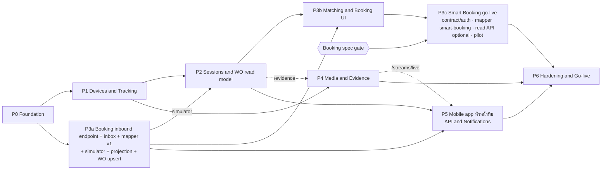

# Part 8 — Implementation Roadmap

> ขนาดงานประมาณจากสมมติฐาน **ทีม 2 Backend + 1–2 Frontend + QA บางเวลา** และ port โค้ดจาก reference ได้ตามแผนใน Part 1 — เป็นกรอบวางแผน ไม่ใช่ commitment

---

## 8.1 Phases & Dependencies

- **Critical path**: P0 → P1 → P2 → P3b → P3c → P6
- **Booking spec gate** = ได้คำตอบครบตาม checklist ใน [Part 9 §9.4](09-risks-open-questions.md#94-booking-information-checklist) ก่อน go-live กับ Smart Booking จริง: Booking POST ซ้ำทุกครั้งที่ใบงานเปลี่ยนหรือไม่, ใช้ contract ขาเข้า v1 ของเราหรือต้องเขียน mapper `smart-booking`, วิธี auth + การส่ง secret, IP ขาออกของ Booking, พฤติกรรม retry / ส่งซ้ำ และมี read API ให้ reconcile หรือไม่ (ทั้งหมด **[Assumption]** จนกว่าจะยืนยัน)
- **ใบงานมาจาก Smart Booking เท่านั้น (DL33) และมาทาง POST (DL46)** ⇒ endpoint รับ POST + การสร้างใบงานอยู่ใน P3a (inbox processor upsert `WorkOrders` 1:1) · P2 พัฒนาและทดสอบ session engine + WO read model กับใบงานที่ `booking-simulator` POST เข้า endpoint จริง (พัฒนาบน mock / simulator ก่อน — DL25)
- ถ้า Smart Booking จริงล่าช้า ระบบยังขึ้น production ได้ในโหมด tracking + evidence: session ถูกบันทึกครบ (ค้าง `AwaitingMatch` / `NoTeam`) และดูภาพสดได้ที่ ภาพสดหลายจอ และดูย้อนหลังรายกล้องได้ที่ วิดีโอย้อนหลัง (DL59) — ยังไม่มีใบงานจนกว่า Smart Booking จะเริ่ม POST แล้ว session ในช่วง `booking.rematch-horizon-hours` จะ match อัตโนมัติเมื่อ POST ถูกประมวลผล (`matching.rematch`) · แอปหัวหน้าทีมยังดู live กล้องของทีมได้ (จาก `DeviceAssignments`) แต่รายการใบงานว่าง
- GPS history (P1) และ talk (P4) เป็น **Must** แม้ requirement ฉบับ 2026-11-12 จัดเป็น Optional (DL48)

| Phase | Priority | ขนาด (สัปดาห์) | ขึ้นกับ | ทำขนานได้กับ |
|---|---|---|---|---|
| P0 Foundation | Must | 3 | — | — |
| P1 Devices & Tracking (รวม GPS history — DL48) | Must | 4 | P0 | P3a |
| P2 Sessions & WO read model | Must | 3 | P1, P3a (simulator) | P4 |
| P3a Booking inbound endpoint + inbox + mapper v1 + simulator + projection + WO upsert + API / หน้า ใบงาน อ่านอย่างเดียว | Must | 3 | P0 | P1 |
| P3b Matching + Booking UI | Must | 3 | P2, P3a | P4, P5 |
| P3c Smart Booking go-live (ตกลง contract/auth, mapper `smart-booking` ถ้า payload ไม่ใช่ v1, read API adapter (optional), pilot) | Must | 2–3 | P3b + **Booking spec** | P5 |
| P4 Media & Evidence (ภาพสดหลายจอ + talk, playback, export, วิดีโอย้อนหลัง `/evidence`, ดูสด / ดูย้อนหลังในหน้า ใบงาน) | Must (DL53 · talk — DL48) | 3 | P1 (หน้า ใบงาน และป้ายใบงานในหน้า วิดีโอย้อนหลัง ใช้ WO read model จาก P3a + session จาก P2) | P2, P3 |
| P5 Mobile app (หัวหน้าทีม) API & Notifications | **Must** (requirement §4: live + รายละเอียดใบงาน = ฟีเจอร์หลักของ mobile — DL47) | 2–3 | P2, P3a · live ใช้ `/streams/live` ของ P4 | P3b, P3c, P4 |
| P6 Hardening & Go-live | Must | 3 | P3c, P4, P5 | — |

---

## 8.2 รายละเอียดแต่ละ Phase

### P0 — Foundation

**Deliverables**
- โครง repo `client/` + `server/` · scripts dev/test/build · Docker images (api, worker+ffmpeg, web) · CI: lint, **typecheck**, unit, integration (Postgres + Redis ใน CI)
- **ช่วง dev รันบนเครื่อง local (DL63)**: PostgreSQL + Redis บนเครื่อง (database ใหม่) · DSS middleware ผ่าน VPN · คู่มือ `docs/runbooks/local-dev.md` · ยังไม่ deploy Azure
- Deploy ทับระบบเดิม (DL60 · **ทำเมื่อผู้ใช้สั่ง** — DL63): ปิดระบบเดิม (scale เป็น 0 ใน gitops) ได้ทันที · `server/` แทนเนื้อหา `psd-bwc-web-backend` และ `client/` แทน `psd-bwc-frontend` (tag HEAD เดิมก่อน · copy จาก `psd-bodycam-v1.0` ซึ่งเป็นที่เก็บโค้ดหลัก โดยคง `azure-pipelines.yml` / `sonar-project.properties` ของ repo บน Azure) เพื่อใช้ Azure pipeline / Harbor / gitops ชุดเดิม · ต้องมี `server/Dockerfile` (stage `runner` + ffmpeg) และ script `coverage` / `test:ci:full` ที่ใช้ได้ · gitops: ชื่อ Deployment / Service เดิม, database ใหม่ (ไม่ใช้ DB ของระบบเดิม — Part 4 §4.7), env ชุดใหม่ (ตัด `BRMS_*`, `ROAD_MATCH_DRIVER` / `OSRM_URL`, `INTEGRATION_WEBHOOK_*`), `web` port 8080
- Port `server/src/common/*` (db, scope แบบใหม่ `all` — `team` เพิ่มใน P5 · ไม่มี `department` DL53, settings + spec, lock, queue, rate limit, storage, context, audit interceptor, permission check, realtime bus, migration guards, prod-readiness)
- DB baseline + custom migration (extensions, partitions) + `0002_drop_departments` (DL53) + data migration ของ roles / permissions (catalog 24 ตัว — DL53) / settings (role `SUPER_ADMIN`, `ADMIN` — DL51, `OPERATOR`, `VIEWER`) · seed dev-only
- Auth: password + Entra SSO + refresh rotation + lockout + ระงับบัญชี · users / roles / employees (ไม่มีแผนก — DL53) · **ผู้ใช้จาก Entra** (port `GET /users/entra-directory`, `POST /users/sync-entra` + Microsoft Graph client · env `GRAPH_*` — DL53) · กติกา `ADMIN` (DL51): permission สงวนของ `SUPER_ADMIN` (`audit:view`, `settings:manage`, `roles:manage` · `PERMISSION_RESERVED_FOR_SUPER_ADMIN`) + ป้องกันบัญชี `SUPER_ADMIN` (`SUPER_ADMIN_ACCOUNT_PROTECTED`) + `availableActions` ต่อแถวผู้ใช้
- Global exception filter (error format Part 5) · pino logging + correlationId · health endpoints · Swagger
- Client: shell + nav 11 เมนู 4 กลุ่ม (DL53), design tokens, primitives, composites, i18n, auth pages, `usePermission`, router + 404/errorElement · หน้า ผู้ใช้ระบบ, ผู้ใช้จาก Entra (`/entra-users` — port `EntraUsersPage`) · port design guard tests

**Acceptance criteria**
- Login password + Entra ทำงานบนเครื่อง dev local (DL63 · Entra ต้องมี redirect URI `http://localhost:5173`) · refresh rotation/reuse detection ผ่าน integration test
- endpoint ทุกตัวไม่มี `@RequirePermission` ⇒ test fail (secure by default)
- `npm run build` รวม typecheck · migrate รันซ้ำได้ผลเดิม · drift gate หยุด process เมื่อ migration ค้าง
- `ADMIN` จัดการผู้ใช้ role อื่นได้ · รายการผู้ใช้ / `/roles` / หน้า ผู้ใช้จาก Entra ไม่มีบัญชีและ role `SUPER_ADMIN` · เรียก `/users/:id` ของบัญชี `SUPER_ADMIN` ⇒ 404 · กำหนด role `SUPER_ADMIN` ⇒ 403 (DL55) · เรียก `/audit-logs`, `/settings`, `PUT /roles/:id/permissions` ⇒ 403 · ใส่ permission สงวนให้ role อื่น ⇒ 400 (integration test — DL51)
- ผู้ใช้จาก Entra: `entra-directory` / `sync-entra` แบบ `dryRun` ไม่แก้ข้อมูล · `sync-entra` จริงเติมเฉพาะช่องที่ว่าง · สร้างบัญชีจากแถว `missing` ได้ทั้งทีละรายการและหลายรายการ (บทบาทเดียวกัน) · `ADMIN` สร้างด้วยบทบาท `SUPER_ADMIN` ⇒ 403 · ไม่ตั้ง env `GRAPH_*` ⇒ 400 พร้อมข้อความ (DL53)
- ไม่มีตาราง `Departments` / คอลัมน์ `DepartmentId` · sidebar ของ `SUPER_ADMIN` มี 11 เมนู (DL53)
- design guard tests ผ่าน · หน้าว่างของ shell ตรง DESIGN.md (light/dark)

### P1 — Devices & Real-time Tracking

**Deliverables**
- job `DeviceSync` ใน worker: sync กล้องจาก DSS device list ตอน start + รายชั่วโมง (`device-sync.plan.ts` ตัด dashcam · ไม่ลบเครื่องที่หาย ⇒ alert `DEVICE_VENDOR_MISSING`) · ไม่มีหน้าจัดการ / sync ด้วยมือ (DL53) · ตาราง `Teams` + `TeamMembers` (ข้อมูลมาจากใบงานใน P3a — DL53) · ตาราง `Depots` (หลายจุด · ไม่มีหน้าจัดการ ⇒ production ว่าง · dev seed พิกัด mock — Q22, DL53)
- DSS client ตัวเดียว (`server/src/common/dss/*` · driver `dss` | `mock` · env `DSS_*` — DL75) · **simulator (DL56) = `DSS_DRIVER=mock`** (ค่าเริ่มต้น · กล้อง `SIM-0001`… จำนวน `DSS_MOCK_DEVICES` = 100 — DL68) · dev ต่อ DSS จริงผ่าน VPN ด้วย `DSS_DRIVER=dss` + `DSS_BASE_URL` + `DSS_API_KEY` (DL63)
- `device-status` module: port GpsPoll + `ingestLocations` (`/location` ให้ทั้ง GPS และ online/offline — DL32) (ไม่ล้าง state เมื่อ restart) · `DeviceState` (แถวสร้างโดย `DeviceSync` — DL67) + `DeviceStatusHistory` · GpsPoll ทุกกล้องทุกรอบ ไม่ซ้อนรอบ ไม่มี cap (DL70)
- `GpsLocations` partitioned + `PartitionMaintenance` job (สร้างล่วงหน้าทั้ง `GpsLocations` และ `AuditLogs` · การลบตาม retention อยู่ P6 — DL72)
- ตาราง `Alerts` + ตัวเขียน alert (alert 13 ส่งถึง `user:{id}` ของ `SUPER_ADMIN` — DL66 · `Notifications` / หน้า แจ้งเตือน อยู่ P2) · settings ของ P1 (`0006_p1_tracking_custom` — Part 3 §3.11)
- Realtime gateway + rooms ใหม่ `org` / `user:{id}` / `tracking` / `alerts` (ตัด company · ไม่มี `dept:*` — DL53)
- `GET /devices` + สถานะกล้องถาม DSS ตอน request (ไม่มี push `device:status` DL35 · DSS device list ครั้งเดียว + cache Redis `cache:{database}:device-status:{deviceId}` — DL45, DL69 · `currentTeam: null` จนถึง P3a — DL73) · `GET /tracking/positions` · `GET /tracking/devices/:id/history`
- Client: แผนที่ติดตาม (cluster · ตำแหน่งสดผ่าน `gps:batch`), ประวัติเส้นทาง (Must — DL48) · สีสถานะกล้องตาม DL74 · ไม่มีหน้า Bodycam / ทีม / ฐาน (DL53)

**Acceptance criteria** — ผ่านครบบน simulator (`DSS_DRIVER=mock`) แล้ว 2026-11-23 · **ทดสอบกับ DSS จริงผ่าน VPN แล้ว 2026-11-24** (`DSS_DRIVER=dss`): JWT ผ่าน · DSS มีกล้อง 1 ตัว (ชนิด `MPT` รุ่น `DH-MPT230` — เข้ากฎ bodycam) ⇒ `Devices` 1 แถว ไม่มีกล้องถูกตั้งหาย · `GET /api/v1/devices` 412 ms · `/location` ~300 ms ต่อกล้อง (รอบ GpsPoll 1 กล้อง 357 ms) · กล้องออฟไลน์แต่ `/location` คืนพิกัดล่าสุด (5 วันก่อน) ⇒ บันทึก 1 จุด หมุดสีเทาแบบจางบนแผนที่ · เวลาต่อรอบที่กล้องจำนวนมากยังวัดไม่ได้จนกว่า DSS มีกล้องมากขึ้น (R3)
- simulator 100 อุปกรณ์ (DL56): ตำแหน่งบนแผนที่อัปเดตผ่าน `gps:batch` ทุกรอบ GpsPoll · `GET /devices` คืนสถานะที่ได้จาก DSS · เรียกซ้ำภายใน `status.display-cache-seconds` ไม่เรียก DSS ซ้ำ (DL45) · Redis ล่มยังได้สถานะจาก DSS ตรง · ไม่มีอุปกรณ์ถูกข้ามในรอบ poll/sweep
- กล้องใหม่ใน DSS ปรากฏใน `Devices` ภายใน 1 รอบ `DeviceSync` · กล้องที่หายจาก DSS ได้ `VendorMissingSince` + alert 13 และไม่ถูกลบ (DL53)
- DSS หลุดแล้วกลับมา / worker restart **ไม่เปลี่ยน `StateSince`** ของอุปกรณ์ที่สถานะไม่เปลี่ยน
- GPS ซ้ำ/เก่า/drift ถูกจัดการตาม pipeline เดิม (port test ของ reference)
- history 24 ชม. ต่ออุปกรณ์ตอบ < 2s ที่ 10M แถว — วัดได้ 34–84 ms บนเครื่อง dev (ใช้ `PK_GpsLocations` ของ partition เดือนนั้นเท่านั้น — Part 4 §4.6)

### P2 — Sessions & WO read model (ใบงานจาก `booking-simulator`)

**Deliverables**
- Session engine: pure `decide()` + sweep (ทุกอุปกรณ์, row lock, DB clock) + split rules ครบตาราง Part 3 §3.4.3 · ไม่มีการสร้างใบงานในเส้นทาง session (DL33)
- กล้องชาร์จที่ฐาน (`Depots` + fix ล่าสุด) ⇒ ระบบตั้ง session เป็น `Classified` + `IdleOrCharging` เอง (logic + test ด้วย dev seed · production `Depots` ว่าง ⇒ ยังไม่ทำงาน — DL53)
- WO read model: list/detail API + `WorkOrderEvents` timeline ทำแล้วใน **P3a** (DL84) · P2 เพิ่ม `availableActions`, `lastActivityAt`, `cameras` จาก session · pass ระดับ WO ใน `SessionSweep` (badge `NeedsReview` ไม่มี check-out 36 ชม. · ปิด `SafetyTimeout` 7 วัน) · ใบงานใน P2 มาจาก `booking-simulator` ที่ POST เข้า inbound endpoint ของ P3a
- Recording index job (ใช้ DSS recording search) · alerts `CAMERA_ACTIVE_NO_TEAM`, `RECORDING_OUTSIDE_WORK` (alert เรื่องใบงานตัดออกแล้ว — DL58) · ตาราง `Notifications` + หน้า แจ้งเตือน (รับทราบ / ปิดเรื่อง — DL57) + push `alert:new` เข้า room `alerts` (ตาราง `Alerts` มีตั้งแต่ P1 — DL66)
- Client: หน้า ใบงาน `/work-orders` + `/work-orders/:id` สร้างแล้วใน **P3a** (อ่านอย่างเดียว · DL84) · P2 เติมคอลัมน์กล้องจาก session · ปุ่ม ดูสด / ดูย้อนหลัง เปิดใน P4 (DL53) · Booking panel เต็มใน P3b · ไม่มีหน้า Tracking sessions (DL53)

**Acceptance criteria**
- unit test ของ `decide()` ครอบทุกแถวใน decision table + scenario: battery swap < / ≥ merge gap, สลับกล้องสำรอง, Booking check-out ขณะกล้องเปิด (**ไม่เกิด loop**), กล้องชาร์จที่ฐาน, max segment, status flap, unknown ยาว, worker restart กลางคัน
- รัน 2 worker พร้อมกัน 1,000 รอบ ⇒ ไม่มี session ซ้อน (constraint ไม่ถูกละเมิด, ไม่มี error ค้าง)
- sweep ไม่สร้างแถว `WorkOrders` เลย — จำนวนใบงาน = จำนวน `BookingJobs` ที่รับมาเสมอ
- กล้องชาร์จ/อยู่ฐาน (ทดสอบด้วย Depots) ⇒ session `IdleOrCharging` ไม่นับเป็นงาน
- ใบงานจาก simulator ที่ไม่มี check-out ⇒ badge `NeedsReview` เมื่อครบ 36 ชม. (ไม่มี alert — DL58) และปิด `SafetyTimeout` เมื่อครบ 7 วัน (ใช้เวลา DB)

### P3a — Booking inbound endpoint, inbox, mapper v1, simulator, projection, WO upsert, หน้า ใบงาน (อ่านอย่างเดียว)

**Deliverables** (DL46, DL84, DL85 · ใบงาน mock ผ่าน simulator + กล้อง / GPS จริงจาก DSS — Q54)
- **Inbound endpoint** `POST /api/integration/booking/jobs` ใน process `api`: `@Public()` + `BookingInboundAuthGuard` (`BOOKING_INBOUND_AUTH=hmac|api-key` · HMAC-SHA256 บน `{timestamp}.{rawBody}` ±300 s (api-key ไม่ใช้ timestamp) · `BOOKING_INBOUND_SECRETS` ได้ 2 ชุดเพื่อ rotation · `BOOKING_INBOUND_ALLOWED_CIDRS` optional) + rate limit `booking-inbound` (`BOOKING_INBOUND_RATE_LIMIT_PER_MIN` default 600 · ตรวจก่อน auth) + body limit 256 KB (raw parser เฉพาะ route นี้) + call log ใน `IntegrationCallLogs` (`Direction = 2 Inbound`, `Operation = 'inbound.job'`, excerpt ≤ 4 KB byte — เขียนโดย guard / interceptor ไม่ใช่ `@Audit`)
- validate DTO (ฟิลด์ที่ไม่รู้จักเก็บใน raw ไม่ reject · `plannedEndAt < plannedStartAt` ⇒ 400) → `INSERT IntegrationInbox` (`Channel = 1 Push`, `ExternalEventId` = `eventId` หรือ `{jobId}:{version ?? updatedAt}`, `ON CONFLICT DO NOTHING`) → enqueue BullMQ `booking-inbox` หลัง commit → 202 `accepted` / 200 `duplicate` · enqueue ไม่สำเร็จยังตอบ 202 · inbox retry sweep (ทุก 5 นาที จาก DB ไม่ผ่าน BullMQ) เก็บ `Pending` ค้าง > 1 นาที + `Failed` · `Dead` หลัง 10 ครั้ง
- `BookingInboundMapper` `v1` (`BOOKING_INBOUND_MAPPER`) → `BookingJobSnapshot` (รวม `doNo` / `shNo`) · `BookingJobs`, inbox, sync state (`LastReceivedAt`), call logs · migration `0012_p3a_booking`
- **inbox processor** (worker role `integration`): projection ด้วย version guard + `WorkOrders` upsert 1:1 + `WorkOrderEvents` + `Teams` / `TeamMembers` (ย้ายหัวหน้าเฉพาะตอนเข้างาน — DL85) ใน transaction เดียว · emit `workorder:changed` หลัง commit · **ยังไม่ enqueue `matching`** (P3b)
- `booking-simulator` (`npm run booking:simulate -- <scenario>`): ใบงานใหม่, check-in, check-out, ยกเลิก, ส่งซ้ำ, สลับลำดับ, signature ผิด, burst, `demo` — POST payload v1 ที่เซ็นแล้วเข้า endpoint จริง
- **API + หน้า ใบงาน อ่านอย่างเดียว (ย้ายมาจาก P2 — DL84)**: `GET /work-orders`, `GET /work-orders/:id`, `GET /work-orders/:id/events` (`work-orders:read` · `booking` เต็มเฉพาะผู้มี `booking:read` · `availableActions: []` · `lastActivityAt` null จน P2) · client `/work-orders` (ตาราง + แท็บสถานะ + คอลัมน์กล้องจาก `DeviceRefs` พร้อมสถานะออนไลน์จาก DSS) และ `/work-orders/:id` · อัปเดตเองผ่าน `workorder:changed`
- mapping (`BookingTeamRef`, `BookingEmployeeRef`, status map) · **ทีม / หัวหน้าทีมจากใบงาน (DL53 · DL85 [Assumption])** · **WO upsert (DL33)** (`UQ_WO_BookingJob`, `WorkOrderCounters`) + สถานะตาม check-in / check-out / ยกเลิก

**ย้ายออกจากขอบเขตเดิมของ P3a**: `BookingProvider` port + read API + circuit breaker + sync `DeviceAssignments` ⇒ **P3c** (ยังไม่รู้ว่า Booking มี read API ไหม — DL84 แบบ ข) · settings `booking.*` (`booking.stale-after-minutes`, `booking.inbound-silence-alert-hours`) + alert 10 / 11 / 12 / 17 + `POST /integration/inbox/:id/retry` ⇒ **P3b**

**Acceptance**: POST ซ้ำ (`ExternalEventId` เดิม) ⇒ 200 `duplicate` ไม่เกิดแถวใหม่ · signature ผิด / timestamp เกิน ±300 s / API key ผิด ⇒ 401 `INBOUND_AUTH_FAILED` · ขาด `job.jobId` / `job.status` / ทั้ง `job.version` และ `job.updatedAt`, วันที่ผิดรูปแบบ, `plannedEndAt < plannedStartAt`, JSON พัง ⇒ 400 `VALIDATION_FAILED` · `Content-Type` ผิด ⇒ 415 · body > 256 KB ⇒ 413 (ทุกกรณีมี call log) · ฟิลด์ที่ไม่รู้จักไม่ทำให้ reject · POST สลับลำดับ ⇒ version / `updatedAt` ที่เก่ากว่าถูกข้าม · POST ขณะ worker `integration` ล่ม ⇒ ได้ 202 และถูกประมวลผลภายหลังจาก inbox · Redis ล่มหลัง insert inbox ⇒ ยังได้ 202 และ retry sweep เก็บได้ · DB ล่ม ⇒ 503 `SERVICE_UNAVAILABLE` · ตอบ 202 ภายใน p95 < 200 ms — p95: วัดบนเครื่อง dev 2026-11-25 — ส่งงานเดิมซ้ำ 200 ครั้ง (วัดทางส่งซ้ำ: ตรวจลายเซ็น + validate + transaction inbox ที่ชน ON CONFLICT + เขียน call log — ตอบ 200 duplicate จึงไม่ enqueue · ส่วน 202 ของ event ใหม่ทำเพิ่มอีก 2 อย่าง คือ insert แถว inbox และ BullMQ add 1 ครั้ง) ⇒ `IntegrationCallLogs.LatencyMs` p50 2 ms / p95 3 ms · ฝั่งผู้ส่ง p50 4.6 ms / p95 7.2 ms (ต่ำกว่าเป้า 200 ms มาก · ยังไม่ได้วัดบน production) · ใช้ secret 2 ชุดพร้อมกันได้ · ทุก Booking job ที่รับมามีใบงาน 1 ใบพอดี · เลข WO ไม่ซ้ำภายใต้ concurrent upsert · check-out ⇒ Closed (`BookingCheckout`), check-in ใหม่ ⇒ Open, Booking ยกเลิก ⇒ Cancelled · `teamRef` ใหม่ ⇒ เกิดทีมใหม่ 1 ทีม (ส่งซ้ำไม่เกิดทีมซ้ำ) · `leaderRef` เปลี่ยนขณะงานอยู่ในสถานะเข้างาน ⇒ หัวหน้าเดิมถูกปิดและคนใหม่เปิดใน transaction เดียว (ไม่ละเมิด `UQ_TeamMembers_ActiveLeader` / `EX_TeamMembers_LeaderNoOverlap`) · ใบล่วงหน้า / ปิดแล้ว / ยกเลิกไม่เปลี่ยนหัวหน้า · `leaderRef` ที่ไม่ตรงพนักงาน ⇒ `MappingIssues` 2 · ไม่มี deadlock เมื่อ processor หลายตัวทำใบเดียวกัน (lock order Part 2 §2.4) · หน้า `/work-orders` แสดงใบ รอเริ่ม / กำลังดำเนินการ / ปิดแล้ว จาก `booking:simulate -- demo` พร้อมสถานะกล้องตรงกับ `GET /api/devices` และใบใหม่ขึ้นเองโดยไม่ refresh · simulator burst ⇒ tracking ไม่ได้รับผลกระทบ

### P3b — Matching & Booking UI

**Deliverables**: settings `booking.stale-after-minutes` (ความหมายใหม่ = อายุ inbox `Pending` / `Failed` ที่เก่าสุด) + `booking.inbound-silence-alert-hours` (24 · 0–168) — `SETTING_DEFAULTS` + `SETTING_BOUNDS` + data migration · ตัด `booking.sync-interval-seconds` · matcher อัตโนมัติ (`AlgoVersion` 1) + `MatchAttempts` · attach session เข้า WO ของ Booking job ตามลำดับ `DeviceRefs` → team ref → team-leader ref · ไม่มีหรือหลาย candidate ⇒ session ค้าง `AwaitingMatch` · re-match triggers (`matching.rematch` ภายใน `booking.rematch-horizon-hours`) · Booking panel ในหน้ารายละเอียดใบงาน (รวมเลข DO / SH · ปุ่ม refresh เฉพาะเมื่อมี read API · ไม่มีปุ่ม "ดูข้อมูลดิบ", ไม่มีหน้า `/booking-jobs` และ `/integration` — DL52, DL53) · badge `NeedsReview` ในหน้าใบงาน (ข้อมูลเท่านั้น ไม่มีคิว — DL33) · alerts `BOOKING_SYNC_STALE` (backlog ของ inbox), `BOOKING_INBOUND_SILENT` (17 — ไม่มี POST นาน `booking.inbound-silence-alert-hours`), `INTEGRATION_DEAD_LETTER` (+ ปุ่ม "ประมวลผลใหม่" → `POST /integration/inbox/:id/retry` และประมวลผลแถว `Dead` ใหม่อัตโนมัติหลัง `re-resolve` / รายวัน 03:00 — DL54), `BOOKING_MAPPING_ISSUES` (alert ถึง `SUPER_ADMIN` เป็นช่องทางเดียวของสถานะการเชื่อมต่อ — DL53) · `integration:status` `{ source, isStale, lastReceivedAt }` + แถบ stale · job `re-resolve` เมื่อ `BookingEmployeeRef` ของพนักงานหรือทีม / หัวหน้าทีมเปลี่ยน

**Acceptance**: ทุก scenario ใน Part 3 §3.3 ผ่านด้วย simulator · ไม่มี/หลาย candidate ⇒ ไม่เกิดใบงานใหม่ และ session match เองเมื่อ Booking POST ข้อมูลใหม่ · session ที่เปิดก่อนใบงานมาถึง ⇒ match เองเมื่อ POST ถูกประมวลผล (`matching.rematch`) · WO ถูกปิดด้วย check-out (simulator) ⇒ session split ภายใน 1 รอบ sweep และเวลาจบ = `ClosedAt` · simulator หยุดส่งแล้วกลับมาส่ง ⇒ session ที่ค้าง `AwaitingMatch` match ได้ถูก · ไม่มี POST นานเกิน `booking.inbound-silence-alert-hours` ⇒ alert 17 · ทุก attach อธิบายได้จาก `MatchAttempts`

### P3c — Smart Booking go-live + pilot

**Deliverables** (**ติด Booking spec gate**): `BookingProvider` port แบบ optional outbound (`fetchJob?` / `fetchWindow?` / `fetchCameraAssignments?`) · `BOOKING_PROVIDER_DRIVER=none|mock|http` (ค่าเริ่มต้น `none` — P3a ยังไม่ใช้) · circuit breaker เฉพาะ call ขาออก · sync `DeviceAssignments` จาก Booking (ถ้ามีข้อมูล) · ตกลง contract ขาเข้ากับทีม Smart Booking (draft v1 ใน Part 7) + วิธี auth / ส่ง secret / IP allowlist · mapper `smart-booking` ถ้า payload ไม่ใช่ v1 (`BOOKING_INBOUND_MAPPER=smart-booking`) · contract test + fixture จาก payload จริง · read API adapter `http` (`fetchJob` สำหรับปุ่ม refresh · `fetchWindow` สำหรับ reconcile รายคืน 02:00) **เฉพาะเมื่อ Booking มี read API** (optional — **[Assumption]**) · เปิด firewall ขาเข้าจาก IP ขาออกของ Booking (route `/api/integration/booking/*` ผ่าน ingress → nginx `web` → `api`) · sandbox run · pilot กับ 1–2 ทีม · deep link จาก Booking app

**Acceptance**: match rate อัตโนมัติ (session ในช่วงงานของ Booking ที่ attach ได้เอง) ≥ 90% ช่วง pilot 2 สัปดาห์ · ใบงาน 1:1 กับ Booking job (ไม่ซ้ำ ไม่ขาด — เทียบรายการกับ Booking ท้าย pilot) · เวลาจาก POST ถึงใบงานปรากฏในระบบ p95 ≤ 1 นาที · ช่วง pilot ไม่มี 401 / 400 จาก Booking ที่ไม่ได้ตั้งใจ · POST ที่หายกู้ได้ด้วย reconcile รายคืน (ถ้ามี read API) หรือ Booking ส่งซ้ำ (ถ้าไม่มี)

### P4 — Media & Evidence

**Deliverables**
- port streaming (live, playback, proxy, quota, role/device access) · talk (Must — DL48)
- **ภาพสดหลายจอ** `/live-wall` + talk (DL53 — ไม่มีเมนู Live รายกล้อง · ใช้ดูภาพสดของกล้องที่ไม่มีใบงาน)
- หน้า **ใบงาน** (จาก P2): ปุ่ม **ดูสด** ต่อกล้องที่ออนไลน์ (`LiveStreamDialog`) + ปุ่ม **ดูย้อนหลัง** (DL53)
- **talk ในทุก dialog ดูสด** (DL62): `LiveStreamDialog` ที่เปิดจากหน้า ใบงาน, รายละเอียดใบงาน และการ์ดกล้องบนแผนที่ติดตาม มีปุ่ม talk แบบเดียวกับภาพสดหลายจอ (ผู้ใช้ต้องมี `streaming:talk`) — acceptance: เปิด dialog จากทั้ง 3 จุดแล้วพูดออกลำโพงกล้องได้ · ปิด dialog แล้ว talk session ปิดด้วย
- **สถานะ (2026-11-26 · DL86, DL87, DL88)**: ทำแล้ว — วิดีโอย้อนหลัง `/evidence` ส่วนค้น + เล่น (`GET /streams/recordings`, `POST /streams/playback`, ย้อนหลัง 30 วัน, ทุกไฟล์ "ไม่ผูกใบงาน" จนถึง P2) · talk (migration `0014_p4_talk`, module `talk`, WS relay), `LiveStreamDialog` + ปุ่ม ดูสด บนการ์ดกล้องแผนที่ / ตารางใบงาน / รายละเอียดใบงาน, talk บนภาพสดหลายจอ · ดาวน์โหลด MP4 ใน `/evidence` (DL88 · migration `0015_p4_evidence_exports`, `/evidence-exports*`, worker `media` + ffmpeg, `EvidenceCleanup`) · ยังไม่ทำ: ดาวน์โหลด MP4 จาก dialog ของใบงาน (`?workOrderId=`), `RecordingSegments` + ป้ายใบงาน (P2), dialog ดูย้อนหลังของใบงาน (ปุ่ม ดูย้อนหลัง, `?workOrderId=`) · ส่วนของใบงานที่รอ spec ของ Booking ข้ามไปก่อน
- **วิดีโอย้อนหลัง** `/evidence` รายกล้อง (DL59 · player / export port จาก `client/src/features/evidence`): เลือกกล้อง + วัน (30 วัน — DL87) → ไฟล์ทุกช่วง + ป้ายใบงาน / ไม่ผูกใบงาน → playback / ดาวน์โหลด MP4 (playback และ MP4 ทำแล้ว — DL87, DL88 · ป้ายใบงานตามมากับ P2)
- **dialog ดูวิดีโอของใบงาน** (หน้า ใบงาน และรายละเอียดใบงาน): กล้อง (sessions + `DeviceRefs`) · เฉพาะไฟล์และช่วงเวลาใน `workWindow` (check-in – check-out ของ Booking) · เปิดได้เฉพาะใบที่ check-in แล้ว (DL59)
- ไม่มี route `/recordings` — การค้นรายกล้องอยู่ที่ `/evidence` (DL59)
- evidence export (BullMQ + ffmpeg) · reuse job เดิมเมื่อ device + channel + start/end ตรงกันและยัง queued / processing / ready ไม่หมดอายุ · ไฟล์บน Local disk PVC ที่ `api` + `worker-media` mount ร่วม · ลบไฟล์หลัง 24 ชม. (DL34)

**Acceptance**: เท่ากับพฤติกรรม reference (live/playback/export/talk) · export มี checksum + audit · dialog ของใบงาน: แสดงเฉพาะไฟล์ที่ทับช่วง check-in – check-out และเล่น / ดาวน์โหลดได้เฉพาะในช่วงนั้น · ใบงานที่ยังไม่ check-in ไม่มีปุ่ม ดูย้อนหลัง · ปุ่ม ดูสด แสดงเฉพาะกล้องที่ออนไลน์และผู้ใช้มี `streaming:view-live` · หน้า วิดีโอย้อนหลัง: เลือกกล้อง + วันแล้วเห็นไฟล์ทุกช่วง ไฟล์ของ session ที่ผูกใบงานแสดงเลขใบงาน ที่ไม่ผูกแสดง "ไม่ผูกใบงาน" (DL59) · ขอ export ช่วงเดิมซ้ำได้ job เดิม ไม่สร้างใหม่ · `api` ทุก pod stream ไฟล์ที่ `worker-media` เขียนได้ (ทดสอบ PVC access mode ใน staging — Part 9 R16) · สั่ง export พร้อมกันเกิน `EVIDENCE_EXPORT_CONCURRENCY` แล้วงานที่เกินรอคิว และ latency ของ `api` (REST / live / แผนที่) ไม่เพิ่มอย่างมีนัย (DL39)

### P5 — Mobile app (หัวหน้าทีม) API & Notifications

> Priority **Must** — requirement ฉบับ 2026-11-12 §4: live กล้องของตัวเอง + รายละเอียดใบงานจาก Smart Booking เป็นฟีเจอร์หลักของ mobile (DL47) · ผู้ใช้แอป = หัวหน้าทีมเท่านั้น

**Deliverables**
- Role `TEAM_LEADER` + scope level `team` (data migration) · permissions `work-orders:read`, `booking:read`, `devices:read`, `streaming:view-live`, `notifications:read` ทั้งหมดประเมินด้วย scope `team`
- Scope predicate `team`: พนักงานของผู้ใช้ (`TeamMembers.UserId`) → ทีมที่เป็นหัวหน้า active (`TeamMembers.Role = 1 Leader` — เปลี่ยนหัวหน้ามีผลทันที DL22) · ใบงาน = `BookingJobs.TeamId` ของทีม หรือ `BookingJobs.LeaderUserId` = ตัวเอง · กล้อง = `DeviceAssignments` active ของทีม + `DeviceRefs` ของใบงาน `Planned` / `Open`
- `GET /mobile/me` · `GET /mobile/jobs?status=planned|open|recent` · `GET /mobile/jobs/:workOrderId` (Booking reference ไม่มี `raw` · กล้อง · สรุป session · `availableActions`) · `/mobile/overview` ตัดทิ้ง
- Live ผ่าน `POST /streams/live` เดิม จำกัดกล้องใน scope `team`
- Push FCM "ใบงานใหม่ของทีม" เมื่อเกิด WO ของทีม (deep link `bodycam://jobs/{workOrderId}`) · alert ไม่ push ไปมือถือแล้ว
- Socket.IO room `team:{id}` (หัวหน้าทีม join) · `workorder:changed` ส่งเข้า `team:{teamId}` ของใบงานด้วย · ไม่ส่ง `gps:batch` ให้หัวหน้าทีม
- ทะเบียนเครื่อง `/auth/devices` (ไม่มี PIN ฝั่ง server — หน้า PIN ของแอปตรวจบนเครื่อง DL61) · refresh token แบบ body · push tokens + FCM queue · notifications inbox
- Web: login ด้วย `TEAM_LEADER` แสดงหน้า "ใช้งานผ่านแอปมือถือ" (ไม่มีเมนู) · `SUPER_ADMIN` หรือ `ADMIN` (DL51) สร้างบัญชีหัวหน้าทีมใน User Management และผูก `TeamMembers.UserId` (บังคับใน service)
- เอกสาร mobile contract ฉบับใหม่ (ปรับจาก `docs/MOBILE-API-CONTRACT.md` ของ reference) — แอปมือถือทีมเราพัฒนาเอง ปรับ / เพิ่ม / ลดฟังก์ชันได้ (DL49) · login หัวหน้าทีมได้ทั้ง Entra SSO และ username/password แบบ reference (DL49) — acceptance: บัญชีไม่มี Entra login ด้วยรหัสผ่านได้ + lockout ทำงาน

**Acceptance**: หัวหน้าทีมเห็นเฉพาะใบงาน / กล้องของทีมตัวเอง — ของทีมอื่น ⇒ 404 · live เปิดได้เฉพาะกล้องใน scope `team` (กล้องอื่น ⇒ 404) · endpoint ของเมนู web (dashboard, tracking, playback, evidence, live wall, talk, alerts, users, settings ฯลฯ) ⇒ 403 และ login web ⇒ หน้า "ใช้งานผ่านแอปมือถือ" ไม่มีเมนู · ไม่ผูกพนักงาน / ไม่ใช่หัวหน้า ⇒ รายการว่าง ไม่ error · เปลี่ยนหัวหน้าทีม ⇒ สิทธิ์ย้ายไปคนใหม่ทันที · push "ใบงานใหม่ของทีม" ถึงเครื่องจริงเมื่อ simulator POST ใบงานใหม่ของทีม · ระงับบัญชี ⇒ refresh + push token ถูก revoke · ทีม mobile เชื่อมต่อได้ครบ

### P6 — Hardening & Go-live

**Deliverables**
- Retention ไม่มี archive (`DETACH` → `DROP PARTITION` ของ `GpsLocations` / `AuditLogs` · DELETE batch ของ `DeviceStatusHistory` 3 เดือน — DL72) · cleanup jobs (รวม `EvidenceCleanup` ไฟล์ export บน PVC)
- Observability: Prometheus metrics + dashboard + alert rules (sweep duration, poll lag, `booking_inbound_requests_total{result}`, `booking_inbound_last_received_timestamp`, `booking_inbox_lag_seconds` / `booking_inbox_pending` / `booking_inbox_dead`, queue depth)
- Security review (OWASP ASVS L2 checklist, secret scan, dependency audit) รวม inbound endpoint (HMAC + replay window ±300 s, rate limit, body limit, ไม่ log secret / signature / body เต็ม) · penetration test เบื้องต้น · PDPA review
- Load test ตามเป้า DL56: 100 อุปกรณ์ + 100 ผู้ใช้พร้อมกัน + ภาพสดพร้อมกัน 16 จอ + burst POST จาก `booking-simulator` · backup/restore drill
- Runbooks: Smart Booking ไม่ส่ง / ส่งแล้วได้ 401 ต่อเนื่อง, rotation secret ขาเข้า (`BOOKING_INBOUND_SECRETS`), DSS ล่ม, Redis ล่ม, migration ค้าง, dead letter (ไม่มีหน้า integration — ประมวลผลใหม่จาก `Payload` ที่เก็บไว้: อัตโนมัติหลัง `re-resolve` / รายวัน หรือปุ่ม "ประมวลผลใหม่" บนการแจ้งเตือน · DL54)
- ตั้ง master data ใหม่ (ไม่ย้ายข้อมูลจากระบบเดิม — DL19): พนักงาน (+ `BookingEmployeeRef`), ผู้ใช้ (สร้างจาก Entra ได้ · รวมบัญชีหัวหน้าทีม `TEAM_LEADER` + ผูก `TeamMembers.UserId`) · ตรวจว่า `DeviceSync` ดึงกล้องครบ · ทีม / หัวหน้าทีมเกิดจากใบงาน Booking · ฐานยังไม่มีหน้าจัดการ (DL53) · UAT · go-live checklist (ไม่มี demo account, CORS ไม่ใช่ `*`, `prod:check` ผ่าน, secret ขาเข้าของ Booking ตั้งใน Kubernetes Secret, app registration ของ Microsoft Graph (`User.Read.All`) สำหรับหน้า ผู้ใช้จาก Entra, ระบบเดิมถูกแทนที่ครบ — DL60: ไม่มี env / secret / OSRM ของระบบเดิมเหลือใน gitops · drop DB ของระบบเดิมหลังพ้นช่วง rollback)

**Acceptance**: ผ่าน load test ที่ p95 API < 500ms, sweep < 10s · ผ่าน security checklist ไม่มี High ค้าง · UAT sign-off

---

## 8.3 Milestones

| Milestone | หลัง Phase | ผลที่ใช้งานได้ |
|---|---|---|
| M1 Tracking ready | P1 | แผนที่สด + สถานะกล้อง + ประวัติเส้นทาง (DL48) แทนส่วน bodycam ของระบบเดิม |
| M2 Evidence-ready | P2 + P4 | ทุกการใช้กล้องมี session + ภาพสดหลายจอพร้อม · ดูสด / ดูย้อนหลัง / export ผ่านหน้า ใบงาน และ วิดีโอย้อนหลัง (ใบงานยังมาจาก `booking-simulator`) |
| M3 Booking-linked | P3c | ใบงานที่ Smart Booking POST จริง + ทีมจากใบงาน + session match อัตโนมัติ + หน้า ใบงาน / วิดีโอย้อนหลัง ตามใบงานจริง |
| M4 Production | P5 + P6 | go-live (web + แอปหัวหน้าทีม) |

---

## 8.4 Definition of Done (ทุก Phase)

- unit test ของ pure logic + integration test ของ endpoint ใหม่ (ต่อ DB/Redis จริง)
- `@RequirePermission` + `@Audit` + data scope ครบทุก endpoint
- Setting ใหม่: defaults + bounds + data migration
- เอกสาร blueprint ที่เกี่ยวข้องอัปเดตตาม implementation จริง (code คือ source of truth — บทเรียนจาก reference ที่เอกสารหลักหายแล้วต้องเขียนใหม่จากโค้ด)
