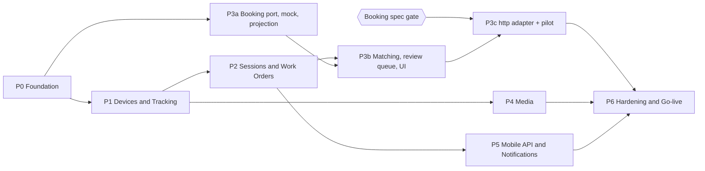

# Part 8 — Implementation Roadmap

> ขนาดงานประมาณจากสมมติฐาน **ทีม 2 Backend + 1–2 Frontend + QA บางเวลา** และ port โค้ดจาก reference ได้ตามแผนใน Part 1 — เป็นกรอบวางแผน ไม่ใช่ commitment

---

## 8.1 Phases & Dependencies

- **Critical path**: P0 → P1 → P2 → P3b → P3c → P6
- **Booking spec gate** = ได้คำตอบครบตาม checklist ใน [Part 9 §9.4](09-risks-open-questions.md#94-booking-information-checklist) ก่อนเขียน `http` adapter
- P2 ออกแบบให้ **ใช้งานได้เต็มโดยไม่มี Booking** (WO แบบ Unlinked) ⇒ ถ้า Booking ล่าช้า ระบบยังขึ้น production ได้ในโหมด tracking + evidence

| Phase | Priority | ขนาด (สัปดาห์) | ขึ้นกับ | ทำขนานได้กับ |
|---|---|---|---|---|
| P0 Foundation | Must | 3 | — | — |
| P1 Devices & Tracking | Must | 4 | P0 | P3a |
| P2 Sessions & Work Orders | Must | 4 | P1 | P3a, P4 |
| P3a Booking port + mock + projection | Must | 2 | P0 | P1, P2 |
| P3b Matching + review queue + UI | Must | 3 | P2, P3a | P4, P5 |
| P3c http adapter + pilot | Must | 2–3 | P3b + **Booking spec** | P5 |
| P4 Media (live, playback, export, live wall, talk) | Must (live/playback) · Should (export/live wall/talk) | 3 | P1 | P2, P3 |
| P5 Mobile API & Notifications | Should | 2 | P2 | P3, P4 |
| P6 Hardening & Go-live | Must | 3 | P3c, P4, P5 | — |

---

## 8.2 รายละเอียดแต่ละ Phase

### P0 — Foundation

**Deliverables**
- โครง repo `client/` + `server/` · scripts dev/test/build · Docker images (api, worker+ffmpeg, web) · CI: lint, **typecheck**, unit, integration (Postgres + Redis ใน CI)
- Port `server/src/common/*` (db, scope แบบใหม่, settings + spec, lock, queue, rate limit, storage, context, audit interceptor, permission check, realtime bus, migration guards, prod-readiness)
- DB baseline + custom migration (extensions, partitions) + data migration ของ roles/permissions/settings · seed dev-only
- Auth: password + Entra SSO + refresh rotation + lockout + ระงับบัญชี · users / roles / departments / employees
- Global exception filter (error format Part 5) · pino logging + correlationId · health endpoints · Swagger
- Client: shell, design tokens, primitives, composites, i18n, auth pages, `usePermission`, router + 404/errorElement · port design guard tests

**Acceptance criteria**
- Login password + Entra ทำงานใน staging · refresh rotation/reuse detection ผ่าน integration test
- endpoint ทุกตัวไม่มี `@RequirePermission` ⇒ test fail (secure by default)
- `npm run build` รวม typecheck · migrate รันซ้ำได้ผลเดิม · drift gate หยุด process เมื่อ migration ค้าง
- design guard tests ผ่าน · หน้าว่างของ shell ตรง DESIGN.md (light/dark)

### P1 — Devices & Real-time Tracking

**Deliverables**
- Devices CRUD + vendor sync (`device-sync.plan.ts` ตัด dashcam) · Teams + TeamMembers · Depots (หลายจุด · dev ใช้พิกัด mock — Q22)
- `device-status` module: StatusPoll (DSS device list), port GpsPoll + `ingestLocations`, BRMS MQ (ไม่ล้าง state) · `DeviceState` + `DeviceStatusHistory`
- `GpsLocations` partitioned + `PartitionMaintenance` job
- Realtime gateway + rooms ใหม่ (ตัด company)
- Client: Live map (cluster, 3 สถานะ), Devices list/detail, Teams, Tracking history

**Acceptance criteria**
- simulator 300 อุปกรณ์: สถานะเปลี่ยนสะท้อนบนแผนที่ ≤ 60s (poll 30s) · ไม่มีอุปกรณ์ถูกข้ามในรอบ poll/sweep
- MQ reconnect / worker restart **ไม่เปลี่ยน `StateSince`** ของอุปกรณ์ที่สถานะไม่เปลี่ยน
- GPS ซ้ำ/เก่า/drift ถูกจัดการตาม pipeline เดิม (port test ของ reference)
- history 24 ชม. ต่ออุปกรณ์ตอบ < 2s ที่ 10M แถว

### P2 — Sessions & Work Orders (ไม่มี Booking)

**Deliverables**
- Session engine: pure `decide()` + sweep (ทุกอุปกรณ์, row lock, DB clock) + split rules ครบตาราง Part 3 §3.4.3
- WO module: auto create (Unlinked), `WorkOrderCounters`, void/edit note, events, idle close ใบรวม, auto-void ไม่มี recording, `availableActions` (สถานะ Closed จาก Booking มาใน P3)
- Recording index job (ใช้ DSS recording search) · alerts 1, 4, 6, 9, 15 (alert 5 ต้องใช้ช่วงเวลางานจาก Booking ⇒ ย้ายไป P3b)
- Client: Active sessions, WO list/detail (ยังไม่มี Booking panel), Review queue (Unlinked/NeedsReview)

**Acceptance criteria**
- unit test ของ `decide()` ครอบทุกแถวใน decision table + scenario: battery swap < / ≥ merge gap, สลับกล้องสำรอง, Booking check-out ขณะกล้องเปิด (**ไม่เกิด loop**), กล้องชาร์จที่ฐาน, max segment, MQ flap, unknown ยาว, worker restart กลางคัน
- รัน 2 worker พร้อมกัน 1,000 รอบ ⇒ ไม่มี session ซ้อน/WO ซ้ำ (constraint ไม่ถูกละเมิด, ไม่มี error ค้าง)
- เลข WO ไม่ซ้ำภายใต้ concurrent create
- กล้องชาร์จ/อยู่ฐาน ไม่เปิดใบงาน (ทดสอบด้วย Depots) · ใบรวมไม่มี recording ถูก auto-void
- WO ถูกปิด (ใน P2 จำลองด้วย mock check-out) ⇒ session split ภายใน 1 รอบ sweep และเวลาจบ = `ClosedAt`

### P3a — Booking port, mock, projection

**Deliverables**: `BookingProvider` port · `mock` adapter + scenarios (check-in/check-out, DeviceRefs, กล้องประจำทีม — พัฒนาบน mock ก่อนตาม Q14) · sync `DeviceAssignments` จาก Booking (ถ้ามีข้อมูล) · `BookingJobs`, inbox, outbox, sync state, call logs · sync jobs (incremental/full) · circuit breaker · webhook endpoint (HMAC) · mapping (`BookingTeamRef`, `BookingEmployeeRef`, status map)

**Acceptance**: inbox dedupe + version guard (ส่งซ้ำ/สลับลำดับ ⇒ projection ถูก) · breaker เปิด/ปิดตามกติกา · Booking mock ล่ม 30 นาที ⇒ tracking/session ไม่ได้รับผลกระทบ (วัด sweep duration และ GPS lag เท่าเดิม)

### P3b — Matching, review queue, UI

**Deliverables**: matcher (`AlgoVersion` 1) + `MatchAttempts` · get-or-create linked WO · **apply Booking check-in/check-out ⇒ สถานะใบงาน** · DeviceRefs matching · link/unlink/merge · re-match triggers · Booking panel + `/booking-jobs` + Review queue เต็ม + `/integration` · alerts 2, 3, 5, 7, 8, 10–12, 14, 16 (SLA คิว 36 ชม.) · job `re-resolve` เมื่อ ref ของทีม/พนักงานเปลี่ยน

**Acceptance**: ทุก scenario ใน Part 3 §3.3 ผ่านด้วย mock · manual link ไม่ถูก auto แก้ · reconcile หลัง Booking กลับมา link WO `Pending` ได้ถูก · ทุก WO ที่ link อัตโนมัติอธิบายได้จาก `MatchAttempts`

### P3c — http adapter + pilot

**Deliverables**: `http` adapter + mapper จาก spec จริง · contract test + fixture · sandbox run · pilot กับ 1–2 แผนก (`booking.writeback-enabled=false`)

**Acceptance**: match rate อัตโนมัติ (Linked/WO ทั้งหมดที่มี Booking จริง) ≥ 90% ช่วง pilot 2 สัปดาห์ · ไม่มี WO ซ้ำต่อ Booking · lag เฉลี่ย ≤ 3 นาที

### P4 — Media

**Deliverables**: port streaming (live, playback, proxy, quota, role/device access) · recordings page · evidence export (BullMQ + ffmpeg) · live wall · talk

**Acceptance**: เท่ากับพฤติกรรม reference (live/playback/export/talk) · export มี checksum + audit · ดู playback จาก WO detail ได้ตรงช่วงเวลา session

### P5 — Mobile API & Notifications

**Deliverables**: `/mobile/overview` + ใช้ API ชุดเดียวกับ web สำหรับ Operator (monitoring, ใบงาน, หลักฐาน, live/playback) · ทะเบียนเครื่อง (ไม่มี PIN) · push tokens + FCM queue · notifications inbox · เอกสาร mobile contract ฉบับใหม่ (ปรับจาก `docs/MOBILE-API-CONTRACT.md` ของ reference)

**Acceptance**: ทีม mobile เชื่อมต่อได้ครบ · push ถึงเครื่องจริงเมื่อเกิด WO Suggested/Unlinked ของทีม · ระงับบัญชี ⇒ refresh + push token ถูก revoke

### P6 — Hardening & Go-live

**Deliverables**
- Retention + archive (`DETACH` → object storage → `DROP PARTITION`) · cleanup jobs
- Observability: Prometheus metrics + dashboard + alert rules (sweep duration, poll lag, booking lag, queue depth, dead letters)
- Security review (OWASP ASVS L2 checklist, secret scan, dependency audit) · penetration test เบื้องต้น · PDPA review
- Load test: 300 อุปกรณ์ + 50 ผู้ใช้พร้อมกัน + 16 stream · backup/restore drill
- Runbooks: Booking ล่ม, DSS ล่ม, Redis ล่ม, migration ค้าง, dead letter
- ตั้ง master data ใหม่ (ไม่ย้ายข้อมูลจากระบบเดิม — DL19): vendor sync อุปกรณ์, พนักงาน, ผู้ใช้, ทีม, ฐาน · UAT · go-live checklist (ไม่มี demo account, CORS ไม่ใช่ `*`, `prod:check` ผ่าน)

**Acceptance**: ผ่าน load test ที่ p95 API < 500ms, sweep < 10s · ผ่าน security checklist ไม่มี High ค้าง · UAT sign-off

---

## 8.3 Milestones

| Milestone | หลัง Phase | ผลที่ใช้งานได้ |
|---|---|---|
| M1 Tracking ready | P1 | แผนที่สด + สถานะกล้อง + ประวัติเส้นทาง แทนส่วน bodycam ของระบบเดิม |
| M2 Evidence-ready | P2 + P4 | ทุกการใช้กล้องมี WO + ดูย้อนหลัง/export ได้ (ยังไม่ link Booking) |
| M3 Booking-linked | P3c | WO link กับ Booking อัตโนมัติ + review queue |
| M4 Production | P6 | go-live |

---

## 8.4 Definition of Done (ทุก Phase)

- unit test ของ pure logic + integration test ของ endpoint ใหม่ (ต่อ DB/Redis จริง)
- `@RequirePermission` + `@Audit` + data scope ครบทุก endpoint
- Setting ใหม่: defaults + bounds + data migration
- เอกสาร blueprint ที่เกี่ยวข้องอัปเดตตาม implementation จริง (code คือ source of truth — บทเรียนจาก reference ที่เอกสารหลักหายแล้วต้องเขียนใหม่จากโค้ด)
