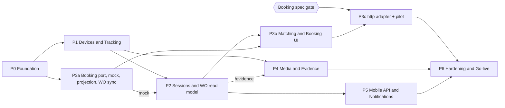

# Part 8 — Implementation Roadmap

> ขนาดงานประมาณจากสมมติฐาน **ทีม 2 Backend + 1–2 Frontend + QA บางเวลา** และ port โค้ดจาก reference ได้ตามแผนใน Part 1 — เป็นกรอบวางแผน ไม่ใช่ commitment

---

## 8.1 Phases & Dependencies

- **Critical path**: P0 → P1 → P2 → P3b → P3c → P6
- **Booking spec gate** = ได้คำตอบครบตาม checklist ใน [Part 9 §9.4](09-risks-open-questions.md#94-booking-information-checklist) ก่อนเขียน `http` adapter
- **ใบงานมาจาก Booking sync เท่านั้น (DL33)** ⇒ การสร้างใบงานอยู่ใน P3a (inbox processor upsert `WorkOrders` 1:1) · P2 พัฒนาและทดสอบ session engine + WO read model กับใบงานจาก `mock` adapter
- ถ้า Booking จริงล่าช้า ระบบยังขึ้น production ได้ในโหมด tracking + evidence: session ถูกบันทึกครบ (ค้าง `AwaitingMatch` / `NoTeam`) และดูหลักฐานรายกล้องได้ที่ `/recordings` — ยังไม่มีใบงานจนกว่าจะต่อ Booking จริง แล้ว session ในช่วง `booking.rematch-horizon-hours` จะ match อัตโนมัติ

| Phase | Priority | ขนาด (สัปดาห์) | ขึ้นกับ | ทำขนานได้กับ |
|---|---|---|---|---|
| P0 Foundation | Must | 3 | — | — |
| P1 Devices & Tracking | Must | 4 | P0 | P3a |
| P2 Sessions & WO read model | Must | 3 | P1, P3a (`mock`) | P4 |
| P3a Booking port + mock + projection + WO sync | Must | 3 | P0 | P1 |
| P3b Matching + Booking UI | Must | 3 | P2, P3a | P4, P5 |
| P3c http adapter + pilot | Must | 2–3 | P3b + **Booking spec** | P5 |
| P4 Media & Evidence (live, live wall, talk, playback, export, `/evidence`) | Must (เมนูหลัก Live + หลักฐาน — DL36) | 3 | P1 (`/evidence` ต้องใช้ WO read model จาก P2) | P2, P3 |
| P5 Mobile API & Notifications | Should | 2 | P2 | P3, P4 |
| P6 Hardening & Go-live | Must | 3 | P3c, P4, P5 | — |

---

## 8.2 รายละเอียดแต่ละ Phase

### P0 — Foundation

**Deliverables**
- โครง repo `client/` + `server/` · scripts dev/test/build · Docker images (api, worker+ffmpeg, web) · CI: lint, **typecheck**, unit, integration (Postgres + Redis ใน CI)
- Port `server/src/common/*` (db, scope แบบใหม่, settings + spec, lock, queue, rate limit, storage, context, audit interceptor, permission check, realtime bus, migration guards, prod-readiness)
- DB baseline + custom migration (extensions, partitions) + data migration ของ roles/permissions/settings · seed dev-only
- Auth: password + Entra SSO + refresh rotation + lockout + ระงับบัญชี · users / roles / departments / employees
- Global exception filter (error format Part 5) · pino logging + correlationId · health endpoints · Swagger
- Client: shell, design tokens, primitives, composites, i18n, auth pages, `usePermission`, router + 404/errorElement · port design guard tests

**Acceptance criteria**
- Login password + Entra ทำงานใน staging · refresh rotation/reuse detection ผ่าน integration test
- endpoint ทุกตัวไม่มี `@RequirePermission` ⇒ test fail (secure by default)
- `npm run build` รวม typecheck · migrate รันซ้ำได้ผลเดิม · drift gate หยุด process เมื่อ migration ค้าง
- design guard tests ผ่าน · หน้าว่างของ shell ตรง DESIGN.md (light/dark)

### P1 — Devices & Real-time Tracking

**Deliverables**
- Devices CRUD + vendor sync (`device-sync.plan.ts` ตัด dashcam) · Teams + TeamMembers · Depots (หลายจุด · dev ใช้พิกัด mock — Q22)
- `device-status` module: port GpsPoll + `ingestLocations` (`/location` ให้ทั้ง GPS และ online/offline — DL32) (ไม่ล้าง state เมื่อ restart) · `DeviceState` + `DeviceStatusHistory`
- `GpsLocations` partitioned + `PartitionMaintenance` job
- Realtime gateway + rooms ใหม่ (ตัด company)
- Client: Live map (cluster · ตำแหน่งสดผ่าน `gps:batch`), Devices list/detail (สถานะกล้องถาม DSS ตอนเปิดหน้า — ไม่มี push `device:status` DL35 · cache Redis `device-status:{deviceId}` DL45), Teams, Tracking history

**Acceptance criteria**
- simulator 300 อุปกรณ์: ตำแหน่งบนแผนที่อัปเดตผ่าน `gps:batch` ทุกรอบ GpsPoll · หน้ารายการ/รายละเอียดอุปกรณ์แสดงสถานะที่ได้จาก DSS ตอนเปิด · เปิดหน้ารายการซ้ำภายใน `status.display-cache-seconds` ไม่เรียก DSS ซ้ำ (DL45) · Redis ล่มยังได้สถานะจาก DSS ตรง · ไม่มีอุปกรณ์ถูกข้ามในรอบ poll/sweep
- DSS หลุดแล้วกลับมา / worker restart **ไม่เปลี่ยน `StateSince`** ของอุปกรณ์ที่สถานะไม่เปลี่ยน
- GPS ซ้ำ/เก่า/drift ถูกจัดการตาม pipeline เดิม (port test ของ reference)
- history 24 ชม. ต่ออุปกรณ์ตอบ < 2s ที่ 10M แถว

### P2 — Sessions & WO read model (ใบงานจาก `mock`)

**Deliverables**
- Session engine: pure `decide()` + sweep (ทุกอุปกรณ์, row lock, DB clock) + split rules ครบตาราง Part 3 §3.4.3 · ไม่มีการสร้างใบงานในเส้นทาง session (DL33)
- กล้องชาร์จที่ฐาน (`Depots` + fix ล่าสุด) ⇒ ระบบตั้ง session เป็น `Classified` + `IdleOrCharging` เอง
- WO read model: list/detail API + `availableActions` + `WorkOrderEvents` timeline · pass ระดับ WO ใน `SessionSweep` (alert ไม่มี check-out 36 ชม. · ปิด `SafetyTimeout` 7 วัน) · ใบงานใน P2 มาจาก `mock` adapter ผ่าน Booking sync ของ P3a
- Recording index job (ใช้ DSS recording search) · alerts `CAMERA_ACTIVE_NO_TEAM`, `RECORDING_OUTSIDE_WORK`, `WORK_ORDER_NO_CHECKOUT`, `WORK_ORDER_AUTO_CLOSED` (alert ที่ต้องใช้ matching / ช่วงเวลางานจาก Booking ⇒ P3b)
- Client: Active sessions (รวม session ที่ยังไม่มีใบงาน — อ่านอย่างเดียว), WO list/detail (อ่านอย่างเดียว · ยังไม่มี Booking panel)

**Acceptance criteria**
- unit test ของ `decide()` ครอบทุกแถวใน decision table + scenario: battery swap < / ≥ merge gap, สลับกล้องสำรอง, Booking check-out ขณะกล้องเปิด (**ไม่เกิด loop**), กล้องชาร์จที่ฐาน, max segment, status flap, unknown ยาว, worker restart กลางคัน
- รัน 2 worker พร้อมกัน 1,000 รอบ ⇒ ไม่มี session ซ้อน (constraint ไม่ถูกละเมิด, ไม่มี error ค้าง)
- sweep ไม่สร้างแถว `WorkOrders` เลย — จำนวนใบงาน = จำนวน `BookingJobs` ที่ sync มาเสมอ
- กล้องชาร์จ/อยู่ฐาน (ทดสอบด้วย Depots) ⇒ session `IdleOrCharging` ไม่นับเป็นงาน
- ใบงานจาก mock ที่ไม่มี check-out ⇒ alert เมื่อครบ 36 ชม. และปิด `SafetyTimeout` เมื่อครบ 7 วัน (ใช้เวลา DB)

### P3a — Booking port, mock, projection, WO sync

**Deliverables**: `BookingProvider` port · `mock` adapter + scenarios (check-in/check-out/ยกเลิก, DeviceRefs, กล้องประจำทีม — พัฒนาบน mock ก่อนตาม Q14) · sync `DeviceAssignments` จาก Booking (ถ้ามีข้อมูล) · `BookingJobs`, inbox, sync state, call logs · sync jobs แบบ pull (incremental/full/refresh รายใบ — DL31) · circuit breaker · mapping (`BookingTeamRef`, `BookingEmployeeRef`, status map) · **WO sync (DL33)**: inbox processor upsert `WorkOrders` 1:1 กับ `BookingJobs` ใน transaction เดียวกับ projection (`UQ_WO_BookingJob`, `WorkOrderCounters`) + สถานะตาม check-in / check-out / ยกเลิก

**Acceptance**: inbox dedupe + version guard (ส่งซ้ำ/สลับลำดับ ⇒ projection ถูก) · ทุก Booking job ที่ sync มามีใบงาน 1 ใบพอดี (ส่งซ้ำ/สลับลำดับไม่เกิดใบซ้ำ) · เลข WO ไม่ซ้ำภายใต้ concurrent upsert · check-out ⇒ Closed (`BookingCheckout`), check-in ใหม่ ⇒ Open, Booking ยกเลิก ⇒ Cancelled · breaker เปิด/ปิดตามกติกา · Booking mock ล่ม 30 นาที ⇒ tracking/session ไม่ได้รับผลกระทบ (วัด sweep duration และ GPS lag เท่าเดิม)

### P3b — Matching & Booking UI

**Deliverables**: matcher อัตโนมัติ (`AlgoVersion` 1) + `MatchAttempts` · attach session เข้า WO ของ Booking job ตามลำดับ `DeviceRefs` → team ref → team-leader ref · ไม่มีหรือหลาย candidate ⇒ session ค้าง `AwaitingMatch` · re-match triggers (`matching.rematch` ภายใน `booking.rematch-horizon-hours`) · Booking panel + `/booking-jobs` + `/integration` · badge `NeedsReview` ในหน้าใบงาน (ข้อมูลเท่านั้น ไม่มีคิว — DL33) · alerts `DEVICE_OFFLINE_DURING_JOB`, `WORK_ORDER_CANCELLED_WITH_EVIDENCE`, `BOOKING_JOB_CHANGED_AFTER_CLOSE`, `BOOKING_SYNC_STALE`, `INTEGRATION_DEAD_LETTER`, `BOOKING_MAPPING_ISSUES` · job `re-resolve` เมื่อ ref ของทีม/พนักงานเปลี่ยน

**Acceptance**: ทุก scenario ใน Part 3 §3.3 ผ่านด้วย mock · ไม่มี/หลาย candidate ⇒ ไม่เกิดใบงานใหม่ และ session match เองเมื่อ Booking เปลี่ยน · WO ถูกปิดด้วย check-out (mock) ⇒ session split ภายใน 1 รอบ sweep และเวลาจบ = `ClosedAt` · Booking mock ล่มแล้วกลับมา ⇒ session ที่ค้าง `AwaitingMatch` match ได้ถูก · ทุก attach อธิบายได้จาก `MatchAttempts`

### P3c — http adapter + pilot

**Deliverables**: `http` adapter + mapper จาก spec จริง · contract test + fixture · sandbox run · pilot กับ 1–2 แผนก · deep link จาก Booking app

**Acceptance**: match rate อัตโนมัติ (session ในช่วงงานของ Booking ที่ attach ได้เอง) ≥ 90% ช่วง pilot 2 สัปดาห์ · ใบงาน 1:1 กับ Booking job (ไม่ซ้ำ ไม่ขาด) · lag เฉลี่ย ≤ 3 นาที

### P4 — Media & Evidence

**Deliverables**
- port streaming (live, playback, proxy, quota, role/device access) · live wall · talk
- เมนูหลัก (DL36): **Live** (`/live-wall` + ดูสดจากรายการอุปกรณ์ + talk) และ **หลักฐาน** `/evidence` (port `client/src/features/evidence`): ตารางใบงานจาก Booking → เลือกกล้อง + ช่วงเวลาจาก session ของใบงาน → playback / ดาวน์โหลด MP4
- `/recordings` ค้นหาวิดีโอรายกล้อง (ใช้กับ session ที่ไม่มีใบงาน)
- evidence export (BullMQ + ffmpeg) · reuse job เดิมเมื่อ device + channel + start/end ตรงกันและยัง queued / processing / ready ไม่หมดอายุ · ไฟล์บน Local disk PVC ที่ `api` + `worker-media` mount ร่วม · ลบไฟล์หลัง 24 ชม. (DL34)

**Acceptance**: เท่ากับพฤติกรรม reference (live/playback/export/talk) · export มี checksum + audit · `/evidence`: เลือกใบงานแล้ว playback / ดาวน์โหลดได้ตรงช่วงเวลา session · ขอ export ช่วงเดิมซ้ำได้ job เดิม ไม่สร้างใหม่ · `api` ทุก pod stream ไฟล์ที่ `worker-media` เขียนได้ (ทดสอบ PVC access mode ใน staging — Part 9 R16) · สั่ง export พร้อมกันเกิน `EVIDENCE_EXPORT_CONCURRENCY` แล้วงานที่เกินรอคิว และ latency ของ `api` (REST / live / แผนที่) ไม่เพิ่มอย่างมีนัย (DL39)

### P5 — Mobile API & Notifications

**Deliverables**: `/mobile/overview` + ใช้ API ชุดเดียวกับ web สำหรับ Operator (monitoring, ใบงาน, หลักฐาน, live/playback) · ทะเบียนเครื่อง (ไม่มี PIN) · push tokens + FCM queue · notifications inbox · เอกสาร mobile contract ฉบับใหม่ (ปรับจาก `docs/MOBILE-API-CONTRACT.md` ของ reference)

**Acceptance**: ทีม mobile เชื่อมต่อได้ครบ · push ถึงเครื่องจริงเมื่อเกิด alert ของแผนก (เช่น `CAMERA_ACTIVE_NO_TEAM`) · ระงับบัญชี ⇒ refresh + push token ถูก revoke

### P6 — Hardening & Go-live

**Deliverables**
- Retention ไม่มี archive (`DETACH` → `DROP PARTITION`) · cleanup jobs (รวม `EvidenceCleanup` ไฟล์ export บน PVC)
- Observability: Prometheus metrics + dashboard + alert rules (sweep duration, poll lag, booking lag, queue depth, dead letters)
- Security review (OWASP ASVS L2 checklist, secret scan, dependency audit) · penetration test เบื้องต้น · PDPA review
- Load test: 300 อุปกรณ์ + 50 ผู้ใช้พร้อมกัน + 16 stream · backup/restore drill
- Runbooks: Booking ล่ม, DSS ล่ม, Redis ล่ม, migration ค้าง, dead letter
- ตั้ง master data ใหม่ (ไม่ย้ายข้อมูลจากระบบเดิม — DL19): vendor sync อุปกรณ์, พนักงาน, ผู้ใช้, ทีม, ฐาน · UAT · go-live checklist (ไม่มี demo account, CORS ไม่ใช่ `*`, `prod:check` ผ่าน)

**Acceptance**: ผ่าน load test ที่ p95 API < 500ms, sweep < 10s · ผ่าน security checklist ไม่มี High ค้าง · UAT sign-off

---

## 8.3 Milestones

| Milestone | หลัง Phase | ผลที่ใช้งานได้ |
|---|---|---|
| M1 Tracking ready | P1 | แผนที่สด + สถานะกล้อง + ประวัติเส้นทาง แทนส่วน bodycam ของระบบเดิม |
| M2 Evidence-ready | P2 + P4 | ทุกการใช้กล้องมี session + ดูย้อนหลัง/export รายกล้องได้ (`/recordings`) · เมนู Live พร้อม (ใบงานยังมาจาก `mock`) |
| M3 Booking-linked | P3c | ใบงานจาก Booking จริง + session match อัตโนมัติ + หน้า หลักฐาน `/evidence` ตามใบงาน |
| M4 Production | P6 | go-live |

---

## 8.4 Definition of Done (ทุก Phase)

- unit test ของ pure logic + integration test ของ endpoint ใหม่ (ต่อ DB/Redis จริง)
- `@RequirePermission` + `@Audit` + data scope ครบทุก endpoint
- Setting ใหม่: defaults + bounds + data migration
- เอกสาร blueprint ที่เกี่ยวข้องอัปเดตตาม implementation จริง (code คือ source of truth — บทเรียนจาก reference ที่เอกสารหลักหายแล้วต้องเขียนใหม่จากโค้ด)
