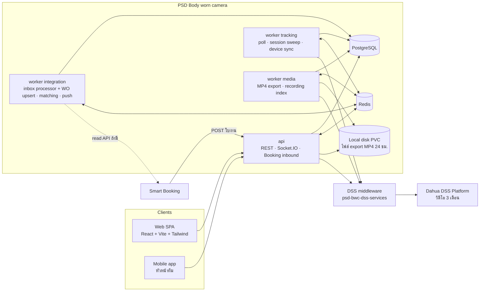

# Blueprint — PSD Body worn camera

**PSD Body worn camera** — ระบบติดตาม Bodycam และหลักฐานตามใบงานจาก Smart Booking (repo `psd-bodycam-v1.0`)

> เอกสารออกแบบก่อน Implementation ของระบบ **PSD Body worn camera** (`psd-bodycam-v1.0`) · ฉบับ 2026-11-03 · ปรับ 2026-11-09 (DL33–DL36) · ปรับ 2026-11-12 (DL46–DL49) · ปรับ 2026-11-18 (DL53 — เมนู web 11 รายการ · ไม่มีแผนก) · ปรับ 2026-11-23 (DL66–DL75 — ตาม code P1 Devices & Tracking)
> Requirement: [requirement ฉบับ 2026-11-12](../requirements/2026-11-12-body-camera-requirements.md) — ยึดทั้งฉบับ (Q24) ยกเว้น 2 ข้อ (Q25 — DL48): ชื่อ role คงเดิม `SUPER_ADMIN` / `OPERATOR` / `VIEWER` (ไม่ใช้คำว่า Safety) · GPS history และ talk เป็น Must
> Reference: `C:\Git\Internal-BodyCam` (อ่านอย่างเดียว ไม่ถูกแก้ไข)
> Diagram ทั้งหมดเป็น Mermaid — เปิดดูได้ใน GitHub / GitLab / VS Code (Markdown Preview Mermaid Support)

## สารบัญ

| Part | เอกสาร | ตอบคำถาม |
|---|---|---|
| — | [Requirement ฉบับ 2026-11-12](../requirements/2026-11-12-body-camera-requirements.md) | ระบบต้องทำอะไร (web / mobile / Smart Booking) · ต้นทางของ blueprint ทั้งชุด (ข้อยกเว้นดู DL48) |
| 1 | [Existing System Analysis](01-existing-system-analysis.md) | ระบบเดิมเป็นอย่างไร · อะไร reuse / refactor / remove / rebuild · Dashcam ตัดตรงไหน |
| 2 | [System Architecture](02-system-architecture.md) | module อะไรบ้าง · process/deploy อย่างไร · Booking ล่มแล้วอะไรยังทำงาน · security/reliability |
| 3 | [Business Workflows](03-business-workflows.md) | กล้องเปิดแล้วเกิดอะไร · WO มาจาก Booking อย่างไร · match session เข้า WO อย่างไร · session lifecycle · Booking ล่ม/กลับมา |
| 4 | [Database Design](04-database-design.md) | ERD · ทุกตาราง/คอลัมน์/constraint/index · enum · retention · migration · ตัวอย่าง Drizzle |
| 5 | [API Design](05-api-design.md) | REST endpoints + ตัวอย่าง · inbound endpoint จาก Smart Booking · mobile API (หัวหน้าทีม) · WebSocket events · alert types · permission matrix |
| 6 | [Frontend Architecture](06-frontend-architecture.md) | โครงโฟลเดอร์ · routing · หน้าจอ · component reuse · design tokens |
| 7 | [Integration Strategy](07-integration-strategy.md) | Smart Booking POST เข้า inbound endpoint · contract v1 + mapper · auth ขาเข้า · read API (optional) · retry · idempotency · reconcile · monitoring · Confirmed vs Assumption |
| 8 | [Implementation Roadmap](08-implementation-roadmap.md) | phase · dependency · priority · deliverables · acceptance criteria |
| 9 | [Risks & Open Questions](09-risks-open-questions.md) | ความเสี่ยง · กติกาที่ยังไม่ชัด · checklist ข้อมูลจาก Booking · decision log |

---

## Executive Summary

ระบบใหม่ติดตามและบริหาร **Bodycam เท่านั้น** (ตัด Dashcam/ยานพาหนะทั้งหมด) และผูก **การใช้งานกล้องจริง** เข้ากับ **ใบงานจากระบบ Smart Booking** อัตโนมัติ

- **Smart Booking เป็นต้นทางใบงานเดียว** — ระบบเราไม่มี flow สร้าง/อนุมัติ/มอบหมายงาน และ **ไม่สร้างใบงานเอง** (DL33)
- **Smart Booking ส่งใบงานเข้า `POST /api/integration/booking/jobs` ของเรา** เมื่อสร้างใบงาน **[Confirmed]** และส่งซ้ำทุกครั้งที่ใบงานเปลี่ยน **[Assumption]** — ไม่ pull ทุก 2 นาทีแล้ว (DL46) · ใบงานมีเลข DO / SH และเวลา check-in / check-out **[Confirmed]** · read API ของ Booking (refresh รายใบ / reconcile รายคืน) เป็น optional ถ้า Booking มีให้ **[Assumption]**
- ทุก Booking job ที่รับมาเป็น **Work Order** ภายใน 1:1 (PK ของตัวเอง) · เมื่อกล้องเริ่มใช้งาน ระบบเปิด **Tracking Session** แล้วผูกเข้า WO ของงานที่ตรงกันอัตโนมัติ (1 WO มีหลาย session)
- **สถานะใบงานตาม Booking check-in/check-out** — check-out ⇒ ปิดใบงาน · Booking ยกเลิก ⇒ Cancelled · ระบบเราไม่มีปุ่มปิด/reopen/void (หัวหน้าทีม/แอดมินทำฝั่ง Booking)
- จับคู่ไม่ได้ ⇒ session ค้าง `AwaitingMatch` รอ Booking แล้ว rematch อัตโนมัติเมื่อข้อมูลเปลี่ยน · ไม่มีการผูกด้วยมือ ไม่มีคิวตรวจสอบ (DL33) · กล้องชาร์จที่ฐาน ⇒ session `IdleOrCharging` (ระยะแรก `Depots` ว่าง กฎนี้ยังไม่ทำงาน — DL53)
- **เมนู web 11 รายการ 4 กลุ่ม** (DL53): ภาพรวม (แดชบอร์ด) · ปฏิบัติงาน (ภาพสดหลายจอ, ใบงาน, วิดีโอย้อนหลัง, แผนที่ติดตาม, ประวัติเส้นทาง) · ผู้ใช้และสิทธิ์ (ผู้ใช้ระบบ, ผู้ใช้จาก Entra) · ระบบ (แจ้งเตือน, ประวัติการใช้งาน, ตั้งค่าระบบ) · **ใบงาน** `/work-orders` = ตารางใบงานจาก Booking + ปุ่ม ดูสด (กล้องออนไลน์) / ดูย้อนหลัง · **วิดีโอย้อนหลัง** `/evidence` = ค้นรายกล้อง: เลือกกล้อง + วัน → ไฟล์ทุกช่วงพร้อมป้ายใบงาน / ไม่ผูกใบงาน → playback / ดาวน์โหลด MP4 · ปุ่ม ดูย้อนหลัง ของใบงานเล่นได้เฉพาะช่วง check-in – check-out ของ Booking (DL59) · GPS history และ talk เป็น Must แม้ requirement จัดเป็น Optional (DL48)
- **ไม่มีแผนก** (ระบบใช้กับฝ่าย จป. ฝ่ายเดียว — DL53): ทุก role web เห็นทั้งบริษัท (scope `all`) · กล้อง sync จาก DSS อัตโนมัติใน worker · ทีม / หัวหน้าทีมสร้างจาก `teamRef` / `leaderRef` ของใบงาน **[Assumption]** · ไม่มีหน้าจัดการ Bodycam / ทีม / ฐาน / สถานะการเชื่อมต่อ (เหลือ alert ถึง `SUPER_ADMIN` + แถบ stale)
- ผู้ใช้ **web** = `SUPER_ADMIN` (super admin ของฝั่ง dev — ไม่ใช่บทบาทของลูกค้า · DL55), `ADMIN` (ผู้ดูแลบริษัท = แอดมินฝ่ายความปลอดภัยใน requirement · จัดการผู้ใช้ทุก role ยกเว้น `SUPER_ADMIN` · ไม่มี audit / ตั้งค่าระบบ / แก้ matrix สิทธิ์ — DL51, DL53), `OPERATOR` (ผู้จัดการฝ่าย), `VIEWER` — ทุก role web ใช้ scope `all` · ฝั่ง monitoring และตรวจหลักฐาน · ไม่เปลี่ยนชื่อ role และไม่ใช้คำว่า Safety (DL48)
- ผู้ใช้ **mobile** = **หัวหน้าทีม** role `TEAM_LEADER` (scope `team`) เท่านั้น: ดู live กล้องของตัวเอง + รายละเอียดใบงานจาก Smart Booking ของทีม · ไม่มี playback / GPS / สถานะกล้อง / talk บนมือถือ · `TEAM_LEADER` ไม่มีเมนู web (DL47)
- Retention: GPS 3 เดือน · ใบงาน 3 เดือน · audit 12 เดือน · ไม่ย้ายข้อมูลจากระบบเดิม
- **Deploy ทับระบบเดิม ไม่รันคู่** (DL60): ระบบเดิมใน `team3` (`psd-bwc-frontend`, `psd-bwc-web-backend` — โค้ดชุดเดียวกับ reference) ไม่มีผู้ใช้จริง ⇒ ปิดได้ทันที · ระบบนี้ใช้ repo / Azure pipeline / gitops / ชื่อ Deployment ของระบบเดิม (โค้ดหลักอยู่ที่ `psd-bodycam-v1.0` · copy ไป repo บน Azure ตอน deploy) แต่ใช้ **database ใหม่** (ชื่อตารางและ migration table ชนกับ DB เดิม) · env และ OSRM ของระบบเดิมตัดทิ้ง · **ช่วง dev รันบนเครื่อง local** (PostgreSQL + Redis บนเครื่อง, DSS middleware ผ่าน VPN) และยังไม่ deploy Azure จนกว่าผู้ใช้สั่ง (DL63)
- **ทั้งหมดอาจปรับตามข้อมูลจากทีม Booking** (ผู้ใช้ระบุ 2026-11-04)
- Real-time tracking **ไม่ขึ้นกับ Booking** — Booking ล่ม แผนที่/สถานะ/session/หลักฐานยังทำงานครบ · สถานะ online/offline บนหน้าจอดึงจาก DSS ตอนเปิด ไม่ push (DL35)
- Stack เดิม: **NestJS 10 + Drizzle + PostgreSQL + Redis/BullMQ + Socket.IO** · **React 18 + Vite + Tailwind + shadcn** · กล้องผ่าน **DSS middleware** ชุดเดิม (ไม่ใช้ BRMS MQ — DL30) · ไฟล์ export MP4 อยู่บน Local disk (PVC) 24 ชม. ไม่ใช้ MinIO (DL34)
- Reuse โค้ดเดิมได้มาก: infra (`server/src/common/*`), auth/Entra (รวมหน้า ผู้ใช้จาก Entra), GPS pipeline, device sync, streaming/playback/export/talk, realtime, HMAC ขาเข้า (pattern ของ webhook เดิม), design system + shell ฝั่ง client

---

- ผู้ใช้ระบบเก็บชื่อและนามสกุลแยกเป็น `Users.FirstName` / `Users.LastName`; API ใช้ `firstName` / `lastName` (DL78) · บัญชีที่มีอีเมลหรือเชื่อม Microsoft ล็อกชื่อ นามสกุล และอีเมล และรับข้อมูลล่าสุดผ่านการซิงก์ Microsoft (DL79)

- ใช้ `Users` แทนทะเบียนพนักงาน: ไม่มีตารางหรือหน้า `Employees` · สมาชิกทีมอ้าง `TeamMembers.UserId` · เพิ่มเบอร์โทรและล็อกชื่อผู้ใช้จาก UPN (DL80)

- บัญชีที่ยังไม่เชื่อม Microsoft แก้ชื่อผู้ใช้ได้ แม้มีอีเมลแล้ว · ตารางผู้ใช้แสดงเบอร์โทร · dropdown ของ `ADMIN` ไม่มี `SUPER_ADMIN` ทั้งฟอร์มเดี่ยวและเพิ่มหลายบัญชี (DL83)

- Role IDs ใช้ `1 SUPER_ADMIN`, `2 ADMIN`, `3 OPERATOR`, `4 VIEWER`, `5 TEAM_LEADER`; ย้ายสิทธิ์ผู้ดูแลสูงสุดไป `SUPER_ADMIN` โดยคงการผูก role และสิทธิ์เดิม (DL81)

## Glossary

| คำ | ความหมาย |
|---|---|
| **Device Online / Offline / Unknown** | สถานะการต่อ platform ของกล้อง · Unknown = ไม่มีข้อมูลใหม่นานเกินกำหนด (คำนวณ ไม่เก็บ) |
| **GPS Active** | มีพิกัดที่ valid อายุ ≤ `status.unknown-after-seconds` + 2 × `gps.poll-interval-seconds` (150 วินาทีตามค่าเริ่มต้น — `fixActiveSeconds`) (กล้องในอาคารมักไม่มี — ไม่ใช่สัญญาณว่าปิด) |
| **Camera Active** | Online ต่อเนื่องครบ 15 นาที และไม่ได้อยู่ในรัศมีฐาน = "เริ่มใช้งาน" |
| **Smart Booking** | ระบบใบงานภายนอก (ต้นทางใบงานเดียว) · POST ใบงานเข้า inbound endpoint ของเรา (DL46) · ในโค้ดใช้ชื่อ `booking` / `BOOKING` |
| **Inbound endpoint** | `POST /api/integration/booking/jobs` ใน process `api` ที่ Smart Booking เรียก · ตรวจ auth (HMAC / API key **[Assumption]**) → validate → บันทึก `IntegrationInbox` → ตอบ 202 (`accepted`) / 200 (`duplicate`) · map และ upsert ใน worker `integration` (DL46) |
| **DO / SH** | เลขอ้างอิงที่มากับใบงาน **[Confirmed]** · ความหมาย = เลข Delivery Order / Shipment **[Assumption]** · เก็บใน `BookingJobs.DoNo` / `ShNo` ใช้แสดงและค้นหา ไม่ใช้จับคู่ |
| **`ADMIN`** | ผู้ดูแลบริษัท (web, scope `all` — DL51) · งานแบบ `OPERATOR` + จัดการพนักงาน / ผู้ใช้ (รวมผู้ใช้จาก Entra · มองไม่เห็นบัญชี `SUPER_ADMIN` — DL55) · ไม่ได้รับ permission สงวนของ `SUPER_ADMIN` (`audit:view`, `settings:manage`, `roles:manage` — DL53) · ไม่ bypass |
| **Data scope** | `all` = ทุก role web (ไม่มีแผนก — DL53) · `team` = `TEAM_LEADER` |
| **`TEAM_LEADER` / scope `team`** | role ของหัวหน้าทีมที่ใช้แอปมือถือ (DL47) · scope `team` = ใบงานของทีมที่ตนเป็นหัวหน้า active (`TeamMembers.Role = 1 Leader`) หรือที่ระบุตนเป็นหัวหน้า + กล้องของทีม/ของใบงาน `Planned` / `Open` · นอก scope = 404 |
| **Booking Check-in / Check-out** | หัวหน้าทีม/แอดมินกดเริ่ม/จบงานใน Smart Booking แล้วมากับ POST (`checkInAt` / `checkOutAt`) · check-out = ปิดใบงานในระบบเรา |
| **Depot** | ฐาน/จุดชาร์จกล้อง — session ที่เกิดที่ฐานไม่นับเป็นงาน (ระบบตั้ง `IdleOrCharging` เอง) · ระยะแรกไม่มีหน้าจัดการ ⇒ `Depots` ว่าง กฎนี้ยังไม่ทำงาน (DL53) |
| **Recording** | มีไฟล์บันทึกจริงตาม DSS recording search (รู้ได้หลังเกิดเหตุ) — เปิดกล้อง **ไม่เท่ากับ** อัดวิดีโอ |
| **Tracking Session** | ช่วงที่กล้อง 1 ตัวเปิดต่อเนื่อง · ผูก WO ได้ 0..1 ใบ (`MatchState`: Attached / AwaitingMatch / NoTeam / Classified) |
| **Work Order (WO)** | ใบงานในระบบเรา สร้าง/อัปเดต 1:1 จาก Booking job เท่านั้น (DL33) · `Status` Planned (รอเริ่ม) / Open / Closed / Cancelled ตาม Booking · `NeedsReview` = badge แจ้งข้อมูล ไม่มีคิว |
| **Booking Job** | ใบงานในระบบ Smart Booking ที่ POST เข้ามา · ระบบเราเก็บ snapshot ล่าสุดเป็น projection (`BookingJobs`) |
| **Team** | หน่วยปฏิบัติงาน หัวหน้า 1 คน (คนขับ) + ลูกทีม · กล้องหลัก 1 ตัวต่อทีม · ใช้จับคู่และกำหนด scope `team` · หัวหน้าทีมมีบัญชี `TEAM_LEADER` ใช้แอปมือถือ ลูกทีมไม่มีบัญชี (DL47) · ทีมและหัวหน้าทีมสร้าง/อัปเดตจาก `teamRef` / `leaderRef` ของใบงาน ไม่มีหน้าจัดการ · หัวหน้าเปลี่ยนเฉพาะตอนใบงานอยู่ในสถานะเข้างาน (DL53, DL85 **[Assumption]**) |
| **DeviceRefs** | กล้องที่ Booking ระบุให้ใบงาน (รวมกล้องสำรอง) — การผูกกล้องมาจาก Booking เท่านั้น |
| **AwaitingMatch** | session ที่ยังจับคู่ Booking ไม่ได้ (ไม่มีหรือมีหลาย candidate) — รอ Booking แล้ว rematch อัตโนมัติ · ไม่มีการผูกด้วยมือ / คิวตรวจสอบ (DL33) · วิดีโอดูย้อนหลังได้ที่หน้า วิดีโอย้อนหลัง รายกล้อง (DL59) |
| **ใบงาน (เมนู)** | `/work-orders` = ตารางใบงานจาก Booking (แท็บสถานะ · คอลัมน์กล้อง + ปุ่ม ดูสด เมื่อออนไลน์ · ปุ่ม ดูย้อนหลัง เฉพาะช่วงใบงาน) + `/work-orders/:id` (DL53, DL59) |
| **วิดีโอย้อนหลัง (Evidence)** | เมนู `/evidence` (เดิมชื่อ หลักฐาน — DL53) = ค้นรายกล้อง: เลือกกล้อง + วัน → ไฟล์ทุกช่วง (ป้ายเลขใบงาน หรือ ไม่ผูกใบงาน) → playback / ดาวน์โหลด MP4 (DL59) · วิดีโอต้นฉบับอยู่บน Dahua DSS Platform · ไฟล์ export อยู่บน PVC 24 ชม. (DL34) |
| **DSS middleware** | `psd-bwc-dss-services` (FastAPI) ที่เรียก Dahua DSS Platform อีกชั้น — ถือ token ของ DSS, HLS ผ่าน `/proxy`, talk เป็น RTSP **[Confirmed]** · ระบบเราต่อด้วย `DSS_DRIVER=dss` + `DSS_BASE_URL` + `DSS_API_KEY` · dev / test ใช้ simulator ในตัว `DSS_DRIVER=mock` (100 กล้อง — DL68, DL75) |

---

## Key Design Decisions & Trade-offs

| Decision | ได้ | เสีย / ยอมรับ |
|---|---|---|
| Modular monolith + process roles (`api`, `worker` แยก `tracking`/`integration`/`media`) | reuse โค้ดเดิม · transaction เดียวข้าม domain · deploy ง่าย | ต้องคุม boundary ด้วย lint rule |
| แยก `TrackingSessions` ออกจาก `WorkOrders` | ไม่มี pseudo work order · ไม่มี reserved seed rows · ไม่มี reopen loop | มี 2 แนวคิดที่ผู้ใช้ต้องเข้าใจ (session vs WO) |
| Session engine แบบ level-triggered sweep 30s | self-healing หลัง restart / DSS หลุด · idempotent | latency สูงสุด ≈ debounce + 1 รอบ |
| Smart Booking **push** ใบงานเข้า `POST /api/integration/booking/jobs` → `IntegrationInbox` · read API เป็น optional (DL46 แทน pull ของ DL31) | ใบงานมาถึงในระดับวินาที · งานปกติไม่ต้องเรียก API ของ Booking · เราเป็นเจ้าของ contract ขาเข้า (mapper `v1` / `smart-booking` กันโครงสร้าง Booking รั่วเข้า core) · `api` แค่บันทึก inbox แล้วตอบ ไม่ map เอง | ต้องเปิด endpoint ให้ระบบภายนอกเรียก ⇒ HMAC / API key + rate limit + firewall ขาเข้า + rotation secret 2 ชุด (`BOOKING_INBOUND_SECRETS`) · POST ที่หายกู้ได้เฉพาะเมื่อ Booking ส่งซ้ำ หรือ reconcile รายคืน (ถ้ามี read API) · ไม่รู้ว่า Booking ส่งไม่ออก ⇒ alert `BOOKING_INBOUND_SILENT` |
| Matching อ่าน projection `BookingJobs` | Booking ล่มไม่กระทบ · อธิบายย้อนหลังได้ (`MatchAttempts`) | ข้อมูลช้าเท่า backlog ของ inbox processor (ปกติไม่กี่วินาที · เกิน `booking.stale-after-minutes` ⇒ `ProjectionStale`) |
| Invariant บังคับที่ DB (partial unique, exclusion, CHECK) | race condition สร้างข้อมูลผิดไม่ได้ | ต้องมี `btree_gist` (มี fallback) |
| ใบงานมาจาก Booking เท่านั้น (`BookingJobId` NOT NULL — DL33) | ใบงานตรง Booking เสมอ · ไม่มีใบงานขยะ · ไม่มีงาน manual (link / void / คิวตรวจสอบ) | session ที่ Booking ไม่ระบุค้าง `AwaitingMatch` ไม่มีใบงาน — ดูย้อนหลังได้ที่หน้า วิดีโอย้อนหลัง รายกล้อง (DL59) |
| สถานะใบงานตาม Booking check-in/check-out | ไม่มีสองแหล่งความจริงเรื่องสถานะ | Booking ล่ม = ปิดใบงานช้า (ปิดย้อนหลังด้วยเวลาจริง) · ต้องมี SafetyTimeout |
| Matching อัตโนมัติอย่างเดียว (DL33) | ไม่มีคิวงานให้ Operator · ผลอธิบายได้จาก `MatchAttempts` | การผูกผิดแก้ได้ทางเดียวคือแก้ข้อมูลใน Booking |
| Mobile app เฉพาะหัวหน้าทีม `TEAM_LEADER` scope `team` (DL47) | ตรง requirement §4 · แอปเล็ก (live กล้องตัวเอง + ใบงานของทีม) · ข้อมูลอ่อนไหว (playback / GPS) อยู่บน web เท่านั้น | scope `team` ต้องทดสอบ 404 ทุก endpoint ที่หัวหน้าทีมเรียก · ต้องผูก `TeamMembers.UserId` และหัวหน้าใน `TeamMembers` (มาจาก leader ref ของใบงาน — DL53) ให้ถูก ไม่งั้นรายการว่าง |
| ไม่มีแผนก · เมนู 11 รายการ · ข้อมูลกล้อง / ทีมมาจากระบบต้นทางอัตโนมัติ (DL53) | ระบบเล็ก scope ง่าย (`all` / `team`) · ไม่มีงาน master data ของกล้อง / ทีม | แยกข้อมูลตามหน่วยงานไม่ได้ (ถ้าภายหลังมีหลายฝ่ายต้องเพิ่มกลับ) · ทีมพึ่ง Booking ส่ง `teamRef` / `leaderRef` **[Assumption]** · ไม่มีหน้าฐาน ⇒ `IdleOrCharging` ยังไม่ทำงาน · ไม่มีหน้าสถานะการเชื่อมต่อ (เหลือ alert) |
| ใบงานที่รับแล้วแต่ประมวลผลไม่ผ่าน ประมวลผลใหม่จาก `IntegrationInbox.Payload` ที่เก็บไว้ (DL54) | ไม่ต้องรอ Booking ส่งซ้ำ · กู้เองอัตโนมัติหลังเติมข้อมูลที่ขาด (`re-resolve`) / รายวัน หรือกดปุ่ม "ประมวลผลใหม่" บนการแจ้งเตือนของ `SUPER_ADMIN` | แถว `Dead` ที่เกิน 7 วันต้องกดปุ่มเอง · ไม่มีหน้ารายการ inbox ให้ไล่ดูทั้งหมด |
| ไม่ push online/offline — หน้าจอดึงสถานะจาก DSS ตอนเปิด (DL35) ผ่าน cache Redis 10s (DL45) | สถานะที่เห็นสดกว่า GpsPoll · event น้อยลง · หลายคนเปิดพร้อมกันไม่ยิง DSS ซ้ำ | หน้าจอที่เปิดค้างไม่อัปเดตสถานะเอง · สถานะเก่าได้ ≤ 10s |
| ไฟล์ export MP4 บน Local disk PVC 24 ชม. (DL34) | ไม่ต้องดูแล object storage | ต้อง mount PVC ร่วม `api` + `worker-media` (R16) · ผู้ใช้ต้องดาวน์โหลดเก็บเองภายใน 24 ชม. |
| Partition GPS/Audit รายเดือน | retention = drop partition · query เร็ว | DDL partition ต้องเขียน custom migration |

## Assumptions หลัก

1. DSS middleware ชุดเดิม (`psd-bwc-dss-services` — [Confirmed]) · สถานะกล้องมาจาก `/location` (GpsPoll) ชุดเดียวกับ GPS (DL32)
2. **ทุกอย่างเกี่ยวกับ Smart Booking = Assumption** (ชื่อฟิลด์, payload, auth, retry, read API) จนกว่าทีม Booking ยืนยัน — ที่ **[Confirmed]** มีแค่ "POST ใบงานเมื่อสร้าง" และ "ใบงานมี DO / SH / check-in / check-out" (ดู [Part 7 §7.1](07-integration-strategy.md#71-confirmed-vs-assumption), [Part 9 §9.4](09-risks-open-questions.md#94-booking-information-checklist))
3. **Smart Booking POST ใบงานทั้งก้อนซ้ำทุกครั้งที่เปลี่ยน** (check-in, check-out, ยกเลิก, แก้ไข) ที่ endpoint เดิม = upsert **[Assumption]** — ถ้า POST เฉพาะตอนสร้าง สถานะใบงานจะตาม check-in / check-out ไม่ได้ ⇒ ข้อแรกของ checklist
4. **Booking ระบุกล้อง/ทีม/หัวหน้าทีมในใบงานได้** (`deviceRefs` / `teamRef` / `leaderRef` **[Assumption]**) **— ความเสี่ยงอันดับ 1** · ถ้าไม่ได้ session ค้าง `AwaitingMatch` / `NoTeam` (ไม่มีการผูกด้วยมือ — DL33) · `teamRef` / `leaderRef` ยังเป็นที่มาของทีมและหัวหน้าทีมในระบบเรา (ไม่มีหน้าจัดการทีม — DL53)
5. DO / SH = เลข Delivery Order / Shipment **[Assumption]** — ใช้แสดงและค้นหาเท่านั้น
6. Auth ขาเข้า = HMAC-SHA256 (`BOOKING_INBOUND_AUTH=hmac`, ค่าเริ่มต้น) หรือ API key **[Assumption — ต้องตกลงกับ Booking]** · Booking retry เมื่อ timeout / non-2xx แบบ exponential backoff ≥ 24 ชม. และส่งซ้ำรายใบได้เมื่อขอ **[Assumption]**
7. PostgreSQL 16 managed รองรับ `btree_gist` + declarative partitioning
8. Vendor ไม่มีสถานะชาร์จ (ยืนยันแล้ว) — ตรวจกล้องที่ฐานด้วย `Depots` + fix ล่าสุด ⇒ session `IdleOrCharging` (ระยะแรก `Depots` ว่าง — DL53)

---

## Recommended Architecture (สรุป)

- **Real-time path** (DSS `/location` → GPS + สถานะ → `DeviceState` ภายใน + `gps:batch` → Socket.IO) และ **session engine** ไม่เรียก Booking · ไม่ push online/offline — หน้าจอดึงสถานะจาก DSS device list ตอนเปิดผ่าน `api` (DL35) ซึ่ง cache ผลรายกล้องไว้ใน Redis 10s (DL45, DL69)
- **Redis** = Socket.IO adapter / emitter · lock · rate limit · BullMQ · circuit breaker · cache สถานะกล้องบนหน้าจอ — ไม่ใช่ cache ข้อมูลทั่วไป
- **Booking path** (DL46): Smart Booking POST → `api` ตรวจ auth + validate → `INSERT IntegrationInbox` (`Channel = 1 Push`, `ON CONFLICT DO NOTHING`) → ตอบ 202 / 200 duplicate (ไม่แตะ `BookingJobs` / `WorkOrders`) → worker integration: inbox processor map (`BookingInboundMapper`) + projection + upsert WO 1:1 (DL33) → queue `matching` · read API (`fetchJob` / `fetchWindow` — ปุ่ม refresh + reconcile รายคืน) เป็น optional มี circuit breaker · `BOOKING_PROVIDER_DRIVER=none` (ค่าเริ่มต้น) ปิดทั้งสองอย่าง
- **Mobile path** (DL47): แอปหัวหน้าทีมเรียก `/mobile/me`, `/mobile/jobs`, `/streams/live` ผ่าน `api` ภายใต้ scope `team` · push FCM "ใบงานใหม่ของทีม" · room `team:{id}`
- **ไฟล์ export MP4**: `worker-media` เขียนลง Local disk PVC · `api` stream ให้ดาวน์โหลดด้วย download ticket · ลบหลัง 24 ชม. (DL34)
- **กติกาหลัก**: session engine เป็น writer เดียวของ lifecycle session · ทุก write ต่ออุปกรณ์ถือ row lock `DeviceState` · emit realtime หลัง commit

## Recommended Database Schema (สรุป)

33 ตาราง แบ่งกลุ่ม (รายละเอียด [Part 4](04-database-design.md)) · DL46–DL47 ไม่เพิ่มตาราง · DL53 ตัด `Departments` และคอลัมน์ `DepartmentId` ทุกตาราง (ไม่มีแผนก):

| กลุ่ม | ตาราง |
|---|---|
| Identity & Access | `Users`, `Users`, `Roles`, `Permissions`, `RolePermissions`, `RefreshTokens`, `UserDevices`, `PushTokens` |
| Teams | `Teams`, `TeamMembers` (สร้างจากใบงาน Booking — DL53) |
| Devices | `Devices` (sync จาก DSS — DL53), `DeviceState`, `DeviceStatusHistory`, `DeviceAssignments`, `Depots` (ระยะแรกว่าง — DL53) |
| Tracking | `GpsLocations` (partitioned), `TrackingSessions`, `RecordingSegments` |
| Work Orders | `WorkOrders`, `WorkOrderEvents`, `WorkOrderCounters` |
| Booking Integration | `BookingJobs` (+ `DoNo`, `ShNo`), `MatchAttempts`, `IntegrationInbox` (+ `Channel`: 1 Push · 2 Reconcile · 3 CsvImport · 4 Refresh), `IntegrationSyncState` (`LastReceivedAt` แทน `Cursor`), `IntegrationCallLogs` (`Direction = 2 Inbound` สำหรับ POST) |
| Media | `StreamingSessions`, `TalkSessions`, `EvidenceExports` |
| System | `Alerts`, `Notifications`, `AuditLogs` (partitioned), `Settings` |

นอกจาก 33 ตารางนี้ DB เดียวกันมี `dss."RequestLogs"` (schema `dss`) ที่ DSS middleware สร้างและเขียนเองสำหรับเก็บประวัติ request — NestJS / drizzle ไม่ได้จัดการ (ดู Part 4 §4.4 I และ §4.7 ข้อ 8)

Role `TEAM_LEADER` และ scope `team` (DL47) และ role `ADMIN` (DL51) เพิ่มผ่าน data migration (`Roles` / `RolePermissions`) ไม่มีตารางใหม่ · หัวหน้าทีมต้องผูก `TeamMembers.UserId` (บังคับใน service — DL47)

Invariant สำคัญที่ DB บังคับ:
- `UQ_TS_OpenPerDevice` + `EX_TS_NoOverlap` — 1 session เปิดต่ออุปกรณ์ ไม่ซ้อนเวลา
- `UQ_WO_BookingJob` — 1 Booking ↔ 1 WO (`BookingJobId` NOT NULL · ใบงานมาจาก Booking เท่านั้น — DL33)
- `UQ_TeamMembers_ActiveLeader` · `UQ_DevAsg_TeamActivePrimary` · `EX_DevAsg_NoOverlap`
- `UQ_Inbox_Event` — idempotency ของ integration (POST ซ้ำด้วย `ExternalEventId` เดิม ⇒ 200 `duplicate`)

## Implementation Plan (สรุป)

| Phase | ผลลัพธ์ | Priority |
|---|---|---|
| P0 Foundation | scaffold, port infra, auth + Entra, RBAC/scope (`all` / `team`), migrations (รวมตัด `Departments`), CI, shell + nav 11 เมนู + design system · ผู้ใช้ระบบ / ผู้ใช้จาก Entra (DL53) | Must |
| P1 Devices & Tracking | device sync อัตโนมัติจาก DSS (worker), status/GPS ingest, live map, GPS history (Must — DL48), ตาราง `Alerts` + alert 13 (DL66) · simulator `DSS_DRIVER=mock` (DL68) · acceptance ผ่านบน simulator และทดสอบกับ DSS จริงผ่าน VPN แล้ว (2026-11-24) | Must |
| P2 Sessions & Work Orders | session engine (`AwaitingMatch` / `IdleOrCharging`), คอลัมน์ / panel จาก session ในหน้า ใบงาน, `NeedsReview` 36 ชม. / `SafetyTimeout`, alert กล้อง + หน้า แจ้งเตือน (API / หน้า ใบงาน อ่านอย่างเดียวทำแล้วใน P3a — DL84) | Must |
| P3 Booking Integration | P3a inbound endpoint `POST /api/integration/booking/jobs` + inbox + mapper `v1` + simulator → projection + ทีม / หัวหน้าทีมจากใบงาน + upsert WO 1:1 + API / หน้า ใบงาน อ่านอย่างเดียว (DL84) · P3b matching อัตโนมัติ + rematch + settings `booking.*` + alert integration · P3c Smart Booking go-live: ตกลง contract/auth, mapper `smart-booking` ถ้าจำเป็น, read API adapter + breaker + sync `DeviceAssignments` (optional), pilot (**ติด Booking spec gate**) | Must |
| P4 Media | ภาพสดหลายจอ + talk (Must — DL48), ดูสด / ดูย้อนหลังจากหน้า ใบงาน (dialog ดูสดทุกจุดมี talk — DL62, DL86 · ทำแล้ว: talk + ดูสดจากแผนที่ / ใบงาน), วิดีโอย้อนหลัง `/evidence` + MP4 export (Local disk PVC) | Must |
| P5 Mobile app (หัวหน้าทีม) API & Notifications | role `TEAM_LEADER` + scope `team`, `/mobile/me`, `/mobile/jobs`, live กล้องของทีม, push "ใบงานใหม่ของทีม" (FCM), device registry (PIN อยู่บนเครื่องเท่านั้น — DL61) (DL47) | Must |
| P6 Hardening & Go-live | retention 3/12 เดือน, observability, security (รวม inbound endpoint), load test, ตั้ง master data ใหม่, UAT | Must |

Critical path: P0 → P1 → P2 → P3 → P6 · ไม่มี Booking ก็ขึ้นระบบได้ในโหมด tracking + ภาพสดหลายจอ + วิดีโอย้อนหลังรายกล้อง (DL59) — ใบงานจะมีเมื่อ Smart Booking เริ่ม POST (DL33, DL46)

**สิ่งที่ต้องทำต่อทันที**: ส่ง [checklist §9.4](09-risks-open-questions.md#94-booking-information-checklist) + draft contract ขาเข้า v1 ([Part 7](07-integration-strategy.md)) ให้ทีม Smart Booking · เริ่ม P0 และ P3a (inbound endpoint + simulator) ได้ทันที
