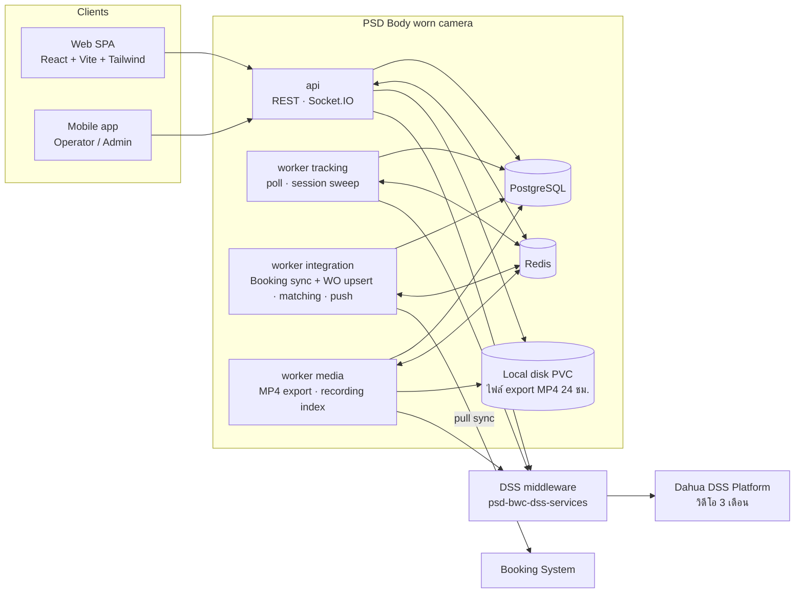

# Blueprint — PSD Body worn camera

**PSD Body worn camera** — ระบบติดตาม Bodycam และหลักฐานตามใบงานจาก Booking (repo `psd-bodycam-v1.0`)

> เอกสารออกแบบก่อน Implementation ของระบบ **PSD Body worn camera** (`psd-bodycam-v1.0`) · ฉบับ 2026-11-03 · ปรับ 2026-11-09 (DL33–DL36)
> Reference: `C:\Git\Internal-BodyCam` (อ่านอย่างเดียว ไม่ถูกแก้ไข)
> Diagram ทั้งหมดเป็น Mermaid — เปิดดูได้ใน GitHub / GitLab / VS Code (Markdown Preview Mermaid Support)

## สารบัญ

| Part | เอกสาร | ตอบคำถาม |
|---|---|---|
| 1 | [Existing System Analysis](01-existing-system-analysis.md) | ระบบเดิมเป็นอย่างไร · อะไร reuse / refactor / remove / rebuild · Dashcam ตัดตรงไหน |
| 2 | [System Architecture](02-system-architecture.md) | module อะไรบ้าง · process/deploy อย่างไร · Booking ล่มแล้วอะไรยังทำงาน · security/reliability |
| 3 | [Business Workflows](03-business-workflows.md) | กล้องเปิดแล้วเกิดอะไร · WO มาจาก Booking อย่างไร · match session เข้า WO อย่างไร · session lifecycle · Booking ล่ม/กลับมา |
| 4 | [Database Design](04-database-design.md) | ERD · ทุกตาราง/คอลัมน์/constraint/index · enum · retention · migration · ตัวอย่าง Drizzle |
| 5 | [API Design](05-api-design.md) | REST endpoints + ตัวอย่าง · mobile API · WebSocket events · alert types · permission matrix |
| 6 | [Frontend Architecture](06-frontend-architecture.md) | โครงโฟลเดอร์ · routing · หน้าจอ · component reuse · design tokens |
| 7 | [Integration Strategy](07-integration-strategy.md) | Booking port/adapter · sync · retry · idempotency · reconcile · monitoring · Confirmed vs Assumption |
| 8 | [Implementation Roadmap](08-implementation-roadmap.md) | phase · dependency · priority · deliverables · acceptance criteria |
| 9 | [Risks & Open Questions](09-risks-open-questions.md) | ความเสี่ยง · กติกาที่ยังไม่ชัด · checklist ข้อมูลจาก Booking · decision log |

---

## Executive Summary

ระบบใหม่ติดตามและบริหาร **Bodycam เท่านั้น** (ตัด Dashcam/ยานพาหนะทั้งหมด) และผูก **การใช้งานกล้องจริง** เข้ากับ **ใบงานจากระบบ Booking** อัตโนมัติ

- **Booking เป็นต้นทางใบงานเดียว** — ระบบเราไม่มี flow สร้าง/อนุมัติ/มอบหมายงาน และ **ไม่สร้างใบงานเอง** (DL33)
- ทุก Booking job ที่ sync มาเป็น **Work Order** ภายใน 1:1 (PK ของตัวเอง) · เมื่อกล้องเริ่มใช้งาน ระบบเปิด **Tracking Session** แล้วผูกเข้า WO ของงานที่ตรงกันอัตโนมัติ (1 WO มีหลาย session)
- **สถานะใบงานตาม Booking check-in/check-out** — check-out ⇒ ปิดใบงาน · Booking ยกเลิก ⇒ Cancelled · ระบบเราไม่มีปุ่มปิด/reopen/void (หัวหน้าทีม/แอดมินทำฝั่ง Booking)
- จับคู่ไม่ได้ ⇒ session ค้าง `AwaitingMatch` รอ Booking แล้ว rematch อัตโนมัติเมื่อข้อมูลเปลี่ยน · ไม่มีการผูกด้วยมือ ไม่มีคิวตรวจสอบ (DL33) · กล้องชาร์จที่ฐาน ⇒ session `IdleOrCharging`
- **เมนูหลัก = Live** (live wall + talk) **และ หลักฐาน** (`/evidence`: ใบงาน → กล้อง + ช่วงเวลา → playback / ดาวน์โหลด MP4) (DL36) · session ที่ไม่มีใบงานค้นได้จาก `/recordings`
- ผู้ใช้ระบบ (web + mobile) = `ADMIN`, `OPERATOR`, `VIEWER` — ฝั่ง monitoring และตรวจหลักฐาน ไม่มีผู้ใช้ภาคสนาม
- Retention: GPS 3 เดือน · ใบงาน 3 เดือน · audit 12 เดือน · ไม่ย้ายข้อมูลจากระบบเดิม
- **ทั้งหมดอาจปรับตามข้อมูลจากทีม Booking** (ผู้ใช้ระบุ 2026-11-04)
- Real-time tracking **ไม่ขึ้นกับ Booking** — Booking ล่ม แผนที่/สถานะ/session/หลักฐานยังทำงานครบ · สถานะ online/offline บนหน้าจอดึงจาก DSS ตอนเปิด ไม่ push (DL35)
- Stack เดิม: **NestJS 10 + Drizzle + PostgreSQL + Redis/BullMQ + Socket.IO** · **React 18 + Vite + Tailwind + shadcn** · กล้องผ่าน **DSS middleware** ชุดเดิม (ไม่ใช้ BRMS MQ — DL30) · ไฟล์ export MP4 อยู่บน Local disk (PVC) 24 ชม. ไม่ใช้ MinIO (DL34)
- Reuse โค้ดเดิมได้มาก: infra (`server/src/common/*`), auth/Entra, GPS pipeline, streaming/playback/export/talk, realtime, design system + shell ฝั่ง client

---

## Glossary

| คำ | ความหมาย |
|---|---|
| **Device Online / Offline / Unknown** | สถานะการต่อ platform ของกล้อง · Unknown = ไม่มีข้อมูลใหม่นานเกินกำหนด (คำนวณ ไม่เก็บ) |
| **GPS Active** | มีพิกัดที่ valid อายุ ≤ 2 นาที (กล้องในอาคารมักไม่มี — ไม่ใช่สัญญาณว่าปิด) |
| **Camera Active** | Online ต่อเนื่องครบ 15 นาที และไม่ได้อยู่ในรัศมีฐาน = "เริ่มใช้งาน" |
| **Booking Check-in / Check-out** | หัวหน้าทีม/แอดมินกดเริ่ม/จบงานใน Booking · check-out = ปิดใบงานในระบบเรา |
| **Depot** | ฐาน/จุดชาร์จกล้อง — session ที่เกิดที่ฐานไม่นับเป็นงาน (ระบบตั้ง `IdleOrCharging` เอง) |
| **Recording** | มีไฟล์บันทึกจริงตาม DSS recording search (รู้ได้หลังเกิดเหตุ) — เปิดกล้อง **ไม่เท่ากับ** อัดวิดีโอ |
| **Tracking Session** | ช่วงที่กล้อง 1 ตัวเปิดต่อเนื่อง · ผูก WO ได้ 0..1 ใบ (`MatchState`: Attached / AwaitingMatch / NoTeam / Classified) |
| **Work Order (WO)** | ใบงานในระบบเรา สร้าง/อัปเดต 1:1 จาก Booking job เท่านั้น (DL33) · `Status` Planned (รอเริ่ม) / Open / Closed / Cancelled ตาม Booking · `NeedsReview` = badge แจ้งข้อมูล ไม่มีคิว |
| **Booking Job** | ใบงานในระบบ Booking · ระบบเราเก็บเป็น projection (`BookingJobs`) |
| **Team** | หน่วยปฏิบัติงาน หัวหน้า 1 คน (คนขับ) + ลูกทีม · กล้องหลัก 1 ตัวต่อทีม · เก็บเป็นข้อมูลเพื่อจับคู่ (ไม่มีบัญชีผู้ใช้ภาคสนาม) |
| **DeviceRefs** | กล้องที่ Booking ระบุให้ใบงาน (รวมกล้องสำรอง) — การผูกกล้องมาจาก Booking เท่านั้น |
| **AwaitingMatch** | session ที่ยังจับคู่ Booking ไม่ได้ (ไม่มีหรือมีหลาย candidate) — รอ Booking แล้ว rematch อัตโนมัติ · ไม่มีการผูกด้วยมือ / คิวตรวจสอบ (DL33) · ดูหลักฐานได้จาก `/recordings` |
| **หลักฐาน (Evidence)** | เมนู `/evidence`: เลือกใบงาน → กล้อง + ช่วงเวลาจาก session → playback / ดาวน์โหลด MP4 (DL36) · วิดีโอต้นฉบับอยู่บน Dahua DSS Platform · ไฟล์ export อยู่บน PVC 24 ชม. (DL34) |
| **DSS middleware** | `psd-bwc-dss-services` (FastAPI) ที่เรียก Dahua DSS Platform อีกชั้น — ถือ token ของ DSS, HLS ผ่าน `/proxy`, talk เป็น RTSP **[Confirmed]** |

---

## Key Design Decisions & Trade-offs

| Decision | ได้ | เสีย / ยอมรับ |
|---|---|---|
| Modular monolith + process roles (`api`, `worker` แยก `tracking`/`integration`/`media`) | reuse โค้ดเดิม · transaction เดียวข้าม domain · deploy ง่าย | ต้องคุม boundary ด้วย lint rule |
| แยก `TrackingSessions` ออกจาก `WorkOrders` | ไม่มี pseudo work order · ไม่มี reserved seed rows · ไม่มี reopen loop | มี 2 แนวคิดที่ผู้ใช้ต้องเข้าใจ (session vs WO) |
| Session engine แบบ level-triggered sweep 30s | self-healing หลัง restart / DSS หลุด · idempotent | latency สูงสุด ≈ debounce + 1 รอบ |
| Matching อ่าน projection `BookingJobs` | Booking ล่มไม่กระทบ · อธิบายย้อนหลังได้ (`MatchAttempts`) | ข้อมูล Booking ช้าได้ถึงรอบ sync (2 นาที) |
| Invariant บังคับที่ DB (partial unique, exclusion, CHECK) | race condition สร้างข้อมูลผิดไม่ได้ | ต้องมี `btree_gist` (มี fallback) |
| ใบงานมาจาก Booking เท่านั้น (`BookingJobId` NOT NULL — DL33) | ใบงานตรง Booking เสมอ · ไม่มีใบงานขยะ · ไม่มีงาน manual (link / void / คิวตรวจสอบ) | session ที่ Booking ไม่ระบุค้าง `AwaitingMatch` ไม่มีใบงาน — ดูหลักฐานจาก `/recordings` รายกล้อง |
| สถานะใบงานตาม Booking check-in/check-out | ไม่มีสองแหล่งความจริงเรื่องสถานะ | Booking ล่ม = ปิดใบงานช้า (ปิดย้อนหลังด้วยเวลาจริง) · ต้องมี SafetyTimeout |
| Matching อัตโนมัติอย่างเดียว (DL33) | ไม่มีคิวงานให้ Operator · ผลอธิบายได้จาก `MatchAttempts` | การผูกผิดแก้ได้ทางเดียวคือแก้ข้อมูลใน Booking |
| ไม่ push online/offline — หน้าจอดึงสถานะจาก DSS ตอนเปิด (DL35) | สถานะที่เห็นสดกว่า GpsPoll · event น้อยลง | หน้าจอที่เปิดค้างไม่อัปเดตสถานะเอง |
| ไฟล์ export MP4 บน Local disk PVC 24 ชม. (DL34) | ไม่ต้องดูแล object storage | ต้อง mount PVC ร่วม `api` + `worker-media` (R16) · ผู้ใช้ต้องดาวน์โหลดเก็บเองภายใน 24 ชม. |
| Partition GPS/Audit รายเดือน | retention = drop partition · query เร็ว | DDL partition ต้องเขียน custom migration |

## Assumptions หลัก

1. DSS middleware ชุดเดิม (`psd-bwc-dss-services` — [Confirmed]) · สถานะกล้องมาจาก `/location` (GpsPoll) ชุดเดียวกับ GPS (DL32)
2. **ทุกอย่างเกี่ยวกับ Booking API = Assumption** จนกว่าทีม Booking ยืนยัน (ดู [Part 7 §7.1](07-integration-strategy.md#71-confirmed-vs-assumption), [Part 9 §9.4](09-risks-open-questions.md#94-booking-information-checklist))
3. **Booking ส่ง check-in/check-out และระบุกล้อง/ทีมในใบงานได้ — ความเสี่ยงอันดับ 1** · ถ้าไม่ได้ session ค้าง `AwaitingMatch` / `NoTeam` (ไม่มีการผูกด้วยมือ — DL33)
4. PostgreSQL 16 managed รองรับ `btree_gist` + declarative partitioning
5. Vendor ไม่มีสถานะชาร์จ (ยืนยันแล้ว) — ตรวจกล้องที่ฐานด้วย `Depots` + fix ล่าสุด ⇒ session `IdleOrCharging`

---

## Recommended Architecture (สรุป)

- **Real-time path** (DSS `/location` → GPS + สถานะ → `DeviceState` ภายใน + `gps:batch` → Socket.IO) และ **session engine** ไม่เรียก Booking · ไม่ push online/offline — หน้าจอดึงสถานะจาก DSS ตอนเปิดผ่าน `api` (DL35)
- **Booking path** อยู่ใน worker integration: pull sync อย่างเดียว (DL31) + projection + inbox + upsert WO 1:1 (DL33) + circuit breaker + reconcile
- **ไฟล์ export MP4**: `worker-media` เขียนลง Local disk PVC · `api` stream ให้ดาวน์โหลดด้วย download ticket · ลบหลัง 24 ชม. (DL34)
- **กติกาหลัก**: session engine เป็น writer เดียวของ lifecycle session · ทุก write ต่ออุปกรณ์ถือ row lock `DeviceState` · emit realtime หลัง commit

## Recommended Database Schema (สรุป)

35 ตาราง แบ่งกลุ่ม (รายละเอียด [Part 4](04-database-design.md)):

| กลุ่ม | ตาราง |
|---|---|
| Identity & Access | `Departments`, `Employees`, `Users`, `Roles`, `Permissions`, `RolePermissions`, `RefreshTokens`, `UserDevices`, `PushTokens` |
| Teams | `Teams`, `TeamMembers` |
| Devices | `Devices`, `DeviceState`, `DeviceStatusHistory`, `DeviceAssignments`, `Depots` |
| Tracking | `GpsLocations` (partitioned), `TrackingSessions`, `RecordingSegments` |
| Work Orders | `WorkOrders`, `WorkOrderEvents`, `WorkOrderCounters` |
| Booking Integration | `BookingJobs`, `MatchAttempts`, `IntegrationInbox`, `IntegrationSyncState`, `IntegrationCallLogs` |
| Media | `StreamingSessions`, `TalkSessions`, `EvidenceExports` |
| System | `Alerts`, `Notifications`, `AuditLogs` (partitioned), `Settings` |

Invariant สำคัญที่ DB บังคับ:
- `UQ_TS_OpenPerDevice` + `EX_TS_NoOverlap` — 1 session เปิดต่ออุปกรณ์ ไม่ซ้อนเวลา
- `UQ_WO_BookingJob` — 1 Booking ↔ 1 WO (`BookingJobId` NOT NULL · ใบงานมาจาก Booking เท่านั้น — DL33)
- `UQ_TeamMembers_ActiveLeader` · `UQ_DevAsg_TeamActivePrimary` · `EX_DevAsg_NoOverlap`
- `UQ_Inbox_Event` — idempotency ของ integration

## Implementation Plan (สรุป)

| Phase | ผลลัพธ์ | Priority |
|---|---|---|
| P0 Foundation | scaffold, port infra, auth + Entra, RBAC/scope, migrations, CI, shell + design system | Must |
| P1 Devices & Tracking | device sync, status/GPS ingest, Teams + assignments, live map, history | Must |
| P2 Sessions & Work Orders | session engine (`AwaitingMatch` / `IdleOrCharging`), sessions page, WO UI (ใบงานจาก mock Booking) | Must |
| P3 Booking Integration | port + mock → projection + upsert WO 1:1, inbox, breaker → matching อัตโนมัติ + rematch → http adapter + pilot (**ติด Booking spec gate**) | Must |
| P4 Media | live, playback, recordings, หลักฐาน `/evidence` + MP4 export (Local disk PVC), live wall, talk | Must / Should |
| P5 Mobile API & Notifications | แอป Operator (monitoring + หลักฐาน), FCM, device registry (ไม่มี PIN) | Should |
| P6 Hardening & Go-live | retention 3/12 เดือน, observability, security, load test, ตั้ง master data ใหม่, UAT | Must |

Critical path: P0 → P1 → P2 → P3 → P6 · ไม่มี Booking ก็ขึ้นระบบได้ในโหมด tracking + live + ค้นหลักฐานรายกล้อง (`/recordings`) — ใบงานจะมีเมื่อ Booking sync (DL33)

**สิ่งที่ต้องทำต่อทันที**: ส่ง [checklist §9.4](09-risks-open-questions.md#94-booking-information-checklist) ให้ทีม Booking · ไม่มีคำถามค้างกับผู้ใช้แล้ว ([Part 9 §9.2](09-risks-open-questions.md#92-open-business-rules)) — รอข้อมูลจากทีม Booking · เริ่ม P0 และ P3a (mock Booking) ได้ทันที · เริ่ม P0
