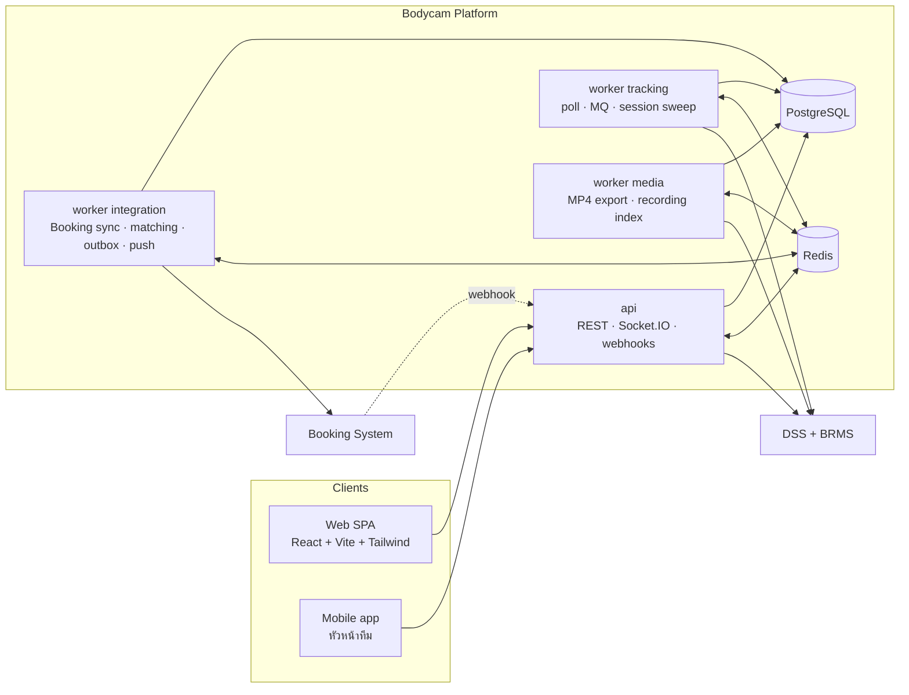

# Blueprint — Bodycam Tracking & Booking Integration System

> เอกสารออกแบบก่อน Implementation ของระบบ `psd-bodycam-v1.0` · ฉบับ 2026-11-03
> Reference: `C:\Git\Internal-BodyCam` (อ่านอย่างเดียว ไม่ถูกแก้ไข)
> Diagram ทั้งหมดเป็น Mermaid — เปิดดูได้ใน GitHub / GitLab / VS Code (Markdown Preview Mermaid Support)

## สารบัญ

| Part | เอกสาร | ตอบคำถาม |
|---|---|---|
| 1 | [Existing System Analysis](01-existing-system-analysis.md) | ระบบเดิมเป็นอย่างไร · อะไร reuse / refactor / remove / rebuild · Dashcam ตัดตรงไหน |
| 2 | [System Architecture](02-system-architecture.md) | module อะไรบ้าง · process/deploy อย่างไร · Booking ล่มแล้วอะไรยังทำงาน · security/reliability |
| 3 | [Business Workflows](03-business-workflows.md) | กล้องเปิดแล้วเกิดอะไร · สร้าง WO และ match Booking อย่างไร · session lifecycle · Booking ล่ม/กลับมา |
| 4 | [Database Design](04-database-design.md) | ERD · ทุกตาราง/คอลัมน์/constraint/index · enum · retention · migration · ตัวอย่าง Drizzle |
| 5 | [API Design](05-api-design.md) | REST endpoints + ตัวอย่าง · mobile API · WebSocket events · alert types · permission matrix |
| 6 | [Frontend Architecture](06-frontend-architecture.md) | โครงโฟลเดอร์ · routing · หน้าจอ · component reuse · design tokens |
| 7 | [Integration Strategy](07-integration-strategy.md) | Booking port/adapter · sync · retry · idempotency · reconcile · monitoring · Confirmed vs Assumption |
| 8 | [Implementation Roadmap](08-implementation-roadmap.md) | phase · dependency · priority · deliverables · acceptance criteria |
| 9 | [Risks & Open Questions](09-risks-open-questions.md) | ความเสี่ยง · กติกาที่ยังไม่ชัด · checklist ข้อมูลจาก Booking · decision log |

---

## Executive Summary

ระบบใหม่ติดตามและบริหาร **Bodycam เท่านั้น** (ตัด Dashcam/ยานพาหนะทั้งหมด) และผูก **การใช้งานกล้องจริง** เข้ากับ **ใบงานจากระบบ Booking** อัตโนมัติ

- **Booking เป็นต้นทางใบงานเดียว** — ระบบเราไม่มี flow สร้าง/อนุมัติ/มอบหมายงาน
- เมื่อกล้องของทีมเริ่มใช้งาน ระบบเปิด **Tracking Session** แล้วสร้าง/ผูก **Work Order** ภายใน (PK ของตัวเอง) ที่อ้างอิง Booking job (1 Booking = 1 WO, 1 WO มีหลาย session)
- จับคู่ไม่ได้ ⇒ WO `Unlinked` + คิวตรวจสอบ · ข้อมูล Booking มาทีหลัง ⇒ reconcile อัตโนมัติ
- Real-time tracking **ไม่ขึ้นกับ Booking** — Booking ล่ม แผนที่/สถานะ/session/หลักฐานยังทำงานครบ
- Stack เดิม: **NestJS 10 + Drizzle + PostgreSQL + Redis/BullMQ + Socket.IO** · **React 18 + Vite + Tailwind + shadcn** · กล้องผ่าน **DSS middleware + BRMS** ชุดเดิม
- Reuse โค้ดเดิมได้มาก: infra (`server/src/common/*`), auth/Entra, GPS pipeline, streaming/playback/export/talk, realtime, design system + shell ฝั่ง client

---

## Glossary

| คำ | ความหมาย |
|---|---|
| **Device Online / Offline / Unknown** | สถานะการต่อ platform ของกล้อง · Unknown = ไม่มีข้อมูลใหม่นานเกินกำหนด (คำนวณ ไม่เก็บ) |
| **GPS Active** | มีพิกัดที่ valid อายุ ≤ 2 นาที (กล้องในอาคารมักไม่มี — ไม่ใช่สัญญาณว่าปิด) |
| **Camera Active** | Online ต่อเนื่องครบ debounce (5 นาที) = "เริ่มใช้งาน" |
| **Recording** | มีไฟล์บันทึกจริงตาม DSS recording search (รู้ได้หลังเกิดเหตุ) — เปิดกล้อง **ไม่เท่ากับ** อัดวิดีโอ |
| **Tracking Session** | ช่วงที่กล้อง 1 ตัวเปิดต่อเนื่องและสังกัด WO เดียวกัน |
| **Work Order (WO)** | ระเบียนการปฏิบัติงานในระบบเรา · `Status` (Open/Closed/Cancelled/Voided/Merged) แยกจาก `LinkStatus` (Pending/Linked/Suggested/Ambiguous/Unlinked) |
| **Booking Job** | ใบงานในระบบ Booking · ระบบเราเก็บเป็น projection (`BookingJobs`) |
| **Team** | หน่วยปฏิบัติงาน หัวหน้า 1 คน (คนขับ) + ลูกทีม · กล้องหลัก 1 ตัวต่อทีม |
| **Primary / Temporary assignment** | การผูกกล้องหลัก / กล้องสำรองชั่วคราวกับทีม |
| **Review queue** | WO ที่ต้องให้คนตัดสิน (Suggested, Ambiguous, Unlinked, Pending, NeedsReview) |

---

## Key Design Decisions & Trade-offs

| Decision | ได้ | เสีย / ยอมรับ |
|---|---|---|
| Modular monolith + process roles (`api`, `worker` แยก `tracking`/`integration`/`media`) | reuse โค้ดเดิม · transaction เดียวข้าม domain · deploy ง่าย | ต้องคุม boundary ด้วย lint rule |
| แยก `TrackingSessions` ออกจาก `WorkOrders` | ไม่มี pseudo work order · ไม่มี reserved seed rows · ไม่มี reopen loop | มี 2 แนวคิดที่ผู้ใช้ต้องเข้าใจ (session vs WO) |
| Session engine แบบ level-triggered sweep 30s | self-healing หลัง restart/MQ หลุด · idempotent | latency สูงสุด ≈ debounce + 1 รอบ |
| Matching อ่าน projection `BookingJobs` | Booking ล่มไม่กระทบ · อธิบายย้อนหลังได้ (`MatchAttempts`) | ข้อมูล Booking ช้าได้ถึงรอบ sync (2 นาที) |
| Invariant บังคับที่ DB (partial unique, exclusion, CHECK) | race condition สร้างข้อมูลผิดไม่ได้ | ต้องมี `btree_gist` (มี fallback) |
| WO Unlinked ได้ (`BookingJobId` nullable) | ตรง requirement · ไม่ทิ้งหลักฐาน | อาจมี WO ขยะจากกล้องชาร์จ — คุมด้วย setting + 1 ใบ/ทีม + idle close |
| Manual ชนะ auto เสมอ | ผู้ใช้เชื่อถือระบบ | ต้องมีคนดูแลคิวตรวจสอบ |
| Partition GPS/Audit รายเดือน | retention = drop partition · query เร็ว | DDL partition ต้องเขียน custom migration |

## Assumptions หลัก

1. DSS middleware + BRMS ชุดเดิม · DSS device list ใช้เป็น bulk status feed ได้
2. **ทุกอย่างเกี่ยวกับ Booking API = Assumption** จนกว่าทีม Booking ยืนยัน (ดู [Part 7 §7.1](07-integration-strategy.md#71-confirmed-vs-assumption), [Part 9 §9.4](09-risks-open-questions.md#94-booking-information-checklist))
3. Booking job มี reference ที่ map เป็นทีม/หัวหน้าทีมได้ — **ความเสี่ยงอันดับ 1**
4. PostgreSQL 16 managed รองรับ `btree_gist` + declarative partitioning
5. Check-in/out หน้างานยังไม่อยู่ในขอบเขต (รอทีม Booking)

---

## Recommended Architecture (สรุป)

- **Real-time path** (DSS → status/GPS → DeviceState → Socket.IO) และ **session engine** ไม่เรียก Booking
- **Booking path** อยู่ใน worker integration: projection + inbox/outbox + circuit breaker + reconcile
- **กติกาหลัก**: session engine เป็น writer เดียวของ lifecycle session · ทุก write ต่ออุปกรณ์ถือ row lock `DeviceState` · emit realtime หลัง commit

## Recommended Database Schema (สรุป)

34 ตาราง แบ่งกลุ่ม (รายละเอียด [Part 4](04-database-design.md)):

| กลุ่ม | ตาราง |
|---|---|
| Identity & Access | `Departments`, `Employees`, `Users`, `Roles`, `Permissions`, `RolePermissions`, `RefreshTokens`, `UserDevices`, `PushTokens` |
| Teams | `Teams`, `TeamMembers` |
| Devices | `Devices`, `DeviceState`, `DeviceStatusHistory`, `DeviceAssignments` |
| Tracking | `GpsLocations` (partitioned), `TrackingSessions`, `RecordingSegments` |
| Work Orders | `WorkOrders`, `WorkOrderEvents`, `WorkOrderCounters` |
| Booking Integration | `BookingJobs`, `MatchAttempts`, `IntegrationInbox`, `IntegrationOutbox`, `IntegrationSyncState`, `IntegrationCallLogs` |
| Media | `StreamingSessions`, `TalkSessions`, `EvidenceExports` |
| System | `Alerts`, `Notifications`, `AuditLogs` (partitioned), `Settings` |

Invariant สำคัญที่ DB บังคับ:
- `UQ_TS_OpenPerDevice` + `EX_TS_NoOverlap` — 1 session เปิดต่ออุปกรณ์ ไม่ซ้อนเวลา
- `UQ_WO_BookingJob` — 1 Booking ↔ 1 WO
- `UQ_WO_OpenUnlinkedPerTeam` — WO ที่ยังไม่มี Booking เปิดได้ 1 ใบต่อทีม
- `UQ_TeamMembers_ActiveLeader` · `UQ_DevAsg_TeamActivePrimary` · `EX_DevAsg_NoOverlap`
- `CK_WO_LinkConsistency` — `LinkStatus = Linked` ⇔ มี `BookingJobId`
- `UQ_Inbox_Event` · `IntegrationOutbox.IdempotencyKey` — idempotency ของ integration

## Implementation Plan (สรุป)

| Phase | ผลลัพธ์ | Priority |
|---|---|---|
| P0 Foundation | scaffold, port infra, auth + Entra, RBAC/scope, migrations, CI, shell + design system | Must |
| P1 Devices & Tracking | device sync, status/GPS ingest, Teams + assignments, live map, history | Must |
| P2 Sessions & Work Orders | session engine, auto WO (Unlinked), WO UI, sessions page | Must |
| P3 Booking Integration | port + mock → projection, inbox/outbox, breaker → matching + review queue → http adapter + pilot (**ติด Booking spec gate**) | Must |
| P4 Media | live, playback, recordings, MP4 export, live wall, talk | Must / Should |
| P5 Mobile API & Notifications | my-jobs, FCM, device registry (ไม่มี PIN) | Should |
| P6 Hardening & Go-live | retention/archive, observability, security, load test, UAT | Must |

Critical path: P0 → P1 → P2 → P3 → P6 · P2 ใช้งานได้โดยไม่มี Booking ⇒ Booking ล่าช้าไม่บล็อกการขึ้นระบบในโหมด tracking + evidence

**สิ่งที่ต้องทำต่อทันที**: ส่ง [checklist §9.4](09-risks-open-questions.md#94-booking-information-checklist) ให้ทีม Booking · ให้ผู้ใช้ตัดสิน Q1–Q16 ใน [Part 9 §9.2](09-risks-open-questions.md#92-open-business-rules) · เริ่ม P0
